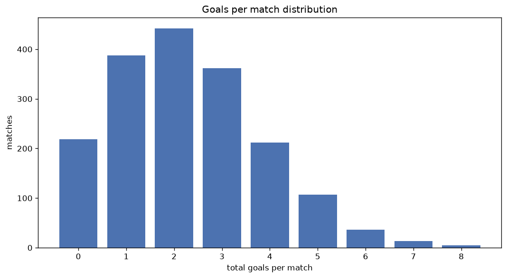
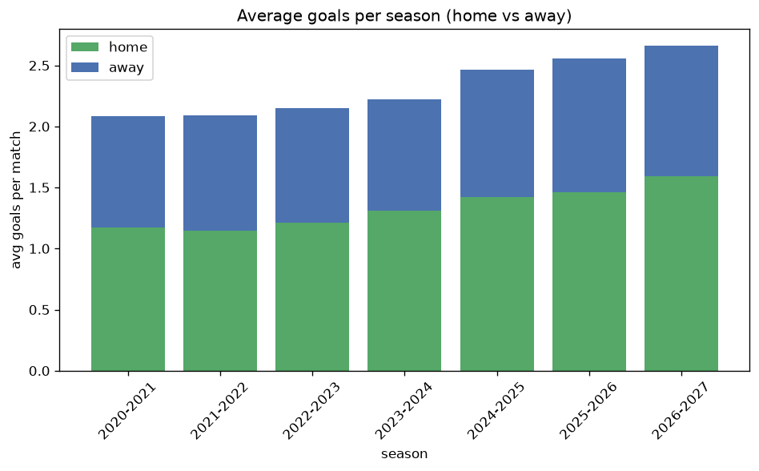

# Goal Analysis
- Report: `goals_analysis`
- Generated: 2026-10-26T01:48:27+00:00
- Script: `backend/scripts/analyze_goals.py` v1.0.0
- League: Segunda RFEF - Group 5 (Spain)
- Scope: league `segunda5`

## 1. Goals per match distribution
| goals | matches | pct |
|---|---|---|
| 0 | 219 | 12.3% |
| 1 | 388 | 21.7% |
| 2 | 442 | 24.8% |
| 3 | 362 | 20.3% |
| 4 | 212 | 11.9% |
| 5 | 107 | 6.0% |
| 6 | 36 | 2.0% |
| 7 | 13 | 0.7% |
| 8 | 5 | 0.3% |

## 2. Goals per match per season
| season | matches | total goals | avg home | avg away | avg total |
|---|---|---|---|---|---|
| 2020-2021 | 180 | 375 | 1.172 | 0.911 | 2.083 |
| 2021-2022 | 306 | 640 | 1.147 | 0.944 | 2.092 |
| 2022-2023 | 306 | 658 | 1.212 | 0.938 | 2.15 |
| 2023-2024 | 306 | 681 | 1.307 | 0.918 | 2.225 |
| 2024-2025 | 306 | 754 | 1.425 | 1.039 | 2.464 |
| 2025-2026 | 306 | 783 | 1.458 | 1.101 | 2.559 |
| 2026-2027 | 74 | 197 | 1.595 | 1.068 | 2.662 |

## 3. Home vs away goal share
- Home goals: **2333** (57.1%)
- Away goals: **1755** (42.9%)
- Home/away ratio: **1.329**

| season | home goals | away goals | total | home pct | away pct |
|---|---|---|---|---|---|
| 2020-2021 | 211 | 164 | 375 | 56.3% | 43.7% |
| 2021-2022 | 351 | 289 | 640 | 54.8% | 45.2% |
| 2022-2023 | 371 | 287 | 658 | 56.4% | 43.6% |
| 2023-2024 | 400 | 281 | 681 | 58.7% | 41.3% |
| 2024-2025 | 436 | 318 | 754 | 57.8% | 42.2% |
| 2025-2026 | 446 | 337 | 783 | 57.0% | 43.0% |
| 2026-2027 | 118 | 79 | 197 | 59.9% | 40.1% |

## 4. BTTS (Both Teams To Score)
- Overall: **791** of `1784` (44.3%)

| season | matches | BTTS | pct |
|---|---|---|---|
| 2020-2021 | 180 | 83 | 46.1% |
| 2021-2022 | 306 | 122 | 39.9% |
| 2022-2023 | 306 | 114 | 37.3% |
| 2023-2024 | 306 | 131 | 42.8% |
| 2024-2025 | 306 | 148 | 48.4% |
| 2025-2026 | 306 | 155 | 50.7% |
| 2026-2027 | 74 | 38 | 51.4% |

## 5. Clean sheets
- Home clean sheets: **712** (39.9%)
- Away clean sheets: **500** (28.0%)
- Total clean sheets recorded: **1212**
- Matches with at least one clean sheet: **993** (55.7%)
- Both teams kept clean sheets (0-0): **219**

| season | matches | home CS | away CS | total CS | matches w/ CS |
|---|---|---|---|---|---|
| 2020-2021 | 180 | 72 | 53 | 125 | 97 (53.9%) |
| 2021-2022 | 306 | 128 | 91 | 219 | 184 (60.1%) |
| 2022-2023 | 306 | 139 | 104 | 243 | 192 (62.7%) |
| 2023-2024 | 306 | 124 | 90 | 214 | 175 (57.2%) |
| 2024-2025 | 306 | 115 | 72 | 187 | 158 (51.6%) |
| 2025-2026 | 306 | 103 | 75 | 178 | 151 (49.3%) |
| 2026-2027 | 74 | 31 | 15 | 46 | 36 (48.6%) |

## 6. Scoring intensity
- First-half goals: **1706** (41.8%)
- Second-half goals: **2379** (58.2%)
- Avg first-half goals per match: **0.957**
- Avg second-half goals per match: **1.334**
- Second-half-only scoring (HT 0-0, FT goals >= 1): **479** (26.8%)
- *1 match(es) excluded (no HT score recorded).*

| season | matches | 1st half | 2nd half | 1st half pct | 2nd half pct |
|---|---|---|---|---|---|
| 2020-2021 | 180 | 159 | 216 | 42.4% | 57.6% |
| 2021-2022 | 306 | 258 | 382 | 40.3% | 59.7% |
| 2022-2023 | 306 | 275 | 380 | 42.0% | 58.0% |
| 2023-2024 | 306 | 280 | 401 | 41.1% | 58.9% |
| 2024-2025 | 306 | 321 | 433 | 42.6% | 57.4% |
| 2025-2026 | 306 | 338 | 445 | 43.2% | 56.8% |
| 2026-2027 | 74 | 75 | 122 | 38.1% | 61.9% |

## 7. First-goal timing
- Matches with first-goal time recorded: `1564` of `1784` (87.7%)
- Goalless matches: `220`
- Min `1` | Max `98` | Mean `34.13` | Median (p50) `29.0`

| bucket | count | % of matches | % of scoring matches |
|---|---|---|---|
| 1-15 | 452 | 25.3% | 28.9% |
| 16-30 | 368 | 20.6% | 23.5% |
| 31-45 | 258 | 14.5% | 16.5% |
| 46-60 | 216 | 12.1% | 13.8% |
| 61-75 | 145 | 8.1% | 9.3% |
| 76-90 | 103 | 5.8% | 6.6% |
| 91-120 | 22 | 1.2% | 1.4% |

---
*All statistics are computed from PostgreSQL tables (read-only). Run with `python backend/scripts/analyze_goals.py` to regenerate.*

## Charts

