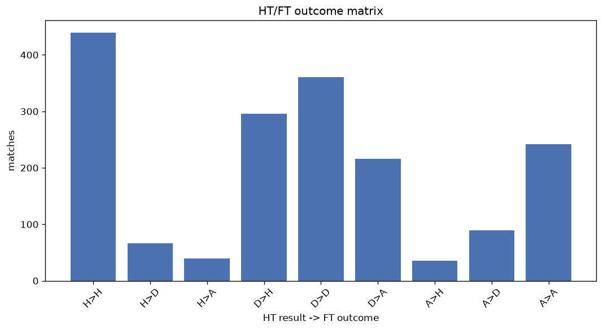
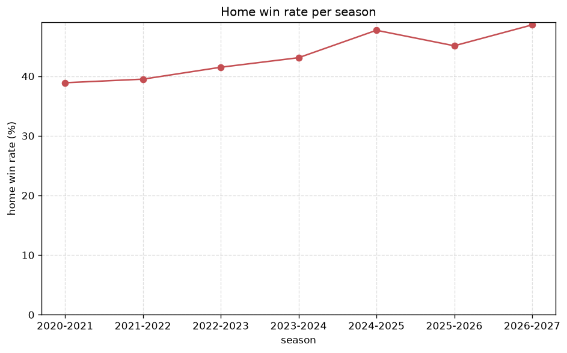

# Match Analysis
- Report: `matches_analysis`
- Generated: 2026-10-26T01:48:25+00:00
- Script: `backend/scripts/analyze_matches.py` v1.0.0
- League: Segunda RFEF - Group 5 (Spain)
- Scope: league `segunda5`

## 1. Overall summary
| metric | value |
|---|---|
| Matches | 1784 |
| Home wins | 770 (43.2%) |
| Draws | 516 (28.9%) |
| Away wins | 498 (27.9%) |
| Total goals | 4088 |
| Average goals per match | 2.291 |
| Goalless matches | 219 (12.3%) |

## 2. Per-season breakdown
| season | matches | home wins | draws | away wins | total goals | avg goals | goalless |
|---|---|---|---|---|---|---|---|
| 2020-2021 | 180 | 70 (38.9%) | 61 (33.9%) | 49 (27.2%) | 375 | 2.083 | 28 (15.6%) |
| 2021-2022 | 306 | 121 (39.5%) | 90 (29.4%) | 95 (31.0%) | 640 | 2.092 | 35 (11.4%) |
| 2022-2023 | 306 | 127 (41.5%) | 96 (31.4%) | 83 (27.1%) | 658 | 2.15 | 51 (16.7%) |
| 2023-2024 | 306 | 132 (43.1%) | 89 (29.1%) | 85 (27.8%) | 681 | 2.225 | 39 (12.7%) |
| 2024-2025 | 306 | 146 (47.7%) | 79 (25.8%) | 81 (26.5%) | 754 | 2.464 | 29 (9.5%) |
| 2025-2026 | 306 | 138 (45.1%) | 77 (25.2%) | 91 (29.7%) | 783 | 2.559 | 27 (8.8%) |
| 2026-2027 | 74 | 36 (48.6%) | 24 (32.4%) | 14 (18.9%) | 197 | 2.662 | 10 (13.5%) |

## 3. HT/FT outcome matrix
| HT result \ FT result | Home | Draw | Away | total |
|---|---|---|---|---|
| HT home lead | 439 (80.7%) | 66 (12.1%) | 39 (7.2%) | 544 |
| HT draw | 296 (33.9%) | 361 (41.4%) | 216 (24.7%) | 873 |
| HT away lead | 35 (9.6%) | 89 (24.3%) | 242 (66.1%) | 366 |
- *1 match(es) excluded (no HT score recorded).*

## 4. Comeback matches
- Home comebacks (trailing at HT, won at FT): **35** (2.0%)
- Away comebacks (trailing at HT, won at FT): **39** (2.2%)

### Home comebacks
| season | home | away | HT | FT |
|---|---|---|---|---|
| 2020-2021 | Real Madrid B | San Sebastian Reyes | 0-1 | 3-1 |
| 2020-2021 | Baleares | Real Madrid B | 0-1 | 2-1 |
| 2020-2021 | Las Rozas | Baleares | 1-2 | 3-2 |
| 2021-2022 | Hercules | Racing Cartagena MM | 0-1 | 2-1 |
| 2021-2022 | Granada CF B | Puertollano C.F. | 0-1 | 2-1 |
| 2021-2022 | Melilla | Eldense | 0-1 | 3-2 |
| 2021-2022 | Marchamalo | El Ejido | 1-2 | 4-2 |
| 2021-2022 | Melilla | Puertollano C.F. | 0-1 | 2-1 |
| 2022-2023 | Atl. Madrid B | Montijo | 0-1 | 4-2 |
| 2022-2023 | Gimnastica Segoviana | Montijo | 0-2 | 3-2 |
| 2022-2023 | Diocesano | Montijo | 0-1 | 3-2 |
| 2022-2023 | Atl. Madrid B | Atl. Paso | 0-1 | 3-2 |
| 2022-2023 | Don Benito | Alcorcon B | 0-1 | 2-1 |
| 2022-2023 | Gimnastica Segoviana | Socuellamos | 0-1 | 3-2 |
| 2023-2024 | Union Adarve | Ursaria | 0-1 | 2-1 |
| 2023-2024 | Numancia | Atl. Paso | 0-1 | 3-1 |
| 2023-2024 | Llerenense | CD Badajoz | 0-1 | 2-1 |
| 2023-2024 | Navalcarnero | Ursaria | 0-1 | 2-1 |
| 2024-2025 | Rayo Majadahonda | Conquense | 0-1 | 2-1 |
| 2024-2025 | Illescas | CD Coria | 0-1 | 2-1 |
| 2024-2025 | Navalcarnero | Getafe B | 0-2 | 3-2 |
| 2024-2025 | Tenerife B | Atl. Paso | 1-2 | 3-2 |
| 2024-2025 | Cacereno | Conquense | 0-1 | 3-1 |
| 2024-2025 | Guadalajara | Getafe B | 0-1 | 2-1 |
| 2024-2025 | Atl. Paso | Tenerife B | 0-2 | 3-2 |
| 2025-2026 | Rayo Majadahonda | San Sebastian Reyes | 0-1 | 2-1 |
| 2025-2026 | Orihuela | Quintanar del Rey | 0-1 | 3-1 |
| 2025-2026 | CD Coria | Real Madrid C | 0-1 | 2-1 |
| 2025-2026 | Tenerife B | Colonia M. | 0-1 | 3-1 |
| 2025-2026 | Quintanar del Rey | Getafe B | 0-1 | 3-1 |
| 2025-2026 | Fuenlabrada | Quintanar del Rey | 0-1 | 2-1 |
| 2025-2026 | San Sebastian Reyes | Quintanar del Rey | 0-1 | 3-2 |
| 2025-2026 | CD Coria | Navalcarnero | 0-1 | 2-1 |
| 2026-2027 | Guadalajara | RSD Alcala | 0-1 | 2-1 |
| 2026-2027 | Guadalajara | Getafe B | 0-1 | 4-1 |

### Away comebacks
| season | home | away | HT | FT |
|---|---|---|---|---|
| 2020-2021 | CF Talavera | Melilla | 1-0 | 1-2 |
| 2020-2021 | Socuellamos | CF Talavera | 1-0 | 1-2 |
| 2020-2021 | Melilla | Socuellamos | 1-0 | 1-2 |
| 2020-2021 | Navalcarnero | Real Madrid B | 1-0 | 1-2 |
| 2021-2022 | La Nucia | Murcia | 1-0 | 1-2 |
| 2021-2022 | Murcia | Eldense | 1-0 | 1-2 |
| 2021-2022 | Puertollano C.F. | Mancha | 1-0 | 1-2 |
| 2021-2022 | Aguilas FC | Toledo | 1-0 | 1-3 |
| 2021-2022 | Granada CF B | Marchamalo | 1-0 | 1-2 |
| 2021-2022 | Mancha | Alzira | 1-0 | 1-2 |
| 2021-2022 | Eldense | Murcia | 1-0 | 1-3 |
| 2022-2023 | Diocesano | Leganes B | 1-0 | 2-3 |
| 2022-2023 | Don Benito | Navalcarnero | 2-1 | 2-4 |
| 2022-2023 | Socuellamos | Atl. Madrid B | 1-0 | 1-2 |
| 2022-2023 | Diocesano | Navalcarnero | 3-0 | 3-4 |
| 2022-2023 | Union Adarve | Guadalajara | 1-0 | 1-3 |
| 2022-2023 | CD Estepona | Atl. Madrid B | 1-0 | 1-2 |
| 2023-2024 | San Sebastian Reyes | San Fernando | 1-0 | 2-3 |
| 2023-2024 | Numancia | Montijo | 1-0 | 1-2 |
| 2023-2024 | Guadalajara | San Fernando | 1-0 | 1-3 |
| 2023-2024 | Illescas | Numancia | 1-0 | 1-2 |
| 2023-2024 | Montijo | Guadalajara | 1-0 | 1-2 |
| 2023-2024 | CF Talavera | CD Badajoz | 1-0 | 1-2 |
| 2023-2024 | Guadalajara | Villanovense | 1-0 | 1-2 |
| 2024-2025 | Rayo Majadahonda | Colonia M. | 1-0 | 1-2 |
| 2024-2025 | Melilla | Yaiza | 1-0 | 1-2 |
| 2024-2025 | Yaiza | Cacereno | 2-1 | 2-3 |
| 2024-2025 | Melilla | CD Coria | 1-0 | 1-2 |
| 2024-2025 | Atl. Paso | Melilla | 1-0 | 2-3 |
| 2024-2025 | Melilla | Real Madrid C | 1-0 | 1-2 |
| 2024-2025 | Union Adarve | CF Talavera | 1-0 | 1-2 |
| 2025-2026 | Tenerife B | Getafe B | 1-0 | 1-2 |
| 2025-2026 | Real Madrid C | San Sebastian Reyes | 1-0 | 1-2 |
| 2025-2026 | CF Intercity | Real Madrid C | 1-0 | 1-2 |
| 2025-2026 | Las Palmas B | Quintanar del Rey | 1-0 | 1-2 |
| 2025-2026 | CF Intercity | Quintanar del Rey | 1-0 | 1-2 |
| 2026-2027 | Guadalajara | Salamanca | 1-0 | 2-3 |
| 2026-2027 | Guadalajara | Salamanca | 1-0 | 2-3 |
| 2026-2027 | Numancia | Navalcarnero | 2-1 | 2-3 |

## 5. HT lead conversion
| HT state | matches | converted to win | held as draw | collapsed to loss |
|---|---|---|---|---|
| Home lead | 544 | 439 (80.7%) | 66 (12.1%) | 39 (7.2%) |
| Away lead | 366 | 242 (66.1%) | 89 (24.3%) | 35 (9.6%) |

### Matches level at half-time
| FT result | count | pct |
|---|---|---|
| Home win | 296 | 33.9% |
| Draw | 361 | 41.4% |
| Away win | 216 | 24.7% |
- *1 match(es) excluded (no HT score recorded).*

## 6. First-goal timing
- Matches with a first-goal time recorded: `1564` of `1784` (87.7%)

Outcome distribution by first-goal timing bucket:
| bucket | matches | % of matches | home | draw | away |
|---|---|---|---|---|---|
| 1-15 | 452 | 25.3% | 231 (51.1%) | 91 (20.1%) | 130 (28.8%) |
| 16-30 | 368 | 20.6% | 183 (49.7%) | 77 (20.9%) | 108 (29.3%) |
| 31-45 | 258 | 14.5% | 124 (48.1%) | 55 (21.3%) | 79 (30.6%) |
| 46-60 | 216 | 12.1% | 99 (45.8%) | 42 (19.4%) | 75 (34.7%) |
| 61-75 | 145 | 8.1% | 72 (49.7%) | 21 (14.5%) | 52 (35.9%) |
| 76-90 | 103 | 5.8% | 51 (49.5%) | 10 (9.7%) | 42 (40.8%) |
| 91-120 | 22 | 1.2% | 10 (45.5%) | 1 (4.5%) | 11 (50.0%) |

## 7. Goalless matches
- Overall: **219** of `1784` (12.3%)

| season | matches | goalless | pct |
|---|---|---|---|
| 2020-2021 | 180 | 28 | 15.6% |
| 2021-2022 | 306 | 35 | 11.4% |
| 2022-2023 | 306 | 51 | 16.7% |
| 2023-2024 | 306 | 39 | 12.7% |
| 2024-2025 | 306 | 29 | 9.5% |
| 2025-2026 | 306 | 27 | 8.8% |
| 2026-2027 | 74 | 10 | 13.5% |

---
*All statistics are computed from PostgreSQL tables (read-only). Run with `python backend/scripts/analyze_matches.py` to regenerate.*

## Charts

