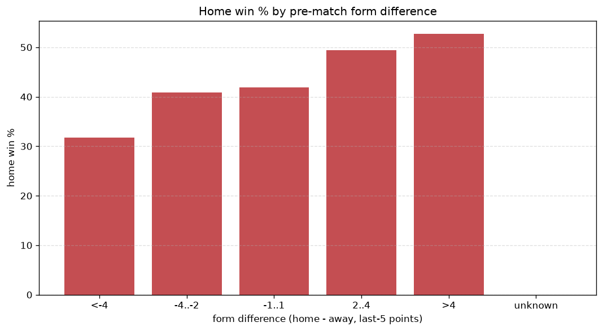
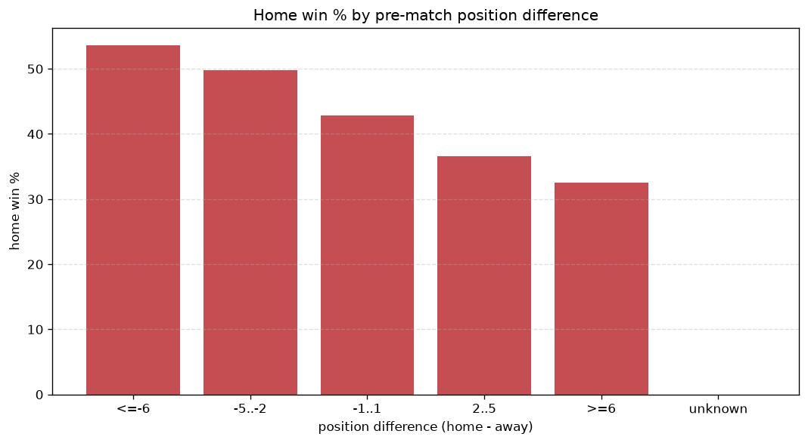

# Relationships Analysis
- Report: `relationships`
- Generated: 2026-10-26T01:48:33+00:00
- Script: `backend/scripts/analyze_relationships.py` v1.0.0
- League: Segunda RFEF - Group 5 (Spain)
- Scope: league `segunda5`

- Matches analysed: **1710** (23 leakage-safe pre-match features).

## 1. Correlation matrix
_Pearson correlation of each pre-match feature with observed goals; sorted by |corr(total goals)|._

| feature | corr(home) | corr(away) | corr(total) |
|---|---|---|---|
| away_team_goals_conceded_last_5 | 0.101 | 0.013 | 0.084 |
| home_team_home_conceded_avg | -0.005 | 0.122 | 0.077 |
| rest_days_difference | 0.059 | 0.043 | 0.072 |
| home_team_goals_conceded_last_5 | 0.007 | 0.101 | 0.072 |
| away_position_before_match | 0.119 | -0.044 | 0.059 |
| away_team_away_conceded_avg | 0.083 | -0.017 | 0.050 |
| home_team_goals_scored_last_5 | 0.085 | -0.024 | 0.047 |
| away_team_away_win_rate | -0.055 | -0.003 | -0.043 |
| away_rest_days | -0.004 | -0.059 | -0.042 |
| away_team_wins_last_5 | -0.082 | 0.029 | -0.042 |
| home_points_before_match | 0.084 | -0.036 | 0.038 |
| away_team_points_last_5 | -0.087 | 0.043 | -0.036 |
| position_difference | -0.162 | 0.133 | -0.031 |
| away_points_before_match | -0.022 | 0.060 | 0.023 |
| points_difference | 0.160 | -0.145 | 0.022 |
| home_team_home_goals_avg | 0.092 | -0.077 | 0.017 |
| home_position_before_match | -0.107 | 0.143 | 0.015 |
| home_team_home_win_rate | 0.076 | -0.106 | -0.014 |
| home_rest_days | 0.041 | -0.027 | 0.012 |
| away_team_goals_scored_last_5 | -0.036 | 0.057 | 0.011 |
| away_team_away_goals_avg | -0.016 | 0.004 | -0.009 |
| home_team_points_last_5 | 0.070 | -0.066 | 0.008 |
| home_team_wins_last_5 | 0.069 | -0.068 | 0.006 |

## 2. Form vs outcome
_Home win/draw/away % per bucket of `home_team_points_last_5 - away_team_points_last_5`._

| bucket | matches | home | draw | away | home % | draw % | away % |
|---|---|---|---|---|---|---|---|
| <-4 | 258 | 82 | 79 | 97 | 31.8% | 30.6% | 37.6% |
| -4..-2 | 384 | 157 | 121 | 106 | 40.9% | 31.5% | 27.6% |
| -1..1 | 523 | 219 | 153 | 151 | 41.9% | 29.3% | 28.9% |
| 2..4 | 340 | 168 | 85 | 87 | 49.4% | 25.0% | 25.6% |
| >4 | 205 | 108 | 54 | 43 | 52.7% | 26.3% | 21.0% |
| unknown | 0 | 0 | 0 | 0 | - | - | - |

## 3. Position vs outcome
_Home win/draw/away % per bucket of `position_difference` (home position - away position; negative favours the home team)._

| bucket | matches | home | draw | away | home % | draw % | away % |
|---|---|---|---|---|---|---|---|
| <=-6 | 401 | 215 | 114 | 72 | 53.6% | 28.4% | 18.0% |
| -5..-2 | 325 | 162 | 86 | 77 | 49.8% | 26.5% | 23.7% |
| -1..1 | 229 | 98 | 64 | 67 | 42.8% | 27.9% | 29.3% |
| 2..5 | 339 | 124 | 102 | 113 | 36.6% | 30.1% | 33.3% |
| >=6 | 416 | 135 | 126 | 155 | 32.5% | 30.3% | 37.3% |
| unknown | 0 | 0 | 0 | 0 | - | - | - |

## 4. Rest advantage
_Home win/draw/away % per bucket of `rest_days_difference` (home rest - away rest). Matches with unknown rest are bucketed separately._

| bucket | matches | home | draw | away | home % | draw % | away % |
|---|---|---|---|---|---|---|---|
| <-1 | 50 | 23 | 13 | 14 | 46.0% | 26.0% | 28.0% |
| -1..0 | 166 | 59 | 51 | 56 | 35.5% | 30.7% | 33.7% |
| 0 | 1198 | 524 | 356 | 318 | 43.7% | 29.7% | 26.5% |
| 1..2 | 180 | 77 | 40 | 63 | 42.8% | 22.2% | 35.0% |
| >2 | 58 | 25 | 16 | 17 | 43.1% | 27.6% | 29.3% |
| unknown | 58 | 26 | 16 | 16 | 44.8% | 27.6% | 27.6% |
- *58 match(es) had unknown rest difference (missing rest data on at least one side).*

## 5. Home team quality
_Home win rate by `home_team_home_win_rate` tier (split at 0.5)._

- `< 0.5` tier: **39.1%** home win (404/1034)
- `>= 0.5` tier: **48.8%** home win (330/676)
- Home-win gap (>= split minus < split): **+9.7 pp**

| tier | label | matches | home | draw | away | home % |
|---|---|---|---|---|---|---|
| low | < 0.5 | 1034 | 404 | 291 | 339 | 39.1% |
| high | >= 0.5 | 676 | 330 | 201 | 145 | 48.8% |

## 6. Feature averages by result
_Mean feature value per outcome; `range` is home-minus-away spread of the group means._

| feature | home mean | draw mean | away mean | range |
|---|---|---|---|---|
| points_difference | 1.711 | -0.557 | -2.800 | 4.511 |
| position_difference | -1.290 | 0.366 | 2.068 | 3.358 |
| home_points_before_match | 22.578 | 20.248 | 19.616 | 2.962 |
| home_position_before_match | 9.046 | 9.805 | 11.091 | 2.045 |
| away_points_before_match | 20.866 | 20.805 | 22.415 | 1.610 |
| away_position_before_match | 10.337 | 9.439 | 9.023 | 1.314 |
| away_team_points_last_5 | 5.952 | 6.423 | 6.591 | 0.639 |
| away_team_goals_conceded_last_5 | 5.272 | 4.663 | 4.890 | 0.610 |
| home_team_points_last_5 | 6.245 | 5.868 | 5.645 | 0.601 |
| home_team_goals_conceded_last_5 | 5.015 | 5.114 | 5.438 | 0.423 |
| away_team_goals_scored_last_5 | 5.033 | 5.146 | 5.421 | 0.389 |
| home_team_goals_scored_last_5 | 5.162 | 4.884 | 4.793 | 0.369 |
| home_rest_days | 7.795 | 7.464 | 7.562 | 0.331 |
| away_rest_days | 7.753 | 7.488 | 7.526 | 0.264 |
| home_team_wins_last_5 | 1.646 | 1.522 | 1.438 | 0.208 |
| away_team_wins_last_5 | 1.554 | 1.705 | 1.731 | 0.177 |
| home_team_home_goals_avg | 1.243 | 1.192 | 1.068 | 0.175 |
| away_team_away_conceded_avg | 1.239 | 1.139 | 1.126 | 0.112 |
| home_team_home_conceded_avg | 0.843 | 0.913 | 0.946 | 0.103 |
| home_team_home_win_rate | 0.424 | 0.395 | 0.342 | 0.082 |
| rest_days_difference | 0.044 | -0.025 | 0.032 | 0.069 |
| away_team_away_goals_avg | 0.887 | 0.892 | 0.904 | 0.016 |
| away_team_away_win_rate | 0.256 | 0.271 | 0.270 | 0.014 |

---
*All features are leakage-safe pre-match values built by `ml.features.build_features.build_rows` from strictly prior matches. Run with `python backend/scripts/analyze_relationships.py` to regenerate.*

## Charts

