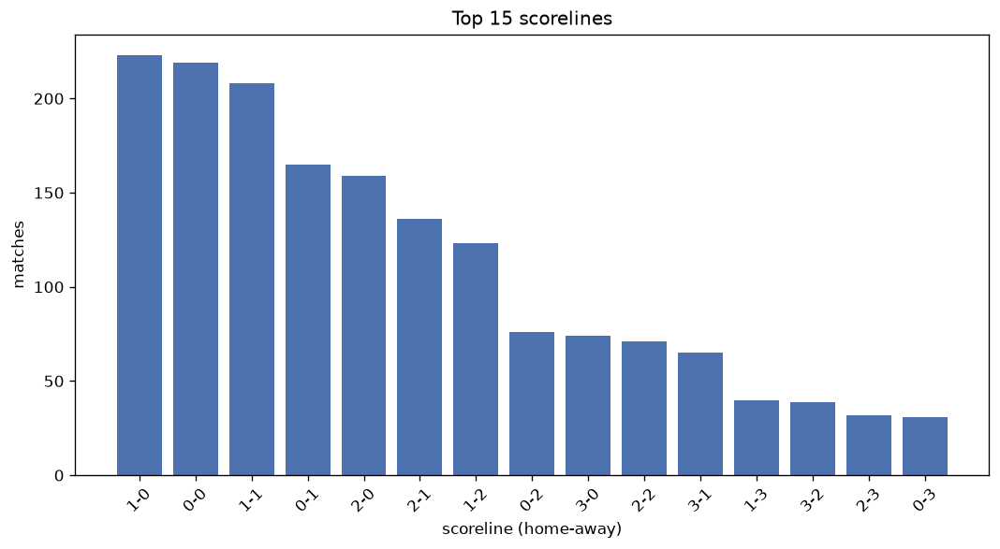
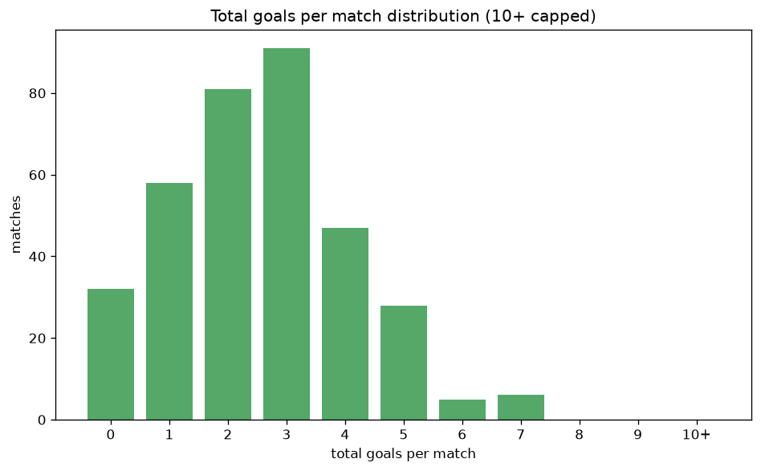

# Scoreline Analysis
- Report: `scoreline_analysis`
- Generated: 2026-10-30T04:12:38+00:00
- Script: `backend/scripts/analyze_scorelines.py` v1.0.0
- League: Segunda RFEF - Group 5 (Spain)
- Scope: league `segunda5`

## 1. Scoreline frequency
- Matches analysed: **1789** across **7** seasons.
- Distinct scorelines seen: **38**.

| scoreline | count | pct |
|---|---|---|
| 1-0 | 223 | 12.5% |
| 0-0 | 219 | 12.2% |
| 1-1 | 208 | 11.6% |
| 0-1 | 165 | 9.2% |
| 2-0 | 159 | 8.9% |
| 2-1 | 136 | 7.6% |
| 1-2 | 123 | 6.9% |
| 0-2 | 76 | 4.2% |
| 3-0 | 74 | 4.1% |
| 2-2 | 71 | 4.0% |
| 3-1 | 65 | 3.6% |
| 1-3 | 40 | 2.2% |
| 3-2 | 39 | 2.2% |
| 2-3 | 32 | 1.8% |
| 0-3 | 31 | 1.7% |
| 4-0 | 29 | 1.6% |
| 3-3 | 18 | 1.0% |
| 4-1 | 17 | 1.0% |
| 1-4 | 12 | 0.7% |
| 4-2 | 9 | 0.5% |

## 2. Scoreline frequency per season

### 2020-2021
| scoreline | count | pct |
|---|---|---|
| 0-0 | 28 | 15.6% |
| 1-1 | 26 | 14.4% |
| 1-0 | 22 | 12.2% |
| 1-2 | 18 | 10.0% |
| 0-1 | 17 | 9.4% |

### 2021-2022
| scoreline | count | pct |
|---|---|---|
| 1-0 | 45 | 14.7% |
| 1-1 | 41 | 13.4% |
| 0-1 | 38 | 12.4% |
| 0-0 | 35 | 11.4% |
| 2-0 | 32 | 10.5% |

### 2022-2023
| scoreline | count | pct |
|---|---|---|
| 0-0 | 51 | 16.7% |
| 1-0 | 36 | 11.8% |
| 2-0 | 33 | 10.8% |
| 1-1 | 31 | 10.1% |
| 0-1 | 30 | 9.8% |

### 2023-2024
| scoreline | count | pct |
|---|---|---|
| 1-0 | 44 | 14.4% |
| 0-0 | 39 | 12.7% |
| 1-1 | 35 | 11.4% |
| 0-1 | 29 | 9.5% |
| 2-0 | 24 | 7.8% |

### 2024-2025
| scoreline | count | pct |
|---|---|---|
| 1-0 | 42 | 13.7% |
| 1-1 | 30 | 9.8% |
| 2-0 | 29 | 9.5% |
| 0-0 | 29 | 9.5% |
| 2-1 | 28 | 9.2% |

### 2025-2026
| scoreline | count | pct |
|---|---|---|
| 1-1 | 37 | 12.1% |
| 2-1 | 32 | 10.5% |
| 0-0 | 27 | 8.8% |
| 1-0 | 25 | 8.2% |
| 0-1 | 24 | 7.8% |

### 2026-2027
| scoreline | count | pct |
|---|---|---|
| 2-1 | 11 | 13.9% |
| 0-0 | 10 | 12.7% |
| 1-0 | 9 | 11.4% |
| 1-1 | 8 | 10.1% |
| 3-0 | 7 | 8.9% |

## 3. Total-goal histogram
_10+ groups all matches with 10 or more total goals._

| total goals | matches | pct |
|---|---|---|
| 0 | 219 | 12.2% |
| 1 | 388 | 21.7% |
| 2 | 443 | 24.8% |
| 3 | 364 | 20.3% |
| 4 | 213 | 11.9% |
| 5 | 107 | 6.0% |
| 6 | 36 | 2.0% |
| 7 | 13 | 0.7% |
| 8 | 6 | 0.3% |
| 9 | 0 | 0.0% |
| 10+ | 0 | 0.0% |

## 4. Extreme scorelines
- Matches with 7+ total goals: **19**

| season | date | scoreline | total goals |
|---|---|---|---|
| 2020-2021 | 2020-11-22 | 5-3 | 8 |
| 2021-2022 | 2021-11-27 | 1-7 | 8 |
| 2023-2024 | 2024-03-23 | 7-1 | 8 |
| 2023-2024 | 2024-05-05 | 6-2 | 8 |
| 2024-2025 | 2025-04-27 | 4-4 | 8 |
| 2026-2027 | 2026-10-25 | 4-4 | 8 |
| 2021-2022 | 2022-03-27 | 4-3 | 7 |
| 2022-2023 | 2022-11-06 | 3-4 | 7 |
| 2022-2023 | 2023-02-04 | 3-4 | 7 |
| 2024-2025 | 2024-11-17 | 5-2 | 7 |
| 2024-2025 | 2024-12-08 | 4-3 | 7 |
| 2024-2025 | 2025-02-09 | 4-3 | 7 |
| 2024-2025 | 2025-02-09 | 4-3 | 7 |
| 2025-2026 | 2025-11-02 | 2-5 | 7 |
| 2025-2026 | 2026-01-03 | 5-2 | 7 |
| 2025-2026 | 2026-02-22 | 2-5 | 7 |
| 2026-2027 | 2026-09-12 | 4-3 | 7 |
| 2026-2027 | 2026-09-20 | 6-1 | 7 |
| 2026-2027 | 2026-09-20 | 5-2 | 7 |

## 5. Margin-of-victory distribution (decided matches)
- Decided matches: **1271** (draws: **518**)
- Average winning margin: **1.64**

| margin | matches | pct |
|---|---|---|
| 1 | 725 | 57.0% |
| 2 | 353 | 27.8% |
| 3+ | 193 | 15.2% |

## 6. Margin by outcome

### Home wins
- Matches: **772** | avg margin: **1.72** | max margin: **6**
| margin | matches | pct |
|---|---|---|
| 1 | 403 | 52.2% |
| 2 | 234 | 30.3% |
| 3+ | 135 | 17.5% |
- *Full match-by-match list available in `scoreline_analysis.json`.*

### Away wins
- Matches: **499** | avg margin: **1.51** | max margin: **6**
| margin | matches | pct |
|---|---|---|
| 1 | 322 | 64.5% |
| 2 | 119 | 23.8% |
| 3+ | 58 | 11.6% |
- *Full match-by-match list available in `scoreline_analysis.json`.*

## 7. Most common exact score by outcome type
| outcome | matches | most common score | count | pct |
|---|---|---|---|---|
| home | 772 | 1-0 | 223 | 28.9% |
| draw | 518 | 0-0 | 219 | 42.3% |
| away | 499 | 0-1 | 165 | 33.1% |

---
*All statistics are computed from PostgreSQL tables (read-only). Run with `python backend/scripts/analyze_scorelines.py` to regenerate.*

## Charts

