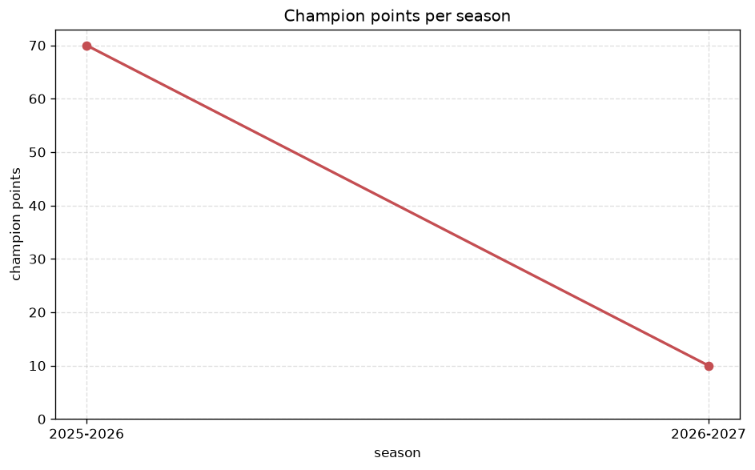
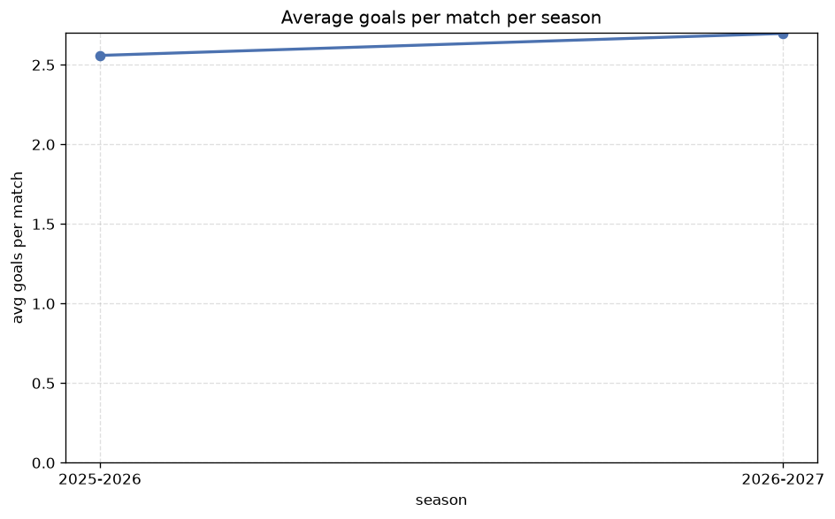

# Season Trends Analysis
- Report: `season_trends`
- Generated: 2026-10-29T02:15:23+00:00
- Script: `backend/scripts/analyze_seasons.py` v1.0.0
- League: Segunda RFEF - Group 5 (Spain)
- Scope: league `segunda5`

## 1. Champions per season
| season | champion | pts | runner-up | margin |
|---|---|---|---|---|
| 2020-2021 | CD Badajoz | 41 | San Sebastian Reyes | 6 pts |
| 2021-2022 | CF Intercity | 66 | La Nucia | 2 pts |
| 2022-2023 | Melilla | 66 | Atl. Madrid B | 1 pts |
| 2023-2024 | San Sebastian Reyes | 61 | Gimnastica Segoviana | 0 pts |
| 2024-2025 | Guadalajara | 74 | Cacereno | 6 pts |
| 2025-2026 | Rayo Majadahonda | 70 | San Sebastian Reyes | 0 pts |
| 2026-2027 | San Sebastian Reyes | 19 | Valladolid Promesas | 2 pts |

## 2. Title-race tightness
- Tight races (margin <= 3 pts): **5** of 7 seasons
- Tightest race: **2023-2024** - San Sebastian Reyes beat Gimnastica Segoviana by **0** pts

| season | margin | tight |
|---|---|---|
| 2020-2021 | 6 pts |  |
| 2021-2022 | 2 pts | yes |
| 2022-2023 | 1 pts | yes |
| 2023-2024 | 0 pts | yes |
| 2024-2025 | 6 pts |  |
| 2025-2026 | 0 pts | yes |
| 2026-2027 | 2 pts | yes |

## 3. Points thresholds
_Position-specific points per season. Key: 1 = champion, 2 = runner-up, 4 = CL line, 6 = Europa, 15 = last safe, 18 = bottom._

| season | pos 1 | pos 2 | pos 4 | pos 6 | pos 15 | pos 18 |
|---|---|---|---|---|---|---|
| 2020-2021 | 41 | 35 | 31 | 28 | 20 | 16 |
| 2021-2022 | 66 | 64 | 56 | 55 | 34 | 28 |
| 2022-2023 | 66 | 65 | 55 | 50 | 35 | 32 |
| 2023-2024 | 61 | 61 | 57 | 49 | 38 | 23 |
| 2024-2025 | 74 | 68 | 55 | 53 | 33 | 21 |
| 2025-2026 | 70 | 70 | 57 | 51 | 37 | 30 |
| 2026-2027 | 19 | 17 | 17 | 15 | 7 | 5 |

## 4. Relegation battle
| season | safe pos | safe pts | drop pos | drop pts | gap |
|---|---|---|---|---|---|
| 2020-2021 | 15 | 20 | 16 | 19 | 1 pts |
| 2021-2022 | 15 | 34 | 16 | 32 | 2 pts |
| 2022-2023 | 15 | 35 | 16 | 34 | 1 pts |
| 2023-2024 | 15 | 38 | 16 | 37 | 1 pts |
| 2024-2025 | 15 | 33 | 16 | 30 | 3 pts |
| 2025-2026 | 15 | 37 | 16 | 34 | 3 pts |
| 2026-2027 | 15 | 7 | 16 | 6 | 1 pts |

## 5. League-level trends
| season | matches | total goals | avg goals | home win | draw | away win | goalless | avg pts/team |
|---|---|---|---|---|---|---|---|---|
| 2020-2021 | 180 | 375 | 2.083 | 38.9% | 33.9% | 27.2% | 15.6% | 23.95 |
| 2021-2022 | 306 | 640 | 2.092 | 39.5% | 29.4% | 31.0% | 11.4% | 46.0 |
| 2022-2023 | 306 | 658 | 2.15 | 41.5% | 31.4% | 27.1% | 16.7% | 43.26 |
| 2023-2024 | 306 | 681 | 2.225 | 43.1% | 29.1% | 27.8% | 12.7% | 46.06 |
| 2024-2025 | 306 | 754 | 2.464 | 47.7% | 25.8% | 26.5% | 9.5% | 46.61 |
| 2025-2026 | 306 | 783 | 2.559 | 45.1% | 25.2% | 29.7% | 8.8% | 46.72 |
| 2026-2027 | 79 | 217 | 2.747 | 48.1% | 32.9% | 19.0% | 12.7% | 11.72 |

## 6. View divergence
- Largest divergence: **2024-2025** (goals view, avg abs position diff = 6.667)

_Avg absolute position difference between classic view and alternative view per season._

| season | classic vs luck | classic vs goals |
|---|---|---|
| 2020-2021 | 2.000 | 6.200 |
| 2021-2022 | 2.333 | 6.556 |
| 2022-2023 | 2.947 | 5.579 |
| 2023-2024 | 3.111 | 5.889 |
| 2024-2025 | 1.667 | 6.667 |
| 2025-2026 | 3.111 | 6.444 |
| 2026-2027 | 1.667 | 4.889 |

---
*All statistics are computed from PostgreSQL tables (read-only). Run with `python backend/scripts/analyze_seasons.py` to regenerate.*

## Charts

