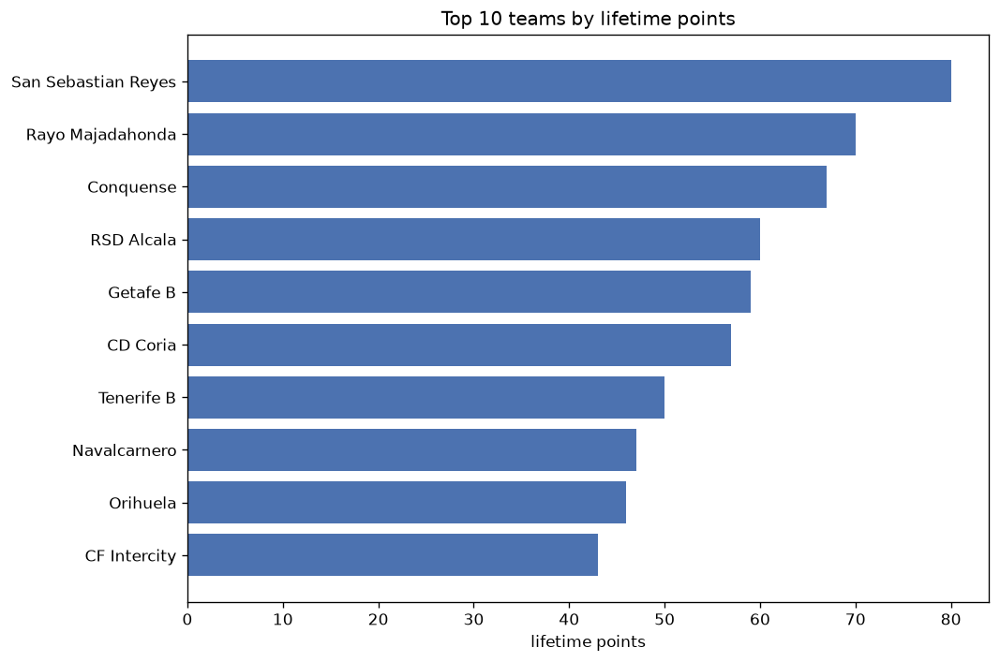
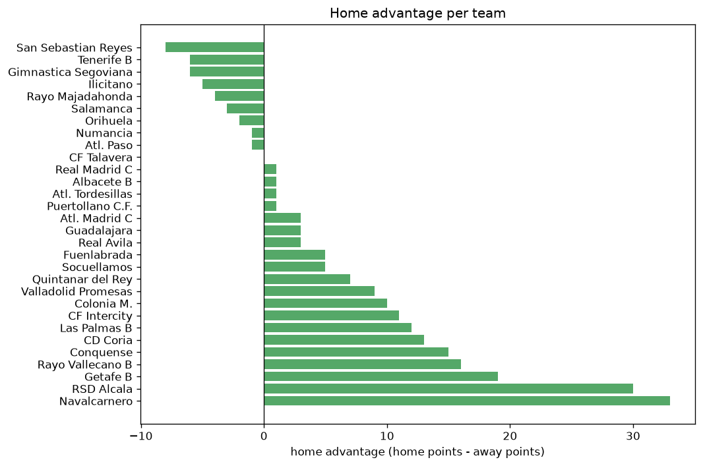

# Team Analysis
- Report: `teams_analysis`
- Generated: 2026-10-30T04:12:36+00:00
- Script: `backend/scripts/analyze_teams.py` v1.0.0
- League: Segunda RFEF - Group 5 (Spain)
- Scope: league `segunda5`

- Teams: **73** | Seasons: **7** | Matches: **1789**

## 1. Team standings (lifetime)
| team | seasons | played | W | D | L | pts | GF | GA | GD | avg pts/season | best pos | worst pos | titles |
|---|---|---|---|---|---|---|---|---|---|---|---|---|---|
| Navalcarnero | 6 | 163 | 62 | 50 | 51 | 236 | 192 | 176 | 16 | 39.33 | 3 | 13 | 0 |
| San Sebastian Reyes | 5 | 129 | 66 | 36 | 27 | 234 | 195 | 121 | 74 | 46.8 | 1 | 8 | 2 |
| Getafe B | 5 | 128 | 48 | 42 | 38 | 186 | 163 | 138 | 25 | 37.2 | 4 | 19 | 0 |
| Melilla | 4 | 120 | 47 | 37 | 36 | 178 | 133 | 115 | 18 | 44.5 | 1 | 12 | 1 |
| Guadalajara | 4 | 111 | 50 | 27 | 34 | 177 | 173 | 130 | 43 | 44.25 | 1 | 14 | 1 |
| Cacereno | 3 | 102 | 46 | 34 | 22 | 172 | 135 | 90 | 45 | 57.33 | 2 | 6 | 0 |
| CF Talavera | 5 | 95 | 42 | 28 | 25 | 154 | 115 | 83 | 32 | 30.8 | 3 | 19 | 0 |
| Rayo Majadahonda | 3 | 86 | 43 | 24 | 19 | 153 | 110 | 69 | 41 | 51.0 | 1 | 6 | 1 |
| CD Coria | 3 | 102 | 39 | 29 | 34 | 146 | 126 | 130 | -4 | 48.67 | 5 | 12 | 0 |
| Union Adarve | 3 | 102 | 33 | 32 | 37 | 131 | 109 | 120 | -11 | 43.67 | 7 | 14 | 0 |
| Atl. Paso | 4 | 110 | 32 | 31 | 47 | 127 | 107 | 128 | -21 | 31.75 | 5 | 18 | 0 |
| Gimnastica Segoviana | 3 | 77 | 34 | 24 | 19 | 126 | 111 | 84 | 27 | 42.0 | 2 | 7 | 0 |
| Socuellamos | 4 | 120 | 28 | 39 | 53 | 123 | 101 | 155 | -54 | 30.75 | 12 | 18 | 0 |
| Conquense | 3 | 76 | 34 | 20 | 22 | 122 | 97 | 80 | 17 | 40.67 | 3 | 10 | 0 |
| Villanovense | 3 | 86 | 32 | 25 | 29 | 121 | 79 | 68 | 11 | 40.33 | 6 | 12 | 0 |
| CF Intercity | 2 | 68 | 29 | 22 | 17 | 109 | 88 | 61 | 27 | 54.5 | 1 | 10 | 1 |
| Tenerife B | 2 | 68 | 28 | 13 | 27 | 97 | 111 | 104 | 7 | 48.5 | 7 | 9 | 0 |
| Real Madrid C | 3 | 77 | 21 | 25 | 31 | 88 | 77 | 86 | -9 | 29.33 | 12 | 16 | 0 |
| Atl. Madrid B | 2 | 52 | 23 | 15 | 14 | 84 | 75 | 53 | 22 | 42.0 | 2 | 16 | 0 |
| CD Badajoz | 2 | 52 | 20 | 18 | 14 | 78 | 67 | 48 | 19 | 39.0 | 1 | 16 | 1 |
| Colonia M. | 2 | 68 | 20 | 16 | 32 | 76 | 78 | 113 | -35 | 38.0 | 13 | 16 | 0 |
| Illescas | 2 | 68 | 19 | 17 | 32 | 74 | 64 | 79 | -15 | 37.0 | 11 | 16 | 0 |
| Numancia | 2 | 42 | 21 | 10 | 11 | 73 | 59 | 43 | 16 | 36.5 | 3 | 8 | 0 |
| La Nucia | 1 | 34 | 18 | 10 | 6 | 64 | 41 | 18 | 23 | 64.0 | 2 | 2 | 0 |
| RSD Alcala | 2 | 43 | 17 | 11 | 15 | 62 | 56 | 51 | 5 | 31.0 | 6 | 10 | 0 |
| Montijo | 2 | 68 | 16 | 14 | 38 | 62 | 61 | 105 | -44 | 31.0 | 13 | 18 | 0 |
| Murcia | 1 | 34 | 15 | 13 | 6 | 58 | 42 | 27 | 15 | 58.0 | 3 | 3 | 0 |
| Eldense | 1 | 34 | 15 | 11 | 8 | 56 | 47 | 37 | 10 | 56.0 | 4 | 4 | 0 |
| Hercules | 1 | 34 | 15 | 11 | 8 | 56 | 41 | 31 | 10 | 56.0 | 5 | 5 | 0 |
| Don Benito | 2 | 52 | 13 | 17 | 22 | 56 | 35 | 68 | -33 | 28.0 | 10 | 18 | 0 |
| Racing Cartagena MM | 1 | 34 | 16 | 7 | 11 | 55 | 34 | 29 | 5 | 55.0 | 6 | 6 | 0 |
| Alzira | 1 | 34 | 13 | 12 | 9 | 51 | 42 | 36 | 6 | 51.0 | 7 | 7 | 0 |
| CD Estepona | 1 | 34 | 11 | 14 | 9 | 47 | 35 | 26 | 9 | 47.0 | 8 | 8 | 0 |
| Granada CF B | 1 | 34 | 11 | 13 | 10 | 46 | 34 | 32 | 2 | 46.0 | 8 | 8 | 0 |
| Orihuela | 1 | 34 | 12 | 10 | 12 | 46 | 45 | 43 | 2 | 46.0 | 8 | 8 | 0 |
| Llerenense | 1 | 34 | 12 | 8 | 14 | 44 | 31 | 36 | -5 | 44.0 | 14 | 14 | 0 |
| Ursaria | 1 | 34 | 12 | 8 | 14 | 44 | 34 | 39 | -5 | 44.0 | 13 | 13 | 0 |
| Mancha | 1 | 34 | 12 | 7 | 15 | 43 | 32 | 36 | -4 | 43.0 | 10 | 10 | 0 |
| El Ejido | 1 | 34 | 12 | 7 | 15 | 43 | 30 | 35 | -5 | 43.0 | 11 | 11 | 0 |
| Las Palmas B | 1 | 34 | 11 | 9 | 14 | 42 | 42 | 45 | -3 | 42.0 | 11 | 11 | 0 |
| Aguilas FC | 1 | 34 | 10 | 11 | 13 | 41 | 32 | 36 | -4 | 41.0 | 13 | 13 | 0 |
| Ilicitano | 1 | 34 | 10 | 11 | 13 | 41 | 51 | 56 | -5 | 41.0 | 12 | 12 | 0 |
| Cerdanyola | 1 | 34 | 10 | 11 | 13 | 41 | 28 | 45 | -17 | 41.0 | 11 | 11 | 0 |
| Quintanar del Rey | 1 | 34 | 11 | 6 | 17 | 39 | 36 | 43 | -7 | 39.0 | 14 | 14 | 0 |
| Levante B | 1 | 34 | 9 | 11 | 14 | 38 | 33 | 33 | 0 | 38.0 | 14 | 14 | 0 |
| San Fernando | 1 | 34 | 9 | 11 | 14 | 38 | 31 | 43 | -12 | 38.0 | 15 | 15 | 0 |
| Leganes B | 1 | 34 | 8 | 13 | 13 | 37 | 31 | 39 | -8 | 37.0 | 14 | 14 | 0 |
| Fuenlabrada | 1 | 34 | 9 | 10 | 15 | 37 | 35 | 44 | -9 | 37.0 | 15 | 15 | 0 |
| Alcorcon B | 1 | 34 | 7 | 14 | 13 | 35 | 34 | 42 | -8 | 35.0 | 15 | 15 | 0 |
| Puertollano C.F. | 2 | 43 | 9 | 8 | 26 | 35 | 43 | 65 | -22 | 17.5 | 17 | 17 | 0 |
| Diocesano | 1 | 34 | 8 | 10 | 16 | 34 | 33 | 43 | -10 | 34.0 | 16 | 16 | 0 |
| Pulpileno | 1 | 34 | 8 | 10 | 16 | 34 | 23 | 48 | -25 | 34.0 | 15 | 15 | 0 |
| CD Mostoles | 1 | 34 | 10 | 3 | 21 | 33 | 40 | 55 | -15 | 33.0 | 15 | 15 | 0 |
| Real Madrid B | 1 | 18 | 9 | 5 | 4 | 32 | 30 | 21 | 9 | 32.0 | 3 | 3 | 0 |
| Marchamalo | 1 | 34 | 8 | 8 | 18 | 32 | 33 | 59 | -26 | 32.0 | 16 | 16 | 0 |
| Extremadura UD | 1 | 18 | 8 | 7 | 3 | 31 | 24 | 16 | 8 | 31.0 | 4 | 4 | 0 |
| Internacional de Madrid | 1 | 18 | 8 | 6 | 4 | 30 | 24 | 16 | 8 | 30.0 | 5 | 5 | 0 |
| Rayo Vallecano B | 1 | 34 | 9 | 3 | 22 | 30 | 30 | 63 | -33 | 30.0 | 18 | 18 | 0 |
| Yaiza | 1 | 34 | 6 | 11 | 17 | 29 | 34 | 55 | -21 | 29.0 | 17 | 17 | 0 |
| Toledo | 1 | 34 | 6 | 10 | 18 | 28 | 27 | 44 | -17 | 28.0 | 18 | 18 | 0 |
| Mensajero | 1 | 34 | 5 | 10 | 19 | 25 | 28 | 58 | -30 | 25.0 | 17 | 17 | 0 |
| Baleares | 1 | 18 | 6 | 6 | 6 | 24 | 26 | 21 | 5 | 24.0 | 9 | 9 | 0 |
| Merida AD | 1 | 18 | 6 | 5 | 7 | 23 | 12 | 12 | 0 | 23.0 | 11 | 11 | 0 |
| Villarrubia | 1 | 18 | 4 | 8 | 6 | 20 | 17 | 24 | -7 | 20.0 | 14 | 14 | 0 |
| Las Rozas | 1 | 18 | 5 | 5 | 8 | 20 | 16 | 25 | -9 | 20.0 | 15 | 15 | 0 |
| Valladolid Promesas | 1 | 9 | 5 | 2 | 2 | 17 | 19 | 10 | 9 | 17.0 | 2 | 2 | 0 |
| Atl. Madrid C | 1 | 9 | 5 | 2 | 2 | 17 | 13 | 10 | 3 | 17.0 | 4 | 4 | 0 |
| Salamanca | 1 | 9 | 5 | 1 | 3 | 16 | 15 | 12 | 3 | 16.0 | 5 | 5 | 0 |
| Poblense | 1 | 18 | 2 | 10 | 6 | 16 | 16 | 21 | -5 | 16.0 | 17 | 17 | 0 |
| Albacete B | 1 | 9 | 2 | 4 | 3 | 10 | 11 | 22 | -11 | 10.0 | 11 | 11 | 0 |
| Villarrobledo | 1 | 18 | 2 | 4 | 12 | 10 | 15 | 29 | -14 | 10.0 | 20 | 20 | 0 |
| Atl. Tordesillas | 1 | 9 | 2 | 3 | 4 | 9 | 13 | 14 | -1 | 9.0 | 13 | 13 | 0 |
| Real Avila | 1 | 9 | 2 | 1 | 6 | 7 | 8 | 16 | -8 | 7.0 | 15 | 15 | 0 |

## 2. Home vs away split
| team | home P | H-W | H-D | H-L | H-pts | away P | A-W | A-D | A-L | A-pts | adv |
|---|---|---|---|---|---|---|---|---|---|---|---|
| Atl. Paso | 55 | 27 | 13 | 15 | 94 | 55 | 5 | 18 | 32 | 33 | 61 |
| Getafe B | 64 | 33 | 16 | 15 | 115 | 64 | 15 | 26 | 23 | 71 | 44 |
| Melilla | 60 | 30 | 19 | 11 | 109 | 60 | 17 | 18 | 25 | 69 | 40 |
| Navalcarnero | 80 | 37 | 26 | 17 | 137 | 83 | 25 | 24 | 34 | 99 | 38 |
| Guadalajara | 57 | 32 | 11 | 14 | 107 | 54 | 18 | 16 | 20 | 70 | 37 |
| Gimnastica Segoviana | 38 | 24 | 9 | 5 | 81 | 39 | 10 | 15 | 14 | 45 | 36 |
| Union Adarve | 51 | 20 | 22 | 9 | 82 | 51 | 13 | 10 | 28 | 49 | 33 |
| Atl. Madrid B | 26 | 17 | 6 | 3 | 57 | 26 | 6 | 9 | 11 | 27 | 30 |
| RSD Alcala | 23 | 14 | 4 | 5 | 46 | 20 | 3 | 7 | 10 | 16 | 30 |
| CD Coria | 51 | 23 | 18 | 10 | 87 | 51 | 16 | 11 | 24 | 59 | 28 |
| Conquense | 38 | 22 | 9 | 7 | 75 | 38 | 12 | 11 | 15 | 47 | 28 |
| Socuellamos | 60 | 18 | 19 | 23 | 73 | 60 | 10 | 20 | 30 | 50 | 23 |
| San Sebastian Reyes | 64 | 37 | 17 | 10 | 128 | 65 | 29 | 19 | 17 | 106 | 22 |
| Cacereno | 51 | 27 | 15 | 9 | 96 | 51 | 19 | 19 | 13 | 76 | 20 |
| CF Talavera | 47 | 24 | 14 | 9 | 86 | 48 | 18 | 14 | 16 | 68 | 18 |
| Villanovense | 43 | 19 | 12 | 12 | 69 | 43 | 13 | 13 | 17 | 52 | 17 |
| Puertollano C.F. | 22 | 7 | 5 | 10 | 26 | 21 | 2 | 3 | 16 | 9 | 17 |
| CD Badajoz | 26 | 13 | 8 | 5 | 47 | 26 | 7 | 10 | 9 | 31 | 16 |
| Rayo Vallecano B | 17 | 7 | 2 | 8 | 23 | 17 | 2 | 1 | 14 | 7 | 16 |
| CF Intercity | 34 | 18 | 8 | 8 | 62 | 34 | 11 | 14 | 9 | 47 | 15 |
| Racing Cartagena MM | 17 | 10 | 5 | 2 | 35 | 17 | 6 | 2 | 9 | 20 | 15 |
| Real Madrid C | 39 | 12 | 15 | 12 | 51 | 38 | 9 | 10 | 19 | 37 | 14 |
| Illescas | 34 | 12 | 8 | 14 | 44 | 34 | 7 | 9 | 18 | 30 | 14 |
| Montijo | 34 | 10 | 8 | 16 | 38 | 34 | 6 | 6 | 22 | 24 | 14 |
| Numancia | 21 | 13 | 4 | 4 | 43 | 21 | 8 | 6 | 7 | 30 | 13 |
| Valladolid Promesas | 5 | 5 | 0 | 0 | 15 | 4 | 0 | 2 | 2 | 2 | 13 |
| Murcia | 17 | 10 | 5 | 2 | 35 | 17 | 5 | 8 | 4 | 23 | 12 |
| Las Palmas B | 17 | 8 | 3 | 6 | 27 | 17 | 3 | 6 | 8 | 15 | 12 |
| Tenerife B | 34 | 15 | 9 | 10 | 54 | 34 | 13 | 4 | 17 | 43 | 11 |
| Alzira | 17 | 8 | 7 | 2 | 31 | 17 | 5 | 5 | 7 | 20 | 11 |
| Yaiza | 17 | 5 | 5 | 7 | 20 | 17 | 1 | 6 | 10 | 9 | 11 |
| Colonia M. | 34 | 12 | 7 | 15 | 43 | 34 | 8 | 9 | 17 | 33 | 10 |
| Ursaria | 17 | 7 | 6 | 4 | 27 | 17 | 5 | 2 | 10 | 17 | 10 |
| Baleares | 9 | 5 | 2 | 2 | 17 | 9 | 1 | 4 | 4 | 7 | 10 |
| CD Mostoles | 17 | 6 | 3 | 8 | 21 | 17 | 4 | 0 | 13 | 12 | 9 |
| Atl. Madrid C | 5 | 4 | 1 | 0 | 13 | 4 | 1 | 1 | 2 | 4 | 9 |
| Hercules | 17 | 9 | 5 | 3 | 32 | 17 | 6 | 6 | 5 | 24 | 8 |
| Llerenense | 17 | 7 | 5 | 5 | 26 | 17 | 5 | 3 | 9 | 18 | 8 |
| Marchamalo | 17 | 5 | 5 | 7 | 20 | 17 | 3 | 3 | 11 | 12 | 8 |
| Las Rozas | 9 | 4 | 2 | 3 | 14 | 9 | 1 | 3 | 5 | 6 | 8 |
| Quintanar del Rey | 17 | 6 | 5 | 6 | 23 | 17 | 5 | 1 | 11 | 16 | 7 |
| Mensajero | 17 | 4 | 4 | 9 | 16 | 17 | 1 | 6 | 10 | 9 | 7 |
| Real Avila | 3 | 2 | 1 | 0 | 7 | 6 | 0 | 0 | 6 | 0 | 7 |
| La Nucia | 17 | 10 | 5 | 2 | 35 | 17 | 8 | 5 | 4 | 29 | 6 |
| San Fernando | 17 | 5 | 7 | 5 | 22 | 17 | 4 | 4 | 9 | 16 | 6 |
| Villarrubia | 9 | 3 | 4 | 2 | 13 | 9 | 1 | 4 | 4 | 7 | 6 |
| Fuenlabrada | 17 | 4 | 9 | 4 | 21 | 17 | 5 | 1 | 11 | 16 | 5 |
| Leganes B | 17 | 5 | 6 | 6 | 21 | 17 | 3 | 7 | 7 | 16 | 5 |
| Atl. Tordesillas | 5 | 2 | 1 | 2 | 7 | 4 | 0 | 2 | 2 | 2 | 5 |
| Don Benito | 26 | 8 | 6 | 12 | 30 | 26 | 5 | 11 | 10 | 26 | 4 |
| Real Madrid B | 9 | 5 | 3 | 1 | 18 | 9 | 4 | 2 | 3 | 14 | 4 |
| Salamanca | 4 | 3 | 1 | 0 | 10 | 5 | 2 | 0 | 3 | 6 | 4 |
| Albacete B | 4 | 2 | 1 | 1 | 7 | 5 | 0 | 3 | 2 | 3 | 4 |
| Cerdanyola | 17 | 6 | 4 | 7 | 22 | 17 | 4 | 7 | 6 | 19 | 3 |
| Granada CF B | 17 | 6 | 6 | 5 | 24 | 17 | 5 | 7 | 5 | 22 | 2 |
| Villarrobledo | 9 | 1 | 3 | 5 | 6 | 9 | 1 | 1 | 7 | 4 | 2 |
| CD Estepona | 17 | 6 | 6 | 5 | 24 | 17 | 5 | 8 | 4 | 23 | 1 |
| Aguilas FC | 17 | 5 | 6 | 6 | 21 | 17 | 5 | 5 | 7 | 20 | 1 |
| Extremadura UD | 9 | 4 | 4 | 1 | 16 | 9 | 4 | 3 | 2 | 15 | 1 |
| Levante B | 17 | 4 | 7 | 6 | 19 | 17 | 5 | 4 | 8 | 19 | 0 |
| Diocesano | 17 | 4 | 5 | 8 | 17 | 17 | 4 | 5 | 8 | 17 | 0 |
| Merida AD | 9 | 3 | 2 | 4 | 11 | 9 | 3 | 3 | 3 | 12 | -1 |
| Orihuela | 17 | 6 | 4 | 7 | 22 | 17 | 6 | 6 | 5 | 24 | -2 |
| Rayo Majadahonda | 43 | 20 | 15 | 8 | 75 | 43 | 23 | 9 | 11 | 78 | -3 |
| Mancha | 17 | 6 | 2 | 9 | 20 | 17 | 6 | 5 | 6 | 23 | -3 |
| Pulpileno | 17 | 3 | 6 | 8 | 15 | 17 | 5 | 4 | 8 | 19 | -4 |
| Internacional de Madrid | 9 | 3 | 4 | 2 | 13 | 9 | 5 | 2 | 2 | 17 | -4 |
| Poblense | 9 | 0 | 6 | 3 | 6 | 9 | 2 | 4 | 3 | 10 | -4 |
| El Ejido | 17 | 5 | 4 | 8 | 19 | 17 | 7 | 3 | 7 | 24 | -5 |
| Ilicitano | 17 | 4 | 6 | 7 | 18 | 17 | 6 | 5 | 6 | 23 | -5 |
| Eldense | 17 | 7 | 4 | 6 | 25 | 17 | 8 | 7 | 2 | 31 | -6 |
| Toledo | 17 | 2 | 5 | 10 | 11 | 17 | 4 | 5 | 8 | 17 | -6 |
| Alcorcon B | 17 | 2 | 8 | 7 | 14 | 17 | 5 | 6 | 6 | 21 | -7 |

## 3. Top performers
### Best points per game (PPG)
| rank | team | PPG |
|---|---|---|
| 1 | Valladolid Promesas | 1.89 |
| 2 | Atl. Madrid C | 1.89 |
| 3 | La Nucia | 1.88 |
| 4 | San Sebastian Reyes | 1.81 |
| 5 | Rayo Majadahonda | 1.78 |

### Most goals scored
| rank | team | goals |
|---|---|---|
| 1 | San Sebastian Reyes | 195 |
| 2 | Navalcarnero | 192 |
| 3 | Guadalajara | 173 |
| 4 | Getafe B | 163 |
| 5 | Cacereno | 135 |

### Best goal difference
| rank | team | GD |
|---|---|---|
| 1 | San Sebastian Reyes | 74 |
| 2 | Cacereno | 45 |
| 3 | Guadalajara | 43 |
| 4 | Rayo Majadahonda | 41 |
| 5 | CF Talavera | 32 |

### Best defence (goals against per match, standings)
| rank | team | GA/match |
|---|---|---|
| 1 | La Nucia | 0.529 |
| 2 | Merida AD | 0.667 |
| 3 | CD Estepona | 0.765 |
| 4 | Villanovense | 0.791 |
| 5 | Murcia | 0.794 |

## 4. Team consistency
- Teams present in all **7** seasons: **0**

## 5. Head-to-head dominance
- Distinct fixtures: **774** (showing the 15 most frequent)

| fixture | meetings | home wins | draws | away wins | home pct | draw pct | away pct |
|---|---|---|---|---|---|---|---|
| Navalcarnero vs Getafe B | 8 | 3 | 3 | 2 | 37.5% | 37.5% | 25.0% |
| San Sebastian Reyes vs Getafe B | 8 | 3 | 2 | 3 | 37.5% | 25.0% | 37.5% |
| San Sebastian Reyes vs Navalcarnero | 8 | 3 | 3 | 2 | 37.5% | 37.5% | 25.0% |
| Rayo Majadahonda vs San Sebastian Reyes | 6 | 5 | 1 | 0 | 83.3% | 16.7% | 0.0% |
| Union Adarve vs Atl. Paso | 6 | 5 | 1 | 0 | 83.3% | 16.7% | 0.0% |
| Cacereno vs Atl. Paso | 6 | 4 | 1 | 1 | 66.7% | 16.7% | 16.7% |
| Cacereno vs Navalcarnero | 6 | 4 | 1 | 1 | 66.7% | 16.7% | 16.7% |
| Guadalajara vs Atl. Paso | 6 | 4 | 1 | 1 | 66.7% | 16.7% | 16.7% |
| Guadalajara vs Navalcarnero | 6 | 4 | 1 | 1 | 66.7% | 16.7% | 16.7% |
| Melilla vs Socuellamos | 6 | 3 | 1 | 2 | 50.0% | 16.7% | 33.3% |
| Navalcarnero vs Atl. Paso | 6 | 3 | 3 | 0 | 50.0% | 50.0% | 0.0% |
| CD Coria vs Navalcarnero | 6 | 2 | 2 | 2 | 33.3% | 33.3% | 33.3% |
| Union Adarve vs Navalcarnero | 6 | 2 | 1 | 3 | 33.3% | 16.7% | 50.0% |
| Cacereno vs Guadalajara | 6 | 1 | 1 | 4 | 16.7% | 16.7% | 66.7% |
| Cacereno vs Union Adarve | 6 | 1 | 4 | 1 | 16.7% | 66.7% | 16.7% |

## 6. Position per season (classic view)
_Cells show final position; '-' when the team was absent from that season._

| team | 2020-2021 | 2021-2022 | 2022-2023 | 2023-2024 | 2024-2025 | 2025-2026 | 2026-2027 |
|---|---|---|---|---|---|---|---|
| Navalcarnero | 13 | - | 3 | 9 | 6 | 9 | 9 |
| San Sebastian Reyes | 2 | - | - | 1 | 8 | 2 | 1 |
| Getafe B | 19 | - | - | 4 | 5 | 4 | 18 |
| Melilla | 12 | 9 | 1 | - | 11 | - | - |
| Guadalajara | - | - | 7 | 10 | 1 | - | 14 |
| Cacereno | - | - | 4 | 6 | 2 | - | - |
| CF Talavera | 8 | - | 19 | 8 | 3 | - | 6 |
| Rayo Majadahonda | 6 | - | - | - | 4 | 1 | - |
| CD Coria | - | - | 12 | - | 7 | 5 | - |
| Union Adarve | - | - | 9 | 7 | 14 | - | - |
| Atl. Paso | - | - | 10 | 5 | 18 | - | 12 |
| Gimnastica Segoviana | - | - | 5 | 2 | - | - | 7 |
| Socuellamos | 18 | 12 | 17 | - | - | 17 | - |
| Conquense | - | - | - | - | 10 | 3 | 3 |
| Villanovense | 7 | - | 6 | 12 | - | - | - |
| CF Intercity | - | 1 | - | - | - | 10 | - |
| Tenerife B | - | - | - | - | 9 | 7 | - |
| Real Madrid C | - | - | - | - | 12 | 13 | 16 |
| Atl. Madrid B | 16 | - | 2 | - | - | - | - |
| CD Badajoz | 1 | - | - | 16 | - | - | - |
| Colonia M. | - | - | - | - | 13 | 16 | - |
| Illescas | - | - | - | 11 | 16 | - | - |
| Numancia | - | - | - | 3 | - | - | 8 |
| La Nucia | - | 2 | - | - | - | - | - |
| RSD Alcala | - | - | - | - | - | 6 | 10 |
| Montijo | - | - | 13 | 18 | - | - | - |
| Murcia | - | 3 | - | - | - | - | - |
| Eldense | - | 4 | - | - | - | - | - |
| Hercules | - | 5 | - | - | - | - | - |
| Don Benito | 10 | - | 18 | - | - | - | - |
| Racing Cartagena MM | - | 6 | - | - | - | - | - |
| Alzira | - | 7 | - | - | - | - | - |
| CD Estepona | - | - | 8 | - | - | - | - |
| Granada CF B | - | 8 | - | - | - | - | - |
| Orihuela | - | - | - | - | - | 8 | - |
| Llerenense | - | - | - | 14 | - | - | - |
| Ursaria | - | - | - | 13 | - | - | - |
| Mancha | - | 10 | - | - | - | - | - |
| El Ejido | - | 11 | - | - | - | - | - |
| Las Palmas B | - | - | - | - | - | 11 | - |
| Aguilas FC | - | 13 | - | - | - | - | - |
| Ilicitano | - | - | - | - | - | 12 | - |
| Cerdanyola | - | - | 11 | - | - | - | - |
| Quintanar del Rey | - | - | - | - | - | 14 | - |
| Levante B | - | 14 | - | - | - | - | - |
| San Fernando | - | - | - | 15 | - | - | - |
| Leganes B | - | - | 14 | - | - | - | - |
| Fuenlabrada | - | - | - | - | - | 15 | - |
| Alcorcon B | - | - | 15 | - | - | - | - |
| Puertollano C.F. | - | 17 | - | - | - | - | 17 |
| Diocesano | - | - | 16 | - | - | - | - |
| Pulpileno | - | 15 | - | - | - | - | - |
| CD Mostoles | - | - | - | - | 15 | - | - |
| Real Madrid B | 3 | - | - | - | - | - | - |
| Marchamalo | - | 16 | - | - | - | - | - |
| Extremadura UD | 4 | - | - | - | - | - | - |
| Internacional de Madrid | 5 | - | - | - | - | - | - |
| Rayo Vallecano B | - | - | - | - | - | 18 | - |
| Yaiza | - | - | - | - | 17 | - | - |
| Toledo | - | 18 | - | - | - | - | - |
| Mensajero | - | - | - | 17 | - | - | - |
| Baleares | 9 | - | - | - | - | - | - |
| Merida AD | 11 | - | - | - | - | - | - |
| Villarrubia | 14 | - | - | - | - | - | - |
| Las Rozas | 15 | - | - | - | - | - | - |
| Valladolid Promesas | - | - | - | - | - | - | 2 |
| Atl. Madrid C | - | - | - | - | - | - | 4 |
| Salamanca | - | - | - | - | - | - | 5 |
| Poblense | 17 | - | - | - | - | - | - |
| Albacete B | - | - | - | - | - | - | 11 |
| Villarrobledo | 20 | - | - | - | - | - | - |
| Atl. Tordesillas | - | - | - | - | - | - | 13 |
| Real Avila | - | - | - | - | - | - | 15 |

---
*All statistics are computed from PostgreSQL tables (read-only). Run with `python backend/scripts/analyze_teams.py` to regenerate.*

## Charts

