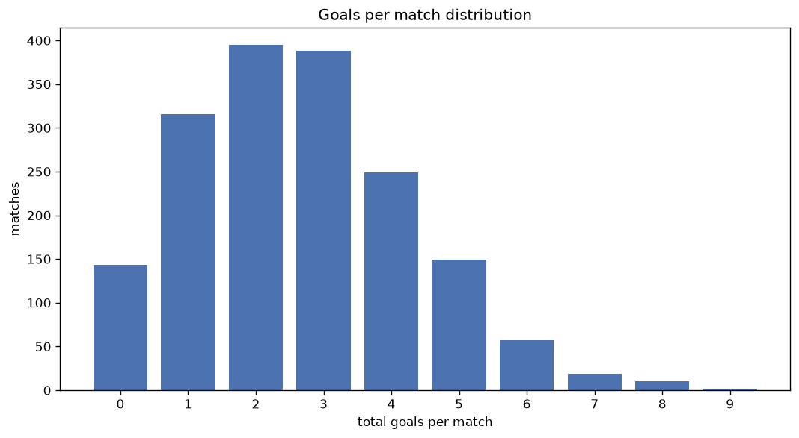
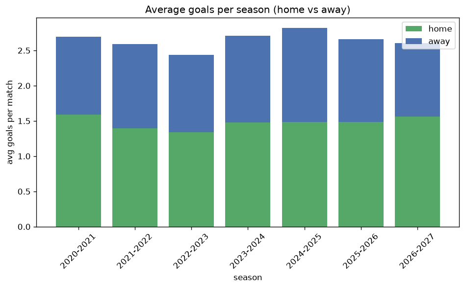

# Goal Analysis
- Report: `goals_analysis`
- Generated: 2026-10-30T04:12:47+00:00
- Script: `backend/scripts/analyze_goals.py` v1.0.0
- League: Mozzart Bet Super Liga (Serbia)
- Scope: league `serbia1`

## 1. Goals per match distribution
| goals | matches | pct |
|---|---|---|
| 0 | 143 | 8.3% |
| 1 | 316 | 18.3% |
| 2 | 395 | 22.9% |
| 3 | 388 | 22.5% |
| 4 | 249 | 14.4% |
| 5 | 149 | 8.6% |
| 6 | 57 | 3.3% |
| 7 | 19 | 1.1% |
| 8 | 10 | 0.6% |
| 9 | 2 | 0.1% |

## 2. Goals per match per season
| season | matches | total goals | avg home | avg away | avg total |
|---|---|---|---|---|---|
| 2020-2021 | 380 | 1024 | 1.587 | 1.108 | 2.695 |
| 2021-2022 | 240 | 621 | 1.396 | 1.192 | 2.587 |
| 2022-2023 | 240 | 585 | 1.342 | 1.096 | 2.438 |
| 2023-2024 | 240 | 650 | 1.479 | 1.229 | 2.708 |
| 2024-2025 | 240 | 677 | 1.488 | 1.333 | 2.821 |
| 2025-2026 | 297 | 790 | 1.488 | 1.172 | 2.66 |
| 2026-2027 | 91 | 237 | 1.56 | 1.044 | 2.604 |

## 3. Home vs away goal share
- Home goals: **2556** (55.8%)
- Away goals: **2028** (44.2%)
- Home/away ratio: **1.26**

| season | home goals | away goals | total | home pct | away pct |
|---|---|---|---|---|---|
| 2020-2021 | 603 | 421 | 1024 | 58.9% | 41.1% |
| 2021-2022 | 335 | 286 | 621 | 53.9% | 46.1% |
| 2022-2023 | 322 | 263 | 585 | 55.0% | 45.0% |
| 2023-2024 | 355 | 295 | 650 | 54.6% | 45.4% |
| 2024-2025 | 357 | 320 | 677 | 52.7% | 47.3% |
| 2025-2026 | 442 | 348 | 790 | 55.9% | 44.1% |
| 2026-2027 | 142 | 95 | 237 | 59.9% | 40.1% |

## 4. BTTS (Both Teams To Score)
- Overall: **837** of `1728` (48.4%)

| season | matches | BTTS | pct |
|---|---|---|---|
| 2020-2021 | 380 | 173 | 45.5% |
| 2021-2022 | 240 | 118 | 49.2% |
| 2022-2023 | 240 | 103 | 42.9% |
| 2023-2024 | 240 | 118 | 49.2% |
| 2024-2025 | 240 | 128 | 53.3% |
| 2025-2026 | 297 | 157 | 52.9% |
| 2026-2027 | 91 | 40 | 44.0% |

## 5. Clean sheets
- Home clean sheets: **611** (35.4%)
- Away clean sheets: **423** (24.5%)
- Total clean sheets recorded: **1034**
- Matches with at least one clean sheet: **891** (51.6%)
- Both teams kept clean sheets (0-0): **143**

| season | matches | home CS | away CS | total CS | matches w/ CS |
|---|---|---|---|---|---|
| 2020-2021 | 380 | 143 | 89 | 232 | 207 (54.5%) |
| 2021-2022 | 240 | 82 | 60 | 142 | 122 (50.8%) |
| 2022-2023 | 240 | 96 | 65 | 161 | 137 (57.1%) |
| 2023-2024 | 240 | 71 | 62 | 133 | 122 (50.8%) |
| 2024-2025 | 240 | 71 | 61 | 132 | 112 (46.7%) |
| 2025-2026 | 297 | 111 | 65 | 176 | 140 (47.1%) |
| 2026-2027 | 91 | 37 | 21 | 58 | 51 (56.0%) |

## 6. Scoring intensity
- First-half goals: **2098** (45.9%)
- Second-half goals: **2475** (54.1%)
- Avg first-half goals per match: **1.217**
- Avg second-half goals per match: **1.436**
- Second-half-only scoring (HT 0-0, FT goals >= 1): **357** (20.7%)
- *4 match(es) excluded (no HT score recorded).*

| season | matches | 1st half | 2nd half | 1st half pct | 2nd half pct |
|---|---|---|---|---|---|
| 2020-2021 | 380 | 471 | 550 | 46.1% | 53.9% |
| 2021-2022 | 240 | 305 | 313 | 49.4% | 50.6% |
| 2022-2023 | 240 | 264 | 321 | 45.1% | 54.9% |
| 2023-2024 | 240 | 283 | 364 | 43.7% | 56.3% |
| 2024-2025 | 240 | 310 | 367 | 45.8% | 54.2% |
| 2025-2026 | 297 | 358 | 430 | 45.4% | 54.6% |
| 2026-2027 | 91 | 107 | 130 | 45.1% | 54.9% |

## 7. First-goal timing
- Matches with first-goal time recorded: `1581` of `1728` (91.5%)
- Goalless matches: `147`
- Min `1` | Max `98` | Mean `30.53` | Median (p50) `25`

| bucket | count | % of matches | % of scoring matches |
|---|---|---|---|
| 1-15 | 509 | 29.5% | 32.2% |
| 16-30 | 399 | 23.1% | 25.2% |
| 31-45 | 295 | 17.1% | 18.7% |
| 46-60 | 183 | 10.6% | 11.6% |
| 61-75 | 108 | 6.2% | 6.8% |
| 76-90 | 69 | 4.0% | 4.4% |
| 91-120 | 18 | 1.0% | 1.1% |

---
*All statistics are computed from PostgreSQL tables (read-only). Run with `python backend/scripts/analyze_goals.py` to regenerate.*

## Charts

