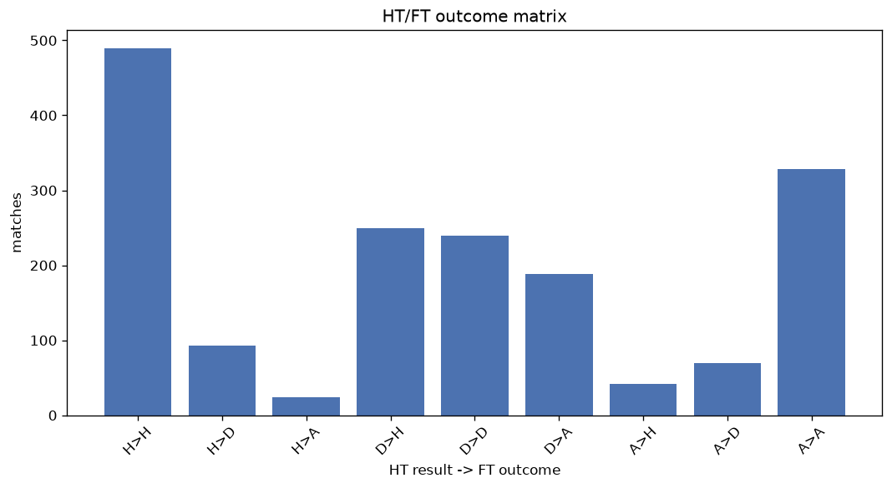
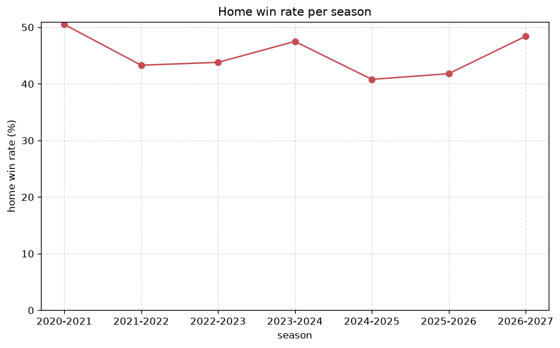

# Match Analysis
- Report: `matches_analysis`
- Generated: 2026-10-29T02:15:36+00:00
- Script: `backend/scripts/analyze_matches.py` v1.0.0
- League: Mozzart Bet Super Liga (Serbia)
- Scope: league `serbia1`

## 1. Overall summary
| metric | value |
|---|---|
| Matches | 1726 |
| Home wins | 781 (45.2%) |
| Draws | 402 (23.3%) |
| Away wins | 543 (31.5%) |
| Total goals | 4576 |
| Average goals per match | 2.651 |
| Goalless matches | 143 (8.3%) |

## 2. Per-season breakdown
| season | matches | home wins | draws | away wins | total goals | avg goals | goalless |
|---|---|---|---|---|---|---|---|
| 2020-2021 | 380 | 192 (50.5%) | 73 (19.2%) | 115 (30.3%) | 1024 | 2.695 | 25 (6.6%) |
| 2021-2022 | 240 | 104 (43.3%) | 58 (24.2%) | 78 (32.5%) | 621 | 2.587 | 20 (8.3%) |
| 2022-2023 | 240 | 105 (43.8%) | 60 (25.0%) | 75 (31.2%) | 585 | 2.438 | 24 (10.0%) |
| 2023-2024 | 240 | 114 (47.5%) | 47 (19.6%) | 79 (32.9%) | 650 | 2.708 | 11 (4.6%) |
| 2024-2025 | 240 | 98 (40.8%) | 56 (23.3%) | 86 (35.8%) | 677 | 2.821 | 20 (8.3%) |
| 2025-2026 | 297 | 124 (41.8%) | 86 (29.0%) | 87 (29.3%) | 790 | 2.66 | 36 (12.1%) |
| 2026-2027 | 89 | 44 (49.4%) | 22 (24.7%) | 23 (25.8%) | 229 | 2.573 | 7 (7.9%) |

## 3. HT/FT outcome matrix
| HT result \ FT result | Home | Draw | Away | total |
|---|---|---|---|---|
| HT home lead | 489 (80.7%) | 93 (15.3%) | 24 (4.0%) | 606 |
| HT draw | 249 (36.8%) | 240 (35.5%) | 188 (27.8%) | 677 |
| HT away lead | 42 (9.6%) | 69 (15.7%) | 328 (74.7%) | 439 |
- *4 match(es) excluded (no HT score recorded).*

## 4. Comeback matches
- Home comebacks (trailing at HT, won at FT): **42** (2.4%)
- Away comebacks (trailing at HT, won at FT): **24** (1.4%)

### Home comebacks
| season | home | away | HT | FT |
|---|---|---|---|---|
| 2020-2021 | Sp. Subotica | Metalac | 0-1 | 4-1 |
| 2020-2021 | Vojvodina | Partizan | 0-1 | 3-2 |
| 2020-2021 | Mladost | Macva | 0-1 | 2-1 |
| 2020-2021 | Vozdovac | Backa | 0-1 | 2-1 |
| 2020-2021 | Crvena zvezda | Radnik | 0-1 | 2-1 |
| 2020-2021 | Mladost | TSC | 0-1 | 2-1 |
| 2020-2021 | Crvena zvezda | Zlatibor Cajetina | 0-1 | 6-1 |
| 2021-2022 | Radnicki Nis | Napredak | 1-2 | 4-2 |
| 2021-2022 | Napredak | Mladost | 0-1 | 2-1 |
| 2021-2022 | Vojvodina | Radnicki 1923 | 0-1 | 3-1 |
| 2021-2022 | Kolubara | TSC | 0-1 | 2-1 |
| 2021-2022 | Sp. Subotica | Kolubara | 0-1 | 4-3 |
| 2022-2023 | Radnicki Nis | Napredak | 1-2 | 3-2 |
| 2022-2023 | Sp. Subotica | Kolubara | 0-1 | 2-1 |
| 2022-2023 | Mladost GAT | Radnik | 0-1 | 2-1 |
| 2022-2023 | Novi Pazar | Javor | 0-1 | 3-1 |
| 2022-2023 | Javor | Napredak | 0-1 | 2-1 |
| 2022-2023 | Radnicki Nis | Mladost | 0-1 | 2-1 |
| 2023-2024 | Partizan | Radnicki Nis | 0-1 | 2-1 |
| 2023-2024 | Vojvodina | Radnicki 1923 | 0-1 | 2-1 |
| 2023-2024 | Partizan | Radnik | 0-2 | 3-2 |
| 2023-2024 | Vojvodina | Javor | 0-1 | 2-1 |
| 2023-2024 | Zeleznicar Pancevo | Napredak | 0-1 | 2-1 |
| 2023-2024 | Cukaricki | Zeleznicar Pancevo | 0-1 | 2-1 |
| 2023-2024 | Cukaricki | Napredak | 0-1 | 2-1 |
| 2023-2024 | Vojvodina | Vozdovac | 0-1 | 2-1 |
| 2023-2024 | Zeleznicar Pancevo | Radnicki Nis | 1-2 | 3-2 |
| 2024-2025 | Mladost | Jedinstvo U. | 0-1 | 2-1 |
| 2024-2025 | Mladost | Radnicki 1923 | 0-1 | 2-1 |
| 2024-2025 | OFK Beograd Mozzart Bet | Partizan | 1-2 | 3-2 |
| 2024-2025 | Cukaricki | Jedinstvo U. | 0-1 | 2-1 |
| 2024-2025 | Napredak | Novi Pazar | 0-1 | 2-1 |
| 2024-2025 | Partizan | Cukaricki | 0-1 | 3-1 |
| 2024-2025 | Radnicki Nis | Novi Pazar | 0-1 | 2-1 |
| 2024-2025 | IMT Novi Beograd | Napredak | 1-2 | 3-2 |
| 2025-2026 | Partizan | Radnicki 1923 | 0-1 | 2-1 |
| 2025-2026 | Crvena zvezda | Radnicki 1923 | 0-1 | 2-1 |
| 2025-2026 | Javor | Radnik | 1-2 | 3-2 |
| 2025-2026 | Vojvodina | Crvena zvezda | 0-2 | 3-2 |
| 2025-2026 | Radnik | Napredak | 0-1 | 2-1 |
| 2026-2027 | Zeleznicar Pancevo | Radnik | 0-1 | 5-1 |
| 2026-2027 | Zeleznicar Pancevo | Cukaricki | 0-1 | 2-1 |

### Away comebacks
| season | home | away | HT | FT |
|---|---|---|---|---|
| 2020-2021 | Napredak | Partizan | 1-0 | 1-3 |
| 2020-2021 | Rad Beograd | Vozdovac | 1-0 | 1-3 |
| 2020-2021 | TSC | Radnik | 1-0 | 1-3 |
| 2020-2021 | Sp. Subotica | Crvena zvezda | 1-0 | 1-2 |
| 2020-2021 | TSC | Napredak | 1-0 | 1-3 |
| 2021-2022 | Vojvodina | Crvena zvezda | 1-0 | 1-2 |
| 2021-2022 | Vojvodina | Cukaricki | 1-0 | 1-2 |
| 2023-2024 | Novi Pazar | IMT Novi Beograd | 2-1 | 3-4 |
| 2023-2024 | IMT Novi Beograd | Partizan | 1-0 | 2-3 |
| 2023-2024 | Mladost | Radnicki Nis | 1-0 | 1-2 |
| 2023-2024 | Zeleznicar Pancevo | Crvena zvezda | 1-0 | 1-2 |
| 2023-2024 | Mladost | IMT Novi Beograd | 1-0 | 1-2 |
| 2024-2025 | Napredak | OFK Beograd Mozzart Bet | 1-0 | 1-3 |
| 2024-2025 | IMT Novi Beograd | Sp. Subotica | 1-0 | 1-2 |
| 2024-2025 | Vojvodina | Crvena zvezda | 2-1 | 3-5 |
| 2025-2026 | Radnicki Nis | Novi Pazar | 2-1 | 2-3 |
| 2025-2026 | TSC | OFK Beograd Mozzart Bet | 1-0 | 1-3 |
| 2025-2026 | Radnik | Radnicki 1923 | 2-0 | 2-3 |
| 2025-2026 | Javor | Partizan | 2-1 | 2-3 |
| 2025-2026 | Sp. Subotica | TSC | 1-0 | 1-2 |
| 2025-2026 | Javor | Vojvodina | 1-0 | 1-2 |
| 2025-2026 | Javor | Mladost | 1-0 | 2-4 |
| 2025-2026 | TSC | Radnicki Nis | 1-0 | 1-2 |
| 2026-2027 | Macva | Mladost | 1-0 | 1-2 |

## 5. HT lead conversion
| HT state | matches | converted to win | held as draw | collapsed to loss |
|---|---|---|---|---|
| Home lead | 606 | 489 (80.7%) | 93 (15.3%) | 24 (4.0%) |
| Away lead | 439 | 328 (74.7%) | 69 (15.7%) | 42 (9.6%) |

### Matches level at half-time
| FT result | count | pct |
|---|---|---|
| Home win | 249 | 36.8% |
| Draw | 240 | 35.5% |
| Away win | 188 | 27.8% |
- *4 match(es) excluded (no HT score recorded).*

## 6. First-goal timing
- Matches with a first-goal time recorded: `1579` of `1726` (91.5%)

Outcome distribution by first-goal timing bucket:
| bucket | matches | % of matches | home | draw | away |
|---|---|---|---|---|---|
| 1-15 | 509 | 29.5% | 244 (47.9%) | 84 (16.5%) | 181 (35.6%) |
| 16-30 | 398 | 23.1% | 192 (48.2%) | 82 (20.6%) | 124 (31.2%) |
| 31-45 | 294 | 17.0% | 149 (50.7%) | 49 (16.7%) | 96 (32.7%) |
| 46-60 | 183 | 10.6% | 91 (49.7%) | 25 (13.7%) | 67 (36.6%) |
| 61-75 | 108 | 6.3% | 58 (53.7%) | 12 (11.1%) | 38 (35.2%) |
| 76-90 | 69 | 4.0% | 37 (53.6%) | 7 (10.1%) | 25 (36.2%) |
| 91-120 | 18 | 1.0% | 9 (50.0%) | 0 (0.0%) | 9 (50.0%) |

## 7. Goalless matches
- Overall: **143** of `1726` (8.3%)

| season | matches | goalless | pct |
|---|---|---|---|
| 2020-2021 | 380 | 25 | 6.6% |
| 2021-2022 | 240 | 20 | 8.3% |
| 2022-2023 | 240 | 24 | 10.0% |
| 2023-2024 | 240 | 11 | 4.6% |
| 2024-2025 | 240 | 20 | 8.3% |
| 2025-2026 | 297 | 36 | 12.1% |
| 2026-2027 | 89 | 7 | 7.9% |

---
*All statistics are computed from PostgreSQL tables (read-only). Run with `python backend/scripts/analyze_matches.py` to regenerate.*

## Charts

