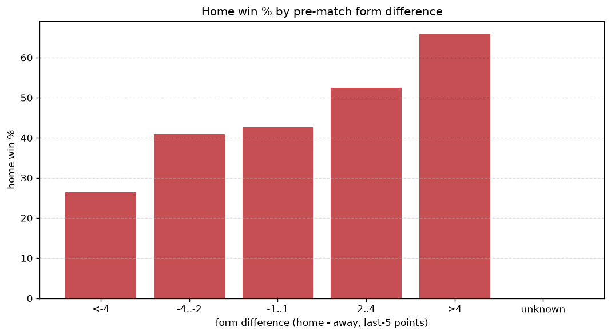
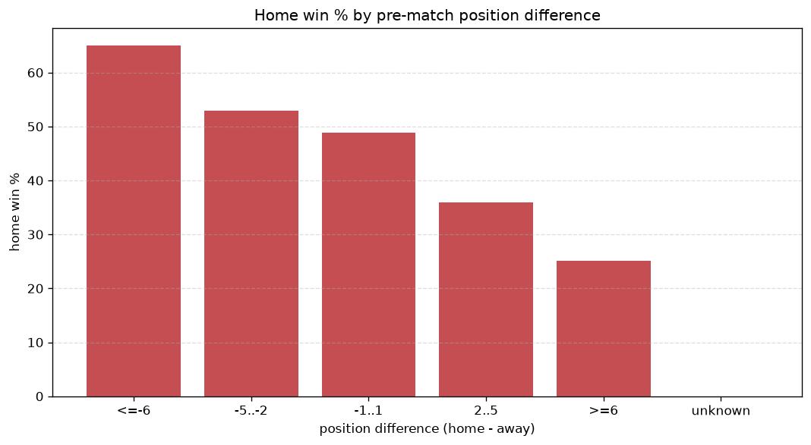

# Relationships Analysis
- Report: `relationships`
- Generated: 2026-10-26T01:48:49+00:00
- Script: `backend/scripts/analyze_relationships.py` v1.0.0
- League: Mozzart Bet Super Liga (Serbia)
- Scope: league `serbia1`

- Matches analysed: **1637** (23 leakage-safe pre-match features).

## 1. Correlation matrix
_Pearson correlation of each pre-match feature with observed goals; sorted by |corr(total goals)|._

| feature | corr(home) | corr(away) | corr(total) |
|---|---|---|---|
| home_team_home_goals_avg | 0.255 | -0.113 | 0.118 |
| home_team_goals_scored_last_5 | 0.256 | -0.120 | 0.113 |
| home_position_before_match | -0.255 | 0.155 | -0.086 |
| home_team_wins_last_5 | 0.223 | -0.133 | 0.078 |
| home_team_goals_conceded_last_5 | -0.148 | 0.056 | -0.076 |
| home_team_points_last_5 | 0.212 | -0.131 | 0.071 |
| away_team_away_conceded_avg | 0.066 | -0.168 | -0.070 |
| home_team_home_win_rate | 0.184 | -0.102 | 0.070 |
| away_team_goals_scored_last_5 | -0.140 | 0.243 | 0.068 |
| home_team_home_conceded_avg | -0.146 | 0.071 | -0.063 |
| away_team_away_win_rate | -0.159 | 0.257 | 0.062 |
| away_team_wins_last_5 | -0.122 | 0.215 | 0.061 |
| away_position_before_match | 0.155 | -0.249 | -0.060 |
| away_team_goals_conceded_last_5 | 0.075 | -0.154 | -0.053 |
| away_team_points_last_5 | -0.132 | 0.208 | 0.048 |
| rest_days_difference | -0.030 | -0.024 | -0.041 |
| home_rest_days | -0.040 | -0.007 | -0.036 |
| away_team_away_goals_avg | -0.182 | 0.244 | 0.036 |
| home_points_before_match | 0.144 | -0.116 | 0.029 |
| away_rest_days | -0.033 | -0.001 | -0.026 |
| points_difference | 0.320 | -0.313 | 0.022 |
| position_difference | -0.303 | 0.298 | -0.020 |
| away_points_before_match | -0.125 | 0.148 | 0.010 |

## 2. Form vs outcome
_Home win/draw/away % per bucket of `home_team_points_last_5 - away_team_points_last_5`._

| bucket | matches | home | draw | away | home % | draw % | away % |
|---|---|---|---|---|---|---|---|
| <-4 | 292 | 77 | 56 | 159 | 26.4% | 19.2% | 54.5% |
| -4..-2 | 330 | 135 | 74 | 121 | 40.9% | 22.4% | 36.7% |
| -1..1 | 448 | 191 | 117 | 140 | 42.6% | 26.1% | 31.2% |
| 2..4 | 295 | 155 | 76 | 64 | 52.5% | 25.8% | 21.7% |
| >4 | 272 | 179 | 57 | 36 | 65.8% | 21.0% | 13.2% |
| unknown | 0 | 0 | 0 | 0 | - | - | - |

## 3. Position vs outcome
_Home win/draw/away % per bucket of `position_difference` (home position - away position; negative favours the home team)._

| bucket | matches | home | draw | away | home % | draw % | away % |
|---|---|---|---|---|---|---|---|
| <=-6 | 326 | 212 | 70 | 44 | 65.0% | 21.5% | 13.5% |
| -5..-2 | 344 | 182 | 94 | 68 | 52.9% | 27.3% | 19.8% |
| -1..1 | 272 | 133 | 64 | 75 | 48.9% | 23.5% | 27.6% |
| 2..5 | 329 | 118 | 73 | 138 | 35.9% | 22.2% | 41.9% |
| >=6 | 366 | 92 | 79 | 195 | 25.1% | 21.6% | 53.3% |
| unknown | 0 | 0 | 0 | 0 | - | - | - |

## 4. Rest advantage
_Home win/draw/away % per bucket of `rest_days_difference` (home rest - away rest). Matches with unknown rest are bucketed separately._

| bucket | matches | home | draw | away | home % | draw % | away % |
|---|---|---|---|---|---|---|---|
| <-1 | 164 | 81 | 30 | 53 | 49.4% | 18.3% | 32.3% |
| -1..0 | 334 | 147 | 83 | 104 | 44.0% | 24.9% | 31.1% |
| 0 | 563 | 251 | 141 | 171 | 44.6% | 25.0% | 30.4% |
| 1..2 | 456 | 199 | 104 | 153 | 43.6% | 22.8% | 33.6% |
| >2 | 69 | 34 | 10 | 25 | 49.3% | 14.5% | 36.2% |
| unknown | 51 | 25 | 12 | 14 | 49.0% | 23.5% | 27.5% |
- *51 match(es) had unknown rest difference (missing rest data on at least one side).*

## 5. Home team quality
_Home win rate by `home_team_home_win_rate` tier (split at 0.5)._

- `< 0.5` tier: **39.6%** home win (359/906)
- `>= 0.5` tier: **51.7%** home win (378/731)
- Home-win gap (>= split minus < split): **+12.1 pp**

| tier | label | matches | home | draw | away | home % |
|---|---|---|---|---|---|---|
| low | < 0.5 | 906 | 359 | 212 | 335 | 39.6% |
| high | >= 0.5 | 731 | 378 | 168 | 185 | 51.7% |

## 6. Feature averages by result
_Mean feature value per outcome; `range` is home-minus-away spread of the group means._

| feature | home mean | draw mean | away mean | range |
|---|---|---|---|---|
| points_difference | 5.061 | -0.132 | -7.600 | 12.661 |
| away_points_before_match | 19.513 | 22.547 | 26.519 | 7.006 |
| home_points_before_match | 24.574 | 22.416 | 18.919 | 5.655 |
| position_difference | -2.079 | 0.053 | 3.488 | 5.567 |
| away_position_before_match | 10.156 | 9.239 | 7.279 | 2.877 |
| home_position_before_match | 8.077 | 9.292 | 10.767 | 2.690 |
| away_team_goals_scored_last_5 | 5.342 | 5.779 | 7.285 | 1.943 |
| away_team_points_last_5 | 5.712 | 6.050 | 7.535 | 1.822 |
| home_team_goals_scored_last_5 | 6.855 | 5.539 | 5.098 | 1.757 |
| home_team_points_last_5 | 6.967 | 6.047 | 5.262 | 1.706 |
| away_team_goals_conceded_last_5 | 6.351 | 6.134 | 5.321 | 1.030 |
| home_team_goals_conceded_last_5 | 5.799 | 5.945 | 6.560 | 0.760 |
| away_team_wins_last_5 | 1.550 | 1.671 | 2.177 | 0.627 |
| home_team_wins_last_5 | 1.996 | 1.645 | 1.381 | 0.615 |
| home_rest_days | 8.468 | 9.076 | 8.901 | 0.608 |
| away_rest_days | 8.458 | 9.041 | 8.881 | 0.583 |
| away_team_away_goals_avg | 0.951 | 1.125 | 1.439 | 0.489 |
| home_team_home_goals_avg | 1.624 | 1.367 | 1.256 | 0.368 |
| away_team_away_conceded_avg | 1.543 | 1.478 | 1.292 | 0.251 |
| home_team_home_conceded_avg | 1.066 | 1.121 | 1.250 | 0.184 |
| away_team_away_win_rate | 0.231 | 0.289 | 0.393 | 0.162 |
| home_team_home_win_rate | 0.480 | 0.433 | 0.377 | 0.103 |
| rest_days_difference | 0.010 | 0.033 | 0.020 | 0.023 |

---
*All features are leakage-safe pre-match values built by `ml.features.build_features.build_rows` from strictly prior matches. Run with `python backend/scripts/analyze_relationships.py` to regenerate.*

## Charts

