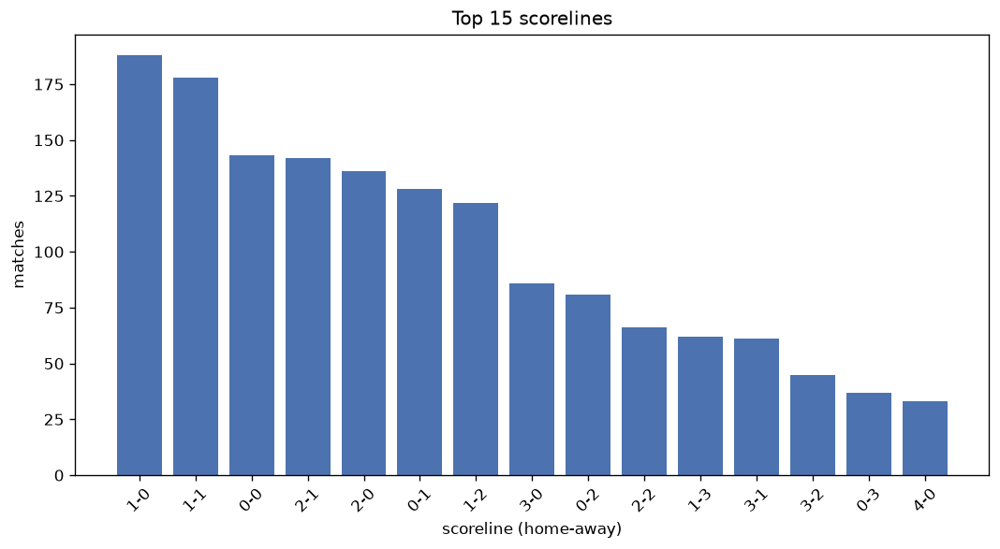
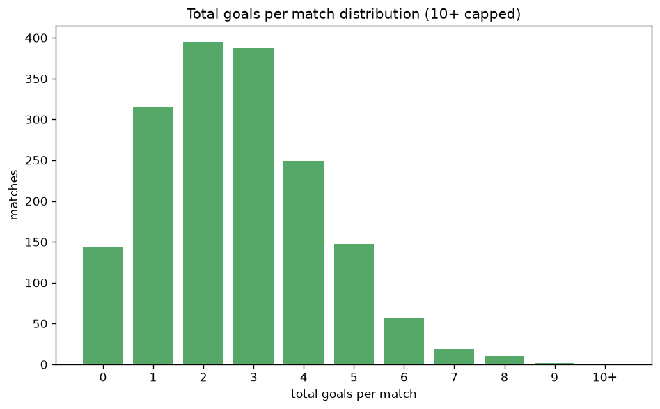

# Scoreline Analysis
- Report: `scoreline_analysis`
- Generated: 2026-10-27T02:30:56+00:00
- Script: `backend/scripts/analyze_scorelines.py` v1.0.0
- League: Mozzart Bet Super Liga (Serbia)
- Scope: league `serbia1`

## 1. Scoreline frequency
- Matches analysed: **1726** across **7** seasons.
- Distinct scorelines seen: **40**.

| scoreline | count | pct |
|---|---|---|
| 1-0 | 188 | 10.9% |
| 1-1 | 178 | 10.3% |
| 0-0 | 143 | 8.3% |
| 2-1 | 142 | 8.2% |
| 2-0 | 136 | 7.9% |
| 0-1 | 128 | 7.4% |
| 1-2 | 122 | 7.1% |
| 3-0 | 86 | 5.0% |
| 0-2 | 81 | 4.7% |
| 2-2 | 66 | 3.8% |
| 1-3 | 62 | 3.6% |
| 3-1 | 61 | 3.5% |
| 3-2 | 45 | 2.6% |
| 0-3 | 37 | 2.1% |
| 4-0 | 33 | 1.9% |
| 4-1 | 31 | 1.8% |
| 2-3 | 27 | 1.6% |
| 0-4 | 27 | 1.6% |
| 1-4 | 22 | 1.3% |
| 5-0 | 18 | 1.0% |

## 2. Scoreline frequency per season

### 2020-2021
| scoreline | count | pct |
|---|---|---|
| 1-0 | 43 | 11.3% |
| 2-1 | 35 | 9.2% |
| 1-1 | 34 | 8.9% |
| 0-1 | 31 | 8.2% |
| 2-0 | 30 | 7.9% |

### 2021-2022
| scoreline | count | pct |
|---|---|---|
| 1-1 | 30 | 12.5% |
| 1-0 | 26 | 10.8% |
| 2-1 | 21 | 8.8% |
| 1-2 | 21 | 8.8% |
| 0-0 | 20 | 8.3% |

### 2022-2023
| scoreline | count | pct |
|---|---|---|
| 1-0 | 33 | 13.8% |
| 1-1 | 26 | 10.8% |
| 0-0 | 24 | 10.0% |
| 2-0 | 19 | 7.9% |
| 0-1 | 19 | 7.9% |

### 2023-2024
| scoreline | count | pct |
|---|---|---|
| 1-0 | 26 | 10.8% |
| 2-1 | 25 | 10.4% |
| 1-1 | 22 | 9.2% |
| 0-1 | 21 | 8.8% |
| 2-0 | 16 | 6.7% |

### 2024-2025
| scoreline | count | pct |
|---|---|---|
| 1-1 | 24 | 10.0% |
| 0-1 | 21 | 8.8% |
| 1-2 | 20 | 8.3% |
| 2-0 | 20 | 8.3% |
| 0-0 | 20 | 8.3% |

### 2025-2026
| scoreline | count | pct |
|---|---|---|
| 0-0 | 36 | 12.1% |
| 1-1 | 33 | 11.1% |
| 1-0 | 32 | 10.8% |
| 2-0 | 24 | 8.1% |
| 2-1 | 22 | 7.4% |

### 2026-2027
| scoreline | count | pct |
|---|---|---|
| 1-0 | 12 | 13.5% |
| 1-1 | 9 | 10.1% |
| 2-0 | 8 | 9.0% |
| 2-1 | 7 | 7.9% |
| 0-1 | 7 | 7.9% |

## 3. Total-goal histogram
_10+ groups all matches with 10 or more total goals._

| total goals | matches | pct |
|---|---|---|
| 0 | 143 | 8.3% |
| 1 | 316 | 18.3% |
| 2 | 395 | 22.9% |
| 3 | 387 | 22.4% |
| 4 | 249 | 14.4% |
| 5 | 148 | 8.6% |
| 6 | 57 | 3.3% |
| 7 | 19 | 1.1% |
| 8 | 10 | 0.6% |
| 9 | 2 | 0.1% |
| 10+ | 0 | 0.0% |

## 4. Extreme scorelines
- Matches with 7+ total goals: **31**

| season | date | scoreline | total goals |
|---|---|---|---|
| 2023-2024 | 2023-09-16 | 6-3 | 9 |
| 2025-2026 | 2025-08-10 | 2-7 | 9 |
| 2020-2021 | 2021-05-15 | 7-1 | 8 |
| 2021-2022 | 2021-08-14 | 4-4 | 8 |
| 2021-2022 | 2021-10-16 | 1-7 | 8 |
| 2024-2025 | 2024-08-25 | 3-5 | 8 |
| 2024-2025 | 2024-12-15 | 1-7 | 8 |
| 2024-2025 | 2025-03-29 | 3-5 | 8 |
| 2025-2026 | 2025-07-26 | 7-1 | 8 |
| 2025-2026 | 2025-09-14 | 7-1 | 8 |
| 2026-2027 | 2026-09-19 | 4-4 | 8 |
| 2026-2027 | 2026-09-19 | 3-5 | 8 |
| 2020-2021 | 2020-10-16 | 7-0 | 7 |
| 2020-2021 | 2020-12-06 | 3-4 | 7 |
| 2020-2021 | 2021-05-09 | 2-5 | 7 |
| 2020-2021 | 2021-05-09 | 6-1 | 7 |
| 2021-2022 | 2021-10-22 | 6-1 | 7 |
| 2021-2022 | 2021-12-19 | 5-2 | 7 |
| 2021-2022 | 2022-04-09 | 4-3 | 7 |
| 2022-2023 | 2022-09-16 | 2-5 | 7 |
| 2023-2024 | 2023-08-14 | 3-4 | 7 |
| 2023-2024 | 2024-02-17 | 5-2 | 7 |
| 2023-2024 | 2024-04-02 | 3-4 | 7 |
| 2024-2025 | 2024-09-21 | 5-2 | 7 |
| 2024-2025 | 2024-09-28 | 4-3 | 7 |
| 2024-2025 | 2024-10-21 | 3-4 | 7 |
| 2024-2025 | 2024-12-22 | 5-2 | 7 |
| 2025-2026 | 2025-09-14 | 2-5 | 7 |
| 2025-2026 | 2025-10-19 | 6-1 | 7 |
| 2025-2026 | 2025-11-30 | 3-4 | 7 |
| 2025-2026 | 2026-05-10 | 6-1 | 7 |

## 5. Margin-of-victory distribution (decided matches)
- Decided matches: **1324** (draws: **402**)
- Average winning margin: **1.87**

| margin | matches | pct |
|---|---|---|
| 1 | 659 | 49.8% |
| 2 | 359 | 27.1% |
| 3+ | 306 | 23.1% |

## 6. Margin by outcome

### Home wins
- Matches: **781** | avg margin: **1.92** | max margin: **7**
| margin | matches | pct |
|---|---|---|
| 1 | 377 | 48.3% |
| 2 | 206 | 26.4% |
| 3+ | 198 | 25.4% |
- *Full match-by-match list available in `scoreline_analysis.json`.*

### Away wins
- Matches: **543** | avg margin: **1.79** | max margin: **6**
| margin | matches | pct |
|---|---|---|
| 1 | 282 | 51.9% |
| 2 | 153 | 28.2% |
| 3+ | 108 | 19.9% |
- *Full match-by-match list available in `scoreline_analysis.json`.*

## 7. Most common exact score by outcome type
| outcome | matches | most common score | count | pct |
|---|---|---|---|---|
| home | 781 | 1-0 | 188 | 24.1% |
| draw | 402 | 1-1 | 178 | 44.3% |
| away | 543 | 0-1 | 128 | 23.6% |

---
*All statistics are computed from PostgreSQL tables (read-only). Run with `python backend/scripts/analyze_scorelines.py` to regenerate.*

## Charts

