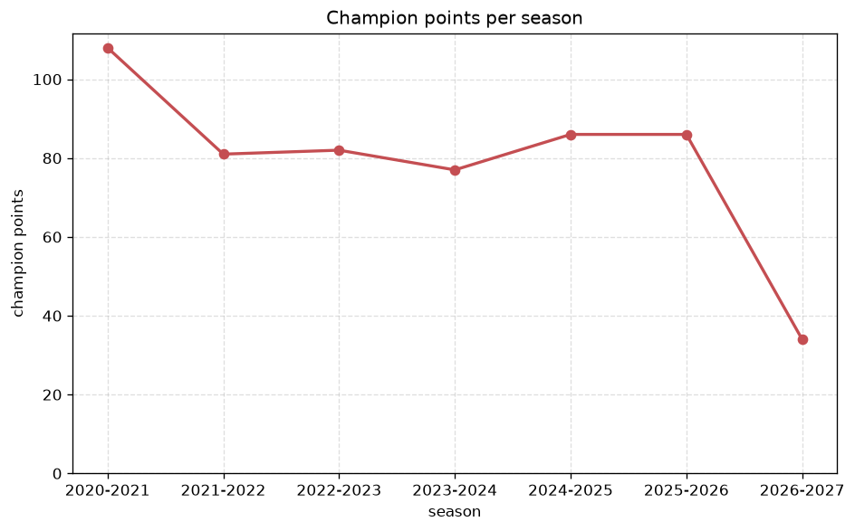
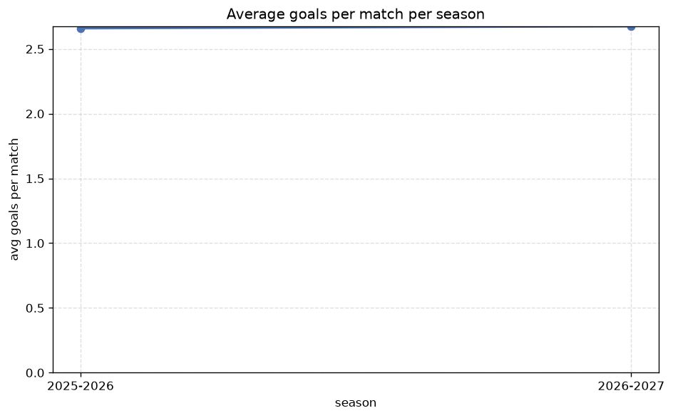

# Season Trends Analysis
- Report: `season_trends`
- Generated: 2026-10-29T02:15:41+00:00
- Script: `backend/scripts/analyze_seasons.py` v1.0.0
- League: Mozzart Bet Super Liga (Serbia)
- Scope: league `serbia1`

## 1. Champions per season
| season | champion | pts | runner-up | margin |
|---|---|---|---|---|
| 2020-2021 | Crvena zvezda | 108 | Partizan | 13 pts |
| 2021-2022 | Crvena zvezda | 81 | Partizan | 2 pts |
| 2022-2023 | Crvena zvezda | 82 | TSC | 20 pts |
| 2023-2024 | Crvena zvezda | 77 | Partizan | 7 pts |
| 2024-2025 | Crvena zvezda | 86 | Partizan | 23 pts |
| 2025-2026 | Crvena zvezda | 86 | Vojvodina | 10 pts |
| 2026-2027 | Crvena zvezda | 37 | Vojvodina | 8 pts |

## 2. Title-race tightness
- Tight races (margin <= 3 pts): **1** of 7 seasons
- Tightest race: **2021-2022** - Crvena zvezda beat Partizan by **2** pts

| season | margin | tight |
|---|---|---|
| 2020-2021 | 13 pts |  |
| 2021-2022 | 2 pts | yes |
| 2022-2023 | 20 pts |  |
| 2023-2024 | 7 pts |  |
| 2024-2025 | 23 pts |  |
| 2025-2026 | 10 pts |  |
| 2026-2027 | 8 pts |  |

## 3. Points thresholds
_Position-specific points per season. Key: 1 = champion, 2 = runner-up, 4 = CL line, 6 = Europa, 11 = last safe, 14 = bottom._

| season | pos 1 | pos 2 | pos 4 | pos 6 | pos 11 | pos 14 |
|---|---|---|---|---|---|---|
| 2020-2021 | 108 | 95 | 71 | 55 | 50 | 48 |
| 2021-2022 | 81 | 79 | 41 | 40 | 34 | 29 |
| 2022-2023 | 82 | 62 | 57 | 50 | 29 | 23 |
| 2023-2024 | 77 | 70 | 50 | 48 | 33 | 30 |
| 2024-2025 | 86 | 63 | 45 | 42 | 35 | 32 |
| 2025-2026 | 86 | 76 | 59 | 50 | 46 | 42 |
| 2026-2027 | 37 | 29 | 21 | 18 | 11 | 6 |

## 4. Relegation battle
| season | safe pos | safe pts | drop pos | drop pts | gap |
|---|---|---|---|---|---|
| 2020-2021 | 11 | 50 | 12 | 49 | 1 pts |
| 2021-2022 | 11 | 34 | 12 | 34 | 0 pts |
| 2022-2023 | 11 | 29 | 12 | 29 | 0 pts |
| 2023-2024 | 11 | 33 | 12 | 32 | 1 pts |
| 2024-2025 | 11 | 35 | 12 | 35 | 0 pts |
| 2025-2026 | 11 | 46 | 12 | 45 | 1 pts |
| 2026-2027 | 11 | 11 | 12 | 10 | 1 pts |

## 5. League-level trends
| season | matches | total goals | avg goals | home win | draw | away win | goalless | avg pts/team |
|---|---|---|---|---|---|---|---|---|
| 2020-2021 | 380 | 1024 | 2.695 | 50.5% | 19.2% | 30.3% | 6.6% | 53.35 |
| 2021-2022 | 240 | 621 | 2.587 | 43.3% | 24.2% | 32.5% | 8.3% | 41.38 |
| 2022-2023 | 240 | 585 | 2.438 | 43.8% | 25.0% | 31.2% | 10.0% | 41.25 |
| 2023-2024 | 240 | 650 | 2.708 | 47.5% | 19.6% | 32.9% | 4.6% | 42.06 |
| 2024-2025 | 240 | 677 | 2.821 | 40.8% | 23.3% | 35.8% | 8.3% | 41.5 |
| 2025-2026 | 297 | 790 | 2.66 | 41.8% | 29.0% | 29.3% | 12.1% | 50.31 |
| 2026-2027 | 89 | 229 | 2.573 | 49.4% | 24.7% | 25.8% | 7.9% | 17.5 |

## 6. View divergence
- Largest divergence: **2021-2022** (goals view, avg abs position diff = 4.875)

_Avg absolute position difference between classic view and alternative view per season._

| season | classic vs luck | classic vs goals |
|---|---|---|
| 2020-2021 | 3.500 | 4.400 |
| 2021-2022 | 3.500 | 4.875 |
| 2022-2023 | 2.375 | 4.000 |
| 2023-2024 | 2.250 | 3.125 |
| 2024-2025 | 4.000 | 4.000 |
| 2025-2026 | 2.375 | 4.375 |
| 2026-2027 | 1.286 | 3.857 |

---
*All statistics are computed from PostgreSQL tables (read-only). Run with `python backend/scripts/analyze_seasons.py` to regenerate.*

## Charts

