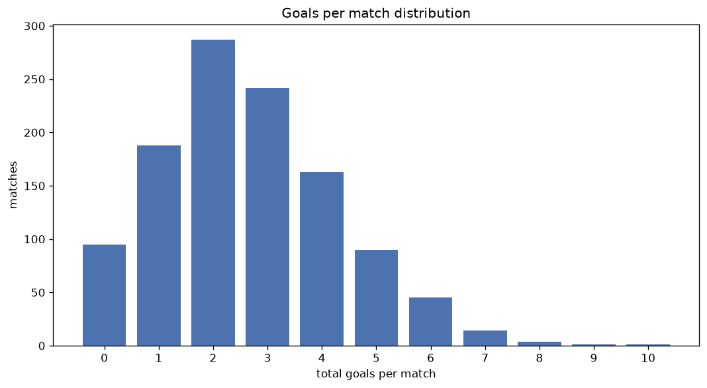
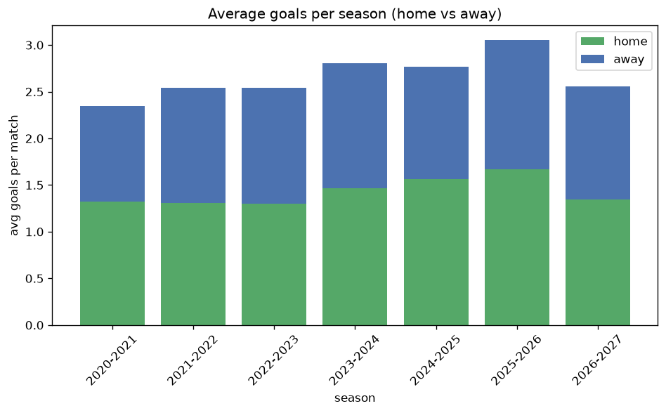

# Goal Analysis
- Report: `goals_analysis`
- Generated: 2026-10-30T04:12:58+00:00
- Script: `backend/scripts/analyze_goals.py` v1.0.0
- League: Prva liga (Slovenia)
- Scope: league `slovenia1`

## 1. Goals per match distribution
| goals | matches | pct |
|---|---|---|
| 0 | 95 | 8.4% |
| 1 | 188 | 16.6% |
| 2 | 287 | 25.4% |
| 3 | 242 | 21.4% |
| 4 | 163 | 14.4% |
| 5 | 90 | 8.0% |
| 6 | 45 | 4.0% |
| 7 | 14 | 1.2% |
| 8 | 4 | 0.4% |
| 9 | 1 | 0.1% |
| 10 | 1 | 0.1% |

## 2. Goals per match per season
| season | matches | total goals | avg home | avg away | avg total |
|---|---|---|---|---|---|
| 2020-2021 | 180 | 422 | 1.322 | 1.022 | 2.344 |
| 2021-2022 | 180 | 457 | 1.311 | 1.228 | 2.539 |
| 2022-2023 | 180 | 457 | 1.3 | 1.239 | 2.539 |
| 2023-2024 | 180 | 505 | 1.467 | 1.339 | 2.806 |
| 2024-2025 | 180 | 498 | 1.561 | 1.206 | 2.767 |
| 2025-2026 | 164 | 501 | 1.665 | 1.39 | 3.055 |
| 2026-2027 | 66 | 169 | 1.348 | 1.212 | 2.561 |

## 3. Home vs away goal share
- Home goals: **1615** (53.7%)
- Away goals: **1394** (46.3%)
- Home/away ratio: **1.159**

| season | home goals | away goals | total | home pct | away pct |
|---|---|---|---|---|---|
| 2020-2021 | 238 | 184 | 422 | 56.4% | 43.6% |
| 2021-2022 | 236 | 221 | 457 | 51.6% | 48.4% |
| 2022-2023 | 234 | 223 | 457 | 51.2% | 48.8% |
| 2023-2024 | 264 | 241 | 505 | 52.3% | 47.7% |
| 2024-2025 | 281 | 217 | 498 | 56.4% | 43.6% |
| 2025-2026 | 273 | 228 | 501 | 54.5% | 45.5% |
| 2026-2027 | 89 | 80 | 169 | 52.7% | 47.3% |

## 4. BTTS (Both Teams To Score)
- Overall: **587** of `1130` (51.9%)

| season | matches | BTTS | pct |
|---|---|---|---|
| 2020-2021 | 180 | 85 | 47.2% |
| 2021-2022 | 180 | 89 | 49.4% |
| 2022-2023 | 180 | 88 | 48.9% |
| 2023-2024 | 180 | 105 | 58.3% |
| 2024-2025 | 180 | 92 | 51.1% |
| 2025-2026 | 164 | 95 | 57.9% |
| 2026-2027 | 66 | 33 | 50.0% |

## 5. Clean sheets
- Home clean sheets: **341** (30.2%)
- Away clean sheets: **297** (26.3%)
- Total clean sheets recorded: **638**
- Matches with at least one clean sheet: **543** (48.1%)
- Both teams kept clean sheets (0-0): **95**

| season | matches | home CS | away CS | total CS | matches w/ CS |
|---|---|---|---|---|---|
| 2020-2021 | 180 | 66 | 53 | 119 | 95 (52.8%) |
| 2021-2022 | 180 | 54 | 52 | 106 | 91 (50.6%) |
| 2022-2023 | 180 | 50 | 58 | 108 | 92 (51.1%) |
| 2023-2024 | 180 | 45 | 40 | 85 | 75 (41.7%) |
| 2024-2025 | 180 | 58 | 43 | 101 | 88 (48.9%) |
| 2025-2026 | 164 | 45 | 32 | 77 | 69 (42.1%) |
| 2026-2027 | 66 | 23 | 19 | 42 | 33 (50.0%) |

## 6. Scoring intensity
- First-half goals: **1351** (45.1%)
- Second-half goals: **1646** (54.9%)
- Avg first-half goals per match: **1.2**
- Avg second-half goals per match: **1.462**
- Second-half-only scoring (HT 0-0, FT goals >= 1): **209** (18.5%)
- *4 match(es) excluded (no HT score recorded).*

| season | matches | 1st half | 2nd half | 1st half pct | 2nd half pct |
|---|---|---|---|---|---|
| 2020-2021 | 180 | 189 | 230 | 45.1% | 54.9% |
| 2021-2022 | 180 | 208 | 249 | 45.5% | 54.5% |
| 2022-2023 | 180 | 206 | 251 | 45.1% | 54.9% |
| 2023-2024 | 180 | 226 | 273 | 45.3% | 54.7% |
| 2024-2025 | 180 | 222 | 276 | 44.6% | 55.4% |
| 2025-2026 | 164 | 228 | 270 | 45.8% | 54.2% |
| 2026-2027 | 66 | 72 | 97 | 42.6% | 57.4% |

## 7. First-goal timing
- Matches with first-goal time recorded: `1031` of `1130` (91.2%)
- Goalless matches: `99`
- Min `1` | Max `95` | Mean `29.59` | Median (p50) `25`

| bucket | count | % of matches | % of scoring matches |
|---|---|---|---|
| 1-15 | 355 | 31.4% | 34.4% |
| 16-30 | 260 | 23.0% | 25.2% |
| 31-45 | 192 | 17.0% | 18.6% |
| 46-60 | 110 | 9.7% | 10.7% |
| 61-75 | 62 | 5.5% | 6.0% |
| 76-90 | 34 | 3.0% | 3.3% |
| 91-120 | 18 | 1.6% | 1.7% |

---
*All statistics are computed from PostgreSQL tables (read-only). Run with `python backend/scripts/analyze_goals.py` to regenerate.*

## Charts

