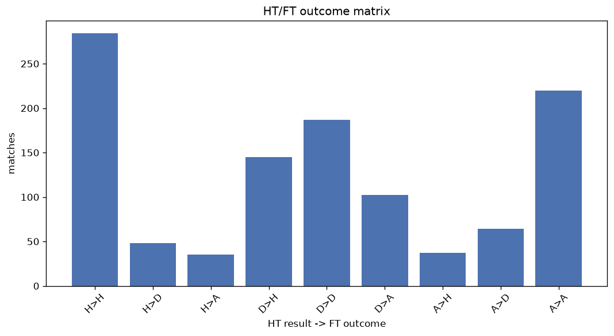
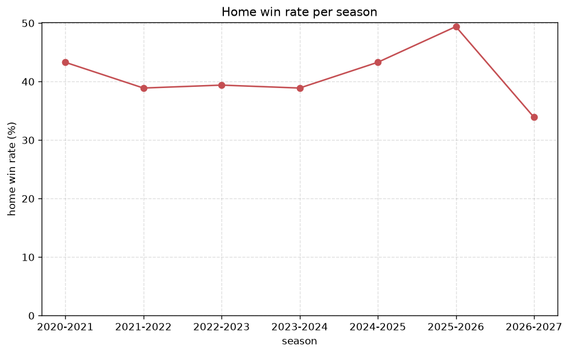

# Match Analysis
- Report: `matches_analysis`
- Generated: 2026-10-26T01:48:57+00:00
- Script: `backend/scripts/analyze_matches.py` v1.0.0
- League: Prva liga (Slovenia)
- Scope: league `slovenia1`

## 1. Overall summary
| metric | value |
|---|---|
| Matches | 1126 |
| Home wins | 469 (41.7%) |
| Draws | 299 (26.6%) |
| Away wins | 358 (31.8%) |
| Total goals | 3001 |
| Average goals per match | 2.665 |
| Goalless matches | 94 (8.3%) |

## 2. Per-season breakdown
| season | matches | home wins | draws | away wins | total goals | avg goals | goalless |
|---|---|---|---|---|---|---|---|
| 2020-2021 | 180 | 78 (43.3%) | 54 (30.0%) | 48 (26.7%) | 422 | 2.344 | 24 (13.3%) |
| 2021-2022 | 180 | 70 (38.9%) | 48 (26.7%) | 62 (34.4%) | 457 | 2.539 | 15 (8.3%) |
| 2022-2023 | 180 | 71 (39.4%) | 53 (29.4%) | 56 (31.1%) | 457 | 2.539 | 16 (8.9%) |
| 2023-2024 | 180 | 70 (38.9%) | 46 (25.6%) | 64 (35.6%) | 505 | 2.806 | 10 (5.6%) |
| 2024-2025 | 180 | 78 (43.3%) | 47 (26.1%) | 55 (30.6%) | 498 | 2.767 | 13 (7.2%) |
| 2025-2026 | 164 | 81 (49.4%) | 30 (18.3%) | 53 (32.3%) | 501 | 3.055 | 8 (4.9%) |
| 2026-2027 | 62 | 21 (33.9%) | 21 (33.9%) | 20 (32.3%) | 161 | 2.597 | 8 (12.9%) |

## 3. HT/FT outcome matrix
| HT result \ FT result | Home | Draw | Away | total |
|---|---|---|---|---|
| HT home lead | 284 (77.4%) | 48 (13.1%) | 35 (9.5%) | 367 |
| HT draw | 145 (33.4%) | 187 (43.1%) | 102 (23.5%) | 434 |
| HT away lead | 37 (11.5%) | 64 (19.9%) | 220 (68.5%) | 321 |
- *4 match(es) excluded (no HT score recorded).*

## 4. Comeback matches
- Home comebacks (trailing at HT, won at FT): **37** (3.3%)
- Away comebacks (trailing at HT, won at FT): **35** (3.1%)

### Home comebacks
| season | home | away | HT | FT |
|---|---|---|---|---|
| 2020-2021 | Maribor | Domzale | 0-1 | 4-3 |
| 2020-2021 | Domzale | Tabor Sezana | 0-1 | 2-1 |
| 2020-2021 | Maribor | Tabor Sezana | 0-1 | 2-1 |
| 2020-2021 | Mura | Koper | 0-1 | 2-1 |
| 2021-2022 | Bravo | Celje | 0-1 | 2-1 |
| 2021-2022 | Maribor | Aluminij | 0-1 | 3-1 |
| 2022-2023 | Mura | Domzale | 1-3 | 4-3 |
| 2022-2023 | O. Ljubljana | Domzale | 0-2 | 3-2 |
| 2022-2023 | Domzale | Radomlje | 0-1 | 3-1 |
| 2022-2023 | Celje | O. Ljubljana | 0-2 | 4-3 |
| 2022-2023 | Celje | Domzale | 0-1 | 2-1 |
| 2022-2023 | Mura | Celje | 0-1 | 3-1 |
| 2022-2023 | Tabor Sezana | Radomlje | 0-1 | 2-1 |
| 2022-2023 | Bravo | Tabor Sezana | 0-1 | 2-1 |
| 2022-2023 | Radomlje | O. Ljubljana | 0-1 | 2-1 |
| 2022-2023 | Mura | ND Gorica | 1-2 | 4-2 |
| 2023-2024 | Domzale | Aluminij | 0-1 | 2-1 |
| 2023-2024 | Bravo | O. Ljubljana | 1-2 | 4-2 |
| 2023-2024 | Maribor | Radomlje | 0-1 | 3-1 |
| 2023-2024 | Koper | Aluminij | 0-1 | 2-1 |
| 2024-2025 | Celje | Bravo | 0-1 | 2-1 |
| 2024-2025 | Nafta | Radomlje | 0-1 | 2-1 |
| 2024-2025 | Celje | Mura | 0-1 | 4-3 |
| 2024-2025 | Radomlje | Celje | 0-1 | 4-2 |
| 2024-2025 | Nafta | Radomlje | 0-1 | 2-1 |
| 2024-2025 | Maribor | Koper | 1-2 | 4-2 |
| 2024-2025 | Celje | Mura | 0-1 | 2-1 |
| 2025-2026 | Primorje | Domzale | 0-1 | 3-2 |
| 2025-2026 | Radomlje | O. Ljubljana | 0-2 | 3-2 |
| 2025-2026 | Aluminij | Celje | 0-1 | 2-1 |
| 2025-2026 | Bravo | Primorje | 0-1 | 2-1 |
| 2025-2026 | Bravo | Radomlje | 0-1 | 2-1 |
| 2025-2026 | Bravo | O. Ljubljana | 0-1 | 2-1 |
| 2026-2027 | Aluminij | Grosuplje | 1-2 | 4-2 |
| 2026-2027 | Maribor | Bravo | 0-1 | 3-1 |
| 2026-2027 | Bravo | Celje | 0-1 | 2-1 |
| 2026-2027 | Grosuplje | Radomlje | 0-1 | 2-1 |

### Away comebacks
| season | home | away | HT | FT |
|---|---|---|---|---|
| 2020-2021 | Aluminij | Domzale | 1-0 | 1-2 |
| 2020-2021 | Aluminij | Mura | 1-0 | 1-2 |
| 2020-2021 | O. Ljubljana | Tabor Sezana | 1-0 | 1-2 |
| 2021-2022 | Celje | Maribor | 2-1 | 2-3 |
| 2021-2022 | O. Ljubljana | Koper | 1-0 | 1-3 |
| 2021-2022 | O. Ljubljana | Radomlje | 2-1 | 2-3 |
| 2021-2022 | Tabor Sezana | O. Ljubljana | 1-0 | 1-2 |
| 2021-2022 | Tabor Sezana | Maribor | 1-0 | 1-2 |
| 2021-2022 | Celje | Mura | 1-0 | 1-3 |
| 2022-2023 | Mura | O. Ljubljana | 2-1 | 2-3 |
| 2022-2023 | Tabor Sezana | Radomlje | 1-0 | 1-2 |
| 2022-2023 | ND Gorica | Celje | 1-0 | 1-2 |
| 2022-2023 | Koper | Mura | 1-0 | 1-2 |
| 2023-2024 | Mura | Domzale | 2-1 | 2-3 |
| 2023-2024 | Aluminij | O. Ljubljana | 2-1 | 4-5 |
| 2023-2024 | Celje | Aluminij | 1-0 | 1-3 |
| 2023-2024 | O. Ljubljana | Maribor | 1-0 | 1-2 |
| 2023-2024 | Celje | Domzale | 1-0 | 2-3 |
| 2024-2025 | Maribor | Celje | 1-0 | 1-2 |
| 2024-2025 | Primorje | Celje | 1-0 | 1-3 |
| 2024-2025 | Koper | O. Ljubljana | 1-0 | 1-2 |
| 2024-2025 | Maribor | Bravo | 2-1 | 2-3 |
| 2024-2025 | Radomlje | Celje | 1-0 | 1-3 |
| 2024-2025 | Celje | Koper | 2-1 | 2-3 |
| 2025-2026 | Maribor | Celje | 1-0 | 1-2 |
| 2025-2026 | Bravo | Aluminij | 1-0 | 1-2 |
| 2025-2026 | Aluminij | Celje | 2-0 | 2-3 |
| 2025-2026 | O. Ljubljana | Koper | 1-0 | 1-3 |
| 2025-2026 | Primorje | Celje | 1-0 | 2-3 |
| 2025-2026 | Aluminij | Bravo | 1-0 | 1-3 |
| 2025-2026 | O. Ljubljana | Domzale | 1-0 | 1-2 |
| 2025-2026 | Maribor | Aluminij | 2-0 | 2-3 |
| 2025-2026 | Radomlje | O. Ljubljana | 1-0 | 1-2 |
| 2025-2026 | O. Ljubljana | Bravo | 1-0 | 1-2 |
| 2026-2027 | Grosuplje | Maribor | 1-0 | 1-2 |

## 5. HT lead conversion
| HT state | matches | converted to win | held as draw | collapsed to loss |
|---|---|---|---|---|
| Home lead | 367 | 284 (77.4%) | 48 (13.1%) | 35 (9.5%) |
| Away lead | 321 | 220 (68.5%) | 64 (19.9%) | 37 (11.5%) |

### Matches level at half-time
| FT result | count | pct |
|---|---|---|
| Home win | 145 | 33.4% |
| Draw | 187 | 43.1% |
| Away win | 102 | 23.5% |
- *4 match(es) excluded (no HT score recorded).*

## 6. First-goal timing
- Matches with a first-goal time recorded: `1028` of `1126` (91.3%)

Outcome distribution by first-goal timing bucket:
| bucket | matches | % of matches | home | draw | away |
|---|---|---|---|---|---|
| 1-15 | 353 | 31.3% | 163 (46.2%) | 70 (19.8%) | 120 (34.0%) |
| 16-30 | 260 | 23.1% | 111 (42.7%) | 59 (22.7%) | 90 (34.6%) |
| 31-45 | 192 | 17.1% | 93 (48.4%) | 37 (19.3%) | 62 (32.3%) |
| 46-60 | 109 | 9.7% | 46 (42.2%) | 28 (25.7%) | 35 (32.1%) |
| 61-75 | 62 | 5.5% | 25 (40.3%) | 8 (12.9%) | 29 (46.8%) |
| 76-90 | 34 | 3.0% | 16 (47.1%) | 3 (8.8%) | 15 (44.1%) |
| 91-120 | 18 | 1.6% | 12 (66.7%) | 0 (0.0%) | 6 (33.3%) |

## 7. Goalless matches
- Overall: **94** of `1126` (8.3%)

| season | matches | goalless | pct |
|---|---|---|---|
| 2020-2021 | 180 | 24 | 13.3% |
| 2021-2022 | 180 | 15 | 8.3% |
| 2022-2023 | 180 | 16 | 8.9% |
| 2023-2024 | 180 | 10 | 5.6% |
| 2024-2025 | 180 | 13 | 7.2% |
| 2025-2026 | 164 | 8 | 4.9% |
| 2026-2027 | 62 | 8 | 12.9% |

---
*All statistics are computed from PostgreSQL tables (read-only). Run with `python backend/scripts/analyze_matches.py` to regenerate.*

## Charts

