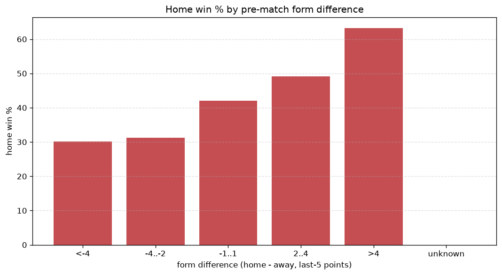
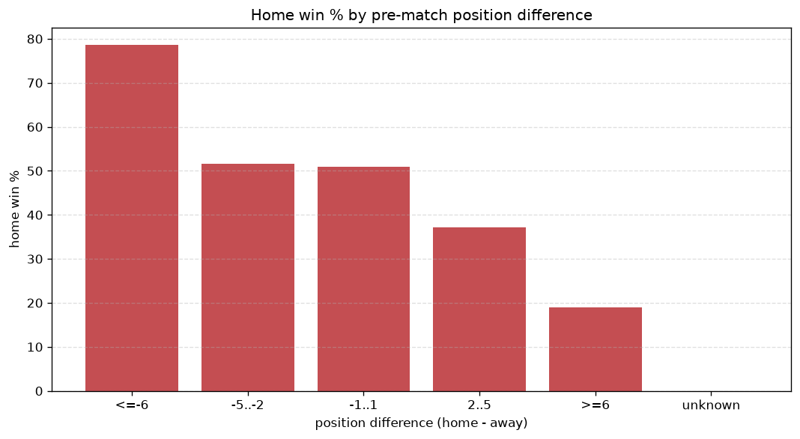

# Relationships Analysis
- Report: `relationships`
- Generated: 2026-10-29T02:16:03+00:00
- Script: `backend/scripts/analyze_relationships.py` v1.0.0
- League: Prva liga (Slovenia)
- Scope: league `slovenia1`

- Matches analysed: **1064** (23 leakage-safe pre-match features).

## 1. Correlation matrix
_Pearson correlation of each pre-match feature with observed goals; sorted by |corr(total goals)|._

| feature | corr(home) | corr(away) | corr(total) |
|---|---|---|---|
| home_rest_days | 0.028 | 0.041 | 0.050 |
| away_team_away_conceded_avg | 0.106 | -0.055 | 0.043 |
| away_rest_days | 0.046 | 0.006 | 0.040 |
| away_team_away_goals_avg | -0.086 | 0.150 | 0.039 |
| home_team_wins_last_5 | 0.128 | -0.090 | 0.035 |
| home_team_points_last_5 | 0.135 | -0.099 | 0.035 |
| home_team_goals_scored_last_5 | 0.114 | -0.077 | 0.034 |
| away_team_away_win_rate | -0.082 | 0.137 | 0.033 |
| home_team_home_conceded_avg | -0.079 | 0.131 | 0.031 |
| away_team_wins_last_5 | -0.089 | 0.139 | 0.028 |
| home_team_home_win_rate | 0.114 | -0.086 | 0.028 |
| home_team_home_goals_avg | 0.105 | -0.079 | 0.025 |
| home_position_before_match | -0.188 | 0.173 | -0.024 |
| away_team_goals_scored_last_5 | -0.078 | 0.118 | 0.022 |
| away_team_points_last_5 | -0.105 | 0.143 | 0.020 |
| home_points_before_match | 0.101 | -0.085 | 0.018 |
| rest_days_difference | -0.035 | 0.059 | 0.015 |
| position_difference | -0.242 | 0.247 | -0.013 |
| points_difference | 0.230 | -0.237 | 0.011 |
| away_team_goals_conceded_last_5 | 0.088 | -0.082 | 0.011 |
| away_points_before_match | -0.078 | 0.100 | 0.010 |
| home_team_goals_conceded_last_5 | -0.123 | 0.122 | -0.009 |
| away_position_before_match | 0.157 | -0.179 | -0.005 |

## 2. Form vs outcome
_Home win/draw/away % per bucket of `home_team_points_last_5 - away_team_points_last_5`._

| bucket | matches | home | draw | away | home % | draw % | away % |
|---|---|---|---|---|---|---|---|
| <-4 | 163 | 49 | 35 | 79 | 30.1% | 21.5% | 48.5% |
| -4..-2 | 240 | 75 | 80 | 85 | 31.2% | 33.3% | 35.4% |
| -1..1 | 299 | 126 | 75 | 98 | 42.1% | 25.1% | 32.8% |
| 2..4 | 218 | 107 | 59 | 52 | 49.1% | 27.1% | 23.9% |
| >4 | 144 | 91 | 29 | 24 | 63.2% | 20.1% | 16.7% |
| unknown | 0 | 0 | 0 | 0 | - | - | - |

## 3. Position vs outcome
_Home win/draw/away % per bucket of `position_difference` (home position - away position; negative favours the home team)._

| bucket | matches | home | draw | away | home % | draw % | away % |
|---|---|---|---|---|---|---|---|
| <=-6 | 93 | 58 | 20 | 15 | 62.4% | 21.5% | 16.1% |
| -5..-2 | 304 | 159 | 88 | 57 | 52.3% | 28.9% | 18.8% |
| -1..1 | 255 | 111 | 65 | 79 | 43.5% | 25.5% | 31.0% |
| 2..5 | 302 | 99 | 76 | 127 | 32.8% | 25.2% | 42.1% |
| >=6 | 110 | 21 | 29 | 60 | 19.1% | 26.4% | 54.5% |
| unknown | 0 | 0 | 0 | 0 | - | - | - |

## 4. Rest advantage
_Home win/draw/away % per bucket of `rest_days_difference` (home rest - away rest). Matches with unknown rest are bucketed separately._

| bucket | matches | home | draw | away | home % | draw % | away % |
|---|---|---|---|---|---|---|---|
| <-1 | 112 | 54 | 34 | 24 | 48.2% | 30.4% | 21.4% |
| -1..0 | 219 | 101 | 49 | 69 | 46.1% | 22.4% | 31.5% |
| 0 | 339 | 145 | 98 | 96 | 42.8% | 28.9% | 28.3% |
| 1..2 | 304 | 114 | 77 | 113 | 37.5% | 25.3% | 37.2% |
| >2 | 57 | 18 | 13 | 26 | 31.6% | 22.8% | 45.6% |
| unknown | 33 | 16 | 7 | 10 | 48.5% | 21.2% | 30.3% |
- *33 match(es) had unknown rest difference (missing rest data on at least one side).*

## 5. Home team quality
_Home win rate by `home_team_home_win_rate` tier (split at 0.5)._

- `< 0.5` tier: **36.9%** home win (235/637)
- `>= 0.5` tier: **49.9%** home win (213/427)
- Home-win gap (>= split minus < split): **+13.0 pp**

| tier | label | matches | home | draw | away | home % |
|---|---|---|---|---|---|---|
| low | < 0.5 | 637 | 235 | 172 | 230 | 36.9% |
| high | >= 0.5 | 427 | 213 | 106 | 108 | 49.9% |

## 6. Feature averages by result
_Mean feature value per outcome; `range` is home-minus-away spread of the group means._

| feature | home mean | draw mean | away mean | range |
|---|---|---|---|---|
| points_difference | 3.433 | -0.464 | -4.763 | 8.196 |
| away_points_before_match | 21.634 | 25.076 | 25.997 | 4.363 |
| home_points_before_match | 25.067 | 24.612 | 21.234 | 3.833 |
| position_difference | -1.136 | 0.223 | 1.639 | 2.775 |
| away_position_before_match | 6.156 | 5.489 | 4.754 | 1.402 |
| home_position_before_match | 5.020 | 5.712 | 6.393 | 1.373 |
| away_team_points_last_5 | 5.710 | 6.601 | 6.941 | 1.231 |
| rest_days_difference | -0.444 | -0.598 | 0.561 | 1.159 |
| home_team_points_last_5 | 6.674 | 6.198 | 5.530 | 1.145 |
| home_team_goals_conceded_last_5 | 5.569 | 6.414 | 6.612 | 1.043 |
| away_team_goals_scored_last_5 | 5.665 | 6.374 | 6.598 | 0.932 |
| home_team_goals_scored_last_5 | 6.408 | 5.975 | 5.533 | 0.876 |
| away_team_goals_conceded_last_5 | 6.395 | 5.975 | 5.645 | 0.750 |
| away_rest_days | 8.847 | 9.033 | 8.314 | 0.719 |
| home_rest_days | 8.396 | 8.423 | 8.875 | 0.479 |
| away_team_wins_last_5 | 1.525 | 1.802 | 1.908 | 0.384 |
| home_team_wins_last_5 | 1.817 | 1.676 | 1.435 | 0.382 |
| away_team_away_goals_avg | 1.067 | 1.171 | 1.292 | 0.225 |
| home_team_home_goals_avg | 1.462 | 1.352 | 1.254 | 0.208 |
| home_team_home_conceded_avg | 1.084 | 1.164 | 1.271 | 0.187 |
| away_team_away_conceded_avg | 1.433 | 1.321 | 1.285 | 0.147 |
| home_team_home_win_rate | 0.452 | 0.404 | 0.365 | 0.088 |
| away_team_away_win_rate | 0.271 | 0.305 | 0.346 | 0.075 |

---
*All features are leakage-safe pre-match values built by `ml.features.build_features.build_rows` from strictly prior matches. Run with `python backend/scripts/analyze_relationships.py` to regenerate.*

## Charts

