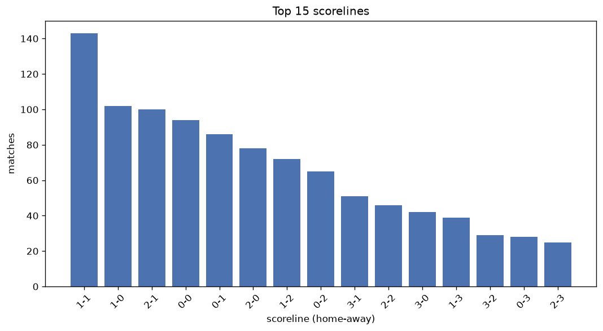
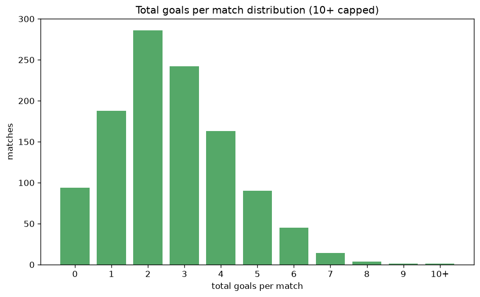

# Scoreline Analysis
- Report: `scoreline_analysis`
- Generated: 2026-10-29T02:16:01+00:00
- Script: `backend/scripts/analyze_scorelines.py` v1.0.0
- League: Prva liga (Slovenia)
- Scope: league `slovenia1`

## 1. Scoreline frequency
- Matches analysed: **1128** across **7** seasons.
- Distinct scorelines seen: **39**.

| scoreline | count | pct |
|---|---|---|
| 1-1 | 143 | 12.7% |
| 1-0 | 102 | 9.0% |
| 2-1 | 100 | 8.9% |
| 0-0 | 94 | 8.3% |
| 0-1 | 86 | 7.6% |
| 2-0 | 78 | 6.9% |
| 1-2 | 72 | 6.4% |
| 0-2 | 65 | 5.8% |
| 3-1 | 51 | 4.5% |
| 2-2 | 46 | 4.1% |
| 3-0 | 42 | 3.7% |
| 1-3 | 39 | 3.5% |
| 3-2 | 29 | 2.6% |
| 0-3 | 28 | 2.5% |
| 2-3 | 25 | 2.2% |
| 3-3 | 17 | 1.5% |
| 4-1 | 16 | 1.4% |
| 0-4 | 15 | 1.3% |
| 4-0 | 12 | 1.1% |
| 4-2 | 11 | 1.0% |

## 2. Scoreline frequency per season

### 2020-2021
| scoreline | count | pct |
|---|---|---|
| 0-0 | 24 | 13.3% |
| 1-1 | 24 | 13.3% |
| 2-1 | 19 | 10.6% |
| 1-0 | 16 | 8.9% |
| 2-0 | 14 | 7.8% |

### 2021-2022
| scoreline | count | pct |
|---|---|---|
| 1-1 | 21 | 11.7% |
| 1-0 | 21 | 11.7% |
| 0-1 | 18 | 10.0% |
| 0-0 | 15 | 8.3% |
| 0-2 | 15 | 8.3% |

### 2022-2023
| scoreline | count | pct |
|---|---|---|
| 1-1 | 25 | 13.9% |
| 2-1 | 19 | 10.6% |
| 0-1 | 19 | 10.6% |
| 1-0 | 17 | 9.4% |
| 0-0 | 16 | 8.9% |

### 2023-2024
| scoreline | count | pct |
|---|---|---|
| 1-1 | 27 | 15.0% |
| 2-1 | 16 | 8.9% |
| 1-2 | 14 | 7.8% |
| 1-0 | 13 | 7.2% |
| 0-2 | 12 | 6.7% |

### 2024-2025
| scoreline | count | pct |
|---|---|---|
| 1-1 | 26 | 14.4% |
| 0-1 | 16 | 8.9% |
| 2-0 | 15 | 8.3% |
| 1-0 | 15 | 8.3% |
| 2-1 | 13 | 7.2% |

### 2025-2026
| scoreline | count | pct |
|---|---|---|
| 2-1 | 22 | 13.4% |
| 1-2 | 14 | 8.5% |
| 1-0 | 14 | 8.5% |
| 1-1 | 12 | 7.3% |
| 2-0 | 11 | 6.7% |

### 2026-2027
| scoreline | count | pct |
|---|---|---|
| 0-0 | 8 | 12.5% |
| 1-1 | 8 | 12.5% |
| 1-0 | 6 | 9.4% |
| 0-2 | 4 | 6.2% |
| 2-2 | 4 | 6.2% |

## 3. Total-goal histogram
_10+ groups all matches with 10 or more total goals._

| total goals | matches | pct |
|---|---|---|
| 0 | 94 | 8.3% |
| 1 | 188 | 16.7% |
| 2 | 286 | 25.4% |
| 3 | 242 | 21.5% |
| 4 | 163 | 14.5% |
| 5 | 90 | 8.0% |
| 6 | 45 | 4.0% |
| 7 | 14 | 1.2% |
| 8 | 4 | 0.4% |
| 9 | 1 | 0.1% |
| 10+ | 1 | 0.1% |

## 4. Extreme scorelines
- Matches with 7+ total goals: **20**

| season | date | scoreline | total goals |
|---|---|---|---|
| 2024-2025 | 2025-02-23 | 9-1 | 10 |
| 2023-2024 | 2023-08-19 | 4-5 | 9 |
| 2020-2021 | 2021-04-21 | 6-2 | 8 |
| 2022-2023 | 2022-12-11 | 0-8 | 8 |
| 2023-2024 | 2024-03-29 | 3-5 | 8 |
| 2025-2026 | 2026-01-31 | 6-2 | 8 |
| 2020-2021 | 2020-11-07 | 4-3 | 7 |
| 2020-2021 | 2020-12-19 | 3-4 | 7 |
| 2022-2023 | 2022-07-24 | 4-3 | 7 |
| 2022-2023 | 2022-09-10 | 4-3 | 7 |
| 2022-2023 | 2022-10-09 | 6-1 | 7 |
| 2022-2023 | 2022-12-06 | 7-0 | 7 |
| 2022-2023 | 2023-02-22 | 4-3 | 7 |
| 2023-2024 | 2024-02-11 | 7-0 | 7 |
| 2024-2025 | 2024-08-30 | 5-2 | 7 |
| 2024-2025 | 2024-10-19 | 4-3 | 7 |
| 2024-2025 | 2024-10-19 | 3-4 | 7 |
| 2024-2025 | 2025-05-18 | 1-6 | 7 |
| 2026-2027 | 2026-08-01 | 5-2 | 7 |
| 2026-2027 | 2026-09-13 | 1-6 | 7 |

## 5. Margin-of-victory distribution (decided matches)
- Decided matches: **828** (draws: **300**)
- Average winning margin: **1.8**

| margin | matches | pct |
|---|---|---|
| 1 | 422 | 51.0% |
| 2 | 251 | 30.3% |
| 3+ | 155 | 18.7% |

## 6. Margin by outcome

### Home wins
- Matches: **470** | avg margin: **1.82** | max margin: **8**
| margin | matches | pct |
|---|---|---|
| 1 | 236 | 50.2% |
| 2 | 140 | 29.8% |
| 3+ | 94 | 20.0% |
- *Full match-by-match list available in `scoreline_analysis.json`.*

### Away wins
- Matches: **358** | avg margin: **1.77** | max margin: **8**
| margin | matches | pct |
|---|---|---|
| 1 | 186 | 52.0% |
| 2 | 111 | 31.0% |
| 3+ | 61 | 17.0% |
- *Full match-by-match list available in `scoreline_analysis.json`.*

## 7. Most common exact score by outcome type
| outcome | matches | most common score | count | pct |
|---|---|---|---|---|
| home | 470 | 1-0 | 102 | 21.7% |
| draw | 300 | 1-1 | 143 | 47.7% |
| away | 358 | 0-1 | 86 | 24.0% |

---
*All statistics are computed from PostgreSQL tables (read-only). Run with `python backend/scripts/analyze_scorelines.py` to regenerate.*

## Charts

