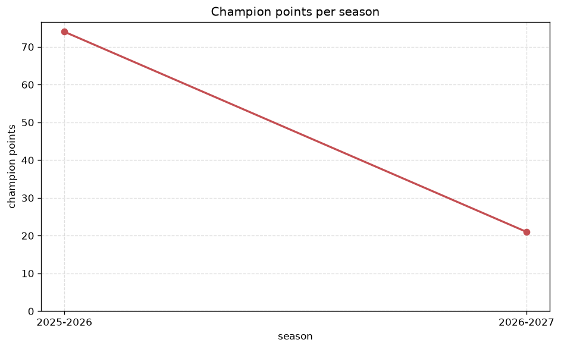
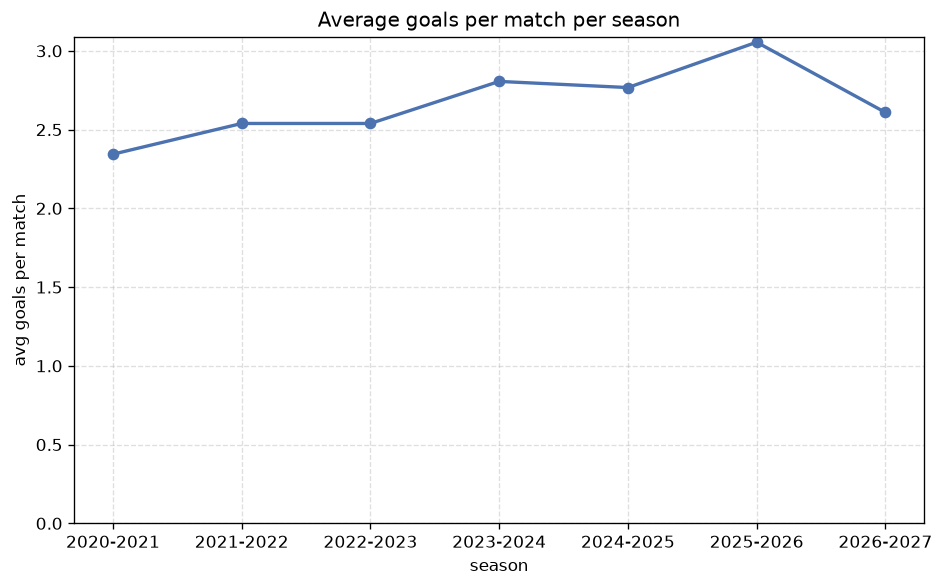

# Season Trends Analysis
- Report: `season_trends`
- Generated: 2026-10-29T02:15:59+00:00
- Script: `backend/scripts/analyze_seasons.py` v1.0.0
- League: Prva liga (Slovenia)
- Scope: league `slovenia1`

## 1. Champions per season
| season | champion | pts | runner-up | margin |
|---|---|---|---|---|
| 2020-2021 | Mura | 63 | Maribor | 0 pts |
| 2021-2022 | Maribor | 70 | Koper | 3 pts |
| 2022-2023 | O. Ljubljana | 73 | Celje | 6 pts |
| 2023-2024 | Celje | 79 | Maribor | 12 pts |
| 2024-2025 | O. Ljubljana | 74 | Maribor | 7 pts |
| 2025-2026 | Celje | 74 | Koper | 7 pts |
| 2026-2027 | Koper | 25 | Maribor | 0 pts |

## 2. Title-race tightness
- Tight races (margin <= 3 pts): **3** of 7 seasons
- Tightest race: **2020-2021** - Mura beat Maribor by **0** pts

| season | margin | tight |
|---|---|---|
| 2020-2021 | 0 pts | yes |
| 2021-2022 | 3 pts | yes |
| 2022-2023 | 6 pts |  |
| 2023-2024 | 12 pts |  |
| 2024-2025 | 7 pts |  |
| 2025-2026 | 7 pts |  |
| 2026-2027 | 0 pts | yes |

## 3. Points thresholds
_Position-specific points per season. Key: 1 = champion, 2 = runner-up, 4 = CL line, 6 = Europa, 7 = last safe, 10 = bottom._

| season | pos 1 | pos 2 | pos 4 | pos 6 | pos 7 | pos 10 |
|---|---|---|---|---|---|---|
| 2020-2021 | 63 | 63 | 55 | 44 | 43 | 29 |
| 2021-2022 | 70 | 67 | 57 | 46 | 45 | 24 |
| 2022-2023 | 73 | 67 | 52 | 50 | 44 | 24 |
| 2023-2024 | 79 | 67 | 50 | 43 | 43 | 31 |
| 2024-2025 | 74 | 67 | 61 | 43 | 35 | 28 |
| 2025-2026 | 74 | 67 | 55 | 45 | 36 | 12 |
| 2026-2027 | 25 | 25 | 20 | 16 | 14 | 8 |

## 4. Relegation battle
| season | safe pos | safe pts | drop pos | drop pts | gap |
|---|---|---|---|---|---|
| 2020-2021 | 7 | 43 | 8 | 43 | 0 pts |
| 2021-2022 | 7 | 45 | 8 | 42 | 3 pts |
| 2022-2023 | 7 | 44 | 8 | 36 | 8 pts |
| 2023-2024 | 7 | 43 | 8 | 36 | 7 pts |
| 2024-2025 | 7 | 35 | 8 | 35 | 0 pts |
| 2025-2026 | 7 | 36 | 8 | 31 | 5 pts |
| 2026-2027 | 7 | 14 | 8 | 13 | 1 pts |

## 5. League-level trends
| season | matches | total goals | avg goals | home win | draw | away win | goalless | avg pts/team |
|---|---|---|---|---|---|---|---|---|
| 2020-2021 | 180 | 422 | 2.344 | 43.3% | 30.0% | 26.7% | 13.3% | 48.6 |
| 2021-2022 | 180 | 457 | 2.539 | 38.9% | 26.7% | 34.4% | 8.3% | 49.2 |
| 2022-2023 | 180 | 457 | 2.539 | 39.4% | 29.4% | 31.1% | 8.9% | 48.7 |
| 2023-2024 | 180 | 505 | 2.806 | 38.9% | 25.6% | 35.6% | 5.6% | 49.4 |
| 2024-2025 | 180 | 498 | 2.767 | 43.3% | 26.1% | 30.6% | 7.2% | 49.3 |
| 2025-2026 | 164 | 501 | 3.055 | 49.4% | 18.3% | 32.3% | 4.9% | 42.0 |
| 2026-2027 | 64 | 167 | 2.609 | 34.4% | 34.4% | 31.2% | 12.5% | 17.0 |

## 6. View divergence
- Largest divergence: **2024-2025** (goals view, avg abs position diff = 4.400)

_Avg absolute position difference between classic view and alternative view per season._

| season | classic vs luck | classic vs goals |
|---|---|---|
| 2020-2021 | 2.400 | 3.200 |
| 2021-2022 | 1.200 | 3.800 |
| 2022-2023 | 1.000 | 2.400 |
| 2023-2024 | 2.200 | 2.800 |
| 2024-2025 | 2.400 | 4.400 |
| 2025-2026 | 2.727 | 1.636 |
| 2026-2027 | 2.000 | 4.400 |

---
*All statistics are computed from PostgreSQL tables (read-only). Run with `python backend/scripts/analyze_seasons.py` to regenerate.*

## Charts

