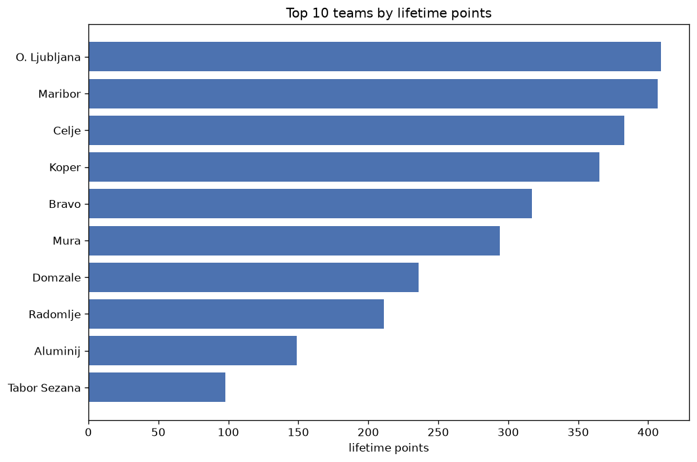
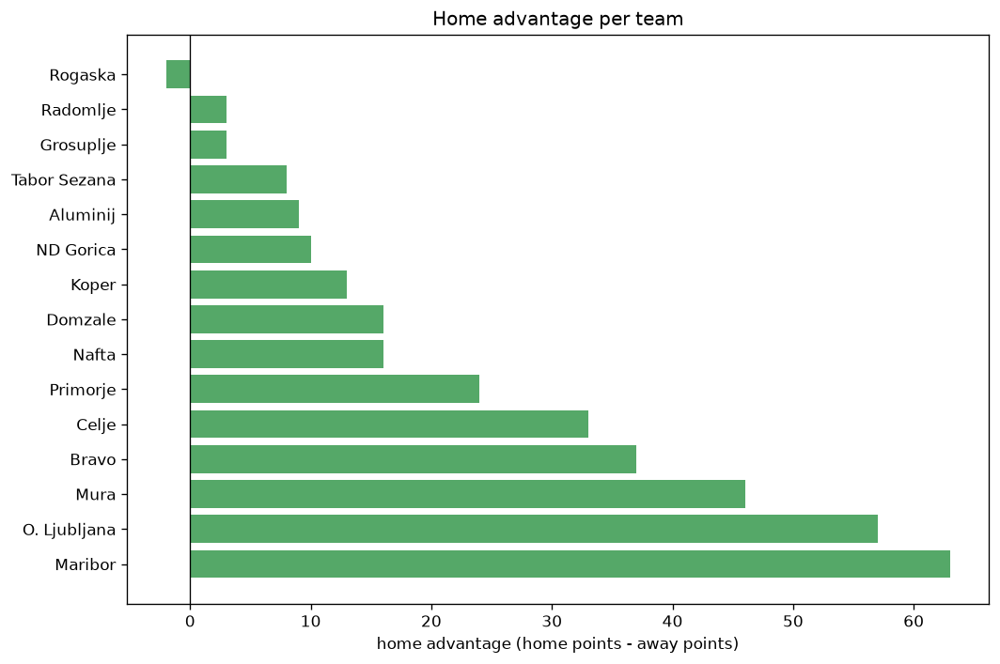

# Team Analysis
- Report: `teams_analysis`
- Generated: 2026-10-30T04:13:00+00:00
- Script: `backend/scripts/analyze_teams.py` v1.0.0
- League: Prva liga (Slovenia)
- Scope: league `slovenia1`

- Teams: **15** | Seasons: **7** | Matches: **1130**

## 1. Team standings (lifetime)
| team | seasons | played | W | D | L | pts | GF | GA | GD | avg pts/season | best pos | worst pos | titles |
|---|---|---|---|---|---|---|---|---|---|---|---|---|---|
| O. Ljubljana | 7 | 228 | 118 | 55 | 55 | 409 | 358 | 228 | 130 | 58.43 | 1 | 4 | 2 |
| Maribor | 7 | 228 | 115 | 62 | 51 | 407 | 401 | 245 | 156 | 58.14 | 1 | 5 | 1 |
| Celje | 7 | 226 | 111 | 50 | 65 | 383 | 384 | 254 | 130 | 54.71 | 1 | 8 | 2 |
| Koper | 7 | 227 | 102 | 59 | 66 | 365 | 346 | 272 | 74 | 52.14 | 1 | 9 | 1 |
| Bravo | 7 | 227 | 82 | 71 | 74 | 317 | 275 | 263 | 12 | 45.29 | 3 | 8 | 0 |
| Mura | 7 | 228 | 75 | 69 | 84 | 294 | 286 | 308 | -22 | 42.0 | 1 | 8 | 1 |
| Domzale | 6 | 198 | 61 | 53 | 84 | 236 | 253 | 293 | -40 | 39.33 | 4 | 10 | 0 |
| Radomlje | 6 | 190 | 53 | 52 | 85 | 211 | 217 | 312 | -95 | 35.17 | 6 | 10 | 0 |
| Aluminij | 5 | 156 | 35 | 44 | 77 | 149 | 159 | 258 | -99 | 29.8 | 7 | 10 | 0 |
| Tabor Sezana | 3 | 108 | 22 | 32 | 54 | 98 | 99 | 148 | -49 | 32.67 | 6 | 10 | 0 |
| Primorje | 2 | 72 | 17 | 15 | 40 | 66 | 72 | 136 | -64 | 33.0 | 6 | 9 | 0 |
| ND Gorica | 2 | 72 | 12 | 20 | 40 | 56 | 55 | 115 | -60 | 28.0 | 9 | 10 | 0 |
| Nafta | 3 | 51 | 12 | 14 | 25 | 50 | 52 | 85 | -33 | 16.67 | 5 | 11 | 0 |
| Rogaska | 1 | 36 | 10 | 6 | 20 | 36 | 37 | 64 | -27 | 36.0 | 8 | 8 | 0 |
| Grosuplje | 1 | 13 | 3 | 2 | 8 | 11 | 15 | 28 | -13 | 11.0 | 9 | 9 | 0 |

## 2. Home vs away split
| team | home P | H-W | H-D | H-L | H-pts | away P | A-W | A-D | A-L | A-pts | adv |
|---|---|---|---|---|---|---|---|---|---|---|---|
| Maribor | 114 | 69 | 28 | 17 | 235 | 114 | 46 | 34 | 34 | 172 | 63 |
| O. Ljubljana | 115 | 68 | 29 | 18 | 233 | 113 | 50 | 26 | 37 | 176 | 57 |
| Mura | 113 | 46 | 32 | 35 | 170 | 115 | 29 | 37 | 49 | 124 | 46 |
| Bravo | 113 | 48 | 33 | 32 | 177 | 114 | 34 | 38 | 42 | 140 | 37 |
| Celje | 112 | 62 | 22 | 28 | 208 | 114 | 49 | 28 | 37 | 175 | 33 |
| Primorje | 36 | 13 | 6 | 17 | 45 | 36 | 4 | 9 | 23 | 21 | 24 |
| Domzale | 99 | 31 | 33 | 35 | 126 | 99 | 30 | 20 | 49 | 110 | 16 |
| Nafta | 26 | 9 | 6 | 11 | 33 | 25 | 3 | 8 | 14 | 17 | 16 |
| Koper | 113 | 54 | 27 | 32 | 189 | 114 | 48 | 32 | 34 | 176 | 13 |
| ND Gorica | 36 | 7 | 12 | 17 | 33 | 36 | 5 | 8 | 23 | 23 | 10 |
| Aluminij | 79 | 18 | 25 | 36 | 79 | 77 | 17 | 19 | 41 | 70 | 9 |
| Tabor Sezana | 54 | 13 | 14 | 27 | 53 | 54 | 9 | 18 | 27 | 45 | 8 |
| Radomlje | 96 | 26 | 29 | 41 | 107 | 94 | 27 | 23 | 44 | 104 | 3 |
| Grosuplje | 6 | 2 | 1 | 3 | 7 | 7 | 1 | 1 | 5 | 4 | 3 |
| Rogaska | 18 | 4 | 5 | 9 | 17 | 18 | 6 | 1 | 11 | 19 | -2 |

## 3. Top performers
### Best points per game (PPG)
| rank | team | PPG |
|---|---|---|
| 1 | O. Ljubljana | 1.79 |
| 2 | Maribor | 1.78 |
| 3 | Celje | 1.70 |
| 4 | Koper | 1.61 |
| 5 | Bravo | 1.40 |

### Most goals scored
| rank | team | goals |
|---|---|---|
| 1 | Maribor | 401 |
| 2 | Celje | 384 |
| 3 | O. Ljubljana | 358 |
| 4 | Koper | 346 |
| 5 | Mura | 286 |

### Best goal difference
| rank | team | GD |
|---|---|---|
| 1 | Maribor | 156 |
| 2 | O. Ljubljana | 130 |
| 3 | Celje | 130 |
| 4 | Koper | 74 |
| 5 | Bravo | 12 |

### Best defence (goals against per match, standings)
| rank | team | GA/match |
|---|---|---|
| 1 | O. Ljubljana | 1.000 |
| 2 | Maribor | 1.075 |
| 3 | Celje | 1.124 |
| 4 | Bravo | 1.159 |
| 5 | Koper | 1.198 |

## 4. Team consistency
- Teams present in all **7** seasons: **6**

Bravo, Celje, Koper, Maribor, Mura, O. Ljubljana

## 5. Head-to-head dominance
- Distinct fixtures: **92** (showing the 15 most frequent)

| fixture | meetings | home wins | draws | away wins | home pct | draw pct | away pct |
|---|---|---|---|---|---|---|---|
| Mura vs Maribor | 26 | 14 | 6 | 6 | 53.8% | 23.1% | 23.1% |
| Maribor vs Koper | 26 | 13 | 7 | 6 | 50.0% | 26.9% | 23.1% |
| Mura vs Celje | 26 | 13 | 6 | 7 | 50.0% | 23.1% | 26.9% |
| Mura vs O. Ljubljana | 26 | 13 | 8 | 5 | 50.0% | 30.8% | 19.2% |
| O. Ljubljana vs Bravo | 26 | 13 | 9 | 4 | 50.0% | 34.6% | 15.4% |
| Maribor vs Celje | 26 | 10 | 8 | 8 | 38.5% | 30.8% | 30.8% |
| O. Ljubljana vs Celje | 26 | 10 | 8 | 8 | 38.5% | 30.8% | 30.8% |
| Bravo vs Celje | 25 | 16 | 2 | 7 | 64.0% | 8.0% | 28.0% |
| Bravo vs Koper | 25 | 12 | 9 | 4 | 48.0% | 36.0% | 16.0% |
| Maribor vs O. Ljubljana | 25 | 12 | 9 | 4 | 48.0% | 36.0% | 16.0% |
| Mura vs Koper | 25 | 10 | 6 | 9 | 40.0% | 24.0% | 36.0% |
| Maribor vs Bravo | 25 | 9 | 7 | 9 | 36.0% | 28.0% | 36.0% |
| Celje vs Koper | 25 | 8 | 8 | 9 | 32.0% | 32.0% | 36.0% |
| O. Ljubljana vs Koper | 25 | 8 | 5 | 12 | 32.0% | 20.0% | 48.0% |
| Mura vs Bravo | 25 | 6 | 11 | 8 | 24.0% | 44.0% | 32.0% |

## 6. Position per season (classic view)
_Cells show final position; '-' when the team was absent from that season._

| team | 2020-2021 | 2021-2022 | 2022-2023 | 2023-2024 | 2024-2025 | 2025-2026 | 2026-2027 |
|---|---|---|---|---|---|---|---|
| O. Ljubljana | 3 | 3 | 1 | 3 | 1 | 4 | 3 |
| Maribor | 2 | 1 | 3 | 2 | 2 | 5 | 2 |
| Celje | 7 | 8 | 2 | 1 | 4 | 1 | 6 |
| Koper | 9 | 2 | 6 | 5 | 3 | 2 | 1 |
| Bravo | 5 | 5 | 8 | 4 | 5 | 3 | 4 |
| Mura | 1 | 4 | 5 | 7 | 7 | 8 | 8 |
| Domzale | 4 | 7 | 4 | 6 | 9 | 10 | - |
| Radomlje | - | 6 | 7 | 9 | 8 | 6 | 10 |
| Aluminij | 8 | 10 | - | 10 | - | 7 | 7 |
| Tabor Sezana | 6 | 9 | 10 | - | - | - | - |
| Primorje | - | - | - | - | 6 | 9 | - |
| ND Gorica | 10 | - | 9 | - | - | - | - |
| Nafta | - | - | - | - | 10 | 11 | 5 |
| Rogaska | - | - | - | 8 | - | - | - |
| Grosuplje | - | - | - | - | - | - | 9 |

---
*All statistics are computed from PostgreSQL tables (read-only). Run with `python backend/scripts/analyze_teams.py` to regenerate.*

## Charts

