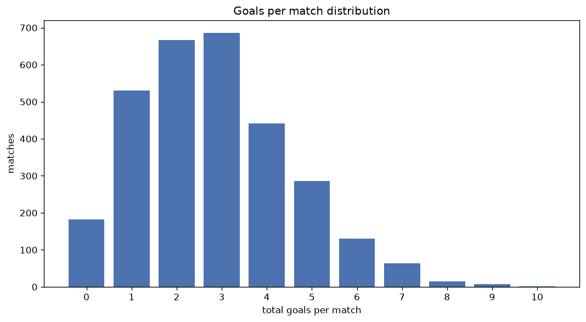
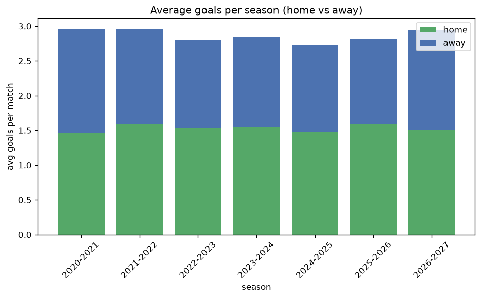

# Goal Analysis
- Report: `goals_analysis`
- Generated: 2026-10-29T02:16:16+00:00
- Script: `backend/scripts/analyze_goals.py` v1.0.0
- League: National League South (England)
- Scope: league `south`

## 1. Goals per match distribution
| goals | matches | pct |
|---|---|---|
| 0 | 182 | 6.0% |
| 1 | 530 | 17.6% |
| 2 | 667 | 22.2% |
| 3 | 686 | 22.8% |
| 4 | 441 | 14.6% |
| 5 | 286 | 9.5% |
| 6 | 131 | 4.4% |
| 7 | 63 | 2.1% |
| 8 | 15 | 0.5% |
| 9 | 8 | 0.3% |
| 10 | 2 | 0.1% |

## 2. Goals per match per season
| season | matches | total goals | avg home | avg away | avg total |
|---|---|---|---|---|---|
| 2020-2021 | 165 | 489 | 1.461 | 1.503 | 2.964 |
| 2021-2022 | 420 | 1242 | 1.59 | 1.367 | 2.957 |
| 2022-2023 | 552 | 1550 | 1.536 | 1.272 | 2.808 |
| 2023-2024 | 550 | 1566 | 1.547 | 1.3 | 2.847 |
| 2024-2025 | 549 | 1498 | 1.474 | 1.255 | 2.729 |
| 2025-2026 | 605 | 1709 | 1.6 | 1.225 | 2.825 |
| 2026-2027 | 170 | 501 | 1.512 | 1.435 | 2.947 |

## 3. Home vs away goal share
- Home goals: **4642** (54.3%)
- Away goals: **3913** (45.7%)
- Home/away ratio: **1.186**

| season | home goals | away goals | total | home pct | away pct |
|---|---|---|---|---|---|
| 2020-2021 | 241 | 248 | 489 | 49.3% | 50.7% |
| 2021-2022 | 668 | 574 | 1242 | 53.8% | 46.2% |
| 2022-2023 | 848 | 702 | 1550 | 54.7% | 45.3% |
| 2023-2024 | 851 | 715 | 1566 | 54.3% | 45.7% |
| 2024-2025 | 809 | 689 | 1498 | 54.0% | 46.0% |
| 2025-2026 | 968 | 741 | 1709 | 56.6% | 43.4% |
| 2026-2027 | 257 | 244 | 501 | 51.3% | 48.7% |

## 4. BTTS (Both Teams To Score)
- Overall: **1682** of `3011` (55.9%)

| season | matches | BTTS | pct |
|---|---|---|---|
| 2020-2021 | 165 | 93 | 56.4% |
| 2021-2022 | 420 | 239 | 56.9% |
| 2022-2023 | 552 | 310 | 56.2% |
| 2023-2024 | 550 | 318 | 57.8% |
| 2024-2025 | 549 | 296 | 53.9% |
| 2025-2026 | 605 | 335 | 55.4% |
| 2026-2027 | 170 | 91 | 53.5% |

## 5. Clean sheets
- Home clean sheets: **863** (28.7%)
- Away clean sheets: **648** (21.5%)
- Total clean sheets recorded: **1511**
- Matches with at least one clean sheet: **1329** (44.1%)
- Both teams kept clean sheets (0-0): **182**

| season | matches | home CS | away CS | total CS | matches w/ CS |
|---|---|---|---|---|---|
| 2020-2021 | 165 | 38 | 43 | 81 | 72 (43.6%) |
| 2021-2022 | 420 | 115 | 90 | 205 | 181 (43.1%) |
| 2022-2023 | 552 | 154 | 124 | 278 | 242 (43.8%) |
| 2023-2024 | 550 | 147 | 117 | 264 | 232 (42.2%) |
| 2024-2025 | 549 | 165 | 123 | 288 | 253 (46.1%) |
| 2025-2026 | 605 | 200 | 109 | 309 | 270 (44.6%) |
| 2026-2027 | 170 | 44 | 42 | 86 | 79 (46.5%) |

## 6. Scoring intensity
- First-half goals: **3835** (44.8%)
- Second-half goals: **4719** (55.2%)
- Avg first-half goals per match: **1.274**
- Avg second-half goals per match: **1.568**
- Second-half-only scoring (HT 0-0, FT goals >= 1): **658** (21.9%)
- *1 match(es) excluded (no HT score recorded).*

| season | matches | 1st half | 2nd half | 1st half pct | 2nd half pct |
|---|---|---|---|---|---|
| 2020-2021 | 165 | 234 | 255 | 47.9% | 52.1% |
| 2021-2022 | 420 | 566 | 676 | 45.6% | 54.4% |
| 2022-2023 | 552 | 696 | 854 | 44.9% | 55.1% |
| 2023-2024 | 550 | 697 | 869 | 44.5% | 55.5% |
| 2024-2025 | 549 | 659 | 839 | 44.0% | 56.0% |
| 2025-2026 | 605 | 750 | 959 | 43.9% | 56.1% |
| 2026-2027 | 170 | 233 | 267 | 46.6% | 53.4% |

## 7. First-goal timing
- Matches with first-goal time recorded: `2828` of `3011` (93.9%)
- Goalless matches: `183`
- Min `1` | Max `99` | Mean `30.73` | Median (p50) `25.0`

| bucket | count | % of matches | % of scoring matches |
|---|---|---|---|
| 1-15 | 941 | 31.3% | 33.3% |
| 16-30 | 709 | 23.5% | 25.1% |
| 31-45 | 476 | 15.8% | 16.8% |
| 46-60 | 336 | 11.2% | 11.9% |
| 61-75 | 192 | 6.4% | 6.8% |
| 76-90 | 146 | 4.8% | 5.2% |
| 91-120 | 28 | 0.9% | 1.0% |

---
*All statistics are computed from PostgreSQL tables (read-only). Run with `python backend/scripts/analyze_goals.py` to regenerate.*

## Charts

