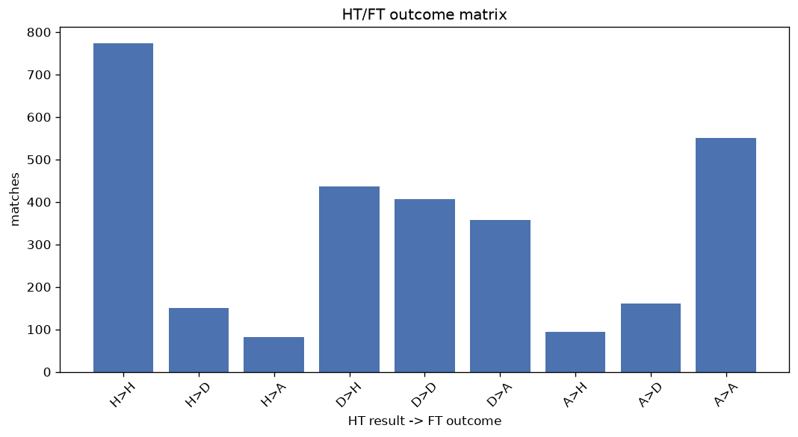
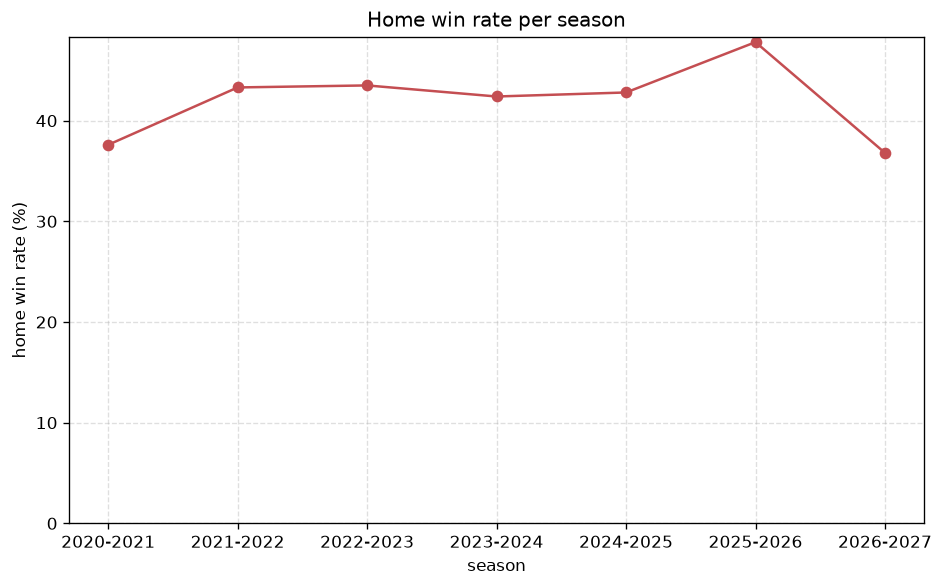

# Match Analysis
- Report: `matches_analysis`
- Generated: 2026-10-29T02:16:15+00:00
- Script: `backend/scripts/analyze_matches.py` v1.0.0
- League: National League South (England)
- Scope: league `south`

## 1. Overall summary
| metric | value |
|---|---|
| Matches | 3011 |
| Home wins | 1303 (43.3%) |
| Draws | 717 (23.8%) |
| Away wins | 991 (32.9%) |
| Total goals | 8555 |
| Average goals per match | 2.841 |
| Goalless matches | 182 (6.0%) |

## 2. Per-season breakdown
| season | matches | home wins | draws | away wins | total goals | avg goals | goalless |
|---|---|---|---|---|---|---|---|
| 2020-2021 | 165 | 62 (37.6%) | 36 (21.8%) | 67 (40.6%) | 489 | 2.964 | 9 (5.5%) |
| 2021-2022 | 420 | 182 (43.3%) | 98 (23.3%) | 140 (33.3%) | 1242 | 2.957 | 24 (5.7%) |
| 2022-2023 | 552 | 240 (43.5%) | 126 (22.8%) | 186 (33.7%) | 1550 | 2.808 | 36 (6.5%) |
| 2023-2024 | 550 | 233 (42.4%) | 137 (24.9%) | 180 (32.7%) | 1566 | 2.847 | 32 (5.8%) |
| 2024-2025 | 549 | 235 (42.8%) | 140 (25.5%) | 174 (31.7%) | 1498 | 2.729 | 35 (6.4%) |
| 2025-2026 | 605 | 289 (47.8%) | 135 (22.3%) | 181 (29.9%) | 1709 | 2.825 | 39 (6.4%) |
| 2026-2027 | 170 | 62 (36.5%) | 45 (26.5%) | 63 (37.1%) | 501 | 2.947 | 7 (4.1%) |

## 3. HT/FT outcome matrix
| HT result \ FT result | Home | Draw | Away | total |
|---|---|---|---|---|
| HT home lead | 773 (76.9%) | 151 (15.0%) | 81 (8.1%) | 1005 |
| HT draw | 436 (36.3%) | 406 (33.8%) | 358 (29.8%) | 1200 |
| HT away lead | 94 (11.7%) | 160 (19.9%) | 551 (68.4%) | 805 |
- *1 match(es) excluded (no HT score recorded).*

## 4. Comeback matches
- Home comebacks (trailing at HT, won at FT): **94** (3.1%)
- Away comebacks (trailing at HT, won at FT): **81** (2.7%)

### Home comebacks
| season | home | away | HT | FT |
|---|---|---|---|---|
| 2020-2021 | Maidstone | Welling | 0-1 | 2-1 |
| 2020-2021 | Ebbsfleet | Hungerford | 1-2 | 3-2 |
| 2020-2021 | St. Albans | Braintree | 0-1 | 2-1 |
| 2020-2021 | Dorking | Oxford City | 0-1 | 3-2 |
| 2020-2021 | Chelmsford | Braintree | 0-2 | 4-2 |
| 2020-2021 | Eastbourne Boro | Billericay | 1-2 | 4-2 |
| 2021-2022 | Maidstone | Hemel Hempstead | 0-1 | 4-2 |
| 2021-2022 | Dorking | Eastbourne Boro | 1-2 | 4-3 |
| 2021-2022 | St. Albans | Eastbourne Boro | 0-1 | 2-1 |
| 2021-2022 | Dulwich Hamlet | Ebbsfleet | 1-2 | 5-2 |
| 2021-2022 | Tonbridge | Hungerford | 0-1 | 2-1 |
| 2021-2022 | Eastbourne Boro | Hungerford | 1-2 | 5-2 |
| 2021-2022 | Oxford City | Havant & W | 0-1 | 3-1 |
| 2021-2022 | Hemel Hempstead | Billericay | 0-1 | 2-1 |
| 2021-2022 | Maidstone | Hungerford | 1-2 | 3-2 |
| 2021-2022 | Eastbourne Boro | Dorking | 1-2 | 3-2 |
| 2021-2022 | Bath | Hemel Hempstead | 0-1 | 2-1 |
| 2021-2022 | Hampton & Richmond | Slough | 0-1 | 3-1 |
| 2021-2022 | Dorking | Dulwich Hamlet | 0-2 | 4-3 |
| 2021-2022 | Concord | Welling | 0-1 | 2-1 |
| 2022-2023 | Cheshunt | Hampton & Richmond | 0-1 | 3-2 |
| 2022-2023 | Bath | Braintree | 0-1 | 3-1 |
| 2022-2023 | Taunton | Dartford | 0-1 | 2-1 |
| 2022-2023 | Cheshunt | Chippenham | 0-2 | 3-2 |
| 2022-2023 | Worthing | Hampton & Richmond | 1-2 | 4-3 |
| 2022-2023 | St. Albans | Hemel Hempstead | 0-1 | 2-1 |
| 2022-2023 | Braintree | Bath | 0-1 | 2-1 |
| 2022-2023 | Tonbridge | Worthing | 0-1 | 2-1 |
| 2022-2023 | Hemel Hempstead | Weymouth | 0-1 | 2-1 |
| 2022-2023 | Bath | Dulwich Hamlet | 0-1 | 2-1 |
| 2022-2023 | Chelmsford | Worthing | 1-2 | 4-2 |
| 2022-2023 | Worthing | Havant & W | 0-1 | 3-2 |
| 2022-2023 | Eastbourne Boro | Dartford | 0-1 | 2-1 |
| 2022-2023 | Chippenham | Hampton & Richmond | 0-1 | 2-1 |
| 2022-2023 | Hampton & Richmond | Weymouth | 0-1 | 2-1 |
| 2022-2023 | Concord | Dartford | 1-2 | 3-2 |
| 2022-2023 | Taunton | Worthing | 1-2 | 3-2 |
| 2022-2023 | Bath | Oxford City | 0-1 | 2-1 |
| 2023-2024 | Torquay | Braintree | 0-1 | 2-1 |
| 2023-2024 | Tonbridge | Bath | 1-2 | 3-2 |
| 2023-2024 | St. Albans | Maidstone | 1-2 | 3-2 |
| 2023-2024 | Worthing | Chippenham | 0-1 | 3-1 |
| 2023-2024 | Aveley | Dover | 0-1 | 2-1 |
| 2023-2024 | Maidstone | Dartford | 0-1 | 2-1 |
| 2023-2024 | Havant & W | Maidstone | 0-1 | 2-1 |
| 2023-2024 | Hemel Hempstead | Farnborough | 0-1 | 2-1 |
| 2023-2024 | Welling | Hampton & Richmond | 0-1 | 2-1 |
| 2023-2024 | Havant & W | Chelmsford | 0-1 | 2-1 |
| 2023-2024 | Weymouth | Hemel Hempstead | 0-1 | 4-3 |
| 2023-2024 | Chippenham | Dover | 0-1 | 2-1 |
| 2023-2024 | Welling | Truro | 0-1 | 3-2 |
| 2023-2024 | Hampton & Richmond | Chippenham | 0-1 | 2-1 |
| 2023-2024 | Havant & W | Slough | 0-1 | 2-1 |
| 2023-2024 | Chippenham | Welling | 0-1 | 4-1 |
| 2024-2025 | Slough | Chelmsford | 0-1 | 2-1 |
| 2024-2025 | Truro | Enfield Town | 0-1 | 3-1 |
| 2024-2025 | Salisbury | Boreham Wood | 0-1 | 2-1 |
| 2024-2025 | Dorking | St. Albans | 0-1 | 2-1 |
| 2024-2025 | Truro | Chelmsford | 0-1 | 2-1 |
| 2024-2025 | Chesham | Aveley | 0-1 | 3-2 |
| 2024-2025 | Torquay | Worthing | 0-1 | 2-1 |
| 2024-2025 | Hampton & Richmond | Eastbourne Boro | 0-1 | 3-1 |
| 2024-2025 | Chesham | Chippenham | 0-1 | 3-1 |
| 2024-2025 | Eastbourne Boro | Boreham Wood | 0-1 | 2-1 |
| 2024-2025 | St. Albans | Bath | 0-1 | 3-2 |
| 2024-2025 | Eastbourne Boro | Welling | 0-1 | 4-1 |
| 2024-2025 | Truro | Chesham | 0-1 | 2-1 |
| 2024-2025 | Aveley | St. Albans | 2-3 | 6-3 |
| 2024-2025 | Aveley | Farnborough | 0-1 | 2-1 |
| 2024-2025 | Worthing | Boreham Wood | 0-1 | 2-1 |
| 2024-2025 | Chippenham | Aveley | 0-1 | 2-1 |
| 2024-2025 | Bath | Chelmsford | 0-1 | 2-1 |
| 2024-2025 | Chelmsford | Torquay | 0-2 | 3-2 |
| 2024-2025 | Worthing | Salisbury | 0-1 | 3-2 |
| 2024-2025 | Hornchurch | Chesham | 0-1 | 2-1 |
| 2024-2025 | Enfield Town | Truro | 0-2 | 3-2 |
| 2025-2026 | Maidenhead | Horsham FC | 0-1 | 2-1 |
| 2025-2026 | AFC Totton | Eastbourne Boro | 0-1 | 2-1 |
| 2025-2026 | Tonbridge | Dover | 0-1 | 2-1 |
| 2025-2026 | Chesham | Enfield Town | 0-1 | 4-1 |
| 2025-2026 | Dag & Red | Enfield Town | 0-1 | 3-2 |
| 2025-2026 | Dover | Enfield Town | 0-1 | 4-1 |
| 2025-2026 | Slough | AFC Totton | 0-2 | 3-2 |
| 2025-2026 | Enfield Town | Maidstone | 0-1 | 2-1 |
| 2025-2026 | Dag & Red | Chippenham | 0-1 | 4-2 |
| 2025-2026 | Eastbourne Boro | Maidstone | 0-1 | 3-1 |
| 2025-2026 | Dorking | Farnborough | 2-3 | 5-3 |
| 2025-2026 | Chesham | Ebbsfleet | 0-1 | 4-1 |
| 2025-2026 | Hemel Hempstead | Chippenham | 1-2 | 3-2 |
| 2025-2026 | Dorking | Ebbsfleet | 0-1 | 3-1 |
| 2025-2026 | Dorking | Hemel Hempstead | 0-1 | 2-1 |
| 2025-2026 | Worthing | Eastbourne Boro | 0-1 | 2-1 |
| 2025-2026 | Enfield Town | Slough | 0-1 | 5-2 |
| 2026-2027 | Truro | Slough | 0-1 | 3-1 |

### Away comebacks
| season | home | away | HT | FT |
|---|---|---|---|---|
| 2020-2021 | Billericay | Havant & W | 1-0 | 1-2 |
| 2020-2021 | Chippenham | Ebbsfleet | 1-0 | 1-2 |
| 2020-2021 | Hungerford | Dartford | 1-0 | 1-2 |
| 2020-2021 | Billericay | Oxford City | 1-0 | 1-3 |
| 2020-2021 | Hemel Hempstead | Oxford City | 2-1 | 3-5 |
| 2021-2022 | Dorking | Hungerford | 1-0 | 1-2 |
| 2021-2022 | Welling | Hampton & Richmond | 2-0 | 2-3 |
| 2021-2022 | Chelmsford | Havant & W | 1-0 | 2-3 |
| 2021-2022 | Billericay | Concord | 1-0 | 1-3 |
| 2021-2022 | Slough | Dulwich Hamlet | 1-0 | 1-2 |
| 2021-2022 | Billericay | Ebbsfleet | 1-0 | 1-2 |
| 2022-2023 | Eastbourne Boro | Bath | 3-1 | 3-4 |
| 2022-2023 | Hemel Hempstead | Welling | 2-0 | 2-3 |
| 2022-2023 | Dulwich Hamlet | Slough | 1-0 | 1-2 |
| 2022-2023 | Dartford | Worthing | 1-0 | 1-2 |
| 2022-2023 | Worthing | Farnborough | 1-0 | 1-2 |
| 2022-2023 | Slough | Dartford | 1-0 | 1-2 |
| 2022-2023 | Tonbridge | Bath | 1-0 | 1-2 |
| 2022-2023 | Hemel Hempstead | Eastbourne Boro | 1-0 | 1-2 |
| 2022-2023 | Dulwich Hamlet | Eastbourne Boro | 1-0 | 1-3 |
| 2022-2023 | Weymouth | Concord | 1-0 | 1-2 |
| 2022-2023 | St. Albans | Ebbsfleet | 1-0 | 1-2 |
| 2022-2023 | Taunton | Eastbourne Boro | 1-0 | 1-2 |
| 2022-2023 | Tonbridge | Taunton | 2-1 | 2-3 |
| 2022-2023 | Worthing | Bath | 1-0 | 2-3 |
| 2022-2023 | St. Albans | Eastbourne Boro | 2-1 | 2-3 |
| 2022-2023 | Dartford | Chelmsford | 1-0 | 1-2 |
| 2022-2023 | Concord | Havant & W | 2-1 | 3-4 |
| 2023-2024 | Slough | Torquay | 1-0 | 1-2 |
| 2023-2024 | St. Albans | Eastbourne Boro | 1-0 | 2-3 |
| 2023-2024 | St. Albans | Tonbridge | 2-0 | 2-3 |
| 2023-2024 | Bath | Chelmsford | 2-1 | 2-3 |
| 2023-2024 | Weston-super-Mare | Truro | 1-0 | 2-3 |
| 2023-2024 | St. Albans | Hemel Hempstead | 1-0 | 1-2 |
| 2023-2024 | Hemel Hempstead | St. Albans | 2-1 | 2-3 |
| 2023-2024 | Eastbourne Boro | St. Albans | 1-0 | 1-2 |
| 2023-2024 | Bath | Braintree | 1-0 | 1-2 |
| 2023-2024 | Yeovil | Chippenham | 1-0 | 1-3 |
| 2023-2024 | Taunton | Chelmsford | 2-1 | 2-3 |
| 2023-2024 | Hemel Hempstead | Aveley | 2-1 | 3-4 |
| 2023-2024 | Tonbridge | Farnborough | 1-0 | 1-2 |
| 2023-2024 | Dartford | Worthing | 1-0 | 1-2 |
| 2024-2025 | Hampton & Richmond | Hornchurch | 1-0 | 1-3 |
| 2024-2025 | Weston-super-Mare | Worthing | 3-0 | 3-4 |
| 2024-2025 | Farnborough | Dorking | 2-1 | 3-4 |
| 2024-2025 | Hemel Hempstead | Eastbourne Boro | 2-1 | 2-5 |
| 2024-2025 | Chelmsford | Boreham Wood | 2-0 | 2-3 |
| 2024-2025 | Chippenham | Dorking | 1-0 | 1-2 |
| 2024-2025 | Hornchurch | Chippenham | 1-0 | 1-2 |
| 2024-2025 | Welling | Hampton & Richmond | 2-1 | 2-3 |
| 2024-2025 | Aveley | Weston-super-Mare | 1-0 | 1-2 |
| 2024-2025 | Enfield Town | Tonbridge | 1-0 | 1-3 |
| 2024-2025 | Slough | Chippenham | 1-0 | 1-2 |
| 2024-2025 | Hampton & Richmond | Hemel Hempstead | 1-0 | 1-2 |
| 2024-2025 | Aveley | Worthing | 1-0 | 1-2 |
| 2024-2025 | Hornchurch | Slough | 2-1 | 2-3 |
| 2024-2025 | Torquay | Chesham | 1-0 | 1-2 |
| 2024-2025 | Hornchurch | Truro | 1-0 | 1-3 |
| 2024-2025 | Chelmsford | Enfield Town | 1-0 | 1-2 |
| 2025-2026 | Eastbourne Boro | Chesham | 1-0 | 1-2 |
| 2025-2026 | Eastbourne Boro | Dag & Red | 1-0 | 1-2 |
| 2025-2026 | Slough | Worthing | 1-0 | 1-2 |
| 2025-2026 | Tonbridge | Hemel Hempstead | 1-0 | 1-3 |
| 2025-2026 | Horsham FC | Chesham | 1-0 | 1-2 |
| 2025-2026 | Slough | Dorking | 1-0 | 1-2 |
| 2025-2026 | Horsham FC | Maidenhead | 1-0 | 1-2 |
| 2025-2026 | Enfield Town | Torquay | 1-0 | 1-2 |
| 2025-2026 | Eastbourne Boro | Farnborough | 1-0 | 1-2 |
| 2025-2026 | Hornchurch | Torquay | 1-0 | 1-2 |
| 2025-2026 | Maidstone | Slough | 1-0 | 1-2 |
| 2025-2026 | Ebbsfleet-Weston | super-Mare | 1-0 | 1-3 |
| 2025-2026 | Ebbsfleet | Weston-super-Mare | 1-0 | 1-3 |
| 2025-2026 | Enfield Town | Chesham | 2-1 | 3-4 |
| 2025-2026 | Eastbourne Boro | AFC Totton | 2-1 | 2-3 |
| 2025-2026 | Bath | Maidstone | 2-0 | 2-3 |
| 2026-2027 | Salisbury | Hemel Hempstead | 1-0 | 1-2 |
| 2026-2027 | Hemel Hempstead | Weston-super-Mare | 1-0 | 1-3 |
| 2026-2027 | Maidstone | Truro | 1-0 | 1-2 |
| 2026-2027 | Farnham | Salisbury | 1-0 | 1-2 |
| 2026-2027 | Hampton & Richmond | Truro | 2-1 | 3-4 |
| 2026-2027 | Slough | Dorking | 1-0 | 1-3 |

## 5. HT lead conversion
| HT state | matches | converted to win | held as draw | collapsed to loss |
|---|---|---|---|---|
| Home lead | 1005 | 773 (76.9%) | 151 (15.0%) | 81 (8.1%) |
| Away lead | 805 | 551 (68.4%) | 160 (19.9%) | 94 (11.7%) |

### Matches level at half-time
| FT result | count | pct |
|---|---|---|
| Home win | 436 | 36.3% |
| Draw | 406 | 33.8% |
| Away win | 358 | 29.8% |
- *1 match(es) excluded (no HT score recorded).*

## 6. First-goal timing
- Matches with a first-goal time recorded: `2828` of `3011` (93.9%)

Outcome distribution by first-goal timing bucket:
| bucket | matches | % of matches | home | draw | away |
|---|---|---|---|---|---|
| 1-15 | 941 | 31.3% | 444 (47.2%) | 164 (17.4%) | 333 (35.4%) |
| 16-30 | 709 | 23.5% | 323 (45.6%) | 145 (20.5%) | 241 (34.0%) |
| 31-45 | 476 | 15.8% | 218 (45.8%) | 104 (21.8%) | 154 (32.4%) |
| 46-60 | 336 | 11.2% | 149 (44.3%) | 64 (19.0%) | 123 (36.6%) |
| 61-75 | 192 | 6.4% | 87 (45.3%) | 39 (20.3%) | 66 (34.4%) |
| 76-90 | 146 | 4.8% | 65 (44.5%) | 19 (13.0%) | 62 (42.5%) |
| 91-120 | 28 | 0.9% | 17 (60.7%) | 0 (0.0%) | 11 (39.3%) |

## 7. Goalless matches
- Overall: **182** of `3011` (6.0%)

| season | matches | goalless | pct |
|---|---|---|---|
| 2020-2021 | 165 | 9 | 5.5% |
| 2021-2022 | 420 | 24 | 5.7% |
| 2022-2023 | 552 | 36 | 6.5% |
| 2023-2024 | 550 | 32 | 5.8% |
| 2024-2025 | 549 | 35 | 6.4% |
| 2025-2026 | 605 | 39 | 6.4% |
| 2026-2027 | 170 | 7 | 4.1% |

---
*All statistics are computed from PostgreSQL tables (read-only). Run with `python backend/scripts/analyze_matches.py` to regenerate.*

## Charts

