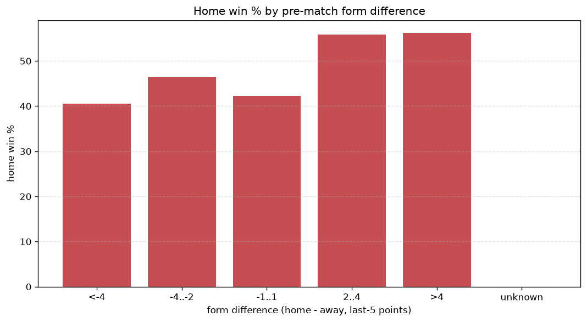
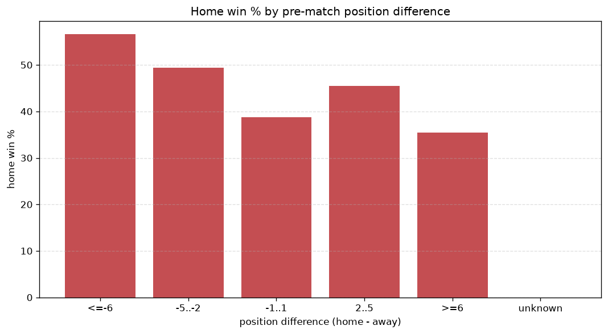

# Relationships Analysis
- Report: `relationships`
- Generated: 2026-10-30T04:13:16+00:00
- Script: `backend/scripts/analyze_relationships.py` v1.0.0
- League: National League South (England)
- Scope: league `south`

- Matches analysed: **2841** (23 leakage-safe pre-match features).

## 1. Correlation matrix
_Pearson correlation of each pre-match feature with observed goals; sorted by |corr(total goals)|._

| feature | corr(home) | corr(away) | corr(total) |
|---|---|---|---|
| home_team_goals_scored_last_5 | 0.127 | -0.035 | 0.070 |
| home_team_home_goals_avg | 0.132 | -0.047 | 0.065 |
| home_team_home_conceded_avg | -0.004 | 0.081 | 0.053 |
| home_position_before_match | -0.145 | 0.082 | -0.051 |
| home_team_wins_last_5 | 0.126 | -0.064 | 0.050 |
| home_team_points_last_5 | 0.120 | -0.063 | 0.045 |
| points_difference | 0.183 | -0.141 | 0.038 |
| home_points_before_match | 0.103 | -0.059 | 0.035 |
| away_team_away_conceded_avg | 0.067 | -0.023 | 0.033 |
| home_team_home_win_rate | 0.102 | -0.063 | 0.032 |
| away_team_goals_conceded_last_5 | 0.068 | -0.032 | 0.028 |
| away_team_away_goals_avg | -0.019 | 0.055 | 0.025 |
| position_difference | -0.164 | 0.142 | -0.023 |
| home_team_goals_conceded_last_5 | -0.040 | 0.071 | 0.020 |
| away_position_before_match | 0.071 | -0.104 | -0.019 |
| away_team_goals_scored_last_5 | -0.036 | 0.054 | 0.011 |
| away_points_before_match | -0.020 | 0.035 | 0.010 |
| away_team_wins_last_5 | -0.059 | 0.051 | -0.008 |
| home_rest_days | 0.017 | -0.007 | 0.007 |
| rest_days_difference | 0.013 | -0.004 | 0.007 |
| away_team_away_win_rate | -0.051 | 0.049 | -0.004 |
| away_team_points_last_5 | -0.053 | 0.054 | -0.002 |
| away_rest_days | 0.003 | -0.002 | 0.001 |

## 2. Form vs outcome
_Home win/draw/away % per bucket of `home_team_points_last_5 - away_team_points_last_5`._

| bucket | matches | home | draw | away | home % | draw % | away % |
|---|---|---|---|---|---|---|---|
| <-4 | 453 | 154 | 104 | 195 | 34.0% | 23.0% | 43.0% |
| -4..-2 | 574 | 226 | 144 | 204 | 39.4% | 25.1% | 35.5% |
| -1..1 | 812 | 352 | 179 | 281 | 43.3% | 22.0% | 34.6% |
| 2..4 | 567 | 276 | 151 | 140 | 48.7% | 26.6% | 24.7% |
| >4 | 435 | 233 | 94 | 108 | 53.6% | 21.6% | 24.8% |
| unknown | 0 | 0 | 0 | 0 | - | - | - |

## 3. Position vs outcome
_Home win/draw/away % per bucket of `position_difference` (home position - away position; negative favours the home team)._

| bucket | matches | home | draw | away | home % | draw % | away % |
|---|---|---|---|---|---|---|---|
| <=-6 | 844 | 460 | 190 | 194 | 54.5% | 22.5% | 23.0% |
| -5..-2 | 411 | 187 | 98 | 126 | 45.5% | 23.8% | 30.7% |
| -1..1 | 328 | 156 | 71 | 101 | 47.6% | 21.6% | 30.8% |
| 2..5 | 417 | 169 | 106 | 142 | 40.5% | 25.4% | 34.1% |
| >=6 | 841 | 269 | 207 | 365 | 32.0% | 24.6% | 43.4% |
| unknown | 0 | 0 | 0 | 0 | - | - | - |

## 4. Rest advantage
_Home win/draw/away % per bucket of `rest_days_difference` (home rest - away rest). Matches with unknown rest are bucketed separately._

| bucket | matches | home | draw | away | home % | draw % | away % |
|---|---|---|---|---|---|---|---|
| <-1 | 413 | 177 | 100 | 136 | 42.9% | 24.2% | 32.9% |
| -1..0 | 58 | 29 | 14 | 15 | 50.0% | 24.1% | 25.9% |
| 0 | 1838 | 787 | 438 | 613 | 42.8% | 23.8% | 33.4% |
| 1..2 | 65 | 21 | 22 | 22 | 32.3% | 33.8% | 33.8% |
| >2 | 350 | 168 | 71 | 111 | 48.0% | 20.3% | 31.7% |
| unknown | 117 | 59 | 27 | 31 | 50.4% | 23.1% | 26.5% |
- *117 match(es) had unknown rest difference (missing rest data on at least one side).*

## 5. Home team quality
_Home win rate by `home_team_home_win_rate` tier (split at 0.5)._

- `< 0.5` tier: **40.3%** home win (716/1776)
- `>= 0.5` tier: **49.3%** home win (525/1065)
- Home-win gap (>= split minus < split): **+9.0 pp**

| tier | label | matches | home | draw | away | home % |
|---|---|---|---|---|---|---|
| low | < 0.5 | 1776 | 716 | 418 | 642 | 40.3% |
| high | >= 0.5 | 1065 | 525 | 254 | 286 | 49.3% |

## 6. Feature averages by result
_Mean feature value per outcome; `range` is home-minus-away spread of the group means._

| feature | home mean | draw mean | away mean | range |
|---|---|---|---|---|
| points_difference | 2.863 | -0.735 | -3.356 | 6.219 |
| position_difference | -2.084 | 0.415 | 2.370 | 4.453 |
| home_points_before_match | 31.057 | 27.740 | 26.733 | 4.324 |
| home_position_before_match | 11.155 | 12.826 | 13.603 | 2.449 |
| away_position_before_match | 13.239 | 12.411 | 11.234 | 2.005 |
| away_points_before_match | 28.194 | 28.475 | 30.088 | 1.894 |
| home_team_points_last_5 | 6.698 | 6.260 | 5.913 | 0.785 |
| away_team_points_last_5 | 6.048 | 6.381 | 6.763 | 0.715 |
| away_team_goals_scored_last_5 | 6.209 | 6.499 | 6.858 | 0.649 |
| home_team_goals_conceded_last_5 | 6.212 | 6.455 | 6.822 | 0.610 |
| home_team_goals_scored_last_5 | 6.728 | 6.253 | 6.188 | 0.540 |
| away_team_goals_conceded_last_5 | 6.599 | 6.504 | 6.158 | 0.440 |
| rest_days_difference | 0.086 | -0.250 | 0.048 | 0.336 |
| home_team_wins_last_5 | 1.879 | 1.714 | 1.597 | 0.282 |
| away_team_wins_last_5 | 1.649 | 1.772 | 1.883 | 0.233 |
| home_rest_days | 6.246 | 6.059 | 6.288 | 0.229 |
| away_rest_days | 6.124 | 6.343 | 6.260 | 0.220 |
| home_team_home_goals_avg | 1.488 | 1.374 | 1.355 | 0.133 |
| home_team_home_conceded_avg | 1.187 | 1.226 | 1.274 | 0.087 |
| away_team_away_goals_avg | 1.201 | 1.232 | 1.287 | 0.086 |
| away_team_away_conceded_avg | 1.451 | 1.416 | 1.377 | 0.074 |
| home_team_home_win_rate | 0.427 | 0.391 | 0.378 | 0.049 |
| away_team_away_win_rate | 0.297 | 0.319 | 0.335 | 0.038 |

---
*All features are leakage-safe pre-match values built by `ml.features.build_features.build_rows` from strictly prior matches. Run with `python backend/scripts/analyze_relationships.py` to regenerate.*

## Charts

