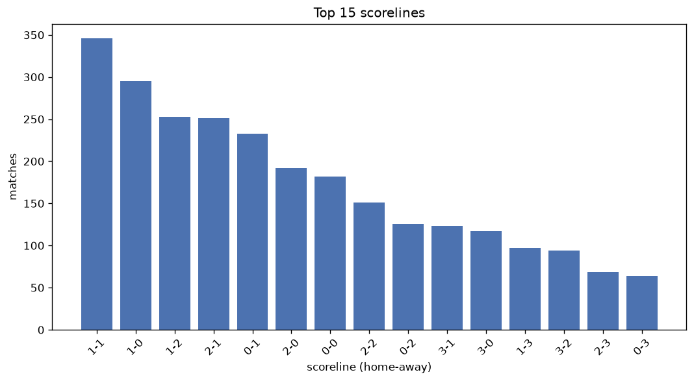
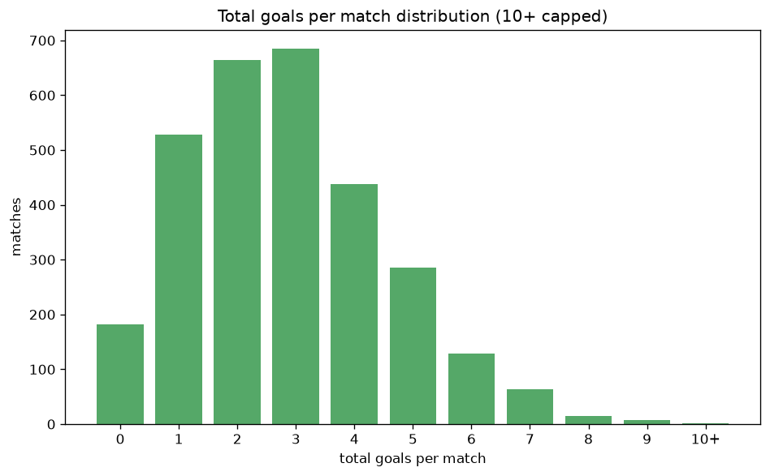

# Scoreline Analysis
- Report: `scoreline_analysis`
- Generated: 2026-10-26T01:49:23+00:00
- Script: `backend/scripts/analyze_scorelines.py` v1.0.0
- League: National League South (England)
- Scope: league `south`

## 1. Scoreline frequency
- Matches analysed: **3000** across **7** seasons.
- Distinct scorelines seen: **50**.

| scoreline | count | pct |
|---|---|---|
| 1-1 | 346 | 11.5% |
| 1-0 | 295 | 9.8% |
| 1-2 | 253 | 8.4% |
| 2-1 | 251 | 8.4% |
| 0-1 | 233 | 7.8% |
| 2-0 | 192 | 6.4% |
| 0-0 | 182 | 6.1% |
| 2-2 | 151 | 5.0% |
| 0-2 | 126 | 4.2% |
| 3-1 | 123 | 4.1% |
| 3-0 | 117 | 3.9% |
| 1-3 | 97 | 3.2% |
| 3-2 | 94 | 3.1% |
| 2-3 | 69 | 2.3% |
| 0-3 | 64 | 2.1% |
| 4-1 | 56 | 1.9% |
| 4-0 | 44 | 1.5% |
| 1-4 | 36 | 1.2% |
| 4-2 | 34 | 1.1% |
| 3-3 | 32 | 1.1% |

## 2. Scoreline frequency per season

### 2020-2021
| scoreline | count | pct |
|---|---|---|
| 1-1 | 17 | 10.3% |
| 1-2 | 15 | 9.1% |
| 2-1 | 14 | 8.5% |
| 0-2 | 14 | 8.5% |
| 1-0 | 11 | 6.7% |

### 2021-2022
| scoreline | count | pct |
|---|---|---|
| 1-0 | 43 | 10.2% |
| 1-1 | 42 | 10.0% |
| 2-1 | 37 | 8.8% |
| 0-1 | 31 | 7.4% |
| 1-2 | 28 | 6.7% |

### 2022-2023
| scoreline | count | pct |
|---|---|---|
| 1-1 | 67 | 12.1% |
| 2-1 | 51 | 9.2% |
| 0-1 | 47 | 8.5% |
| 1-2 | 47 | 8.5% |
| 1-0 | 46 | 8.3% |

### 2023-2024
| scoreline | count | pct |
|---|---|---|
| 1-1 | 67 | 12.2% |
| 2-1 | 49 | 8.9% |
| 1-2 | 49 | 8.9% |
| 1-0 | 46 | 8.4% |
| 0-1 | 46 | 8.4% |

### 2024-2025
| scoreline | count | pct |
|---|---|---|
| 1-1 | 71 | 12.9% |
| 1-0 | 61 | 11.1% |
| 0-1 | 48 | 8.7% |
| 2-1 | 44 | 8.0% |
| 1-2 | 36 | 6.6% |

### 2025-2026
| scoreline | count | pct |
|---|---|---|
| 1-0 | 75 | 12.4% |
| 1-2 | 63 | 10.4% |
| 1-1 | 59 | 9.8% |
| 2-1 | 51 | 8.4% |
| 2-0 | 46 | 7.6% |

### 2026-2027
| scoreline | count | pct |
|---|---|---|
| 1-1 | 23 | 14.5% |
| 1-2 | 15 | 9.4% |
| 2-0 | 13 | 8.2% |
| 0-1 | 13 | 8.2% |
| 1-0 | 13 | 8.2% |

## 3. Total-goal histogram
_10+ groups all matches with 10 or more total goals._

| total goals | matches | pct |
|---|---|---|
| 0 | 182 | 6.1% |
| 1 | 528 | 17.6% |
| 2 | 664 | 22.1% |
| 3 | 685 | 22.8% |
| 4 | 438 | 14.6% |
| 5 | 286 | 9.5% |
| 6 | 129 | 4.3% |
| 7 | 63 | 2.1% |
| 8 | 15 | 0.5% |
| 9 | 8 | 0.3% |
| 10+ | 2 | 0.1% |

## 4. Extreme scorelines
- Matches with 7+ total goals: **88**

| season | date | scoreline | total goals |
|---|---|---|---|
| 2023-2024 | 2024-02-10 | 6-4 | 10 |
| 2024-2025 | 2025-04-21 | 2-8 | 10 |
| 2021-2022 | 2022-04-23 | 7-2 | 9 |
| 2021-2022 | 2022-05-07 | 2-7 | 9 |
| 2022-2023 | 2023-02-11 | 4-5 | 9 |
| 2022-2023 | 2023-03-07 | 7-2 | 9 |
| 2024-2025 | 2024-11-25 | 6-3 | 9 |
| 2025-2026 | 2026-01-10 | 5-4 | 9 |
| 2025-2026 | 2026-04-06 | 5-4 | 9 |
| 2025-2026 | 2026-04-11 | 7-2 | 9 |
| 2020-2021 | 2020-10-17 | 4-4 | 8 |
| 2020-2021 | 2020-11-28 | 2-6 | 8 |
| 2020-2021 | 2021-01-19 | 3-5 | 8 |
| 2021-2022 | 2021-12-26 | 8-0 | 8 |
| 2022-2023 | 2022-12-13 | 5-3 | 8 |
| 2022-2023 | 2023-02-18 | 6-2 | 8 |
| 2022-2023 | 2023-02-18 | 4-4 | 8 |
| 2023-2024 | 2023-08-15 | 2-6 | 8 |
| 2023-2024 | 2023-12-09 | 4-4 | 8 |
| 2024-2025 | 2024-11-25 | 1-7 | 8 |
| 2025-2026 | 2026-02-14 | 5-3 | 8 |
| 2025-2026 | 2026-02-24 | 8-0 | 8 |
| 2025-2026 | 2026-03-07 | 7-1 | 8 |
| 2026-2027 | 2026-08-15 | 5-3 | 8 |
| 2026-2027 | 2026-08-22 | 5-3 | 8 |
| 2020-2021 | 2020-10-31 | 3-4 | 7 |
| 2020-2021 | 2020-12-12 | 3-4 | 7 |
| 2020-2021 | 2021-02-16 | 4-3 | 7 |
| 2021-2022 | 2021-08-21 | 2-5 | 7 |
| 2021-2022 | 2021-09-28 | 2-5 | 7 |
| 2021-2022 | 2021-10-09 | 5-2 | 7 |
| 2021-2022 | 2021-10-26 | 4-3 | 7 |
| 2021-2022 | 2021-10-30 | 4-3 | 7 |
| 2021-2022 | 2021-11-13 | 3-4 | 7 |
| 2021-2022 | 2021-11-16 | 3-4 | 7 |
| 2021-2022 | 2021-12-04 | 5-2 | 7 |
| 2021-2022 | 2022-01-08 | 6-1 | 7 |
| 2021-2022 | 2022-01-15 | 5-2 | 7 |
| 2021-2022 | 2022-03-26 | 4-3 | 7 |
| 2021-2022 | 2022-05-02 | 4-3 | 7 |
| 2022-2023 | 2022-08-13 | 3-4 | 7 |
| 2022-2023 | 2022-09-03 | 3-4 | 7 |
| 2022-2023 | 2022-09-24 | 3-4 | 7 |
| 2022-2023 | 2022-12-26 | 4-3 | 7 |
| 2022-2023 | 2023-01-21 | 4-3 | 7 |
| 2022-2023 | 2023-03-14 | 2-5 | 7 |
| 2022-2023 | 2023-03-25 | 4-3 | 7 |
| 2022-2023 | 2023-04-07 | 6-1 | 7 |
| 2022-2023 | 2023-04-07 | 7-0 | 7 |
| 2022-2023 | 2023-04-27 | 3-4 | 7 |
| 2023-2024 | 2023-08-05 | 5-2 | 7 |
| 2023-2024 | 2023-08-28 | 4-3 | 7 |
| 2023-2024 | 2023-09-02 | 2-5 | 7 |
| 2023-2024 | 2023-10-14 | 4-3 | 7 |
| 2023-2024 | 2023-11-11 | 4-3 | 7 |
| 2023-2024 | 2023-11-11 | 5-2 | 7 |
| 2023-2024 | 2023-11-14 | 3-4 | 7 |
| 2023-2024 | 2023-12-02 | 3-4 | 7 |
| 2023-2024 | 2023-12-02 | 4-3 | 7 |
| 2023-2024 | 2024-02-03 | 4-3 | 7 |
| 2023-2024 | 2024-02-10 | 3-4 | 7 |
| 2023-2024 | 2024-03-29 | 3-4 | 7 |
| 2024-2025 | 2024-08-10 | 3-4 | 7 |
| 2024-2025 | 2024-08-20 | 1-6 | 7 |
| 2024-2025 | 2024-10-05 | 3-4 | 7 |
| 2024-2025 | 2024-10-26 | 4-3 | 7 |
| 2024-2025 | 2024-11-02 | 3-4 | 7 |
| 2024-2025 | 2024-11-02 | 2-5 | 7 |
| 2024-2025 | 2024-11-23 | 4-3 | 7 |
| 2024-2025 | 2025-02-03 | 3-4 | 7 |
| 2024-2025 | 2025-02-08 | 3-4 | 7 |
| 2024-2025 | 2025-04-26 | 1-6 | 7 |
| 2024-2025 | 2025-04-26 | 5-2 | 7 |
| 2025-2026 | 2025-08-16 | 3-4 | 7 |
| 2025-2026 | 2025-09-01 | 2-5 | 7 |
| 2025-2026 | 2025-09-06 | 2-5 | 7 |
| 2025-2026 | 2025-09-20 | 2-5 | 7 |
| 2025-2026 | 2025-11-22 | 7-0 | 7 |
| 2025-2026 | 2025-12-20 | 2-5 | 7 |
| 2025-2026 | 2025-12-30 | 3-4 | 7 |
| 2025-2026 | 2026-03-21 | 5-2 | 7 |
| 2025-2026 | 2026-03-31 | 3-4 | 7 |
| 2025-2026 | 2026-04-18 | 1-6 | 7 |
| 2025-2026 | 2026-04-18 | 5-2 | 7 |
| 2025-2026 | 2026-04-25 | 1-6 | 7 |
| 2026-2027 | 2026-09-26 | 4-3 | 7 |
| 2026-2027 | 2026-10-17 | 6-1 | 7 |
| 2026-2027 | 2026-10-24 | 3-4 | 7 |

## 5. Margin-of-victory distribution (decided matches)
- Decided matches: **2286** (draws: **714**)
- Average winning margin: **1.77**

| margin | matches | pct |
|---|---|---|
| 1 | 1235 | 54.0% |
| 2 | 595 | 26.0% |
| 3+ | 456 | 19.9% |

## 6. Margin by outcome

### Home wins
- Matches: **1299** | avg margin: **1.84** | max margin: **8**
| margin | matches | pct |
|---|---|---|
| 1 | 658 | 50.7% |
| 2 | 354 | 27.3% |
| 3+ | 287 | 22.1% |
- *Full match-by-match list available in `scoreline_analysis.json`.*

### Away wins
- Matches: **987** | avg margin: **1.68** | max margin: **6**
| margin | matches | pct |
|---|---|---|
| 1 | 577 | 58.5% |
| 2 | 241 | 24.4% |
| 3+ | 169 | 17.1% |
- *Full match-by-match list available in `scoreline_analysis.json`.*

## 7. Most common exact score by outcome type
| outcome | matches | most common score | count | pct |
|---|---|---|---|---|
| home | 1299 | 1-0 | 295 | 22.7% |
| draw | 714 | 1-1 | 346 | 48.5% |
| away | 987 | 1-2 | 253 | 25.6% |

---
*All statistics are computed from PostgreSQL tables (read-only). Run with `python backend/scripts/analyze_scorelines.py` to regenerate.*

## Charts

