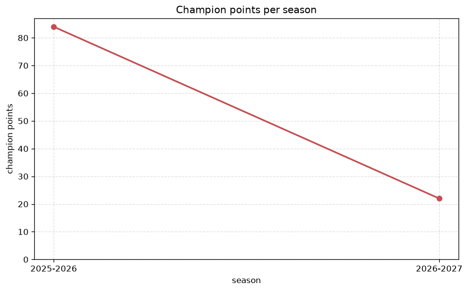
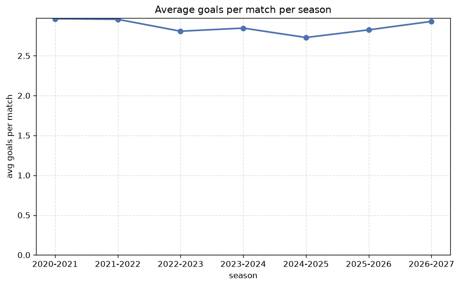

# Season Trends Analysis
- Report: `season_trends`
- Generated: 2026-10-27T02:31:33+00:00
- Script: `backend/scripts/analyze_seasons.py` v1.0.0
- League: National League South (England)
- Scope: league `south`

## 1. Champions per season
| season | champion | pts | runner-up | margin |
|---|---|---|---|---|
| 2020-2021 | Dorking | 39 | Dartford | 5 pts |
| 2021-2022 | Maidstone | 87 | Dorking | 6 pts |
| 2022-2023 | Ebbsfleet | 103 | Dartford | 20 pts |
| 2023-2024 | Yeovil | 95 | Chelmsford | 11 pts |
| 2024-2025 | Truro | 89 | Torquay | 0 pts |
| 2025-2026 | Worthing | 84 | Hornchurch | 0 pts |
| 2026-2027 | Maidstone | 29 | Ebbsfleet | 1 pts |

## 2. Title-race tightness
- Tight races (margin <= 3 pts): **3** of 7 seasons
- Tightest race: **2024-2025** - Truro beat Torquay by **0** pts

| season | margin | tight |
|---|---|---|
| 2020-2021 | 5 pts |  |
| 2021-2022 | 6 pts |  |
| 2022-2023 | 20 pts |  |
| 2023-2024 | 11 pts |  |
| 2024-2025 | 0 pts | yes |
| 2025-2026 | 0 pts | yes |
| 2026-2027 | 1 pts | yes |

## 3. Points thresholds
_Position-specific points per season. Key: 1 = champion, 2 = runner-up, 4 = CL line, 6 = Europa, 21 = last safe, 24 = bottom._

| season | pos 1 | pos 2 | pos 4 | pos 6 | pos 21 | pos 24 |
|---|---|---|---|---|---|---|
| 2020-2021 | 39 | 34 | 32 | 29 | 12 | - |
| 2021-2022 | 87 | 81 | 74 | 60 | 36 | - |
| 2022-2023 | 103 | 83 | 78 | 75 | 48 | 40 |
| 2023-2024 | 95 | 84 | 83 | 73 | 46 | 27 |
| 2024-2025 | 89 | 89 | 87 | 83 | 45 | 32 |
| 2025-2026 | 84 | 84 | 82 | 78 | 48 | 40 |
| 2026-2027 | 29 | 28 | 25 | 24 | 10 | 4 |

## 4. Relegation battle
| season | safe pos | safe pts | drop pos | drop pts | gap |
|---|---|---|---|---|---|
| 2020-2021 | 21 | 12 | 22 | - | - |
| 2021-2022 | 21 | 36 | 22 | - | - |
| 2022-2023 | 21 | 48 | 22 | 44 | 4 pts |
| 2023-2024 | 21 | 46 | 22 | 46 | 0 pts |
| 2024-2025 | 21 | 45 | 22 | 38 | 7 pts |
| 2025-2026 | 21 | 48 | 22 | 43 | 5 pts |
| 2026-2027 | 21 | 10 | 22 | 8 | 2 pts |

## 5. League-level trends
| season | matches | total goals | avg goals | home win | draw | away win | goalless | avg pts/team |
|---|---|---|---|---|---|---|---|---|
| 2020-2021 | 165 | 489 | 2.964 | 37.6% | 21.8% | 40.6% | 5.5% | 21.86 |
| 2021-2022 | 420 | 1242 | 2.957 | 43.3% | 23.3% | 33.3% | 5.7% | 55.33 |
| 2022-2023 | 552 | 1550 | 2.808 | 43.5% | 22.8% | 33.7% | 6.5% | 63.75 |
| 2023-2024 | 550 | 1566 | 2.847 | 42.4% | 24.9% | 32.7% | 5.8% | 63.04 |
| 2024-2025 | 549 | 1498 | 2.729 | 42.8% | 25.5% | 31.7% | 6.4% | 62.79 |
| 2025-2026 | 605 | 1709 | 2.825 | 47.8% | 22.3% | 29.9% | 6.4% | 23.21 |
| 2026-2027 | 159 | 466 | 2.931 | 36.5% | 26.4% | 37.1% | 4.4% | 18.12 |

## 6. View divergence
- Largest divergence: **2025-2026** (goals view, avg abs position diff = 21.083)

_Avg absolute position difference between classic view and alternative view per season._

| season | classic vs luck | classic vs goals |
|---|---|---|
| 2020-2021 | 3.048 | 8.190 |
| 2021-2022 | 4.476 | 5.429 |
| 2022-2023 | 3.917 | 6.750 |
| 2023-2024 | 3.083 | 7.667 |
| 2024-2025 | 3.333 | 8.250 |
| 2025-2026 | 17.000 | 21.083 |
| 2026-2027 | 2.583 | 8.833 |

---
*All statistics are computed from PostgreSQL tables (read-only). Run with `python backend/scripts/analyze_seasons.py` to regenerate.*

## Charts

