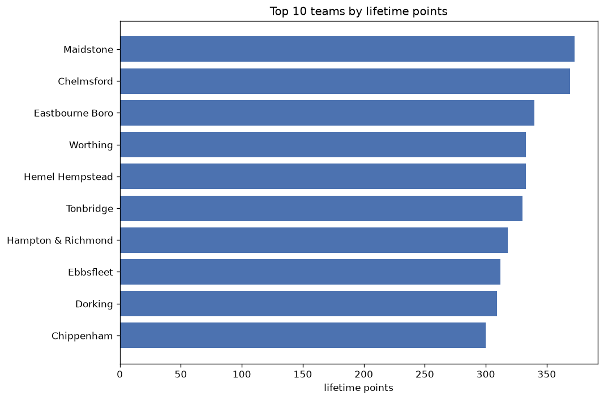
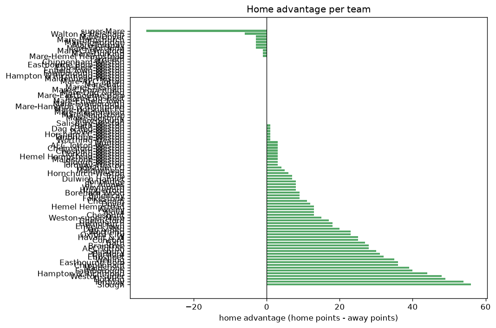

# Team Analysis
- Report: `teams_analysis`
- Generated: 2026-10-27T02:31:30+00:00
- Script: `backend/scripts/analyze_teams.py` v1.0.0
- League: National League South (England)
- Scope: league `south`

- Teams: **92** | Seasons: **7** | Matches: **3000**

## 1. Team standings (lifetime)
| team | seasons | played | W | D | L | pts | GF | GA | GD | avg pts/season | best pos | worst pos | titles |
|---|---|---|---|---|---|---|---|---|---|---|---|---|---|
| Maidstone | 6 | 204 | 108 | 49 | 47 | 373 | 339 | 207 | 132 | 62.17 | 1 | 11 | 2 |
| Chelmsford | 7 | 251 | 99 | 72 | 80 | 369 | 374 | 305 | 69 | 52.71 | 2 | 19 | 0 |
| Eastbourne Boro | 6 | 243 | 96 | 52 | 95 | 340 | 365 | 366 | -1 | 56.67 | 3 | 25 | 0 |
| Worthing | 4 | 183 | 99 | 36 | 48 | 333 | 372 | 253 | 119 | 83.25 | 1 | 4 | 1 |
| Hemel Hempstead | 7 | 256 | 90 | 63 | 103 | 333 | 312 | 377 | -65 | 47.57 | 5 | 20 | 0 |
| Tonbridge | 7 | 252 | 89 | 63 | 100 | 330 | 337 | 351 | -14 | 47.14 | 5 | 16 | 0 |
| Hampton & Richmond | 7 | 254 | 88 | 54 | 112 | 318 | 331 | 380 | -49 | 45.43 | 6 | 22 | 0 |
| Ebbsfleet | 5 | 162 | 94 | 30 | 38 | 312 | 315 | 184 | 131 | 62.4 | 1 | 9 | 1 |
| Dorking | 5 | 165 | 90 | 39 | 36 | 309 | 341 | 210 | 131 | 61.8 | 1 | 8 | 1 |
| Chippenham | 6 | 238 | 79 | 63 | 96 | 300 | 303 | 349 | -46 | 50.0 | 7 | 23 | 0 |
| Bath | 6 | 235 | 81 | 54 | 100 | 297 | 288 | 321 | -33 | 49.5 | 6 | 22 | 0 |
| Slough | 7 | 249 | 76 | 64 | 109 | 292 | 359 | 438 | -79 | 41.71 | 11 | 24 | 0 |
| St. Albans | 5 | 193 | 75 | 47 | 71 | 272 | 273 | 250 | 23 | 54.4 | 5 | 21 | 0 |
| Farnborough | 5 | 197 | 75 | 43 | 79 | 268 | 286 | 302 | -16 | 53.6 | 8 | 19 | 0 |
| Torquay | 4 | 153 | 74 | 34 | 45 | 256 | 261 | 203 | 58 | 64.0 | 2 | 12 | 0 |
| Dartford | 4 | 151 | 68 | 33 | 50 | 237 | 239 | 184 | 55 | 59.25 | 2 | 21 | 0 |
| Weston-super-Mare | 4 | 154 | 67 | 32 | 55 | 233 | 216 | 198 | 18 | 58.25 | 6 | 14 | 0 |
| Braintree | 5 | 161 | 62 | 40 | 59 | 226 | 207 | 219 | -12 | 45.2 | 5 | 20 | 0 |
| Welling | 5 | 192 | 49 | 54 | 89 | 201 | 224 | 342 | -118 | 40.2 | 16 | 22 | 0 |
| Havant & W | 4 | 146 | 50 | 33 | 63 | 183 | 215 | 238 | -23 | 45.75 | 8 | 23 | 0 |
| Oxford City | 3 | 103 | 49 | 32 | 22 | 179 | 189 | 119 | 70 | 59.67 | 3 | 5 | 0 |
| Truro | 3 | 104 | 49 | 24 | 31 | 171 | 157 | 120 | 37 | 57.0 | 1 | 16 | 1 |
| Hornchurch | 2 | 94 | 42 | 26 | 26 | 152 | 145 | 120 | 25 | 76.0 | 2 | 9 | 0 |
| Dover | 4 | 151 | 34 | 42 | 75 | 144 | 161 | 241 | -80 | 36.0 | 13 | 24 | 0 |
| Chesham | 3 | 105 | 40 | 21 | 44 | 141 | 146 | 156 | -10 | 47.0 | 11 | 21 | 0 |
| Weymouth | 3 | 137 | 32 | 38 | 67 | 134 | 159 | 219 | -60 | 44.67 | 18 | 23 | 0 |
| Salisbury | 3 | 105 | 30 | 32 | 43 | 122 | 128 | 144 | -16 | 40.67 | 7 | 20 | 0 |
| Hungerford | 3 | 105 | 34 | 16 | 55 | 118 | 134 | 168 | -34 | 39.33 | 7 | 24 | 0 |
| Dulwich Hamlet | 3 | 99 | 30 | 25 | 44 | 115 | 139 | 166 | -27 | 38.33 | 10 | 21 | 0 |
| Taunton | 2 | 92 | 27 | 26 | 39 | 107 | 94 | 126 | -32 | 53.5 | 14 | 22 | 0 |
| Concord | 3 | 100 | 28 | 23 | 49 | 107 | 114 | 181 | -67 | 35.67 | 14 | 22 | 0 |
| Aveley | 2 | 92 | 29 | 18 | 45 | 105 | 113 | 142 | -29 | 52.5 | 7 | 24 | 0 |
| Yeovil | 1 | 45 | 29 | 8 | 8 | 95 | 81 | 45 | 36 | 95.0 | 1 | 1 | 1 |
| Maidenhead | 2 | 61 | 26 | 15 | 20 | 93 | 82 | 61 | 21 | 46.5 | 7 | 16 | 0 |
| Dag & Red | 2 | 60 | 24 | 16 | 20 | 88 | 74 | 72 | 2 | 44.0 | 6 | 13 | 0 |
| Enfield Town | 2 | 92 | 22 | 22 | 48 | 88 | 104 | 170 | -66 | 44.0 | 19 | 24 | 0 |
| Boreham Wood | 1 | 45 | 25 | 8 | 12 | 83 | 85 | 48 | 37 | 83.0 | 6 | 6 | 0 |
| AFC Totton | 2 | 60 | 25 | 7 | 28 | 82 | 76 | 104 | -28 | 41.0 | 12 | 17 | 0 |
| Horsham FC | 2 | 60 | 19 | 21 | 20 | 78 | 69 | 70 | -1 | 39.0 | 12 | 15 | 0 |
| Billericay | 3 | 70 | 20 | 17 | 33 | 77 | 96 | 120 | -24 | 25.67 | 4 | 21 | 0 |
| Weston-super | 1 | 23 | 15 | 3 | 5 | 48 | 35 | 16 | 19 | 48.0 | 21 | 21 | 0 |
| Cheshunt | 1 | 46 | 11 | 10 | 25 | 43 | 48 | 74 | -26 | 43.0 | 23 | 23 | 0 |
| super-Mare | 1 | 25 | 9 | 6 | 10 | 33 | 28 | 35 | -7 | 33.0 | 26 | 26 | 0 |
| Farnham | 1 | 12 | 6 | 2 | 4 | 20 | 23 | 16 | 7 | 20.0 | 9 | 9 | 0 |
| Folkestone | 1 | 14 | 5 | 4 | 5 | 19 | 22 | 17 | 5 | 19.0 | 11 | 11 | 0 |
| Walton & Hersham | 1 | 13 | 2 | 2 | 9 | 8 | 10 | 30 | -20 | 8.0 | 23 | 23 | 0 |
| Hornchurch-Weston | 1 | 2 | 2 | 0 | 0 | 6 | 5 | 2 | 3 | 6.0 | 27 | 27 | 0 |
| Chesham-Weston | 1 | 1 | 1 | 0 | 0 | 3 | 4 | 0 | 4 | 3.0 | 28 | 28 | 0 |
| Mare-Torquay | 1 | 1 | 1 | 0 | 0 | 3 | 3 | 0 | 3 | 3.0 | 30 | 30 | 0 |
| AFC Totton-Weston | 1 | 1 | 1 | 0 | 0 | 3 | 3 | 1 | 2 | 3.0 | 32 | 32 | 0 |
| Hemel Hempstead-Weston | 1 | 2 | 1 | 0 | 1 | 3 | 4 | 2 | 2 | 3.0 | 29 | 29 | 0 |
| Torquay-Weston | 1 | 1 | 1 | 0 | 0 | 3 | 3 | 1 | 2 | 3.0 | 31 | 31 | 0 |
| Chelmsford-Weston | 1 | 1 | 1 | 0 | 0 | 3 | 1 | 0 | 1 | 3.0 | 40 | 40 | 0 |
| Dorking-Weston | 1 | 1 | 1 | 0 | 0 | 3 | 3 | 2 | 1 | 3.0 | 34 | 34 | 0 |
| Maidstone-Weston | 1 | 1 | 1 | 0 | 0 | 3 | 2 | 1 | 1 | 3.0 | 36 | 36 | 0 |
| Mare-Dover | 1 | 1 | 1 | 0 | 0 | 3 | 2 | 1 | 1 | 3.0 | 37 | 37 | 0 |
| Mare-Hornchurch | 1 | 1 | 1 | 0 | 0 | 3 | 2 | 1 | 1 | 3.0 | 35 | 35 | 0 |
| Mare-Tonbridge | 1 | 1 | 1 | 0 | 0 | 3 | 1 | 0 | 1 | 3.0 | 38 | 38 | 0 |
| Mare-Worthing | 1 | 1 | 1 | 0 | 0 | 3 | 3 | 2 | 1 | 3.0 | 33 | 33 | 0 |
| Slough-Weston | 1 | 1 | 1 | 0 | 0 | 3 | 1 | 0 | 1 | 3.0 | 39 | 39 | 0 |
| Bath-Weston | 1 | 1 | 0 | 1 | 0 | 1 | 0 | 0 | 0 | 1.0 | 47 | 47 | 0 |
| Dag & Red-Weston | 1 | 1 | 0 | 1 | 0 | 1 | 0 | 0 | 0 | 1.0 | 48 | 48 | 0 |
| Dover-Weston | 1 | 1 | 0 | 1 | 0 | 1 | 1 | 1 | 0 | 1.0 | 43 | 43 | 0 |
| Horsham FC-Weston | 1 | 1 | 0 | 1 | 0 | 1 | 1 | 1 | 0 | 1.0 | 42 | 42 | 0 |
| Mare-Chelmsford | 1 | 1 | 0 | 1 | 0 | 1 | 0 | 0 | 0 | 1.0 | 46 | 46 | 0 |
| Mare-Dorking | 1 | 1 | 0 | 1 | 0 | 1 | 1 | 1 | 0 | 1.0 | 41 | 41 | 0 |
| Mare-Hemel Hempstead | 1 | 1 | 0 | 1 | 0 | 1 | 0 | 0 | 0 | 1.0 | 49 | 49 | 0 |
| Tonbridge-Weston | 1 | 1 | 0 | 1 | 0 | 1 | 0 | 0 | 0 | 1.0 | 45 | 45 | 0 |
| Worthing-Weston | 1 | 1 | 0 | 1 | 0 | 1 | 1 | 1 | 0 | 1.0 | 44 | 44 | 0 |
| Chippenham-Weston | 1 | 1 | 0 | 0 | 1 | 0 | 1 | 2 | -1 | 0.0 | 51 | 51 | 0 |
| Eastbourne Boro-Weston | 1 | 1 | 0 | 0 | 1 | 0 | 1 | 2 | -1 | 0.0 | 52 | 52 | 0 |
| Enfield Town-Weston | 1 | 1 | 0 | 0 | 1 | 0 | 0 | 1 | -1 | 0.0 | 63 | 63 | 0 |
| Hampton & Richmond-Weston | 1 | 1 | 0 | 0 | 1 | 0 | 0 | 1 | -1 | 0.0 | 55 | 55 | 0 |
| Maidenhead-Weston | 1 | 1 | 0 | 0 | 1 | 0 | 1 | 2 | -1 | 0.0 | 53 | 53 | 0 |
| Mare-AFC Totton | 1 | 1 | 0 | 0 | 1 | 0 | 0 | 1 | -1 | 0.0 | 64 | 64 | 0 |
| Mare-Bath | 1 | 1 | 0 | 0 | 1 | 0 | 1 | 2 | -1 | 0.0 | 54 | 54 | 0 |
| Mare-Chesham | 1 | 1 | 0 | 0 | 1 | 0 | 0 | 1 | -1 | 0.0 | 56 | 56 | 0 |
| Mare-Chippenham | 1 | 1 | 0 | 0 | 1 | 0 | 0 | 1 | -1 | 0.0 | 57 | 57 | 0 |
| Mare-Ebbsfleet | 1 | 1 | 0 | 0 | 1 | 0 | 0 | 1 | -1 | 0.0 | 58 | 58 | 0 |
| Mare-Enfield Town | 1 | 1 | 0 | 0 | 1 | 0 | 0 | 1 | -1 | 0.0 | 59 | 59 | 0 |
| Mare-Horsham FC | 1 | 1 | 0 | 0 | 1 | 0 | 0 | 1 | -1 | 0.0 | 60 | 60 | 0 |
| Mare-Maidenhead | 1 | 1 | 0 | 0 | 1 | 0 | 0 | 1 | -1 | 0.0 | 61 | 61 | 0 |
| Mare-Salisbury | 1 | 1 | 0 | 0 | 1 | 0 | 0 | 1 | -1 | 0.0 | 62 | 62 | 0 |
| Salisbury-Weston | 1 | 1 | 0 | 0 | 1 | 0 | 1 | 2 | -1 | 0.0 | 50 | 50 | 0 |
| Ebbsfleet-Weston | 1 | 1 | 0 | 0 | 1 | 0 | 1 | 3 | -2 | 0.0 | 67 | 67 | 0 |
| Farnborough-Weston | 1 | 1 | 0 | 0 | 1 | 0 | 1 | 3 | -2 | 0.0 | 65 | 65 | 0 |
| Mare-Eastbourne Boro | 1 | 1 | 0 | 0 | 1 | 0 | 1 | 3 | -2 | 0.0 | 66 | 66 | 0 |
| Mare-Hampton & Richmond | 1 | 1 | 0 | 0 | 1 | 0 | 0 | 2 | -2 | 0.0 | 68 | 68 | 0 |
| Mare-Dag & Red | 1 | 1 | 0 | 0 | 1 | 0 | 0 | 3 | -3 | 0.0 | 71 | 71 | 0 |
| Mare-Farnborough | 1 | 1 | 0 | 0 | 1 | 0 | 1 | 4 | -3 | 0.0 | 69 | 69 | 0 |
| Mare-Maidstone | 1 | 1 | 0 | 0 | 1 | 0 | 0 | 3 | -3 | 0.0 | 70 | 70 | 0 |
| Mare-Slough | 1 | 1 | 0 | 0 | 1 | 0 | 1 | 5 | -4 | 0.0 | 72 | 72 | 0 |

## 2. Home vs away split
| team | home P | H-W | H-D | H-L | H-pts | away P | A-W | A-D | A-L | A-pts | adv |
|---|---|---|---|---|---|---|---|---|---|---|---|
| Slough | 126 | 46 | 36 | 44 | 174 | 123 | 30 | 28 | 65 | 118 | 56 |
| Torquay | 78 | 45 | 20 | 13 | 155 | 75 | 29 | 14 | 32 | 101 | 54 |
| Dorking | 82 | 55 | 14 | 13 | 179 | 83 | 35 | 25 | 23 | 130 | 49 |
| Weston-super | 23 | 15 | 3 | 5 | 48 | 0 | 0 | 0 | 0 | 0 | 48 |
| Hampton & Richmond | 126 | 51 | 28 | 47 | 181 | 128 | 37 | 26 | 65 | 137 | 44 |
| Farnborough | 98 | 45 | 19 | 34 | 154 | 99 | 30 | 24 | 45 | 114 | 40 |
| Maidstone | 102 | 62 | 20 | 20 | 206 | 102 | 46 | 29 | 27 | 167 | 39 |
| Eastbourne Boro | 123 | 53 | 29 | 41 | 188 | 120 | 43 | 23 | 54 | 152 | 36 |
| Chippenham | 119 | 46 | 30 | 43 | 168 | 119 | 33 | 33 | 53 | 132 | 36 |
| Welling | 94 | 32 | 22 | 40 | 118 | 98 | 17 | 32 | 49 | 83 | 35 |
| Ebbsfleet | 80 | 52 | 16 | 12 | 172 | 82 | 42 | 14 | 26 | 140 | 32 |
| Dartford | 78 | 38 | 20 | 20 | 134 | 73 | 30 | 13 | 30 | 103 | 31 |
| Salisbury | 52 | 22 | 10 | 20 | 76 | 53 | 8 | 22 | 23 | 46 | 30 |
| Braintree | 81 | 35 | 22 | 24 | 127 | 80 | 27 | 18 | 35 | 99 | 28 |
| AFC Totton | 30 | 17 | 4 | 9 | 55 | 30 | 8 | 3 | 19 | 27 | 28 |
| Bath | 116 | 46 | 24 | 46 | 162 | 119 | 35 | 30 | 54 | 135 | 27 |
| Havant & W | 75 | 29 | 17 | 29 | 104 | 71 | 21 | 16 | 34 | 79 | 25 |
| Concord | 48 | 18 | 12 | 18 | 66 | 52 | 10 | 11 | 31 | 41 | 25 |
| Worthing | 91 | 52 | 22 | 17 | 178 | 92 | 47 | 14 | 31 | 155 | 23 |
| Oxford City | 53 | 28 | 17 | 8 | 101 | 50 | 21 | 15 | 14 | 78 | 23 |
| Dag & Red | 30 | 16 | 6 | 8 | 54 | 30 | 8 | 10 | 12 | 34 | 20 |
| Hornchurch | 48 | 24 | 13 | 11 | 85 | 46 | 18 | 13 | 15 | 67 | 18 |
| Enfield Town | 46 | 14 | 11 | 21 | 53 | 46 | 8 | 11 | 27 | 35 | 18 |
| Chelmsford | 126 | 52 | 37 | 37 | 193 | 125 | 47 | 35 | 43 | 176 | 17 |
| Weston-super-Mare | 77 | 35 | 19 | 23 | 124 | 77 | 32 | 13 | 32 | 109 | 15 |
| Hemel Hempstead | 128 | 46 | 35 | 47 | 173 | 128 | 44 | 28 | 56 | 160 | 13 |
| Aveley | 46 | 16 | 11 | 19 | 59 | 46 | 13 | 7 | 26 | 46 | 13 |
| Yeovil | 23 | 17 | 3 | 3 | 54 | 22 | 12 | 5 | 5 | 41 | 13 |
| Cheshunt | 23 | 8 | 4 | 11 | 28 | 23 | 3 | 6 | 14 | 15 | 13 |
| Dover | 76 | 18 | 24 | 34 | 78 | 75 | 16 | 18 | 41 | 66 | 12 |
| Chesham | 51 | 23 | 7 | 21 | 76 | 54 | 17 | 14 | 23 | 65 | 11 |
| Boreham Wood | 22 | 14 | 4 | 4 | 46 | 23 | 11 | 4 | 8 | 37 | 9 |
| Billericay | 38 | 11 | 10 | 17 | 43 | 32 | 9 | 7 | 16 | 34 | 9 |
| Folkestone | 7 | 4 | 2 | 1 | 14 | 7 | 1 | 2 | 4 | 5 | 9 |
| Tonbridge | 125 | 46 | 31 | 48 | 169 | 127 | 43 | 32 | 52 | 161 | 8 |
| St. Albans | 97 | 40 | 20 | 37 | 140 | 96 | 35 | 27 | 34 | 132 | 8 |
| Weymouth | 68 | 17 | 20 | 31 | 71 | 69 | 15 | 18 | 36 | 63 | 8 |
| Hungerford | 51 | 17 | 12 | 22 | 63 | 54 | 17 | 4 | 33 | 55 | 8 |
| Truro | 52 | 26 | 11 | 15 | 89 | 52 | 23 | 13 | 16 | 82 | 7 |
| Dulwich Hamlet | 47 | 17 | 10 | 20 | 61 | 52 | 13 | 15 | 24 | 54 | 7 |
| Hornchurch-Weston | 2 | 2 | 0 | 0 | 6 | 0 | 0 | 0 | 0 | 0 | 6 |
| Maidenhead | 29 | 14 | 7 | 8 | 49 | 32 | 12 | 8 | 12 | 44 | 5 |
| Horsham FC | 31 | 10 | 11 | 10 | 41 | 29 | 9 | 10 | 10 | 37 | 4 |
| Taunton | 46 | 14 | 13 | 19 | 55 | 46 | 13 | 13 | 20 | 52 | 3 |
| AFC Totton-Weston | 1 | 1 | 0 | 0 | 3 | 0 | 0 | 0 | 0 | 0 | 3 |
| Chelmsford-Weston | 1 | 1 | 0 | 0 | 3 | 0 | 0 | 0 | 0 | 0 | 3 |
| Chesham-Weston | 1 | 1 | 0 | 0 | 3 | 0 | 0 | 0 | 0 | 0 | 3 |
| Dorking-Weston | 1 | 1 | 0 | 0 | 3 | 0 | 0 | 0 | 0 | 0 | 3 |
| Hemel Hempstead-Weston | 2 | 1 | 0 | 1 | 3 | 0 | 0 | 0 | 0 | 0 | 3 |
| Maidstone-Weston | 1 | 1 | 0 | 0 | 3 | 0 | 0 | 0 | 0 | 0 | 3 |
| Slough-Weston | 1 | 1 | 0 | 0 | 3 | 0 | 0 | 0 | 0 | 0 | 3 |
| Torquay-Weston | 1 | 1 | 0 | 0 | 3 | 0 | 0 | 0 | 0 | 0 | 3 |
| Bath-Weston | 1 | 0 | 1 | 0 | 1 | 0 | 0 | 0 | 0 | 0 | 1 |
| Dag & Red-Weston | 1 | 0 | 1 | 0 | 1 | 0 | 0 | 0 | 0 | 0 | 1 |
| Dover-Weston | 1 | 0 | 1 | 0 | 1 | 0 | 0 | 0 | 0 | 0 | 1 |
| Horsham FC-Weston | 1 | 0 | 1 | 0 | 1 | 0 | 0 | 0 | 0 | 0 | 1 |
| Tonbridge-Weston | 1 | 0 | 1 | 0 | 1 | 0 | 0 | 0 | 0 | 0 | 1 |
| Worthing-Weston | 1 | 0 | 1 | 0 | 1 | 0 | 0 | 0 | 0 | 0 | 1 |
| Farnham | 7 | 3 | 1 | 3 | 10 | 5 | 3 | 1 | 1 | 10 | 0 |
| Chippenham-Weston | 1 | 0 | 0 | 1 | 0 | 0 | 0 | 0 | 0 | 0 | 0 |
| Eastbourne Boro-Weston | 1 | 0 | 0 | 1 | 0 | 0 | 0 | 0 | 0 | 0 | 0 |
| Ebbsfleet-Weston | 1 | 0 | 0 | 1 | 0 | 0 | 0 | 0 | 0 | 0 | 0 |
| Enfield Town-Weston | 1 | 0 | 0 | 1 | 0 | 0 | 0 | 0 | 0 | 0 | 0 |
| Farnborough-Weston | 1 | 0 | 0 | 1 | 0 | 0 | 0 | 0 | 0 | 0 | 0 |
| Hampton & Richmond-Weston | 1 | 0 | 0 | 1 | 0 | 0 | 0 | 0 | 0 | 0 | 0 |
| Maidenhead-Weston | 1 | 0 | 0 | 1 | 0 | 0 | 0 | 0 | 0 | 0 | 0 |
| Mare-AFC Totton | 0 | 0 | 0 | 0 | 0 | 1 | 0 | 0 | 1 | 0 | 0 |
| Mare-Bath | 0 | 0 | 0 | 0 | 0 | 1 | 0 | 0 | 1 | 0 | 0 |
| Mare-Chesham | 0 | 0 | 0 | 0 | 0 | 1 | 0 | 0 | 1 | 0 | 0 |
| Mare-Chippenham | 0 | 0 | 0 | 0 | 0 | 1 | 0 | 0 | 1 | 0 | 0 |
| Mare-Dag & Red | 0 | 0 | 0 | 0 | 0 | 1 | 0 | 0 | 1 | 0 | 0 |
| Mare-Eastbourne Boro | 0 | 0 | 0 | 0 | 0 | 1 | 0 | 0 | 1 | 0 | 0 |
| Mare-Ebbsfleet | 0 | 0 | 0 | 0 | 0 | 1 | 0 | 0 | 1 | 0 | 0 |
| Mare-Enfield Town | 0 | 0 | 0 | 0 | 0 | 1 | 0 | 0 | 1 | 0 | 0 |
| Mare-Farnborough | 0 | 0 | 0 | 0 | 0 | 1 | 0 | 0 | 1 | 0 | 0 |
| Mare-Hampton & Richmond | 0 | 0 | 0 | 0 | 0 | 1 | 0 | 0 | 1 | 0 | 0 |
| Mare-Horsham FC | 0 | 0 | 0 | 0 | 0 | 1 | 0 | 0 | 1 | 0 | 0 |
| Mare-Maidenhead | 0 | 0 | 0 | 0 | 0 | 1 | 0 | 0 | 1 | 0 | 0 |
| Mare-Maidstone | 0 | 0 | 0 | 0 | 0 | 1 | 0 | 0 | 1 | 0 | 0 |
| Mare-Salisbury | 0 | 0 | 0 | 0 | 0 | 1 | 0 | 0 | 1 | 0 | 0 |
| Mare-Slough | 0 | 0 | 0 | 0 | 0 | 1 | 0 | 0 | 1 | 0 | 0 |
| Salisbury-Weston | 1 | 0 | 0 | 1 | 0 | 0 | 0 | 0 | 0 | 0 | 0 |
| Mare-Chelmsford | 0 | 0 | 0 | 0 | 0 | 1 | 0 | 1 | 0 | 1 | -1 |
| Mare-Dorking | 0 | 0 | 0 | 0 | 0 | 1 | 0 | 1 | 0 | 1 | -1 |
| Mare-Hemel Hempstead | 0 | 0 | 0 | 0 | 0 | 1 | 0 | 1 | 0 | 1 | -1 |
| Mare-Dover | 0 | 0 | 0 | 0 | 0 | 1 | 1 | 0 | 0 | 3 | -3 |
| Mare-Hornchurch | 0 | 0 | 0 | 0 | 0 | 1 | 1 | 0 | 0 | 3 | -3 |
| Mare-Tonbridge | 0 | 0 | 0 | 0 | 0 | 1 | 1 | 0 | 0 | 3 | -3 |
| Mare-Torquay | 0 | 0 | 0 | 0 | 0 | 1 | 1 | 0 | 0 | 3 | -3 |
| Mare-Worthing | 0 | 0 | 0 | 0 | 0 | 1 | 1 | 0 | 0 | 3 | -3 |
| Walton & Hersham | 6 | 0 | 1 | 5 | 1 | 7 | 2 | 1 | 4 | 7 | -6 |
| super-Mare | 0 | 0 | 0 | 0 | 0 | 25 | 9 | 6 | 10 | 33 | -33 |

## 3. Top performers
### Best points per game (PPG)
| rank | team | PPG |
|---|---|---|
| 1 | Hornchurch-Weston | 3.00 |
| 2 | Chesham-Weston | 3.00 |
| 3 | Mare-Torquay | 3.00 |
| 4 | AFC Totton-Weston | 3.00 |
| 5 | Torquay-Weston | 3.00 |

### Most goals scored
| rank | team | goals |
|---|---|---|
| 1 | Chelmsford | 374 |
| 2 | Worthing | 372 |
| 3 | Eastbourne Boro | 365 |
| 4 | Slough | 359 |
| 5 | Dorking | 341 |

### Best goal difference
| rank | team | GD |
|---|---|---|
| 1 | Maidstone | 132 |
| 2 | Ebbsfleet | 131 |
| 3 | Dorking | 131 |
| 4 | Worthing | 119 |
| 5 | Oxford City | 70 |

### Best defence (goals against per match, standings)
| rank | team | GA/match |
|---|---|---|
| 1 | Chesham-Weston | 0.000 |
| 2 | Hemel Hempstead-Weston | 0.000 |
| 3 | Mare-Torquay | 0.000 |
| 4 | Mare-Tonbridge | 0.000 |
| 5 | Slough-Weston | 0.000 |

## 4. Team consistency
- Teams present in all **7** seasons: **5**

Chelmsford, Hampton & Richmond, Hemel Hempstead, Slough, Tonbridge

## 5. Head-to-head dominance
- Distinct fixtures: **745** (showing the 15 most frequent)

| fixture | meetings | home wins | draws | away wins | home pct | draw pct | away pct |
|---|---|---|---|---|---|---|---|
| Hemel Hempstead vs Tonbridge | 13 | 7 | 4 | 2 | 53.8% | 30.8% | 15.4% |
| Chelmsford vs Tonbridge | 12 | 5 | 5 | 2 | 41.7% | 41.7% | 16.7% |
| Hampton & Richmond vs Chelmsford | 12 | 5 | 3 | 4 | 41.7% | 25.0% | 33.3% |
| Hemel Hempstead vs Slough | 12 | 4 | 2 | 6 | 33.3% | 16.7% | 50.0% |
| Hemel Hempstead vs Bath | 11 | 7 | 2 | 2 | 63.6% | 18.2% | 18.2% |
| Eastbourne Boro vs Hampton & Richmond | 11 | 6 | 0 | 5 | 54.5% | 0.0% | 45.5% |
| Hampton & Richmond vs Slough | 11 | 6 | 2 | 3 | 54.5% | 18.2% | 27.3% |
| Tonbridge vs Chippenham | 11 | 6 | 3 | 2 | 54.5% | 27.3% | 18.2% |
| Chelmsford vs Bath | 11 | 5 | 0 | 6 | 45.5% | 0.0% | 54.5% |
| Chippenham vs Slough | 11 | 5 | 2 | 4 | 45.5% | 18.2% | 36.4% |
| Eastbourne Boro vs Chelmsford | 11 | 5 | 2 | 4 | 45.5% | 18.2% | 36.4% |
| Eastbourne Boro vs Hemel Hempstead | 11 | 5 | 3 | 3 | 45.5% | 27.3% | 27.3% |
| Eastbourne Boro vs Tonbridge | 11 | 5 | 2 | 4 | 45.5% | 18.2% | 36.4% |
| Hampton & Richmond vs Bath | 11 | 4 | 2 | 5 | 36.4% | 18.2% | 45.5% |
| Chippenham vs Bath | 11 | 3 | 3 | 5 | 27.3% | 27.3% | 45.5% |

## 6. Position per season (classic view)
_Cells show final position; '-' when the team was absent from that season._

| team | 2020-2021 | 2021-2022 | 2022-2023 | 2023-2024 | 2024-2025 | 2025-2026 | 2026-2027 |
|---|---|---|---|---|---|---|---|
| Maidstone | 11 | 1 | - | 4 | 7 | 8 | 1 |
| Chelmsford | 13 | 19 | 5 | 2 | 12 | 10 | 15 |
| Eastbourne Boro | 3 | 6 | 8 | 19 | 3 | 25 | - |
| Worthing | - | - | 4 | 3 | 4 | 1 | - |
| Hemel Hempstead | 10 | 15 | 15 | 20 | 11 | 5 | 18 |
| Tonbridge | 14 | 16 | 9 | 15 | 16 | 14 | 5 |
| Hampton & Richmond | 6 | 11 | 17 | 9 | 18 | 18 | 22 |
| Ebbsfleet | 8 | 3 | 1 | - | - | 9 | 2 |
| Dorking | 1 | 2 | - | - | 5 | 4 | 8 |
| Chippenham | 16 | 7 | 13 | 13 | 14 | 23 | - |
| Bath | 18 | 18 | 11 | 6 | 17 | 22 | - |
| Slough | 20 | 13 | 18 | 11 | 15 | 16 | 24 |
| St. Albans | 5 | 9 | 6 | 10 | 21 | - | - |
| Farnborough | - | - | 12 | 8 | 10 | 19 | 19 |
| Torquay | - | - | - | 12 | 2 | 3 | 10 |
| Dartford | 2 | 4 | 2 | 21 | - | - | - |
| Weston-super-Mare | - | - | - | 14 | 8 | 6 | 14 |
| Braintree | 19 | 17 | 7 | 5 | - | - | 20 |
| Welling | 21 | 20 | 16 | 17 | 22 | - | - |
| Havant & W | 9 | 8 | 10 | 23 | - | - | - |
| Oxford City | 4 | 5 | 3 | - | - | - | - |
| Truro | - | - | - | 16 | 1 | - | 3 |
| Hornchurch | - | - | - | - | 9 | 2 | - |
| Dover | - | - | 20 | 24 | - | 20 | 13 |
| Chesham | - | - | - | - | 13 | 11 | 21 |
| Weymouth | - | - | 19 | 18 | 23 | - | - |
| Salisbury | - | - | - | - | 20 | 17 | 7 |
| Hungerford | 7 | 12 | 24 | - | - | - | - |
| Dulwich Hamlet | 12 | 10 | 21 | - | - | - | - |
| Taunton | - | - | 14 | 22 | - | - | - |
| Concord | 17 | 14 | 22 | - | - | - | - |
| Aveley | - | - | - | 7 | 24 | - | - |
| Yeovil | - | - | - | 1 | - | - | - |
| Maidenhead | - | - | - | - | - | 7 | 16 |
| Dag & Red | - | - | - | - | - | 13 | 6 |
| Enfield Town | - | - | - | - | 19 | 24 | - |
| Boreham Wood | - | - | - | - | 6 | - | - |
| AFC Totton | - | - | - | - | - | 12 | 17 |
| Horsham FC | - | - | - | - | - | 15 | 12 |
| Billericay | 15 | 21 | - | - | - | - | 4 |
| Weston-super | - | - | - | - | - | 21 | - |
| Cheshunt | - | - | 23 | - | - | - | - |
| super-Mare | - | - | - | - | - | 26 | - |
| Farnham | - | - | - | - | - | - | 9 |
| Folkestone | - | - | - | - | - | - | 11 |
| Walton & Hersham | - | - | - | - | - | - | 23 |
| Hornchurch-Weston | - | - | - | - | - | 27 | - |
| Chesham-Weston | - | - | - | - | - | 28 | - |
| Mare-Torquay | - | - | - | - | - | 30 | - |
| AFC Totton-Weston | - | - | - | - | - | 32 | - |
| Hemel Hempstead-Weston | - | - | - | - | - | 29 | - |
| Torquay-Weston | - | - | - | - | - | 31 | - |
| Chelmsford-Weston | - | - | - | - | - | 40 | - |
| Dorking-Weston | - | - | - | - | - | 34 | - |
| Maidstone-Weston | - | - | - | - | - | 36 | - |
| Mare-Dover | - | - | - | - | - | 37 | - |
| Mare-Hornchurch | - | - | - | - | - | 35 | - |
| Mare-Tonbridge | - | - | - | - | - | 38 | - |
| Mare-Worthing | - | - | - | - | - | 33 | - |
| Slough-Weston | - | - | - | - | - | 39 | - |
| Bath-Weston | - | - | - | - | - | 47 | - |
| Dag & Red-Weston | - | - | - | - | - | 48 | - |
| Dover-Weston | - | - | - | - | - | 43 | - |
| Horsham FC-Weston | - | - | - | - | - | 42 | - |
| Mare-Chelmsford | - | - | - | - | - | 46 | - |
| Mare-Dorking | - | - | - | - | - | 41 | - |
| Mare-Hemel Hempstead | - | - | - | - | - | 49 | - |
| Tonbridge-Weston | - | - | - | - | - | 45 | - |
| Worthing-Weston | - | - | - | - | - | 44 | - |
| Chippenham-Weston | - | - | - | - | - | 51 | - |
| Eastbourne Boro-Weston | - | - | - | - | - | 52 | - |
| Enfield Town-Weston | - | - | - | - | - | 63 | - |
| Hampton & Richmond-Weston | - | - | - | - | - | 55 | - |
| Maidenhead-Weston | - | - | - | - | - | 53 | - |
| Mare-AFC Totton | - | - | - | - | - | 64 | - |
| Mare-Bath | - | - | - | - | - | 54 | - |
| Mare-Chesham | - | - | - | - | - | 56 | - |
| Mare-Chippenham | - | - | - | - | - | 57 | - |
| Mare-Ebbsfleet | - | - | - | - | - | 58 | - |
| Mare-Enfield Town | - | - | - | - | - | 59 | - |
| Mare-Horsham FC | - | - | - | - | - | 60 | - |
| Mare-Maidenhead | - | - | - | - | - | 61 | - |
| Mare-Salisbury | - | - | - | - | - | 62 | - |
| Salisbury-Weston | - | - | - | - | - | 50 | - |
| Ebbsfleet-Weston | - | - | - | - | - | 67 | - |
| Farnborough-Weston | - | - | - | - | - | 65 | - |
| Mare-Eastbourne Boro | - | - | - | - | - | 66 | - |
| Mare-Hampton & Richmond | - | - | - | - | - | 68 | - |
| Mare-Dag & Red | - | - | - | - | - | 71 | - |
| Mare-Farnborough | - | - | - | - | - | 69 | - |
| Mare-Maidstone | - | - | - | - | - | 70 | - |
| Mare-Slough | - | - | - | - | - | 72 | - |

---
*All statistics are computed from PostgreSQL tables (read-only). Run with `python backend/scripts/analyze_teams.py` to regenerate.*

## Charts

