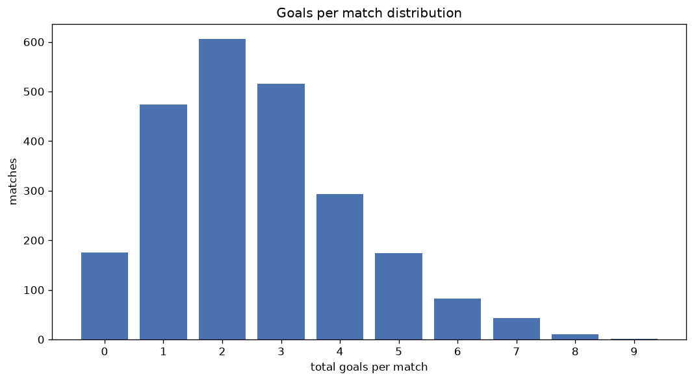
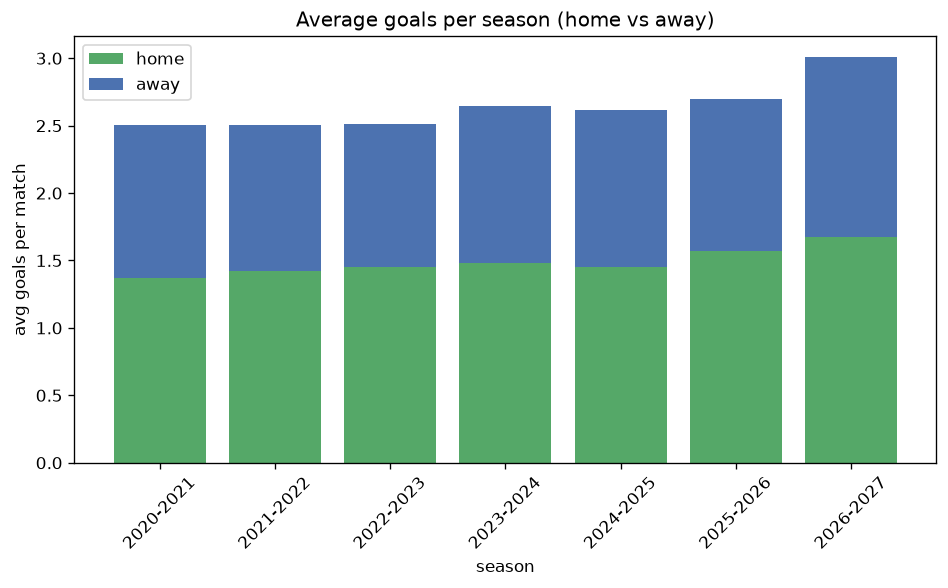

# Goal Analysis
- Report: `goals_analysis`
- Generated: 2026-10-26T01:49:35+00:00
- Script: `backend/scripts/analyze_goals.py` v1.0.0
- League: LaLiga (Spain)
- Scope: league `spain1`

## 1. Goals per match distribution
| goals | matches | pct |
|---|---|---|
| 0 | 175 | 7.4% |
| 1 | 474 | 20.0% |
| 2 | 606 | 25.5% |
| 3 | 515 | 21.7% |
| 4 | 293 | 12.3% |
| 5 | 174 | 7.3% |
| 6 | 83 | 3.5% |
| 7 | 43 | 1.8% |
| 8 | 11 | 0.5% |
| 9 | 1 | 0.0% |

## 2. Goals per match per season
| season | matches | total goals | avg home | avg away | avg total |
|---|---|---|---|---|---|
| 2020-2021 | 380 | 953 | 1.368 | 1.139 | 2.508 |
| 2021-2022 | 380 | 951 | 1.421 | 1.082 | 2.503 |
| 2022-2023 | 380 | 955 | 1.455 | 1.058 | 2.513 |
| 2023-2024 | 380 | 1005 | 1.484 | 1.161 | 2.645 |
| 2024-2025 | 380 | 995 | 1.453 | 1.166 | 2.618 |
| 2025-2026 | 380 | 1024 | 1.574 | 1.121 | 2.695 |
| 2026-2027 | 95 | 286 | 1.674 | 1.337 | 3.011 |

## 3. Home vs away goal share
- Home goals: **3486** (56.5%)
- Away goals: **2683** (43.5%)
- Home/away ratio: **1.299**

| season | home goals | away goals | total | home pct | away pct |
|---|---|---|---|---|---|
| 2020-2021 | 520 | 433 | 953 | 54.6% | 45.4% |
| 2021-2022 | 540 | 411 | 951 | 56.8% | 43.2% |
| 2022-2023 | 553 | 402 | 955 | 57.9% | 42.1% |
| 2023-2024 | 564 | 441 | 1005 | 56.1% | 43.9% |
| 2024-2025 | 552 | 443 | 995 | 55.5% | 44.5% |
| 2025-2026 | 598 | 426 | 1024 | 58.4% | 41.6% |
| 2026-2027 | 159 | 127 | 286 | 55.6% | 44.4% |

## 4. BTTS (Both Teams To Score)
- Overall: **1238** of `2375` (52.1%)

| season | matches | BTTS | pct |
|---|---|---|---|
| 2020-2021 | 380 | 197 | 51.8% |
| 2021-2022 | 380 | 185 | 48.7% |
| 2022-2023 | 380 | 191 | 50.3% |
| 2023-2024 | 380 | 188 | 49.5% |
| 2024-2025 | 380 | 206 | 54.2% |
| 2025-2026 | 380 | 215 | 56.6% |
| 2026-2027 | 95 | 56 | 58.9% |

## 5. Clean sheets
- Home clean sheets: **767** (32.3%)
- Away clean sheets: **545** (22.9%)
- Total clean sheets recorded: **1312**
- Matches with at least one clean sheet: **1137** (47.9%)
- Both teams kept clean sheets (0-0): **175**

| season | matches | home CS | away CS | total CS | matches w/ CS |
|---|---|---|---|---|---|
| 2020-2021 | 380 | 115 | 98 | 213 | 183 (48.2%) |
| 2021-2022 | 380 | 143 | 95 | 238 | 195 (51.3%) |
| 2022-2023 | 380 | 124 | 91 | 215 | 189 (49.7%) |
| 2023-2024 | 380 | 129 | 94 | 223 | 192 (50.5%) |
| 2024-2025 | 380 | 116 | 79 | 195 | 174 (45.8%) |
| 2025-2026 | 380 | 111 | 69 | 180 | 165 (43.4%) |
| 2026-2027 | 95 | 29 | 19 | 48 | 39 (41.1%) |

## 6. Scoring intensity
- First-half goals: **2731** (44.3%)
- Second-half goals: **3438** (55.7%)
- Avg first-half goals per match: **1.15**
- Avg second-half goals per match: **1.448**
- Second-half-only scoring (HT 0-0, FT goals >= 1): **604** (25.4%)
- *1 match(es) excluded (no HT score recorded).*

| season | matches | 1st half | 2nd half | 1st half pct | 2nd half pct |
|---|---|---|---|---|---|
| 2020-2021 | 380 | 439 | 514 | 46.1% | 53.9% |
| 2021-2022 | 380 | 415 | 536 | 43.6% | 56.4% |
| 2022-2023 | 380 | 425 | 530 | 44.5% | 55.5% |
| 2023-2024 | 380 | 455 | 550 | 45.3% | 54.7% |
| 2024-2025 | 380 | 438 | 557 | 44.0% | 56.0% |
| 2025-2026 | 380 | 437 | 587 | 42.7% | 57.3% |
| 2026-2027 | 95 | 122 | 164 | 42.7% | 57.3% |

## 7. First-goal timing
- Matches with first-goal time recorded: `2200` of `2375` (92.6%)
- Goalless matches: `175`
- Min `1` | Max `101` | Mean `33.1` | Median (p50) `28.0`

| bucket | count | % of matches | % of scoring matches |
|---|---|---|---|
| 1-15 | 694 | 29.2% | 31.5% |
| 16-30 | 483 | 20.3% | 22.0% |
| 31-45 | 374 | 15.7% | 17.0% |
| 46-60 | 299 | 12.6% | 13.6% |
| 61-75 | 183 | 7.7% | 8.3% |
| 76-90 | 132 | 5.6% | 6.0% |
| 91-120 | 35 | 1.5% | 1.6% |

---
*All statistics are computed from PostgreSQL tables (read-only). Run with `python backend/scripts/analyze_goals.py` to regenerate.*

## Charts

