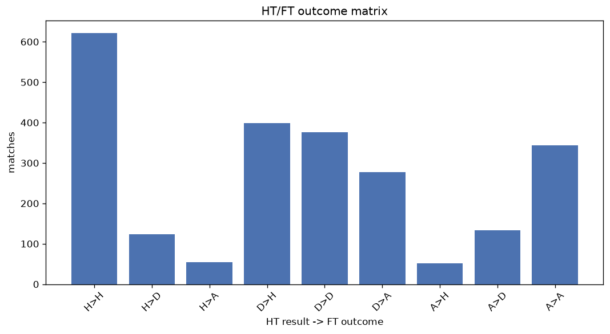
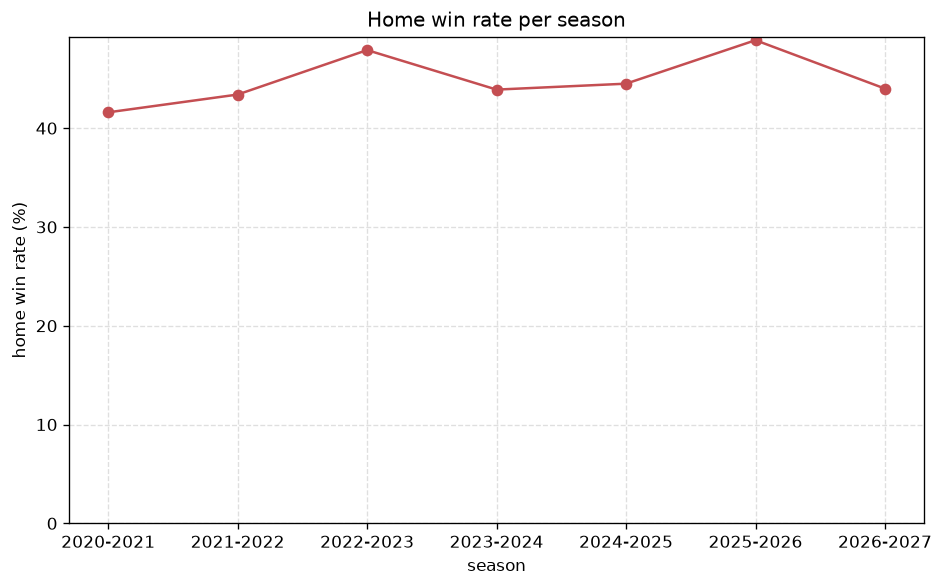

# Match Analysis
- Report: `matches_analysis`
- Generated: 2026-10-29T02:16:34+00:00
- Script: `backend/scripts/analyze_matches.py` v1.0.0
- League: LaLiga (Spain)
- Scope: league `spain1`

## 1. Overall summary
| metric | value |
|---|---|
| Matches | 2380 |
| Home wins | 1071 (45.0%) |
| Draws | 634 (26.6%) |
| Away wins | 675 (28.4%) |
| Total goals | 6181 |
| Average goals per match | 2.597 |
| Goalless matches | 176 (7.4%) |

## 2. Per-season breakdown
| season | matches | home wins | draws | away wins | total goals | avg goals | goalless |
|---|---|---|---|---|---|---|---|
| 2020-2021 | 380 | 158 (41.6%) | 109 (28.7%) | 113 (29.7%) | 953 | 2.508 | 30 (7.9%) |
| 2021-2022 | 380 | 165 (43.4%) | 111 (29.2%) | 104 (27.4%) | 951 | 2.503 | 43 (11.3%) |
| 2022-2023 | 380 | 182 (47.9%) | 89 (23.4%) | 109 (28.7%) | 955 | 2.513 | 26 (6.8%) |
| 2023-2024 | 380 | 167 (43.9%) | 107 (28.2%) | 106 (27.9%) | 1005 | 2.645 | 31 (8.2%) |
| 2024-2025 | 380 | 169 (44.5%) | 97 (25.5%) | 114 (30.0%) | 995 | 2.618 | 21 (5.5%) |
| 2025-2026 | 380 | 186 (48.9%) | 93 (24.5%) | 101 (26.6%) | 1024 | 2.695 | 15 (3.9%) |
| 2026-2027 | 100 | 44 (44.0%) | 28 (28.0%) | 28 (28.0%) | 298 | 2.98 | 10 (10.0%) |

## 3. HT/FT outcome matrix
| HT result \ FT result | Home | Draw | Away | total |
|---|---|---|---|---|
| HT home lead | 621 (77.6%) | 124 (15.5%) | 55 (6.9%) | 800 |
| HT draw | 398 (37.9%) | 376 (35.8%) | 277 (26.4%) | 1051 |
| HT away lead | 52 (9.8%) | 133 (25.2%) | 343 (65.0%) | 528 |
- *1 match(es) excluded (no HT score recorded).*

## 4. Comeback matches
- Home comebacks (trailing at HT, won at FT): **52** (2.2%)
- Away comebacks (trailing at HT, won at FT): **55** (2.3%)

### Home comebacks
| season | home | away | HT | FT |
|---|---|---|---|---|
| 2020-2021 | Ath Bilbao | Sevilla | 0-1 | 2-1 |
| 2020-2021 | Valladolid | Osasuna | 1-2 | 3-2 |
| 2020-2021 | Valencia | Villarreal | 0-1 | 2-1 |
| 2020-2021 | Betis | Alaves | 0-2 | 3-2 |
| 2020-2021 | Real Madrid | Villarreal | 0-1 | 2-1 |
| 2021-2022 | Real Madrid | Celta Vigo | 1-2 | 5-2 |
| 2021-2022 | Alaves | Levante | 0-1 | 2-1 |
| 2021-2022 | Betis | Levante | 0-1 | 3-1 |
| 2021-2022 | Espanyol | Levante | 1-2 | 4-3 |
| 2021-2022 | Atl. Madrid | Valencia | 0-2 | 3-2 |
| 2021-2022 | Elche | Alaves | 0-1 | 3-1 |
| 2021-2022 | Levante | Alaves | 0-1 | 3-1 |
| 2022-2023 | Villarreal | Almeria | 0-1 | 2-1 |
| 2022-2023 | Almeria | Celta Vigo | 0-1 | 3-1 |
| 2022-2023 | Girona | Sevilla | 0-1 | 2-1 |
| 2022-2023 | Osasuna | Elche | 0-1 | 2-1 |
| 2022-2023 | Mallorca | Getafe | 0-1 | 3-1 |
| 2022-2023 | Valencia | Valladolid | 0-1 | 2-1 |
| 2022-2023 | Villarreal | Espanyol | 0-1 | 4-2 |
| 2022-2023 | Sevilla | Espanyol | 1-2 | 3-2 |
| 2023-2024 | Real Madrid | Getafe | 0-1 | 2-1 |
| 2023-2024 | Real Madrid | Real Sociedad | 0-1 | 2-1 |
| 2023-2024 | Barcelona | Celta Vigo | 0-1 | 3-2 |
| 2023-2024 | Real Sociedad | Getafe | 1-2 | 4-3 |
| 2023-2024 | Atl. Madrid | Cadiz CF | 1-2 | 3-2 |
| 2023-2024 | Barcelona | Alaves | 0-1 | 2-1 |
| 2023-2024 | Real Madrid | Almeria | 0-2 | 3-2 |
| 2023-2024 | Rayo Vallecano | Osasuna | 0-1 | 2-1 |
| 2023-2024 | Barcelona | Valencia | 1-2 | 4-2 |
| 2023-2024 | Girona | Barcelona | 1-2 | 4-2 |
| 2023-2024 | Villarreal | Sevilla | 1-2 | 3-2 |
| 2023-2024 | Celta Vigo | Ath Bilbao | 0-1 | 2-1 |
| 2023-2024 | Almeria | Cadiz CF | 0-1 | 6-1 |
| 2024-2025 | Celta Vigo | Alaves | 0-1 | 2-1 |
| 2024-2025 | Villarreal | Celta Vigo | 1-2 | 4-3 |
| 2024-2025 | Rayo Vallecano | Osasuna | 0-1 | 3-1 |
| 2024-2025 | Atl. Madrid | Leganes | 0-1 | 3-1 |
| 2024-2025 | Atl. Madrid | Alaves | 0-1 | 2-1 |
| 2024-2025 | Atl. Madrid | Sevilla | 1-2 | 4-3 |
| 2024-2025 | Celta Vigo | Betis | 0-2 | 3-2 |
| 2024-2025 | Real Madrid | Leganes | 1-2 | 3-2 |
| 2024-2025 | Ath Bilbao | Rayo Vallecano | 0-1 | 3-1 |
| 2024-2025 | Real Madrid | Mallorca | 0-1 | 2-1 |
| 2025-2026 | Espanyol | Atl. Madrid | 0-1 | 2-1 |
| 2025-2026 | Villarreal | Osasuna | 0-1 | 2-1 |
| 2025-2026 | Levante | Elche | 0-1 | 3-2 |
| 2025-2026 | Valencia | Alaves | 0-1 | 3-2 |
| 2025-2026 | Mallorca | Espanyol | 0-1 | 2-1 |
| 2025-2026 | Real Madrid | Atl. Madrid | 0-1 | 3-2 |
| 2025-2026 | Alaves | Mallorca | 0-1 | 2-1 |
| 2025-2026 | Atl. Madrid | Ath Bilbao | 0-1 | 3-2 |
| 2026-2027 | Sevilla | Rayo Vallecano | 0-1 | 2-1 |

### Away comebacks
| season | home | away | HT | FT |
|---|---|---|---|---|
| 2020-2021 | Betis | Real Madrid | 2-1 | 2-3 |
| 2020-2021 | Betis | Barcelona | 1-0 | 2-3 |
| 2020-2021 | Valladolid | Granada CF | 1-0 | 1-2 |
| 2020-2021 | Celta Vigo | Sevilla | 3-2 | 3-4 |
| 2020-2021 | Barcelona | Granada CF | 1-0 | 1-2 |
| 2020-2021 | Cadiz CF | Elche | 1-0 | 1-3 |
| 2020-2021 | Celta Vigo | Betis | 1-0 | 2-3 |
| 2020-2021 | Valladolid | Atl. Madrid | 1-0 | 1-2 |
| 2021-2022 | Cadiz CF | Osasuna | 1-0 | 2-3 |
| 2021-2022 | Espanyol | Atl. Madrid | 1-0 | 1-2 |
| 2021-2022 | Getafe | Atl. Madrid | 1-0 | 1-2 |
| 2021-2022 | Granada CF | Real Sociedad | 1-0 | 2-3 |
| 2021-2022 | Mallorca | Osasuna | 2-1 | 2-3 |
| 2021-2022 | Levante | Valencia | 2-1 | 3-4 |
| 2021-2022 | Elche | Barcelona | 1-0 | 1-2 |
| 2021-2022 | Sevilla | Real Madrid | 2-0 | 2-3 |
| 2021-2022 | Villarreal | Real Sociedad | 1-0 | 1-2 |
| 2022-2023 | Almeria | Real Madrid | 1-0 | 1-2 |
| 2022-2023 | Osasuna | Barcelona | 1-0 | 1-2 |
| 2022-2023 | Elche | Betis | 2-0 | 2-3 |
| 2022-2023 | Girona | Betis | 1-0 | 1-2 |
| 2023-2024 | Barcelona | Real Madrid | 1-0 | 1-2 |
| 2023-2024 | Las Palmas | Barcelona | 1-0 | 1-2 |
| 2023-2024 | Granada CF | Real Sociedad | 2-1 | 2-3 |
| 2023-2024 | Betis | Villarreal | 2-1 | 2-3 |
| 2023-2024 | Sevilla | Celta Vigo | 1-0 | 1-2 |
| 2024-2025 | Rayo Vallecano | Barcelona | 1-0 | 1-2 |
| 2024-2025 | Rayo Vallecano | Ath Bilbao | 1-0 | 1-2 |
| 2024-2025 | Barcelona | Atl. Madrid | 1-0 | 1-2 |
| 2024-2025 | Valencia | Real Madrid | 1-0 | 1-2 |
| 2024-2025 | Girona | Sevilla | 1-0 | 1-2 |
| 2024-2025 | Leganes | Betis | 2-0 | 2-3 |
| 2024-2025 | Osasuna | Getafe | 1-0 | 1-2 |
| 2024-2025 | Atl. Madrid | Barcelona | 1-0 | 2-4 |
| 2024-2025 | Mallorca | Celta Vigo | 1-0 | 1-2 |
| 2024-2025 | Getafe | Las Palmas | 1-0 | 1-3 |
| 2024-2025 | Valladolid | Barcelona | 1-0 | 1-2 |
| 2024-2025 | Espanyol | Betis | 1-0 | 1-2 |
| 2024-2025 | Barcelona | Villarreal | 2-1 | 2-3 |
| 2025-2026 | Levante | Barcelona | 2-0 | 2-3 |
| 2025-2026 | Oviedo | Barcelona | 1-0 | 1-3 |
| 2025-2026 | Valencia | Oviedo | 1-0 | 1-2 |
| 2025-2026 | Espanyol | Betis | 1-0 | 1-2 |
| 2025-2026 | Sevilla | Mallorca | 1-0 | 1-3 |
| 2025-2026 | Osasuna | Celta Vigo | 2-1 | 2-3 |
| 2025-2026 | Osasuna | Real Sociedad | 1-0 | 1-3 |
| 2025-2026 | Real Sociedad | Girona | 1-0 | 1-2 |
| 2025-2026 | Oviedo | Ath Bilbao | 1-0 | 1-2 |
| 2025-2026 | Girona | Celta Vigo | 1-0 | 1-2 |
| 2025-2026 | Celta Vigo | Alaves | 3-1 | 3-4 |
| 2025-2026 | Valencia | Celta Vigo | 1-0 | 2-3 |
| 2025-2026 | Alaves | Ath Bilbao | 1-0 | 2-4 |
| 2025-2026 | Alaves | Rayo Vallecano | 1-0 | 1-2 |
| 2026-2027 | Celta Vigo | Osasuna | 1-0 | 1-2 |
| 2026-2027 | Valencia | Villarreal | 1-0 | 1-2 |

## 5. HT lead conversion
| HT state | matches | converted to win | held as draw | collapsed to loss |
|---|---|---|---|---|
| Home lead | 800 | 621 (77.6%) | 124 (15.5%) | 55 (6.9%) |
| Away lead | 528 | 343 (65.0%) | 133 (25.2%) | 52 (9.8%) |

### Matches level at half-time
| FT result | count | pct |
|---|---|---|
| Home win | 398 | 37.9% |
| Draw | 376 | 35.8% |
| Away win | 277 | 26.4% |
- *1 match(es) excluded (no HT score recorded).*

## 6. First-goal timing
- Matches with a first-goal time recorded: `2204` of `2380` (92.6%)

Outcome distribution by first-goal timing bucket:
| bucket | matches | % of matches | home | draw | away |
|---|---|---|---|---|---|
| 1-15 | 695 | 29.2% | 337 (48.5%) | 159 (22.9%) | 199 (28.6%) |
| 16-30 | 485 | 20.4% | 239 (49.3%) | 86 (17.7%) | 160 (33.0%) |
| 31-45 | 375 | 15.8% | 181 (48.3%) | 100 (26.7%) | 94 (25.1%) |
| 46-60 | 299 | 12.6% | 140 (46.8%) | 67 (22.4%) | 92 (30.8%) |
| 61-75 | 183 | 7.7% | 93 (50.8%) | 30 (16.4%) | 60 (32.8%) |
| 76-90 | 132 | 5.5% | 62 (47.0%) | 16 (12.1%) | 54 (40.9%) |
| 91-120 | 35 | 1.5% | 19 (54.3%) | 0 (0.0%) | 16 (45.7%) |

## 7. Goalless matches
- Overall: **176** of `2380` (7.4%)

| season | matches | goalless | pct |
|---|---|---|---|
| 2020-2021 | 380 | 30 | 7.9% |
| 2021-2022 | 380 | 43 | 11.3% |
| 2022-2023 | 380 | 26 | 6.8% |
| 2023-2024 | 380 | 31 | 8.2% |
| 2024-2025 | 380 | 21 | 5.5% |
| 2025-2026 | 380 | 15 | 3.9% |
| 2026-2027 | 100 | 10 | 10.0% |

---
*All statistics are computed from PostgreSQL tables (read-only). Run with `python backend/scripts/analyze_matches.py` to regenerate.*

## Charts

