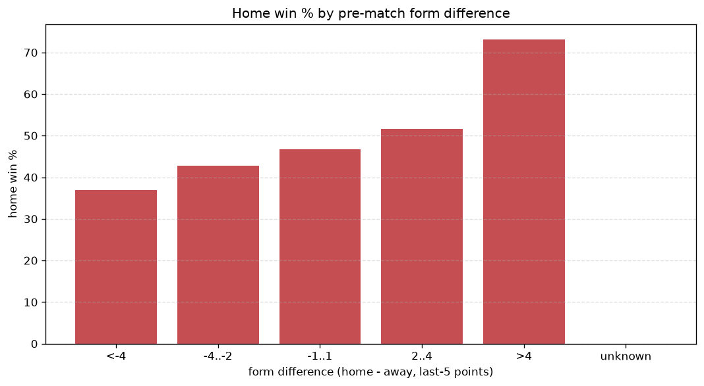
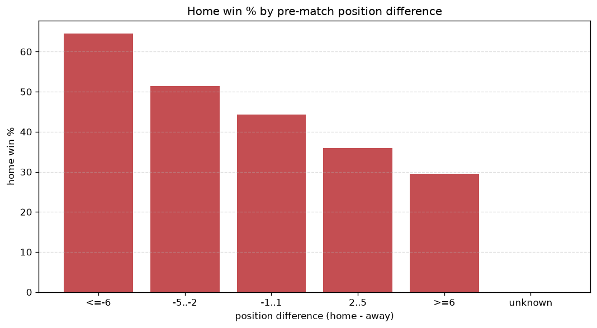

# Relationships Analysis
- Report: `relationships`
- Generated: 2026-10-29T02:16:43+00:00
- Script: `backend/scripts/analyze_relationships.py` v1.0.0
- League: LaLiga (Spain)
- Scope: league `spain1`

- Matches analysed: **2280** (23 leakage-safe pre-match features).

## 1. Correlation matrix
_Pearson correlation of each pre-match feature with observed goals; sorted by |corr(total goals)|._

| feature | corr(home) | corr(away) | corr(total) |
|---|---|---|---|
| home_team_home_goals_avg | 0.210 | -0.070 | 0.114 |
| home_position_before_match | -0.218 | 0.090 | -0.107 |
| home_team_points_last_5 | 0.189 | -0.059 | 0.105 |
| home_team_wins_last_5 | 0.187 | -0.057 | 0.105 |
| home_team_goals_scored_last_5 | 0.180 | -0.053 | 0.102 |
| home_team_home_win_rate | 0.196 | -0.083 | 0.095 |
| position_difference | -0.281 | 0.192 | -0.088 |
| points_difference | 0.282 | -0.199 | 0.085 |
| home_points_before_match | 0.155 | -0.059 | 0.079 |
| away_team_away_conceded_avg | 0.117 | -0.067 | 0.045 |
| away_team_goals_conceded_last_5 | 0.099 | -0.058 | 0.037 |
| away_team_goals_scored_last_5 | -0.083 | 0.144 | 0.031 |
| home_team_goals_conceded_last_5 | -0.081 | 0.047 | -0.031 |
| away_team_away_goals_avg | -0.099 | 0.154 | 0.025 |
| away_position_before_match | 0.175 | -0.179 | 0.016 |
| away_team_wins_last_5 | -0.096 | 0.133 | 0.013 |
| away_points_before_match | -0.070 | 0.100 | 0.012 |
| home_team_home_conceded_avg | -0.071 | 0.066 | -0.011 |
| away_rest_days | 0.000 | -0.013 | -0.008 |
| away_team_points_last_5 | -0.095 | 0.123 | 0.008 |
| home_rest_days | -0.007 | -0.003 | -0.007 |
| away_team_away_win_rate | -0.112 | 0.134 | 0.002 |
| rest_days_difference | -0.016 | 0.021 | 0.002 |

## 2. Form vs outcome
_Home win/draw/away % per bucket of `home_team_points_last_5 - away_team_points_last_5`._

| bucket | matches | home | draw | away | home % | draw % | away % |
|---|---|---|---|---|---|---|---|
| <-4 | 377 | 104 | 116 | 157 | 27.6% | 30.8% | 41.6% |
| -4..-2 | 477 | 193 | 124 | 160 | 40.5% | 26.0% | 33.5% |
| -1..1 | 655 | 288 | 184 | 183 | 44.0% | 28.1% | 27.9% |
| 2..4 | 456 | 233 | 117 | 106 | 51.1% | 25.7% | 23.2% |
| >4 | 315 | 209 | 65 | 41 | 66.3% | 20.6% | 13.0% |
| unknown | 0 | 0 | 0 | 0 | - | - | - |

## 3. Position vs outcome
_Home win/draw/away % per bucket of `position_difference` (home position - away position; negative favours the home team)._

| bucket | matches | home | draw | away | home % | draw % | away % |
|---|---|---|---|---|---|---|---|
| <=-6 | 560 | 361 | 116 | 83 | 64.5% | 20.7% | 14.8% |
| -5..-2 | 407 | 209 | 113 | 85 | 51.4% | 27.8% | 20.9% |
| -1..1 | 291 | 129 | 83 | 79 | 44.3% | 28.5% | 27.1% |
| 2..5 | 421 | 151 | 130 | 140 | 35.9% | 30.9% | 33.3% |
| >=6 | 601 | 177 | 164 | 260 | 29.5% | 27.3% | 43.3% |
| unknown | 0 | 0 | 0 | 0 | - | - | - |

## 4. Rest advantage
_Home win/draw/away % per bucket of `rest_days_difference` (home rest - away rest). Matches with unknown rest are bucketed separately._

| bucket | matches | home | draw | away | home % | draw % | away % |
|---|---|---|---|---|---|---|---|
| <-1 | 251 | 121 | 64 | 66 | 48.2% | 25.5% | 26.3% |
| -1..0 | 542 | 255 | 140 | 147 | 47.0% | 25.8% | 27.1% |
| 0 | 668 | 300 | 172 | 196 | 44.9% | 25.7% | 29.3% |
| 1..2 | 669 | 298 | 176 | 195 | 44.5% | 26.3% | 29.1% |
| >2 | 87 | 33 | 31 | 23 | 37.9% | 35.6% | 26.4% |
| unknown | 63 | 20 | 23 | 20 | 31.7% | 36.5% | 31.7% |
- *63 match(es) had unknown rest difference (missing rest data on at least one side).*

## 5. Home team quality
_Home win rate by `home_team_home_win_rate` tier (split at 0.5)._

- `< 0.5` tier: **38.5%** home win (514/1335)
- `>= 0.5` tier: **54.3%** home win (513/945)
- Home-win gap (>= split minus < split): **+15.8 pp**

| tier | label | matches | home | draw | away | home % |
|---|---|---|---|---|---|---|
| low | < 0.5 | 1335 | 514 | 387 | 434 | 38.5% |
| high | >= 0.5 | 945 | 513 | 219 | 213 | 54.3% |

## 6. Feature averages by result
_Mean feature value per outcome; `range` is home-minus-away spread of the group means._

| feature | home mean | draw mean | away mean | range |
|---|---|---|---|---|
| points_difference | 4.323 | -1.469 | -6.065 | 10.388 |
| position_difference | -2.333 | 1.102 | 3.379 | 5.712 |
| home_points_before_match | 28.093 | 22.421 | 22.937 | 5.673 |
| away_points_before_match | 23.770 | 23.889 | 29.002 | 5.231 |
| away_position_before_match | 11.905 | 10.795 | 8.527 | 3.378 |
| home_position_before_match | 9.572 | 11.898 | 11.906 | 2.334 |
| away_team_points_last_5 | 5.955 | 6.249 | 7.236 | 1.281 |
| home_team_points_last_5 | 6.861 | 5.597 | 5.675 | 1.263 |
| away_team_goals_scored_last_5 | 5.572 | 5.946 | 6.748 | 1.177 |
| home_team_goals_scored_last_5 | 6.394 | 5.409 | 5.389 | 1.005 |
| away_team_goals_conceded_last_5 | 6.165 | 5.896 | 5.357 | 0.808 |
| home_team_goals_conceded_last_5 | 5.684 | 6.244 | 6.232 | 0.561 |
| away_team_wins_last_5 | 1.549 | 1.672 | 2.032 | 0.483 |
| home_team_wins_last_5 | 1.890 | 1.450 | 1.478 | 0.439 |
| home_rest_days | 7.457 | 7.750 | 7.398 | 0.352 |
| home_team_home_goals_avg | 1.509 | 1.246 | 1.206 | 0.303 |
| away_team_away_goals_avg | 0.986 | 1.003 | 1.242 | 0.255 |
| away_rest_days | 7.488 | 7.666 | 7.419 | 0.247 |
| away_team_away_conceded_avg | 1.425 | 1.343 | 1.212 | 0.213 |
| home_team_home_conceded_avg | 0.998 | 1.131 | 1.104 | 0.133 |
| rest_days_difference | -0.032 | 0.086 | -0.022 | 0.118 |
| home_team_home_win_rate | 0.471 | 0.368 | 0.362 | 0.109 |
| away_team_away_win_rate | 0.238 | 0.254 | 0.344 | 0.107 |

---
*All features are leakage-safe pre-match values built by `ml.features.build_features.build_rows` from strictly prior matches. Run with `python backend/scripts/analyze_relationships.py` to regenerate.*

## Charts

