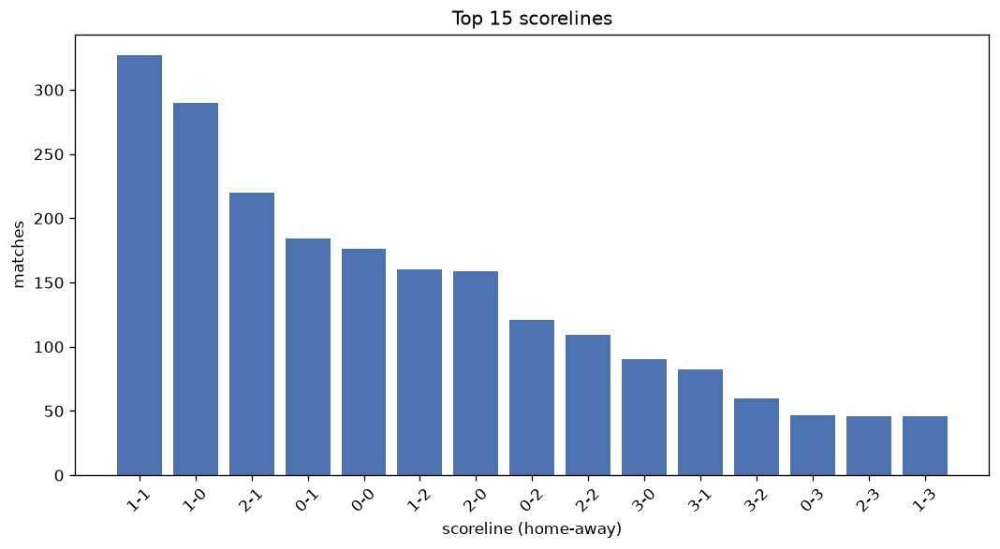
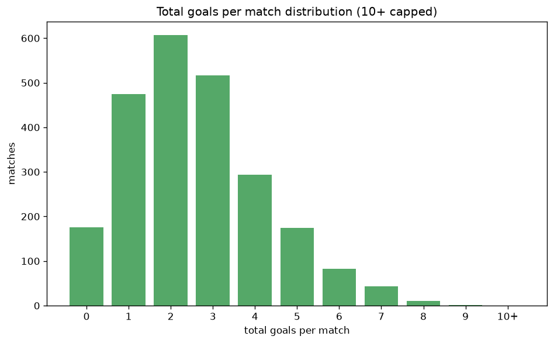

# Scoreline Analysis
- Report: `scoreline_analysis`
- Generated: 2026-10-29T02:16:40+00:00
- Script: `backend/scripts/analyze_scorelines.py` v1.0.0
- League: LaLiga (Spain)
- Scope: league `spain1`

## 1. Scoreline frequency
- Matches analysed: **2380** across **7** seasons.
- Distinct scorelines seen: **42**.

| scoreline | count | pct |
|---|---|---|
| 1-1 | 327 | 13.7% |
| 1-0 | 290 | 12.2% |
| 2-1 | 220 | 9.2% |
| 0-1 | 184 | 7.7% |
| 0-0 | 176 | 7.4% |
| 1-2 | 160 | 6.7% |
| 2-0 | 159 | 6.7% |
| 0-2 | 121 | 5.1% |
| 2-2 | 109 | 4.6% |
| 3-0 | 90 | 3.8% |
| 3-1 | 82 | 3.4% |
| 3-2 | 60 | 2.5% |
| 0-3 | 47 | 2.0% |
| 2-3 | 46 | 1.9% |
| 1-3 | 46 | 1.9% |
| 4-0 | 43 | 1.8% |
| 4-1 | 39 | 1.6% |
| 4-2 | 24 | 1.0% |
| 3-3 | 21 | 0.9% |
| 1-4 | 19 | 0.8% |

## 2. Scoreline frequency per season

### 2020-2021
| scoreline | count | pct |
|---|---|---|
| 1-1 | 56 | 14.7% |
| 2-1 | 40 | 10.5% |
| 1-0 | 38 | 10.0% |
| 0-1 | 34 | 8.9% |
| 0-0 | 30 | 7.9% |

### 2021-2022
| scoreline | count | pct |
|---|---|---|
| 1-0 | 48 | 12.6% |
| 1-1 | 47 | 12.4% |
| 0-0 | 43 | 11.3% |
| 2-0 | 29 | 7.6% |
| 2-1 | 27 | 7.1% |

### 2022-2023
| scoreline | count | pct |
|---|---|---|
| 1-0 | 49 | 12.9% |
| 2-1 | 46 | 12.1% |
| 1-1 | 44 | 11.6% |
| 0-1 | 36 | 9.5% |
| 0-0 | 26 | 6.8% |

### 2023-2024
| scoreline | count | pct |
|---|---|---|
| 1-1 | 51 | 13.4% |
| 1-0 | 48 | 12.6% |
| 0-0 | 31 | 8.2% |
| 0-1 | 29 | 7.6% |
| 2-0 | 25 | 6.6% |

### 2024-2025
| scoreline | count | pct |
|---|---|---|
| 1-1 | 57 | 15.0% |
| 1-0 | 53 | 13.9% |
| 1-2 | 37 | 9.7% |
| 2-1 | 33 | 8.7% |
| 0-1 | 31 | 8.2% |

### 2025-2026
| scoreline | count | pct |
|---|---|---|
| 1-1 | 58 | 15.3% |
| 1-0 | 44 | 11.6% |
| 2-1 | 42 | 11.1% |
| 2-0 | 27 | 7.1% |
| 1-2 | 27 | 7.1% |

### 2026-2027
| scoreline | count | pct |
|---|---|---|
| 1-1 | 14 | 14.0% |
| 1-0 | 10 | 10.0% |
| 0-0 | 10 | 10.0% |
| 2-1 | 8 | 8.0% |
| 1-2 | 6 | 6.0% |

## 3. Total-goal histogram
_10+ groups all matches with 10 or more total goals._

| total goals | matches | pct |
|---|---|---|
| 0 | 176 | 7.4% |
| 1 | 474 | 19.9% |
| 2 | 607 | 25.5% |
| 3 | 517 | 21.7% |
| 4 | 294 | 12.4% |
| 5 | 174 | 7.3% |
| 6 | 83 | 3.5% |
| 7 | 43 | 1.8% |
| 8 | 11 | 0.5% |
| 9 | 1 | 0.0% |
| 10+ | 0 | 0.0% |

## 4. Extreme scorelines
- Matches with 7+ total goals: **55**

| season | date | scoreline | total goals |
|---|---|---|---|
| 2026-2027 | 2026-09-16 | 7-2 | 9 |
| 2021-2022 | 2021-10-24 | 5-3 | 8 |
| 2021-2022 | 2022-05-07 | 2-6 | 8 |
| 2022-2023 | 2022-10-02 | 3-5 | 8 |
| 2022-2023 | 2023-02-17 | 6-2 | 8 |
| 2023-2024 | 2023-09-02 | 5-3 | 8 |
| 2023-2024 | 2023-09-23 | 5-3 | 8 |
| 2023-2024 | 2024-01-27 | 3-5 | 8 |
| 2023-2024 | 2024-05-19 | 4-4 | 8 |
| 2024-2025 | 2025-01-26 | 7-1 | 8 |
| 2024-2025 | 2025-02-23 | 7-1 | 8 |
| 2025-2026 | 2025-12-06 | 3-5 | 8 |
| 2020-2021 | 2020-09-27 | 6-1 | 7 |
| 2020-2021 | 2020-11-07 | 5-2 | 7 |
| 2020-2021 | 2020-12-29 | 4-3 | 7 |
| 2020-2021 | 2021-03-07 | 3-4 | 7 |
| 2020-2021 | 2021-03-21 | 1-6 | 7 |
| 2020-2021 | 2021-04-12 | 3-4 | 7 |
| 2020-2021 | 2021-04-22 | 5-2 | 7 |
| 2021-2022 | 2021-09-12 | 5-2 | 7 |
| 2021-2022 | 2021-09-22 | 6-1 | 7 |
| 2021-2022 | 2021-12-11 | 4-3 | 7 |
| 2021-2022 | 2021-12-20 | 3-4 | 7 |
| 2021-2022 | 2021-12-21 | 5-2 | 7 |
| 2021-2022 | 2022-02-12 | 4-3 | 7 |
| 2021-2022 | 2022-03-06 | 4-3 | 7 |
| 2022-2023 | 2023-02-04 | 3-4 | 7 |
| 2022-2023 | 2023-03-04 | 6-1 | 7 |
| 2022-2023 | 2023-04-30 | 2-5 | 7 |
| 2023-2024 | 2023-08-21 | 4-3 | 7 |
| 2023-2024 | 2023-08-27 | 3-4 | 7 |
| 2023-2024 | 2023-08-28 | 0-7 | 7 |
| 2023-2024 | 2023-09-24 | 4-3 | 7 |
| 2023-2024 | 2023-10-22 | 5-2 | 7 |
| 2023-2024 | 2023-11-10 | 4-3 | 7 |
| 2023-2024 | 2024-01-03 | 4-3 | 7 |
| 2023-2024 | 2024-05-24 | 7-0 | 7 |
| 2023-2024 | 2024-05-25 | 6-1 | 7 |
| 2024-2025 | 2024-08-26 | 4-3 | 7 |
| 2024-2025 | 2024-08-31 | 7-0 | 7 |
| 2024-2025 | 2024-11-02 | 4-3 | 7 |
| 2024-2025 | 2024-12-08 | 4-3 | 7 |
| 2024-2025 | 2024-12-22 | 2-5 | 7 |
| 2024-2025 | 2025-04-19 | 4-3 | 7 |
| 2024-2025 | 2025-05-11 | 4-3 | 7 |
| 2025-2026 | 2025-09-27 | 5-2 | 7 |
| 2025-2026 | 2026-03-15 | 5-2 | 7 |
| 2025-2026 | 2026-03-22 | 3-4 | 7 |
| 2025-2026 | 2026-05-17 | 3-4 | 7 |
| 2026-2027 | 2026-08-29 | 5-2 | 7 |
| 2026-2027 | 2026-08-31 | 5-2 | 7 |
| 2026-2027 | 2026-09-06 | 5-2 | 7 |
| 2026-2027 | 2026-10-11 | 5-2 | 7 |
| 2026-2027 | 2026-10-17 | 2-5 | 7 |
| 2026-2027 | 2026-10-18 | 2-5 | 7 |

## 5. Margin-of-victory distribution (decided matches)
- Decided matches: **1746** (draws: **634**)
- Average winning margin: **1.7**

| margin | matches | pct |
|---|---|---|
| 1 | 980 | 56.1% |
| 2 | 452 | 25.9% |
| 3+ | 314 | 18.0% |

## 6. Margin by outcome

### Home wins
- Matches: **1071** | avg margin: **1.76** | max margin: **7**
| margin | matches | pct |
|---|---|---|
| 1 | 583 | 54.4% |
| 2 | 268 | 25.0% |
| 3+ | 220 | 20.5% |
- *Full match-by-match list available in `scoreline_analysis.json`.*

### Away wins
- Matches: **675** | avg margin: **1.6** | max margin: **7**
| margin | matches | pct |
|---|---|---|
| 1 | 397 | 58.8% |
| 2 | 184 | 27.3% |
| 3+ | 94 | 13.9% |
- *Full match-by-match list available in `scoreline_analysis.json`.*

## 7. Most common exact score by outcome type
| outcome | matches | most common score | count | pct |
|---|---|---|---|---|
| home | 1071 | 1-0 | 290 | 27.1% |
| draw | 634 | 1-1 | 327 | 51.6% |
| away | 675 | 0-1 | 184 | 27.3% |

---
*All statistics are computed from PostgreSQL tables (read-only). Run with `python backend/scripts/analyze_scorelines.py` to regenerate.*

## Charts

