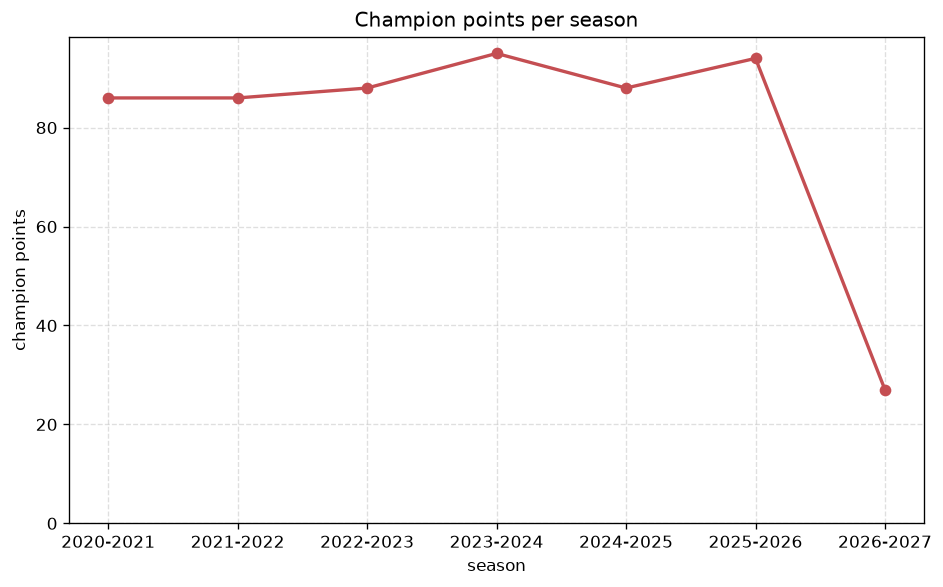
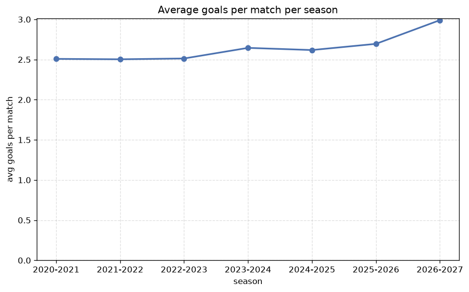

# Season Trends Analysis
- Report: `season_trends`
- Generated: 2026-10-27T02:31:53+00:00
- Script: `backend/scripts/analyze_seasons.py` v1.0.0
- League: LaLiga (Spain)
- Scope: league `spain1`

## 1. Champions per season
| season | champion | pts | runner-up | margin |
|---|---|---|---|---|
| 2020-2021 | Atl. Madrid | 86 | Real Madrid | 2 pts |
| 2021-2022 | Real Madrid | 86 | Barcelona | 13 pts |
| 2022-2023 | Barcelona | 88 | Real Madrid | 10 pts |
| 2023-2024 | Real Madrid | 95 | Barcelona | 10 pts |
| 2024-2025 | Barcelona | 88 | Real Madrid | 4 pts |
| 2025-2026 | Barcelona | 94 | Real Madrid | 8 pts |
| 2026-2027 | Barcelona | 27 | Atl. Madrid | 2 pts |

## 2. Title-race tightness
- Tight races (margin <= 3 pts): **2** of 7 seasons
- Tightest race: **2020-2021** - Atl. Madrid beat Real Madrid by **2** pts

| season | margin | tight |
|---|---|---|
| 2020-2021 | 2 pts | yes |
| 2021-2022 | 13 pts |  |
| 2022-2023 | 10 pts |  |
| 2023-2024 | 10 pts |  |
| 2024-2025 | 4 pts |  |
| 2025-2026 | 8 pts |  |
| 2026-2027 | 2 pts | yes |

## 3. Points thresholds
_Position-specific points per season. Key: 1 = champion, 2 = runner-up, 4 = CL line, 6 = Europa, 17 = last safe, 20 = bottom._

| season | pos 1 | pos 2 | pos 4 | pos 6 | pos 17 | pos 20 |
|---|---|---|---|---|---|---|
| 2020-2021 | 86 | 84 | 77 | 61 | 36 | 30 |
| 2021-2022 | 86 | 73 | 70 | 62 | 39 | 31 |
| 2022-2023 | 88 | 78 | 71 | 60 | 41 | 25 |
| 2023-2024 | 95 | 85 | 76 | 60 | 38 | 21 |
| 2024-2025 | 88 | 84 | 70 | 60 | 41 | 16 |
| 2025-2026 | 94 | 86 | 69 | 54 | 42 | 29 |
| 2026-2027 | 27 | 25 | 20 | 14 | 9 | 5 |

## 4. Relegation battle
| season | safe pos | safe pts | drop pos | drop pts | gap |
|---|---|---|---|---|---|
| 2020-2021 | 17 | 36 | 18 | 34 | 2 pts |
| 2021-2022 | 17 | 39 | 18 | 38 | 1 pts |
| 2022-2023 | 17 | 41 | 18 | 40 | 1 pts |
| 2023-2024 | 17 | 38 | 18 | 33 | 5 pts |
| 2024-2025 | 17 | 41 | 18 | 40 | 1 pts |
| 2025-2026 | 17 | 42 | 18 | 42 | 0 pts |
| 2026-2027 | 17 | 9 | 18 | 8 | 1 pts |

## 5. League-level trends
| season | matches | total goals | avg goals | home win | draw | away win | goalless | avg pts/team |
|---|---|---|---|---|---|---|---|---|
| 2020-2021 | 380 | 953 | 2.508 | 41.6% | 28.7% | 29.7% | 7.9% | 51.55 |
| 2021-2022 | 380 | 951 | 2.503 | 43.4% | 29.2% | 27.4% | 11.3% | 51.45 |
| 2022-2023 | 380 | 955 | 2.513 | 47.9% | 23.4% | 28.7% | 6.8% | 52.55 |
| 2023-2024 | 380 | 1005 | 2.645 | 43.9% | 28.2% | 27.9% | 8.2% | 51.65 |
| 2024-2025 | 380 | 995 | 2.618 | 44.5% | 25.5% | 30.0% | 5.5% | 52.15 |
| 2025-2026 | 380 | 1024 | 2.695 | 48.9% | 24.5% | 26.6% | 3.9% | 52.35 |
| 2026-2027 | 99 | 296 | 2.99 | 43.4% | 28.3% | 28.3% | 10.1% | 13.45 |

## 6. View divergence
- Largest divergence: **2022-2023** (goals view, avg abs position diff = 7.000)

_Avg absolute position difference between classic view and alternative view per season._

| season | classic vs luck | classic vs goals |
|---|---|---|
| 2020-2021 | 3.800 | 5.300 |
| 2021-2022 | 4.100 | 5.500 |
| 2022-2023 | 4.300 | 7.000 |
| 2023-2024 | 2.000 | 5.000 |
| 2024-2025 | 3.500 | 5.200 |
| 2025-2026 | 3.400 | 4.300 |
| 2026-2027 | 3.400 | 5.200 |

---
*All statistics are computed from PostgreSQL tables (read-only). Run with `python backend/scripts/analyze_seasons.py` to regenerate.*

## Charts

