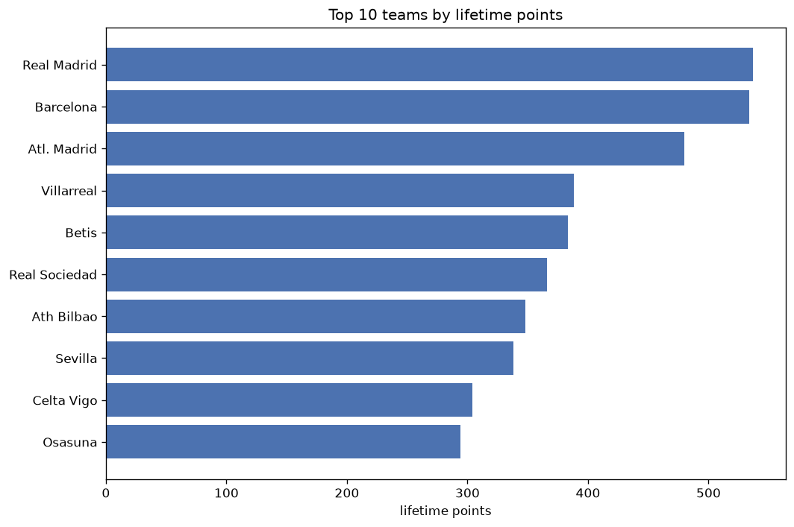
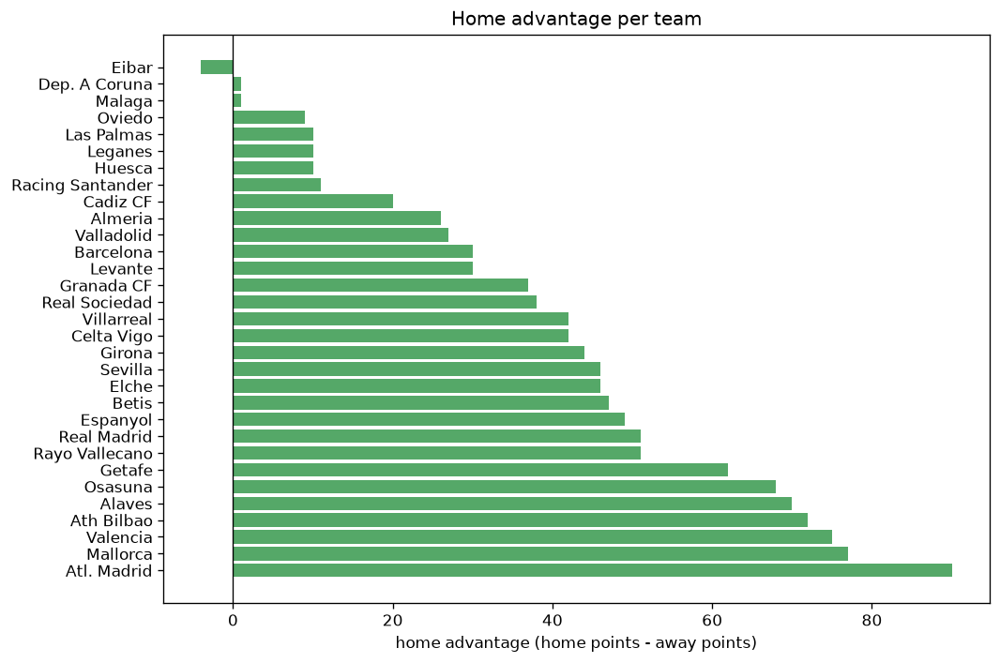

# Team Analysis
- Report: `teams_analysis`
- Generated: 2026-10-29T02:16:37+00:00
- Script: `backend/scripts/analyze_teams.py` v1.0.0
- League: LaLiga (Spain)
- Scope: league `spain1`

- Teams: **31** | Seasons: **7** | Matches: **2380**

## 1. Team standings (lifetime)
| team | seasons | played | W | D | L | pts | GF | GA | GD | avg pts/season | best pos | worst pos | titles |
|---|---|---|---|---|---|---|---|---|---|---|---|---|---|
| Real Madrid | 7 | 238 | 165 | 42 | 31 | 537 | 489 | 204 | 285 | 76.71 | 1 | 3 | 2 |
| Barcelona | 7 | 238 | 167 | 33 | 38 | 534 | 539 | 226 | 313 | 76.29 | 1 | 3 | 4 |
| Atl. Madrid | 7 | 238 | 145 | 45 | 48 | 480 | 422 | 226 | 196 | 68.57 | 1 | 4 | 1 |
| Villarreal | 7 | 238 | 109 | 61 | 68 | 388 | 405 | 297 | 108 | 55.43 | 3 | 10 | 0 |
| Betis | 7 | 238 | 104 | 71 | 63 | 383 | 338 | 288 | 50 | 54.71 | 4 | 7 | 0 |
| Real Sociedad | 7 | 238 | 101 | 63 | 74 | 366 | 314 | 274 | 40 | 52.29 | 4 | 12 | 0 |
| Ath Bilbao | 7 | 238 | 93 | 69 | 76 | 348 | 306 | 254 | 52 | 49.71 | 4 | 12 | 0 |
| Sevilla | 7 | 238 | 92 | 62 | 84 | 338 | 305 | 302 | 3 | 48.29 | 4 | 16 | 0 |
| Celta Vigo | 7 | 238 | 79 | 67 | 92 | 304 | 309 | 322 | -13 | 43.43 | 6 | 14 | 0 |
| Osasuna | 7 | 238 | 76 | 66 | 96 | 294 | 258 | 319 | -61 | 42.0 | 7 | 16 | 0 |
| Valencia | 7 | 238 | 70 | 73 | 95 | 283 | 277 | 322 | -45 | 40.43 | 9 | 19 | 0 |
| Getafe | 7 | 238 | 65 | 69 | 104 | 264 | 208 | 275 | -67 | 37.71 | 7 | 17 | 0 |
| Rayo Vallecano | 6 | 200 | 59 | 64 | 77 | 241 | 207 | 260 | -53 | 40.17 | 8 | 17 | 0 |
| Mallorca | 5 | 190 | 56 | 51 | 83 | 219 | 188 | 251 | -63 | 43.8 | 9 | 17 | 0 |
| Girona | 4 | 152 | 58 | 38 | 56 | 212 | 226 | 216 | 10 | 53.0 | 3 | 19 | 0 |
| Alaves | 6 | 200 | 53 | 53 | 94 | 212 | 199 | 283 | -84 | 35.33 | 8 | 20 | 0 |
| Espanyol | 5 | 162 | 43 | 46 | 73 | 175 | 187 | 242 | -55 | 35.0 | 11 | 19 | 0 |
| Cadiz CF | 4 | 152 | 35 | 53 | 64 | 158 | 127 | 217 | -90 | 39.5 | 12 | 18 | 0 |
| Elche | 5 | 162 | 36 | 48 | 78 | 156 | 167 | 248 | -81 | 31.2 | 13 | 20 | 0 |
| Levante | 4 | 124 | 30 | 38 | 56 | 128 | 160 | 213 | -53 | 32.0 | 14 | 19 | 0 |
| Granada CF | 3 | 114 | 25 | 30 | 59 | 105 | 129 | 205 | -76 | 35.0 | 10 | 20 | 0 |
| Valladolid | 3 | 114 | 20 | 27 | 67 | 87 | 93 | 210 | -117 | 29.0 | 18 | 20 | 0 |
| Las Palmas | 2 | 76 | 18 | 18 | 40 | 72 | 73 | 108 | -35 | 36.0 | 16 | 19 | 0 |
| Almeria | 2 | 76 | 14 | 20 | 42 | 62 | 92 | 140 | -48 | 31.0 | 17 | 19 | 0 |
| Leganes | 1 | 38 | 9 | 13 | 16 | 40 | 39 | 56 | -17 | 40.0 | 18 | 18 | 0 |
| Huesca | 1 | 38 | 7 | 13 | 18 | 34 | 34 | 53 | -19 | 34.0 | 18 | 18 | 0 |
| Eibar | 1 | 38 | 6 | 12 | 20 | 30 | 29 | 52 | -23 | 30.0 | 20 | 20 | 0 |
| Oviedo | 1 | 38 | 6 | 11 | 21 | 29 | 26 | 60 | -34 | 29.0 | 20 | 20 | 0 |
| Dep. A Coruna | 1 | 10 | 2 | 5 | 3 | 11 | 13 | 13 | 0 | 11.0 | 11 | 11 | 0 |
| Racing Santander | 1 | 10 | 3 | 2 | 5 | 11 | 15 | 26 | -11 | 11.0 | 13 | 13 | 0 |
| Malaga | 1 | 10 | 0 | 5 | 5 | 5 | 7 | 19 | -12 | 5.0 | 20 | 20 | 0 |

## 2. Home vs away split
| team | home P | H-W | H-D | H-L | H-pts | away P | A-W | A-D | A-L | A-pts | adv |
|---|---|---|---|---|---|---|---|---|---|---|---|
| Atl. Madrid | 119 | 89 | 18 | 12 | 285 | 119 | 56 | 27 | 36 | 195 | 90 |
| Mallorca | 95 | 39 | 31 | 25 | 148 | 95 | 17 | 20 | 58 | 71 | 77 |
| Valencia | 120 | 47 | 38 | 35 | 179 | 118 | 23 | 35 | 60 | 104 | 75 |
| Ath Bilbao | 119 | 60 | 30 | 29 | 210 | 119 | 33 | 39 | 47 | 138 | 72 |
| Alaves | 101 | 38 | 27 | 36 | 141 | 99 | 15 | 26 | 58 | 71 | 70 |
| Osasuna | 119 | 50 | 31 | 38 | 181 | 119 | 26 | 35 | 58 | 113 | 68 |
| Getafe | 119 | 42 | 37 | 40 | 163 | 119 | 23 | 32 | 64 | 101 | 62 |
| Real Madrid | 119 | 92 | 18 | 9 | 294 | 119 | 73 | 24 | 22 | 243 | 51 |
| Rayo Vallecano | 100 | 36 | 38 | 26 | 146 | 100 | 23 | 26 | 51 | 95 | 51 |
| Espanyol | 81 | 29 | 25 | 27 | 112 | 81 | 14 | 21 | 46 | 63 | 49 |
| Betis | 119 | 61 | 32 | 26 | 215 | 119 | 43 | 39 | 37 | 168 | 47 |
| Sevilla | 119 | 55 | 27 | 37 | 192 | 119 | 37 | 35 | 47 | 146 | 46 |
| Elche | 80 | 24 | 29 | 27 | 101 | 82 | 12 | 19 | 51 | 55 | 46 |
| Girona | 76 | 38 | 14 | 24 | 128 | 76 | 20 | 24 | 32 | 84 | 44 |
| Villarreal | 118 | 62 | 29 | 27 | 215 | 120 | 47 | 32 | 41 | 173 | 42 |
| Celta Vigo | 120 | 48 | 29 | 43 | 173 | 118 | 31 | 38 | 49 | 131 | 42 |
| Real Sociedad | 119 | 57 | 31 | 31 | 202 | 119 | 44 | 32 | 43 | 164 | 38 |
| Granada CF | 57 | 18 | 17 | 22 | 71 | 57 | 7 | 13 | 37 | 34 | 37 |
| Barcelona | 119 | 90 | 12 | 17 | 282 | 119 | 77 | 21 | 21 | 252 | 30 |
| Levante | 61 | 19 | 22 | 20 | 79 | 63 | 11 | 16 | 36 | 49 | 30 |
| Valladolid | 57 | 14 | 15 | 28 | 57 | 57 | 6 | 12 | 39 | 30 | 27 |
| Almeria | 38 | 11 | 11 | 16 | 44 | 38 | 3 | 9 | 26 | 18 | 26 |
| Cadiz CF | 76 | 20 | 29 | 27 | 89 | 76 | 15 | 24 | 37 | 69 | 20 |
| Racing Santander | 5 | 3 | 2 | 0 | 11 | 5 | 0 | 0 | 5 | 0 | 11 |
| Las Palmas | 38 | 10 | 11 | 17 | 41 | 38 | 8 | 7 | 23 | 31 | 10 |
| Leganes | 19 | 7 | 4 | 8 | 25 | 19 | 2 | 9 | 8 | 15 | 10 |
| Huesca | 19 | 5 | 7 | 7 | 22 | 19 | 2 | 6 | 11 | 12 | 10 |
| Oviedo | 19 | 4 | 7 | 8 | 19 | 19 | 2 | 4 | 13 | 10 | 9 |
| Dep. A Coruna | 5 | 1 | 3 | 1 | 6 | 5 | 1 | 2 | 2 | 5 | 1 |
| Malaga | 5 | 0 | 3 | 2 | 3 | 5 | 0 | 2 | 3 | 2 | 1 |
| Eibar | 19 | 2 | 7 | 10 | 13 | 19 | 4 | 5 | 10 | 17 | -4 |

## 3. Top performers
### Best points per game (PPG)
| rank | team | PPG |
|---|---|---|
| 1 | Real Madrid | 2.26 |
| 2 | Barcelona | 2.24 |
| 3 | Atl. Madrid | 2.02 |
| 4 | Villarreal | 1.63 |
| 5 | Betis | 1.61 |

### Most goals scored
| rank | team | goals |
|---|---|---|
| 1 | Barcelona | 539 |
| 2 | Real Madrid | 489 |
| 3 | Atl. Madrid | 422 |
| 4 | Villarreal | 405 |
| 5 | Betis | 338 |

### Best goal difference
| rank | team | GD |
|---|---|---|
| 1 | Barcelona | 313 |
| 2 | Real Madrid | 285 |
| 3 | Atl. Madrid | 196 |
| 4 | Villarreal | 108 |
| 5 | Ath Bilbao | 52 |

### Best defence (goals against per match, standings)
| rank | team | GA/match |
|---|---|---|
| 1 | Real Madrid | 0.857 |
| 2 | Atl. Madrid | 0.950 |
| 3 | Barcelona | 0.950 |
| 4 | Ath Bilbao | 1.067 |
| 5 | Real Sociedad | 1.151 |

## 4. Team consistency
- Teams present in all **7** seasons: **12**

Ath Bilbao, Atl. Madrid, Barcelona, Betis, Celta Vigo, Getafe, Osasuna, Real Madrid, Real Sociedad, Sevilla, Valencia, Villarreal

## 5. Head-to-head dominance
- Distinct fixtures: **377** (showing the 15 most frequent)

| fixture | meetings | home wins | draws | away wins | home pct | draw pct | away pct |
|---|---|---|---|---|---|---|---|
| Atl. Madrid vs Ath Bilbao | 13 | 10 | 1 | 2 | 76.9% | 7.7% | 15.4% |
| Atl. Madrid vs Sevilla | 13 | 9 | 1 | 3 | 69.2% | 7.7% | 23.1% |
| Barcelona vs Getafe | 13 | 8 | 4 | 1 | 61.5% | 30.8% | 7.7% |
| Osasuna vs Getafe | 13 | 8 | 3 | 2 | 61.5% | 23.1% | 15.4% |
| Villarreal vs Valencia | 13 | 8 | 3 | 2 | 61.5% | 23.1% | 15.4% |
| Atl. Madrid vs Osasuna | 13 | 7 | 0 | 6 | 53.8% | 0.0% | 46.2% |
| Atl. Madrid vs Real Madrid | 13 | 7 | 5 | 1 | 53.8% | 38.5% | 7.7% |
| Barcelona vs Ath Bilbao | 13 | 7 | 2 | 4 | 53.8% | 15.4% | 30.8% |
| Betis vs Getafe | 13 | 7 | 3 | 3 | 53.8% | 23.1% | 23.1% |
| Betis vs Osasuna | 13 | 7 | 2 | 4 | 53.8% | 15.4% | 30.8% |
| Celta Vigo vs Valencia | 13 | 7 | 3 | 3 | 53.8% | 23.1% | 23.1% |
| Real Madrid vs Barcelona | 13 | 7 | 0 | 6 | 53.8% | 0.0% | 46.2% |
| Sevilla vs Osasuna | 13 | 7 | 4 | 2 | 53.8% | 30.8% | 15.4% |
| Barcelona vs Sevilla | 13 | 6 | 2 | 5 | 46.2% | 15.4% | 38.5% |
| Barcelona vs Valencia | 13 | 6 | 2 | 5 | 46.2% | 15.4% | 38.5% |

## 6. Position per season (classic view)
_Cells show final position; '-' when the team was absent from that season._

| team | 2020-2021 | 2021-2022 | 2022-2023 | 2023-2024 | 2024-2025 | 2025-2026 | 2026-2027 |
|---|---|---|---|---|---|---|---|
| Real Madrid | 2 | 1 | 2 | 1 | 2 | 2 | 3 |
| Barcelona | 3 | 2 | 1 | 2 | 1 | 1 | 1 |
| Atl. Madrid | 1 | 3 | 3 | 4 | 3 | 4 | 2 |
| Villarreal | 7 | 7 | 5 | 8 | 5 | 3 | 10 |
| Betis | 6 | 5 | 6 | 7 | 6 | 5 | 4 |
| Real Sociedad | 5 | 6 | 4 | 6 | 12 | 10 | 5 |
| Ath Bilbao | 9 | 8 | 8 | 5 | 4 | 12 | 7 |
| Sevilla | 4 | 4 | 11 | 13 | 16 | 15 | 6 |
| Celta Vigo | 8 | 11 | 13 | 14 | 7 | 6 | 9 |
| Osasuna | 11 | 10 | 7 | 11 | 8 | 16 | 12 |
| Valencia | 13 | 9 | 14 | 9 | 11 | 9 | 19 |
| Getafe | 15 | 15 | 15 | 12 | 13 | 7 | 17 |
| Rayo Vallecano | - | 12 | 12 | 17 | 9 | 8 | 16 |
| Mallorca | - | 17 | 9 | 15 | 10 | 17 | - |
| Girona | - | - | 10 | 3 | 17 | 19 | - |
| Alaves | 16 | 20 | - | 10 | 14 | 14 | 8 |
| Espanyol | - | 14 | 19 | - | 15 | 11 | 18 |
| Cadiz CF | 12 | 16 | 16 | 18 | - | - | - |
| Elche | 17 | 13 | 20 | - | - | 13 | 15 |
| Levante | 14 | 19 | - | - | - | 18 | 14 |
| Granada CF | 10 | 18 | - | 20 | - | - | - |
| Valladolid | 19 | - | 18 | - | 20 | - | - |
| Las Palmas | - | - | - | 16 | 19 | - | - |
| Almeria | - | - | 17 | 19 | - | - | - |
| Leganes | - | - | - | - | 18 | - | - |
| Huesca | 18 | - | - | - | - | - | - |
| Eibar | 20 | - | - | - | - | - | - |
| Oviedo | - | - | - | - | - | 20 | - |
| Dep. A Coruna | - | - | - | - | - | - | 11 |
| Racing Santander | - | - | - | - | - | - | 13 |
| Malaga | - | - | - | - | - | - | 20 |

---
*All statistics are computed from PostgreSQL tables (read-only). Run with `python backend/scripts/analyze_teams.py` to regenerate.*

## Charts

