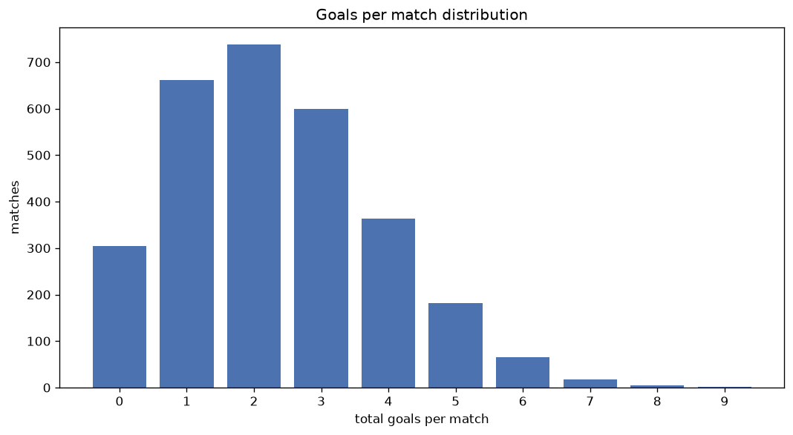
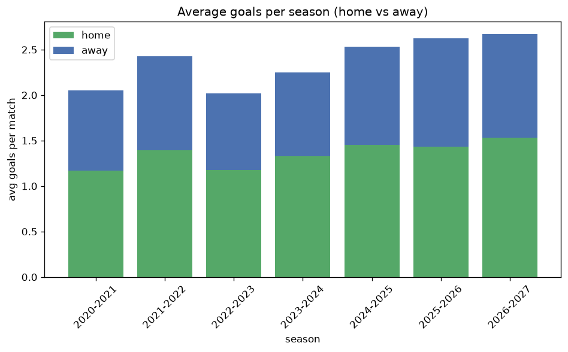

# Goal Analysis
- Report: `goals_analysis`
- Generated: 2026-10-26T01:49:52+00:00
- Script: `backend/scripts/analyze_goals.py` v1.0.0
- League: LaLiga2 (Spain)
- Scope: league `spain2`

## 1. Goals per match distribution
| goals | matches | pct |
|---|---|---|
| 0 | 304 | 10.4% |
| 1 | 661 | 22.5% |
| 2 | 738 | 25.1% |
| 3 | 599 | 20.4% |
| 4 | 363 | 12.4% |
| 5 | 181 | 6.2% |
| 6 | 66 | 2.2% |
| 7 | 17 | 0.6% |
| 8 | 4 | 0.1% |
| 9 | 2 | 0.1% |

## 2. Goals per match per season
| season | matches | total goals | avg home | avg away | avg total |
|---|---|---|---|---|---|
| 2020-2021 | 462 | 949 | 1.171 | 0.883 | 2.054 |
| 2021-2022 | 462 | 1122 | 1.396 | 1.032 | 2.429 |
| 2022-2023 | 462 | 932 | 1.177 | 0.84 | 2.017 |
| 2023-2024 | 462 | 1039 | 1.331 | 0.918 | 2.249 |
| 2024-2025 | 462 | 1169 | 1.45 | 1.08 | 2.53 |
| 2025-2026 | 509 | 1335 | 1.432 | 1.191 | 2.623 |
| 2026-2027 | 116 | 310 | 1.534 | 1.138 | 2.672 |

## 3. Home vs away goal share
- Home goals: **3922** (57.2%)
- Away goals: **2934** (42.8%)
- Home/away ratio: **1.337**

| season | home goals | away goals | total | home pct | away pct |
|---|---|---|---|---|---|
| 2020-2021 | 541 | 408 | 949 | 57.0% | 43.0% |
| 2021-2022 | 645 | 477 | 1122 | 57.5% | 42.5% |
| 2022-2023 | 544 | 388 | 932 | 58.4% | 41.6% |
| 2023-2024 | 615 | 424 | 1039 | 59.2% | 40.8% |
| 2024-2025 | 670 | 499 | 1169 | 57.3% | 42.7% |
| 2025-2026 | 729 | 606 | 1335 | 54.6% | 45.4% |
| 2026-2027 | 178 | 132 | 310 | 57.4% | 42.6% |

## 4. BTTS (Both Teams To Score)
- Overall: **1426** of `2935` (48.6%)

| season | matches | BTTS | pct |
|---|---|---|---|
| 2020-2021 | 462 | 190 | 41.1% |
| 2021-2022 | 462 | 242 | 52.4% |
| 2022-2023 | 462 | 203 | 43.9% |
| 2023-2024 | 462 | 201 | 43.5% |
| 2024-2025 | 462 | 245 | 53.0% |
| 2025-2026 | 509 | 286 | 56.2% |
| 2026-2027 | 116 | 59 | 50.9% |

## 5. Clean sheets
- Home clean sheets: **1071** (36.5%)
- Away clean sheets: **742** (25.3%)
- Total clean sheets recorded: **1813**
- Matches with at least one clean sheet: **1509** (51.4%)
- Both teams kept clean sheets (0-0): **304**

| season | matches | home CS | away CS | total CS | matches w/ CS |
|---|---|---|---|---|---|
| 2020-2021 | 462 | 183 | 139 | 322 | 272 (58.9%) |
| 2021-2022 | 462 | 155 | 108 | 263 | 220 (47.6%) |
| 2022-2023 | 462 | 198 | 129 | 327 | 259 (56.1%) |
| 2023-2024 | 462 | 189 | 122 | 311 | 261 (56.5%) |
| 2024-2025 | 462 | 162 | 99 | 261 | 217 (47.0%) |
| 2025-2026 | 509 | 147 | 116 | 263 | 223 (43.8%) |
| 2026-2027 | 116 | 37 | 29 | 66 | 57 (49.1%) |

## 6. Scoring intensity
- First-half goals: **2957** (43.1%)
- Second-half goals: **3896** (56.9%)
- Avg first-half goals per match: **1.008**
- Avg second-half goals per match: **1.328**
- Second-half-only scoring (HT 0-0, FT goals >= 1): **771** (26.3%)
- *1 match(es) excluded (no HT score recorded).*

| season | matches | 1st half | 2nd half | 1st half pct | 2nd half pct |
|---|---|---|---|---|---|
| 2020-2021 | 462 | 405 | 541 | 42.8% | 57.2% |
| 2021-2022 | 462 | 491 | 631 | 43.8% | 56.2% |
| 2022-2023 | 462 | 394 | 538 | 42.3% | 57.7% |
| 2023-2024 | 462 | 440 | 599 | 42.3% | 57.7% |
| 2024-2025 | 462 | 491 | 678 | 42.0% | 58.0% |
| 2025-2026 | 509 | 593 | 742 | 44.4% | 55.6% |
| 2026-2027 | 116 | 143 | 167 | 46.1% | 53.9% |

## 7. First-goal timing
- Matches with first-goal time recorded: `2630` of `2935` (89.6%)
- Goalless matches: `305`
- Min `1` | Max `98` | Mean `34.1` | Median (p50) `29.0`

| bucket | count | % of matches | % of scoring matches |
|---|---|---|---|
| 1-15 | 768 | 26.2% | 29.2% |
| 16-30 | 600 | 20.4% | 22.8% |
| 31-45 | 442 | 15.1% | 16.8% |
| 46-60 | 391 | 13.3% | 14.9% |
| 61-75 | 222 | 7.6% | 8.4% |
| 76-90 | 155 | 5.3% | 5.9% |
| 91-120 | 52 | 1.8% | 2.0% |

---
*All statistics are computed from PostgreSQL tables (read-only). Run with `python backend/scripts/analyze_goals.py` to regenerate.*

## Charts

