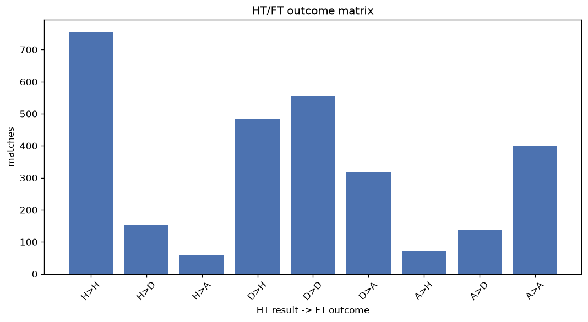
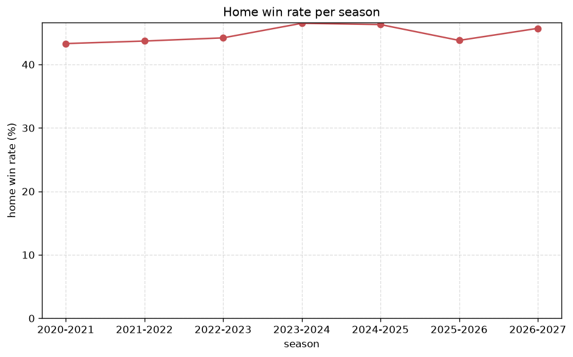

# Match Analysis
- Report: `matches_analysis`
- Generated: 2026-10-26T01:49:51+00:00
- Script: `backend/scripts/analyze_matches.py` v1.0.0
- League: LaLiga2 (Spain)
- Scope: league `spain2`

## 1. Overall summary
| metric | value |
|---|---|
| Matches | 2935 |
| Home wins | 1311 (44.7%) |
| Draws | 846 (28.8%) |
| Away wins | 778 (26.5%) |
| Total goals | 6856 |
| Average goals per match | 2.336 |
| Goalless matches | 304 (10.4%) |

## 2. Per-season breakdown
| season | matches | home wins | draws | away wins | total goals | avg goals | goalless |
|---|---|---|---|---|---|---|---|
| 2020-2021 | 462 | 200 (43.3%) | 132 (28.6%) | 130 (28.1%) | 949 | 2.054 | 50 (10.8%) |
| 2021-2022 | 462 | 202 (43.7%) | 137 (29.7%) | 123 (26.6%) | 1122 | 2.429 | 43 (9.3%) |
| 2022-2023 | 462 | 204 (44.2%) | 154 (33.3%) | 104 (22.5%) | 932 | 2.017 | 68 (14.7%) |
| 2023-2024 | 462 | 215 (46.5%) | 139 (30.1%) | 108 (23.4%) | 1039 | 2.249 | 50 (10.8%) |
| 2024-2025 | 462 | 214 (46.3%) | 130 (28.1%) | 118 (25.5%) | 1169 | 2.53 | 44 (9.5%) |
| 2025-2026 | 509 | 223 (43.8%) | 129 (25.3%) | 157 (30.8%) | 1335 | 2.623 | 40 (7.9%) |
| 2026-2027 | 116 | 53 (45.7%) | 25 (21.6%) | 38 (32.8%) | 310 | 2.672 | 9 (7.8%) |

## 3. HT/FT outcome matrix
| HT result \ FT result | Home | Draw | Away | total |
|---|---|---|---|---|
| HT home lead | 755 (78.1%) | 153 (15.8%) | 59 (6.1%) | 967 |
| HT draw | 484 (35.6%) | 557 (41.0%) | 319 (23.5%) | 1360 |
| HT away lead | 72 (11.9%) | 136 (22.4%) | 399 (65.7%) | 607 |
- *1 match(es) excluded (no HT score recorded).*

## 4. Comeback matches
- Home comebacks (trailing at HT, won at FT): **72** (2.5%)
- Away comebacks (trailing at HT, won at FT): **59** (2.0%)

### Home comebacks
| season | home | away | HT | FT |
|---|---|---|---|---|
| 2020-2021 | Rayo Vallecano | Sabadell | 0-1 | 2-1 |
| 2020-2021 | Lugo | Leganes | 0-1 | 2-1 |
| 2020-2021 | Gijon | Ponferradina | 0-1 | 2-1 |
| 2020-2021 | Las Palmas | Gijon | 0-2 | 3-2 |
| 2020-2021 | Leganes | Almeria | 0-1 | 2-1 |
| 2020-2021 | Rayo Vallecano | Zaragoza | 1-2 | 3-2 |
| 2020-2021 | Ponferradina | Almeria | 0-1 | 2-1 |
| 2020-2021 | Lugo | Mirandes | 0-1 | 2-1 |
| 2020-2021 | Mallorca | Zaragoza | 0-1 | 2-1 |
| 2021-2022 | Lugo | Huesca | 1-2 | 3-2 |
| 2021-2022 | Gijon | Malaga | 0-1 | 2-1 |
| 2021-2022 | Mirandes | Lugo | 0-1 | 3-2 |
| 2021-2022 | Girona | Alcorcon | 0-1 | 3-1 |
| 2021-2022 | Almeria | Valladolid | 0-1 | 3-1 |
| 2021-2022 | Gijon | Amorebieta | 0-1 | 2-1 |
| 2021-2022 | Zaragoza | Fuenlabrada | 0-1 | 2-1 |
| 2021-2022 | Leganes | Fuenlabrada | 1-2 | 3-2 |
| 2022-2023 | Andorra | Levante | 0-1 | 3-1 |
| 2022-2023 | FC Cartagena SAD | Eibar | 0-1 | 2-1 |
| 2022-2023 | Zaragoza | UD Ibiza | 0-1 | 2-1 |
| 2022-2023 | Eibar | Huesca | 0-1 | 2-1 |
| 2022-2023 | Ponferradina | Villarreal B | 0-1 | 2-1 |
| 2022-2023 | Burgos CF | Andorra | 0-1 | 2-1 |
| 2022-2023 | Albacete | Malaga | 1-2 | 3-2 |
| 2022-2023 | Villarreal B | FC Cartagena SAD | 1-2 | 5-2 |
| 2022-2023 | Oviedo | Ponferradina | 0-2 | 3-2 |
| 2022-2023 | Tenerife | Burgos CF | 0-1 | 2-1 |
| 2022-2023 | Andorra | Villarreal B | 1-2 | 4-3 |
| 2023-2024 | Espanyol | Amorebieta | 0-2 | 3-2 |
| 2023-2024 | Leganes | Levante | 0-1 | 2-1 |
| 2023-2024 | Burgos CF | Alcorcon | 0-2 | 4-2 |
| 2023-2024 | Oviedo | Eibar | 0-1 | 2-1 |
| 2023-2024 | Valladolid | Amorebieta | 0-1 | 2-1 |
| 2023-2024 | Oviedo | Elche | 1-2 | 3-2 |
| 2023-2024 | FC Cartagena SAD | Villarreal B | 0-1 | 4-1 |
| 2023-2024 | Oviedo | Levante | 0-1 | 3-2 |
| 2023-2024 | Andorra | Valladolid | 0-1 | 2-1 |
| 2023-2024 | Racing Santander | Tenerife | 0-1 | 4-2 |
| 2023-2024 | Valladolid | Eibar | 0-1 | 3-1 |
| 2023-2024 | Levante | Elche | 0-1 | 3-2 |
| 2023-2024 | Racing Club Ferrol | Huesca | 0-1 | 2-1 |
| 2024-2025 | Gijon | Castellon | 0-1 | 2-1 |
| 2024-2025 | Almeria | Granada CF | 0-1 | 2-1 |
| 2024-2025 | Elche | Cadiz CF | 0-1 | 2-1 |
| 2024-2025 | Mirandes | Malaga | 0-1 | 3-2 |
| 2024-2025 | Mirandes | Racing Santander | 0-1 | 2-1 |
| 2024-2025 | Tenerife | Granada CF | 0-1 | 2-1 |
| 2024-2025 | Cadiz CF | Almeria | 0-1 | 2-1 |
| 2024-2025 | Zaragoza | FC Cartagena SAD | 1-2 | 3-2 |
| 2024-2025 | Huesca | Elche | 0-1 | 2-1 |
| 2024-2025 | Huesca | Eldense | 1-2 | 3-2 |
| 2025-2026 | Cordoba | Castellon | 0-1 | 2-1 |
| 2025-2026 | Almeria | Gijon | 0-1 | 2-1 |
| 2025-2026 | Albacete | Huesca | 0-1 | 2-1 |
| 2025-2026 | Valladolid | Granada CF | 0-1 | 2-1 |
| 2025-2026 | Mirandes | Gijon | 0-1 | 2-1 |
| 2025-2026 | Eibar | Albacete | 0-1 | 3-2 |
| 2025-2026 | Eibar | Mirandes | 0-1 | 2-1 |
| 2025-2026 | Malaga | Cultural Leonesa | 0-1 | 2-1 |
| 2025-2026 | Eibar | Racing Santander | 0-1 | 2-1 |
| 2025-2026 | Albacete | Las Palmas | 0-1 | 2-1 |
| 2025-2026 | Las Palmas | Huesca | 0-1 | 2-1 |
| 2025-2026 | Leganes | Albacete | 0-1 | 2-1 |
| 2025-2026 | Dep. A Coruna | Mirandes | 0-1 | 3-1 |
| 2025-2026 | Dep. La Coruna | Mirandes | 0-1 | 3-1 |
| 2025-2026 | Racing Santander | Huesca | 0-1 | 4-2 |
| 2025-2026 | Malaga | Gijon | 0-1 | 2-1 |
| 2025-2026 | Dep. La Coruna | Andorra | 0-1 | 2-1 |
| 2025-2026 | Dep. A Coruna | Andorra | 0-1 | 2-1 |
| 2026-2027 | Eldense | Oviedo | 0-1 | 4-1 |
| 2026-2027 | Almeria | Burgos CF | 0-1 | 2-1 |
| 2026-2027 | Eldense | Cordoba | 0-1 | 2-1 |

### Away comebacks
| season | home | away | HT | FT |
|---|---|---|---|---|
| 2020-2021 | UD Logrones | Lugo | 1-0 | 2-3 |
| 2020-2021 | Oviedo | UD Logrones | 1-0 | 2-3 |
| 2020-2021 | Espanyol | Girona | 1-0 | 1-2 |
| 2020-2021 | Zaragoza | Rayo Vallecano | 1-0 | 1-2 |
| 2020-2021 | Espanyol | Rayo Vallecano | 2-0 | 2-3 |
| 2020-2021 | Las Palmas | Girona | 1-0 | 1-2 |
| 2021-2022 | Alcorcon | Zaragoza | 1-0 | 1-2 |
| 2021-2022 | Tenerife | Mirandes | 1-0 | 1-2 |
| 2021-2022 | Ponferradina | Tenerife | 1-0 | 1-2 |
| 2021-2022 | Las Palmas | Girona | 1-0 | 1-3 |
| 2021-2022 | Real Sociedad B | Mirandes | 1-0 | 1-3 |
| 2021-2022 | Ponferradina | Las Palmas | 1-0 | 1-2 |
| 2021-2022 | Fuenlabrada | Ponferradina | 2-0 | 2-3 |
| 2021-2022 | Fuenlabrada | Real Sociedad B | 1-0 | 1-2 |
| 2022-2023 | Zaragoza | Lugo | 1-0 | 1-2 |
| 2022-2023 | Lugo | Alaves | 1-0 | 1-2 |
| 2022-2023 | Leganes | Albacete | 1-0 | 1-2 |
| 2022-2023 | UD Ibiza | Eibar | 1-0 | 1-2 |
| 2022-2023 | Burgos CF | Eibar | 1-0 | 1-2 |
| 2022-2023 | Villarreal B | Zaragoza | 2-0 | 2-3 |
| 2022-2023 | UD Ibiza | Las Palmas | 1-0 | 1-2 |
| 2022-2023 | Burgos CF | Granada CF | 1-0 | 1-3 |
| 2022-2023 | Mirandes | Eibar | 2-0 | 2-3 |
| 2022-2023 | Leganes | FC Cartagena SAD | 1-0 | 1-3 |
| 2022-2023 | Albacete | Las Palmas | 1-0 | 1-2 |
| 2023-2024 | Villarreal B | FC Cartagena SAD | 1-0 | 1-2 |
| 2023-2024 | Zaragoza | Eibar | 2-0 | 2-3 |
| 2023-2024 | Levante | Racing Santander | 2-1 | 2-4 |
| 2023-2024 | Elche | FC Cartagena SAD | 1-0 | 1-2 |
| 2023-2024 | Eibar | Espanyol | 1-0 | 2-3 |
| 2023-2024 | Villarreal B | Leganes | 1-0 | 1-2 |
| 2023-2024 | Gijon | Racing Santander | 1-0 | 2-3 |
| 2023-2024 | Eldense | Leganes | 1-0 | 1-2 |
| 2024-2025 | FC Cartagena SAD | Zaragoza | 1-0 | 1-2 |
| 2024-2025 | Eldense | FC Cartagena SAD | 1-0 | 1-2 |
| 2024-2025 | Tenerife | Zaragoza | 1-0 | 2-3 |
| 2024-2025 | Castellon | Granada CF | 2-1 | 2-3 |
| 2024-2025 | Zaragoza | Oviedo | 2-0 | 2-3 |
| 2024-2025 | Eldense | Eibar | 1-0 | 1-3 |
| 2024-2025 | Castellon | Cordoba | 1-0 | 1-2 |
| 2024-2025 | Cordoba | Huesca | 1-0 | 1-2 |
| 2024-2025 | Eldense | Levante | 1-0 | 1-2 |
| 2024-2025 | Huesca | Racing Santander | 1-0 | 1-3 |
| 2024-2025 | Burgos CF | Levante | 2-1 | 2-3 |
| 2025-2026 | Almeria | Racing Santander | 2-0 | 2-3 |
| 2025-2026 | Gijon | Albacete | 3-1 | 3-4 |
| 2025-2026 | Cadiz CF | Racing Santander | 2-1 | 2-3 |
| 2025-2026 | Dep. La Coruna | Castellon | 1-0 | 1-3 |
| 2025-2026 | Dep. A Coruna | Castellon | 1-0 | 1-3 |
| 2025-2026 | Albacete | Malaga | 1-0 | 1-3 |
| 2025-2026 | Almeria | Dep. La Coruna | 1-0 | 1-2 |
| 2025-2026 | Almeria | Dep. A Coruna | 1-0 | 1-2 |
| 2025-2026 | Eibar | Malaga | 2-1 | 2-4 |
| 2026-2027 | Cordoba | Granada CF | 1-0 | 1-3 |
| 2026-2027 | Girona | Castellon | 1-0 | 1-2 |
| 2026-2027 | Albacete | Cordoba | 1-0 | 1-2 |
| 2026-2027 | Las Palmas | Burgos CF | 1-0 | 1-2 |
| 2026-2027 | Albacete | Eibar | 1-0 | 1-3 |
| 2026-2027 | Real Sociedad B | Granada CF | 2-0 | 2-3 |

## 5. HT lead conversion
| HT state | matches | converted to win | held as draw | collapsed to loss |
|---|---|---|---|---|
| Home lead | 967 | 755 (78.1%) | 153 (15.8%) | 59 (6.1%) |
| Away lead | 607 | 399 (65.7%) | 136 (22.4%) | 72 (11.9%) |

### Matches level at half-time
| FT result | count | pct |
|---|---|---|
| Home win | 484 | 35.6% |
| Draw | 557 | 41.0% |
| Away win | 319 | 23.5% |
- *1 match(es) excluded (no HT score recorded).*

## 6. First-goal timing
- Matches with a first-goal time recorded: `2630` of `2935` (89.6%)

Outcome distribution by first-goal timing bucket:
| bucket | matches | % of matches | home | draw | away |
|---|---|---|---|---|---|
| 1-15 | 768 | 26.2% | 386 (50.3%) | 156 (20.3%) | 226 (29.4%) |
| 16-30 | 600 | 20.4% | 311 (51.8%) | 131 (21.8%) | 158 (26.3%) |
| 31-45 | 442 | 15.1% | 211 (47.7%) | 101 (22.9%) | 130 (29.4%) |
| 46-60 | 391 | 13.3% | 180 (46.0%) | 97 (24.8%) | 114 (29.2%) |
| 61-75 | 222 | 7.6% | 111 (50.0%) | 36 (16.2%) | 75 (33.8%) |
| 76-90 | 155 | 5.3% | 85 (54.8%) | 19 (12.3%) | 51 (32.9%) |
| 91-120 | 52 | 1.8% | 27 (51.9%) | 2 (3.8%) | 23 (44.2%) |

## 7. Goalless matches
- Overall: **304** of `2935` (10.4%)

| season | matches | goalless | pct |
|---|---|---|---|
| 2020-2021 | 462 | 50 | 10.8% |
| 2021-2022 | 462 | 43 | 9.3% |
| 2022-2023 | 462 | 68 | 14.7% |
| 2023-2024 | 462 | 50 | 10.8% |
| 2024-2025 | 462 | 44 | 9.5% |
| 2025-2026 | 509 | 40 | 7.9% |
| 2026-2027 | 116 | 9 | 7.8% |

---
*All statistics are computed from PostgreSQL tables (read-only). Run with `python backend/scripts/analyze_matches.py` to regenerate.*

## Charts

