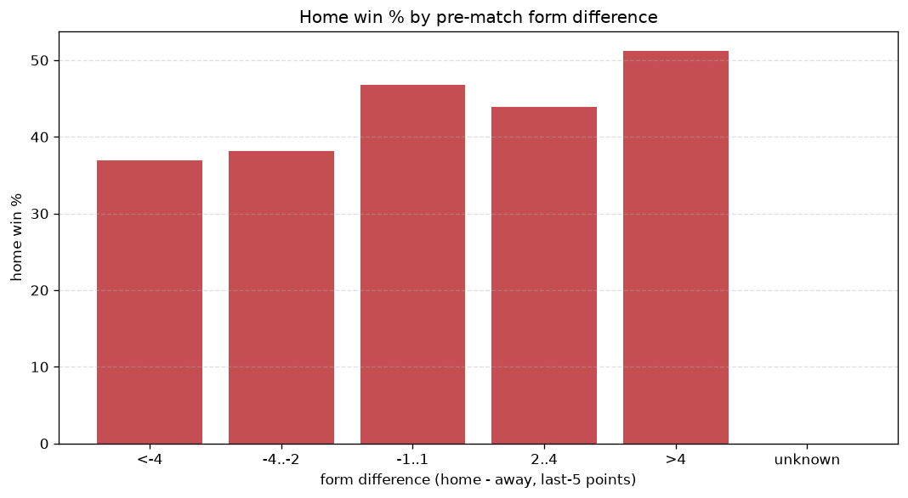
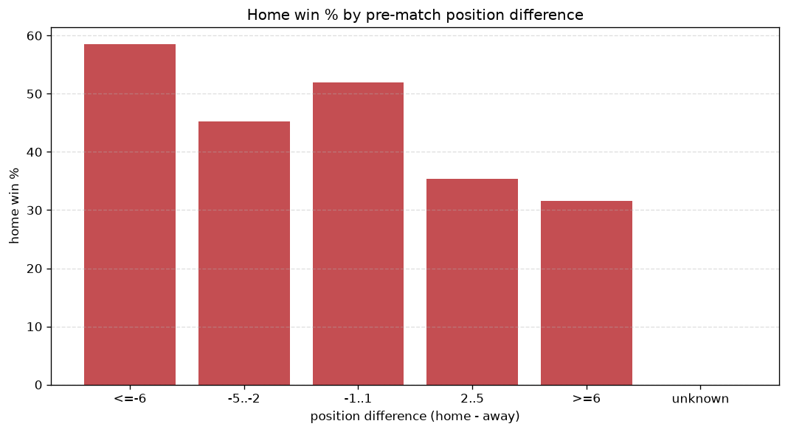

# Relationships Analysis
- Report: `relationships`
- Generated: 2026-10-29T02:17:01+00:00
- Script: `backend/scripts/analyze_relationships.py` v1.0.0
- League: LaLiga2 (Spain)
- Scope: league `spain2`

- Matches analysed: **2819** (23 leakage-safe pre-match features).

## 1. Correlation matrix
_Pearson correlation of each pre-match feature with observed goals; sorted by |corr(total goals)|._

| feature | corr(home) | corr(away) | corr(total) |
|---|---|---|---|
| home_team_home_goals_avg | 0.126 | -0.015 | 0.083 |
| home_team_goals_scored_last_5 | 0.106 | 0.002 | 0.080 |
| home_points_before_match | 0.100 | 0.001 | 0.074 |
| points_difference | 0.180 | -0.092 | 0.073 |
| home_position_before_match | -0.150 | 0.071 | -0.064 |
| away_team_goals_conceded_last_5 | 0.065 | 0.024 | 0.064 |
| position_difference | -0.164 | 0.088 | -0.063 |
| away_team_goals_scored_last_5 | 0.010 | 0.063 | 0.048 |
| home_team_points_last_5 | 0.095 | -0.036 | 0.046 |
| home_team_wins_last_5 | 0.090 | -0.031 | 0.046 |
| away_team_away_conceded_avg | 0.063 | -0.006 | 0.043 |
| home_team_home_win_rate | 0.100 | -0.049 | 0.042 |
| home_team_home_conceded_avg | -0.017 | 0.072 | 0.034 |
| away_points_before_match | -0.011 | 0.057 | 0.029 |
| away_team_away_goals_avg | 0.004 | 0.037 | 0.027 |
| away_position_before_match | 0.080 | -0.053 | 0.025 |
| home_team_goals_conceded_last_5 | -0.021 | 0.049 | 0.017 |
| away_rest_days | -0.010 | -0.010 | -0.014 |
| home_rest_days | -0.005 | -0.009 | -0.010 |
| away_team_wins_last_5 | -0.009 | 0.021 | 0.007 |
| rest_days_difference | 0.008 | 0.001 | 0.006 |
| away_team_away_win_rate | -0.013 | 0.022 | 0.005 |
| away_team_points_last_5 | -0.020 | 0.019 | -0.002 |

## 2. Form vs outcome
_Home win/draw/away % per bucket of `home_team_points_last_5 - away_team_points_last_5`._

| bucket | matches | home | draw | away | home % | draw % | away % |
|---|---|---|---|---|---|---|---|
| <-4 | 405 | 159 | 121 | 125 | 39.3% | 29.9% | 30.9% |
| -4..-2 | 667 | 278 | 206 | 183 | 41.7% | 30.9% | 27.4% |
| -1..1 | 837 | 369 | 248 | 220 | 44.1% | 29.6% | 26.3% |
| 2..4 | 576 | 276 | 154 | 146 | 47.9% | 26.7% | 25.3% |
| >4 | 334 | 176 | 92 | 66 | 52.7% | 27.5% | 19.8% |
| unknown | 0 | 0 | 0 | 0 | - | - | - |

## 3. Position vs outcome
_Home win/draw/away % per bucket of `position_difference` (home position - away position; negative favours the home team)._

| bucket | matches | home | draw | away | home % | draw % | away % |
|---|---|---|---|---|---|---|---|
| <=-6 | 749 | 418 | 193 | 138 | 55.8% | 25.8% | 18.4% |
| -5..-2 | 465 | 216 | 133 | 116 | 46.5% | 28.6% | 24.9% |
| -1..1 | 306 | 132 | 103 | 71 | 43.1% | 33.7% | 23.2% |
| 2..5 | 467 | 191 | 147 | 129 | 40.9% | 31.5% | 27.6% |
| >=6 | 832 | 301 | 245 | 286 | 36.2% | 29.4% | 34.4% |
| unknown | 0 | 0 | 0 | 0 | - | - | - |

## 4. Rest advantage
_Home win/draw/away % per bucket of `rest_days_difference` (home rest - away rest). Matches with unknown rest are bucketed separately._

| bucket | matches | home | draw | away | home % | draw % | away % |
|---|---|---|---|---|---|---|---|
| <-1 | 273 | 128 | 79 | 66 | 46.9% | 28.9% | 24.2% |
| -1..0 | 651 | 287 | 183 | 181 | 44.1% | 28.1% | 27.8% |
| 0 | 896 | 396 | 257 | 243 | 44.2% | 28.7% | 27.1% |
| 1..2 | 860 | 385 | 265 | 210 | 44.8% | 30.8% | 24.4% |
| >2 | 70 | 33 | 18 | 19 | 47.1% | 25.7% | 27.1% |
| unknown | 69 | 29 | 19 | 21 | 42.0% | 27.5% | 30.4% |
- *69 match(es) had unknown rest difference (missing rest data on at least one side).*

## 5. Home team quality
_Home win rate by `home_team_home_win_rate` tier (split at 0.5)._

- `< 0.5` tier: **41.4%** home win (667/1612)
- `>= 0.5` tier: **49.0%** home win (591/1207)
- Home-win gap (>= split minus < split): **+7.6 pp**

| tier | label | matches | home | draw | away | home % |
|---|---|---|---|---|---|---|
| low | < 0.5 | 1612 | 667 | 460 | 485 | 41.4% |
| high | >= 0.5 | 1207 | 591 | 361 | 255 | 49.0% |

## 6. Feature averages by result
_Mean feature value per outcome; `range` is home-minus-away spread of the group means._

| feature | home mean | draw mean | away mean | range |
|---|---|---|---|---|
| points_difference | 1.730 | -0.644 | -3.341 | 5.070 |
| position_difference | -1.207 | 0.629 | 2.427 | 3.634 |
| home_points_before_match | 29.231 | 27.636 | 25.926 | 3.305 |
| home_position_before_match | 11.269 | 12.205 | 13.414 | 2.145 |
| away_points_before_match | 27.501 | 28.280 | 29.266 | 1.765 |
| away_position_before_match | 12.475 | 11.576 | 10.986 | 1.489 |
| home_team_points_last_5 | 6.417 | 6.084 | 5.758 | 0.659 |
| home_team_goals_scored_last_5 | 5.488 | 5.201 | 5.023 | 0.465 |
| home_rest_days | 6.862 | 7.095 | 6.787 | 0.307 |
| home_team_goals_conceded_last_5 | 5.311 | 5.479 | 5.608 | 0.297 |
| away_team_points_last_5 | 6.318 | 6.572 | 6.458 | 0.255 |
| away_team_goals_scored_last_5 | 5.354 | 5.453 | 5.582 | 0.229 |
| away_rest_days | 6.886 | 7.022 | 6.794 | 0.228 |
| home_team_wins_last_5 | 1.679 | 1.575 | 1.466 | 0.213 |
| away_team_goals_conceded_last_5 | 5.344 | 5.269 | 5.186 | 0.158 |
| home_team_home_goals_avg | 1.289 | 1.231 | 1.146 | 0.143 |
| rest_days_difference | -0.023 | 0.071 | -0.007 | 0.094 |
| away_team_wins_last_5 | 1.652 | 1.733 | 1.692 | 0.081 |
| home_team_home_conceded_avg | 0.910 | 0.938 | 0.978 | 0.067 |
| away_team_away_conceded_avg | 1.257 | 1.213 | 1.192 | 0.065 |
| home_team_home_win_rate | 0.439 | 0.422 | 0.380 | 0.059 |
| away_team_away_goals_avg | 0.920 | 0.943 | 0.952 | 0.032 |
| away_team_away_win_rate | 0.253 | 0.266 | 0.265 | 0.013 |

---
*All features are leakage-safe pre-match values built by `ml.features.build_features.build_rows` from strictly prior matches. Run with `python backend/scripts/analyze_relationships.py` to regenerate.*

## Charts

