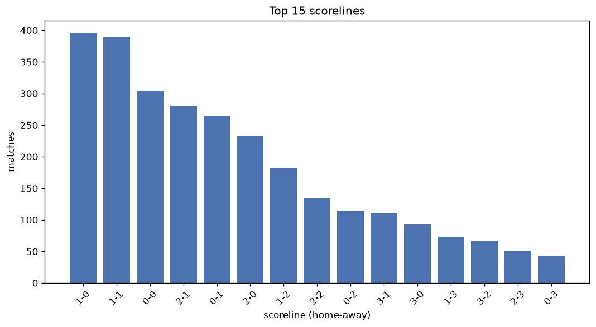
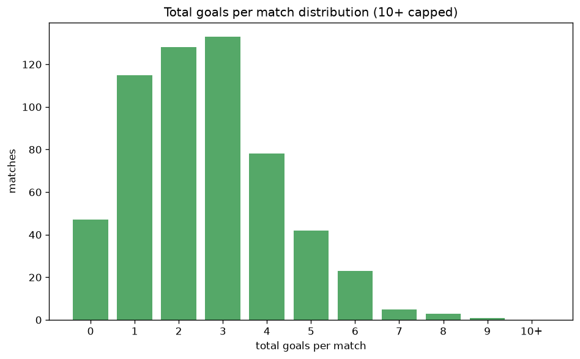

# Scoreline Analysis
- Report: `scoreline_analysis`
- Generated: 2026-10-30T04:13:41+00:00
- Script: `backend/scripts/analyze_scorelines.py` v1.0.0
- League: LaLiga2 (Spain)
- Scope: league `spain2`

## 1. Scoreline frequency
- Matches analysed: **2940** across **7** seasons.
- Distinct scorelines seen: **36**.

| scoreline | count | pct |
|---|---|---|
| 1-0 | 396 | 13.5% |
| 1-1 | 391 | 13.3% |
| 0-0 | 304 | 10.3% |
| 2-1 | 280 | 9.5% |
| 0-1 | 265 | 9.0% |
| 2-0 | 234 | 8.0% |
| 1-2 | 183 | 6.2% |
| 2-2 | 134 | 4.6% |
| 0-2 | 115 | 3.9% |
| 3-1 | 111 | 3.8% |
| 3-0 | 93 | 3.2% |
| 1-3 | 73 | 2.5% |
| 3-2 | 66 | 2.2% |
| 2-3 | 51 | 1.7% |
| 0-3 | 43 | 1.5% |
| 4-0 | 36 | 1.2% |
| 4-1 | 36 | 1.2% |
| 4-2 | 19 | 0.6% |
| 3-3 | 17 | 0.6% |
| 1-4 | 17 | 0.6% |

## 2. Scoreline frequency per season

### 2020-2021
| scoreline | count | pct |
|---|---|---|
| 1-0 | 71 | 15.4% |
| 1-1 | 63 | 13.6% |
| 0-1 | 55 | 11.9% |
| 0-0 | 50 | 10.8% |
| 2-1 | 41 | 8.9% |

### 2021-2022
| scoreline | count | pct |
|---|---|---|
| 1-1 | 69 | 14.9% |
| 1-0 | 51 | 11.0% |
| 2-1 | 44 | 9.5% |
| 0-0 | 43 | 9.3% |
| 2-0 | 36 | 7.8% |

### 2022-2023
| scoreline | count | pct |
|---|---|---|
| 1-0 | 81 | 17.5% |
| 0-0 | 68 | 14.7% |
| 1-1 | 67 | 14.5% |
| 2-1 | 48 | 10.4% |
| 0-1 | 43 | 9.3% |

### 2023-2024
| scoreline | count | pct |
|---|---|---|
| 1-1 | 64 | 13.9% |
| 1-0 | 61 | 13.2% |
| 2-0 | 53 | 11.5% |
| 0-0 | 50 | 10.8% |
| 0-1 | 40 | 8.7% |

### 2024-2025
| scoreline | count | pct |
|---|---|---|
| 1-0 | 66 | 14.3% |
| 1-1 | 48 | 10.4% |
| 2-1 | 44 | 9.5% |
| 0-0 | 44 | 9.5% |
| 2-2 | 36 | 7.8% |

### 2025-2026
| scoreline | count | pct |
|---|---|---|
| 1-1 | 67 | 13.2% |
| 2-1 | 57 | 11.2% |
| 1-0 | 56 | 11.0% |
| 0-1 | 45 | 8.8% |
| 0-0 | 40 | 7.9% |

### 2026-2027
| scoreline | count | pct |
|---|---|---|
| 1-1 | 13 | 10.7% |
| 0-1 | 12 | 9.9% |
| 2-0 | 12 | 9.9% |
| 1-0 | 10 | 8.3% |
| 0-0 | 9 | 7.4% |

## 3. Total-goal histogram
_10+ groups all matches with 10 or more total goals._

| total goals | matches | pct |
|---|---|---|
| 0 | 304 | 10.3% |
| 1 | 661 | 22.5% |
| 2 | 740 | 25.2% |
| 3 | 599 | 20.4% |
| 4 | 365 | 12.4% |
| 5 | 182 | 6.2% |
| 6 | 66 | 2.2% |
| 7 | 17 | 0.6% |
| 8 | 4 | 0.1% |
| 9 | 2 | 0.1% |
| 10+ | 0 | 0.0% |

## 4. Extreme scorelines
- Matches with 7+ total goals: **23**

| season | date | scoreline | total goals |
|---|---|---|---|
| 2023-2024 | 2023-12-03 | 5-4 | 9 |
| 2025-2026 | 2025-11-15 | 5-4 | 9 |
| 2021-2022 | 2022-01-08 | 6-2 | 8 |
| 2025-2026 | 2025-08-18 | 4-4 | 8 |
| 2025-2026 | 2026-03-15 | 5-3 | 8 |
| 2025-2026 | 2026-04-05 | 6-2 | 8 |
| 2020-2021 | 2021-04-01 | 6-1 | 7 |
| 2022-2023 | 2023-03-12 | 3-4 | 7 |
| 2022-2023 | 2023-03-19 | 5-2 | 7 |
| 2022-2023 | 2023-05-27 | 4-3 | 7 |
| 2023-2024 | 2023-09-10 | 4-3 | 7 |
| 2023-2024 | 2024-05-11 | 5-2 | 7 |
| 2023-2024 | 2024-06-02 | 4-3 | 7 |
| 2024-2025 | 2024-09-16 | 2-5 | 7 |
| 2024-2025 | 2024-09-27 | 2-5 | 7 |
| 2024-2025 | 2025-02-09 | 5-2 | 7 |
| 2024-2025 | 2025-04-19 | 5-2 | 7 |
| 2024-2025 | 2025-05-05 | 4-3 | 7 |
| 2025-2026 | 2025-09-28 | 3-4 | 7 |
| 2025-2026 | 2025-10-04 | 5-2 | 7 |
| 2025-2026 | 2026-03-08 | 4-3 | 7 |
| 2025-2026 | 2026-03-21 | 5-2 | 7 |
| 2026-2027 | 2026-08-29 | 5-2 | 7 |

## 5. Margin-of-victory distribution (decided matches)
- Decided matches: **2093** (draws: **847**)
- Average winning margin: **1.58**

| margin | matches | pct |
|---|---|---|
| 1 | 1250 | 59.7% |
| 2 | 562 | 26.9% |
| 3+ | 281 | 13.4% |

## 6. Margin by outcome

### Home wins
- Matches: **1314** | avg margin: **1.64** | max margin: **6**
| margin | matches | pct |
|---|---|---|
| 1 | 749 | 57.0% |
| 2 | 365 | 27.8% |
| 3+ | 200 | 15.2% |
- *Full match-by-match list available in `scoreline_analysis.json`.*

### Away wins
- Matches: **779** | avg margin: **1.49** | max margin: **5**
| margin | matches | pct |
|---|---|---|
| 1 | 501 | 64.3% |
| 2 | 197 | 25.3% |
| 3+ | 81 | 10.4% |
- *Full match-by-match list available in `scoreline_analysis.json`.*

## 7. Most common exact score by outcome type
| outcome | matches | most common score | count | pct |
|---|---|---|---|---|
| home | 1314 | 1-0 | 396 | 30.1% |
| draw | 847 | 1-1 | 391 | 46.2% |
| away | 779 | 0-1 | 265 | 34.0% |

---
*All statistics are computed from PostgreSQL tables (read-only). Run with `python backend/scripts/analyze_scorelines.py` to regenerate.*

## Charts

