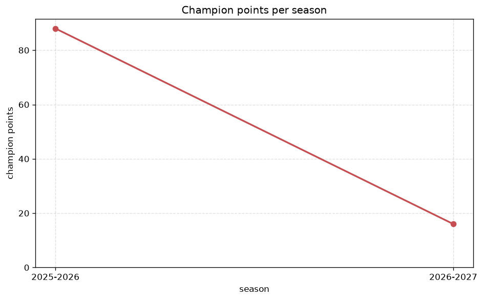
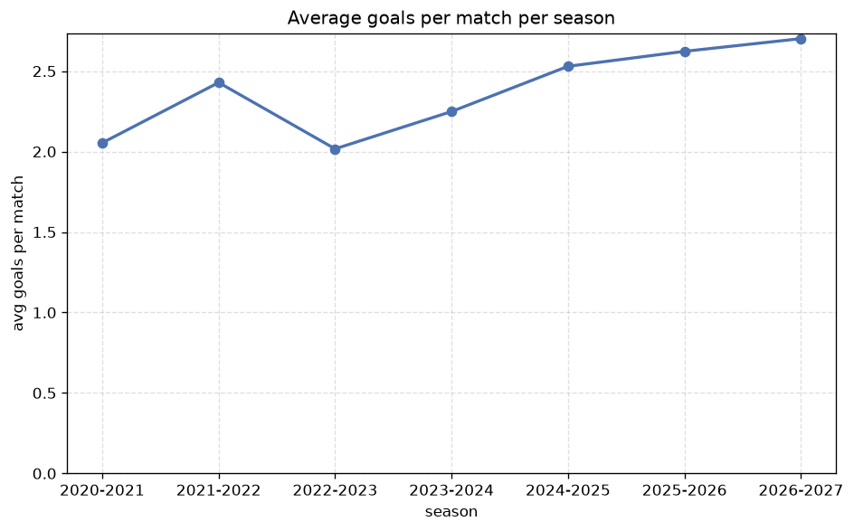

# Season Trends Analysis
- Report: `season_trends`
- Generated: 2026-10-29T02:16:58+00:00
- Script: `backend/scripts/analyze_seasons.py` v1.0.0
- League: LaLiga2 (Spain)
- Scope: league `spain2`

## 1. Champions per season
| season | champion | pts | runner-up | margin |
|---|---|---|---|---|
| 2020-2021 | Espanyol | 82 | Mallorca | 0 pts |
| 2021-2022 | Almeria | 81 | Valladolid | 0 pts |
| 2022-2023 | Granada CF | 75 | Las Palmas | 3 pts |
| 2023-2024 | Leganes | 74 | Valladolid | 2 pts |
| 2024-2025 | Levante | 79 | Elche | 2 pts |
| 2025-2026 | Racing Santander | 88 | Malaga | 3 pts |
| 2026-2027 | Castellon | 26 | Almeria | 1 pts |

## 2. Title-race tightness
- Tight races (margin <= 3 pts): **7** of 7 seasons
- Tightest race: **2020-2021** - Espanyol beat Mallorca by **0** pts

| season | margin | tight |
|---|---|---|
| 2020-2021 | 0 pts | yes |
| 2021-2022 | 0 pts | yes |
| 2022-2023 | 3 pts | yes |
| 2023-2024 | 2 pts | yes |
| 2024-2025 | 2 pts | yes |
| 2025-2026 | 3 pts | yes |
| 2026-2027 | 1 pts | yes |

## 3. Points thresholds
_Position-specific points per season. Key: 1 = champion, 2 = runner-up, 4 = CL line, 6 = Europa, 19 = last safe, 22 = bottom._

| season | pos 1 | pos 2 | pos 4 | pos 6 | pos 19 | pos 22 |
|---|---|---|---|---|---|---|
| 2020-2021 | 82 | 82 | 73 | 67 | 46 | 38 |
| 2021-2022 | 81 | 81 | 70 | 68 | 43 | 29 |
| 2022-2023 | 75 | 72 | 71 | 67 | 44 | 31 |
| 2023-2024 | 74 | 72 | 69 | 64 | 45 | 43 |
| 2024-2025 | 79 | 77 | 75 | 69 | 45 | 23 |
| 2025-2026 | 88 | 85 | 79 | 77 | 44 | 37 |
| 2026-2027 | 26 | 25 | 21 | 20 | 10 | 4 |

## 4. Relegation battle
| season | safe pos | safe pts | drop pos | drop pts | gap |
|---|---|---|---|---|---|
| 2020-2021 | 19 | 46 | 20 | 44 | 2 pts |
| 2021-2022 | 19 | 43 | 20 | 40 | 3 pts |
| 2022-2023 | 19 | 44 | 20 | 44 | 0 pts |
| 2023-2024 | 19 | 45 | 20 | 44 | 1 pts |
| 2024-2025 | 19 | 45 | 20 | 36 | 9 pts |
| 2025-2026 | 19 | 44 | 20 | 40 | 4 pts |
| 2026-2027 | 19 | 10 | 20 | 8 | 2 pts |

## 5. League-level trends
| season | matches | total goals | avg goals | home win | draw | away win | goalless | avg pts/team |
|---|---|---|---|---|---|---|---|---|
| 2020-2021 | 462 | 949 | 2.054 | 43.3% | 28.6% | 28.1% | 10.8% | 57.0 |
| 2021-2022 | 462 | 1122 | 2.429 | 43.7% | 29.7% | 26.6% | 9.3% | 56.77 |
| 2022-2023 | 462 | 932 | 2.017 | 44.2% | 33.3% | 22.5% | 14.7% | 56.0 |
| 2023-2024 | 462 | 1039 | 2.249 | 46.5% | 30.1% | 23.4% | 10.8% | 56.68 |
| 2024-2025 | 462 | 1169 | 2.53 | 46.3% | 28.1% | 25.5% | 9.5% | 57.09 |
| 2025-2026 | 509 | 1335 | 2.623 | 43.8% | 25.3% | 30.8% | 7.9% | 60.78 |
| 2026-2027 | 121 | 327 | 2.702 | 46.3% | 21.5% | 32.2% | 7.4% | 15.32 |

## 6. View divergence
- Largest divergence: **2022-2023** (goals view, avg abs position diff = 8.909)

_Avg absolute position difference between classic view and alternative view per season._

| season | classic vs luck | classic vs goals |
|---|---|---|
| 2020-2021 | 3.636 | 6.364 |
| 2021-2022 | 2.727 | 7.455 |
| 2022-2023 | 3.182 | 8.909 |
| 2023-2024 | 4.455 | 6.818 |
| 2024-2025 | 2.636 | 6.636 |
| 2025-2026 | 2.696 | 5.130 |
| 2026-2027 | 1.727 | 8.727 |

---
*All statistics are computed from PostgreSQL tables (read-only). Run with `python backend/scripts/analyze_seasons.py` to regenerate.*

## Charts

