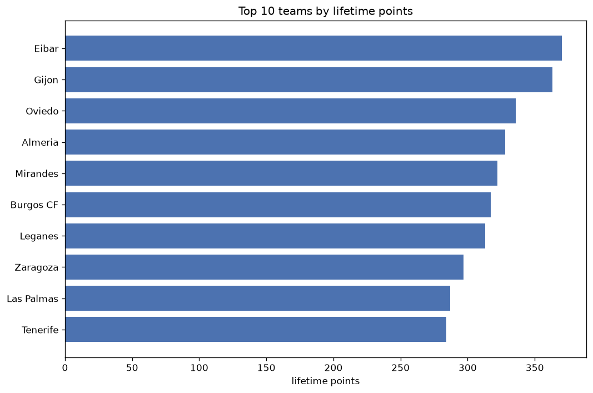
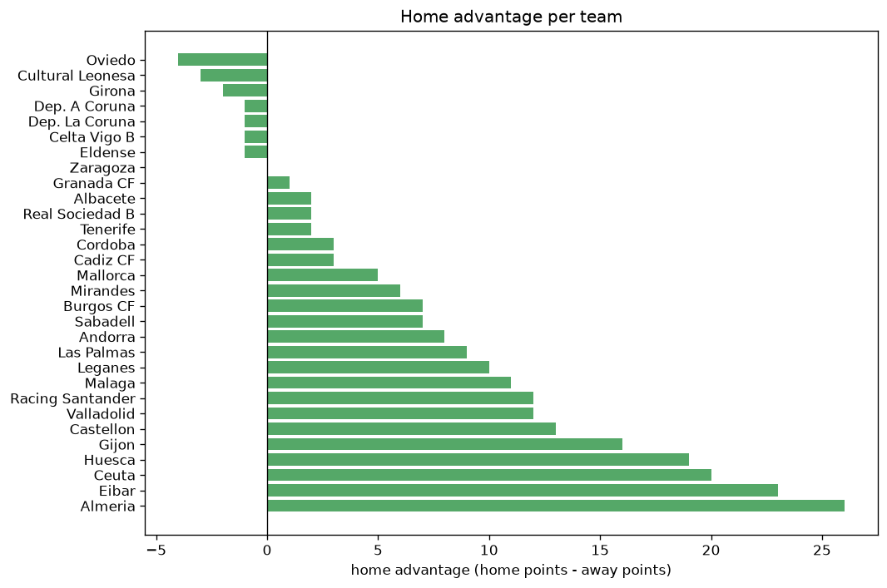

# Team Analysis
- Report: `teams_analysis`
- Generated: 2026-10-30T04:13:38+00:00
- Script: `backend/scripts/analyze_teams.py` v1.0.0
- League: LaLiga2 (Spain)
- Scope: league `spain2`

- Teams: **45** | Seasons: **7** | Matches: **2940**

## 1. Team standings (lifetime)
| team | seasons | played | W | D | L | pts | GF | GA | GD | avg pts/season | best pos | worst pos | titles |
|---|---|---|---|---|---|---|---|---|---|---|---|---|---|
| Eibar | 6 | 223 | 104 | 58 | 61 | 370 | 295 | 225 | 70 | 61.67 | 3 | 9 | 0 |
| Gijon | 7 | 265 | 95 | 78 | 92 | 363 | 303 | 289 | 14 | 51.86 | 5 | 17 | 0 |
| Oviedo | 6 | 221 | 87 | 75 | 59 | 336 | 262 | 215 | 47 | 56.0 | 4 | 14 | 0 |
| Almeria | 5 | 185 | 95 | 43 | 47 | 328 | 311 | 210 | 101 | 65.6 | 1 | 6 | 1 |
| Mirandes | 6 | 254 | 86 | 64 | 104 | 322 | 299 | 329 | -30 | 53.67 | 3 | 20 | 0 |
| Burgos CF | 6 | 223 | 85 | 62 | 76 | 317 | 232 | 224 | 8 | 52.83 | 6 | 14 | 0 |
| Leganes | 6 | 223 | 82 | 67 | 74 | 313 | 247 | 223 | 24 | 52.17 | 1 | 17 | 1 |
| Zaragoza | 6 | 254 | 70 | 87 | 97 | 297 | 250 | 296 | -46 | 49.5 | 10 | 23 | 0 |
| Las Palmas | 5 | 182 | 75 | 62 | 45 | 287 | 225 | 191 | 34 | 57.4 | 2 | 14 | 0 |
| Tenerife | 6 | 221 | 73 | 65 | 83 | 284 | 217 | 221 | -4 | 47.33 | 5 | 20 | 0 |
| Malaga | 5 | 216 | 71 | 67 | 78 | 280 | 235 | 249 | -14 | 56.0 | 2 | 19 | 0 |
| Racing Santander | 4 | 170 | 79 | 40 | 51 | 277 | 260 | 208 | 52 | 69.25 | 1 | 11 | 1 |
| Albacete | 6 | 223 | 70 | 67 | 86 | 277 | 260 | 294 | -34 | 46.17 | 6 | 22 | 0 |
| Huesca | 5 | 212 | 62 | 72 | 78 | 258 | 221 | 230 | -9 | 51.6 | 8 | 21 | 0 |
| FC Cartagena SAD | 5 | 210 | 66 | 43 | 101 | 241 | 224 | 287 | -63 | 48.2 | 9 | 22 | 0 |
| Valladolid | 4 | 139 | 60 | 32 | 47 | 212 | 183 | 155 | 28 | 53.0 | 2 | 18 | 0 |
| Granada CF | 4 | 139 | 59 | 34 | 46 | 211 | 191 | 157 | 34 | 52.75 | 1 | 15 | 1 |
| Levante | 3 | 126 | 53 | 51 | 22 | 210 | 164 | 117 | 47 | 70.0 | 1 | 8 | 1 |
| Castellon | 4 | 141 | 55 | 34 | 52 | 199 | 200 | 177 | 23 | 49.75 | 1 | 21 | 1 |
| Andorra | 4 | 139 | 47 | 32 | 60 | 173 | 159 | 166 | -7 | 43.25 | 7 | 21 | 0 |
| Ponferradina | 3 | 126 | 41 | 41 | 44 | 164 | 142 | 158 | -16 | 54.67 | 8 | 20 | 0 |
| Girona | 3 | 95 | 46 | 22 | 27 | 160 | 126 | 88 | 38 | 53.33 | 4 | 7 | 0 |
| Espanyol | 2 | 84 | 41 | 28 | 15 | 151 | 130 | 68 | 62 | 75.5 | 1 | 4 | 1 |
| Elche | 2 | 84 | 38 | 22 | 24 | 136 | 102 | 80 | 22 | 68.0 | 2 | 11 | 0 |
| Cordoba | 3 | 97 | 36 | 23 | 38 | 131 | 134 | 149 | -15 | 43.67 | 11 | 13 | 0 |
| Dep. La Coruna | 2 | 83 | 35 | 25 | 23 | 130 | 120 | 96 | 24 | 65.0 | 5 | 16 | 0 |
| Lugo | 3 | 126 | 27 | 47 | 52 | 128 | 111 | 162 | -51 | 42.67 | 16 | 22 | 0 |
| Alcorcon | 3 | 126 | 29 | 34 | 63 | 121 | 101 | 166 | -65 | 40.33 | 17 | 22 | 0 |
| Cadiz CF | 3 | 97 | 27 | 28 | 42 | 109 | 112 | 131 | -19 | 36.33 | 12 | 19 | 0 |
| Eldense | 3 | 95 | 27 | 28 | 40 | 109 | 103 | 134 | -31 | 36.33 | 12 | 19 | 0 |
| Mallorca | 2 | 53 | 29 | 14 | 10 | 101 | 67 | 34 | 33 | 50.5 | 2 | 7 | 0 |
| Real Sociedad B | 3 | 97 | 25 | 23 | 49 | 98 | 114 | 147 | -33 | 32.67 | 16 | 20 | 0 |
| Villarreal B | 2 | 84 | 24 | 21 | 39 | 93 | 90 | 117 | -27 | 46.5 | 18 | 22 | 0 |
| Racing Club Ferrol | 2 | 84 | 21 | 26 | 37 | 89 | 71 | 116 | -45 | 44.5 | 10 | 21 | 0 |
| Amorebieta | 2 | 84 | 20 | 28 | 36 | 88 | 81 | 116 | -35 | 44.0 | 19 | 19 | 0 |
| Fuenlabrada | 2 | 84 | 18 | 33 | 33 | 87 | 84 | 111 | -27 | 43.5 | 10 | 21 | 0 |
| UD Ibiza | 2 | 84 | 19 | 29 | 36 | 86 | 86 | 125 | -39 | 43.0 | 15 | 21 | 0 |
| Dep. A Coruna | 1 | 42 | 22 | 11 | 9 | 77 | 65 | 44 | 21 | 77.0 | 6 | 6 | 0 |
| Alaves | 1 | 42 | 19 | 14 | 9 | 71 | 47 | 33 | 14 | 71.0 | 4 | 4 | 0 |
| Rayo Vallecano | 1 | 42 | 19 | 10 | 13 | 67 | 52 | 40 | 12 | 67.0 | 6 | 6 | 0 |
| Ceuta | 2 | 55 | 18 | 12 | 25 | 66 | 63 | 92 | -29 | 33.0 | 13 | 21 | 0 |
| Sabadell | 2 | 53 | 15 | 18 | 20 | 63 | 51 | 57 | -6 | 31.5 | 10 | 19 | 0 |
| UD Logrones | 1 | 42 | 11 | 11 | 20 | 44 | 28 | 53 | -25 | 44.0 | 20 | 20 | 0 |
| Cultural Leonesa | 1 | 44 | 9 | 10 | 25 | 37 | 39 | 72 | -33 | 37.0 | 22 | 22 | 0 |
| Celta Vigo B | 1 | 11 | 3 | 3 | 5 | 12 | 16 | 21 | -5 | 12.0 | 16 | 16 | 0 |

## 2. Home vs away split
| team | home P | H-W | H-D | H-L | H-pts | away P | A-W | A-D | A-L | A-pts | adv |
|---|---|---|---|---|---|---|---|---|---|---|---|
| Gijon | 133 | 63 | 38 | 32 | 227 | 132 | 32 | 40 | 60 | 136 | 91 |
| Eibar | 111 | 67 | 29 | 15 | 230 | 112 | 37 | 29 | 46 | 140 | 90 |
| Mirandes | 127 | 57 | 34 | 36 | 205 | 127 | 29 | 30 | 68 | 117 | 88 |
| Burgos CF | 112 | 54 | 37 | 21 | 199 | 111 | 31 | 25 | 55 | 118 | 81 |
| Tenerife | 110 | 50 | 32 | 28 | 182 | 111 | 23 | 33 | 55 | 102 | 80 |
| Leganes | 111 | 52 | 34 | 25 | 190 | 112 | 30 | 33 | 49 | 123 | 67 |
| Oviedo | 110 | 56 | 33 | 21 | 201 | 111 | 31 | 42 | 38 | 135 | 66 |
| Almeria | 93 | 58 | 22 | 13 | 196 | 92 | 37 | 21 | 34 | 132 | 64 |
| Huesca | 106 | 40 | 38 | 28 | 158 | 106 | 22 | 34 | 50 | 100 | 58 |
| Malaga | 108 | 43 | 39 | 26 | 168 | 108 | 28 | 28 | 52 | 112 | 56 |
| Albacete | 111 | 45 | 31 | 35 | 166 | 112 | 25 | 36 | 51 | 111 | 55 |
| Racing Santander | 85 | 49 | 17 | 19 | 164 | 85 | 30 | 23 | 32 | 113 | 51 |
| FC Cartagena SAD | 105 | 43 | 17 | 45 | 146 | 105 | 23 | 26 | 56 | 95 | 51 |
| Valladolid | 69 | 39 | 14 | 16 | 131 | 70 | 21 | 18 | 31 | 81 | 50 |
| Zaragoza | 127 | 42 | 46 | 39 | 172 | 127 | 28 | 41 | 58 | 125 | 47 |
| Las Palmas | 92 | 46 | 28 | 18 | 166 | 90 | 29 | 34 | 27 | 121 | 45 |
| Granada CF | 69 | 36 | 20 | 13 | 128 | 70 | 23 | 14 | 33 | 83 | 45 |
| Lugo | 63 | 20 | 26 | 17 | 86 | 63 | 7 | 21 | 35 | 42 | 44 |
| Andorra | 70 | 31 | 13 | 26 | 106 | 69 | 16 | 19 | 34 | 67 | 39 |
| Villarreal B | 42 | 18 | 12 | 12 | 66 | 42 | 6 | 9 | 27 | 27 | 39 |
| Castellon | 70 | 35 | 13 | 22 | 118 | 71 | 20 | 21 | 30 | 81 | 37 |
| Espanyol | 42 | 27 | 11 | 4 | 92 | 42 | 14 | 17 | 11 | 59 | 33 |
| Levante | 63 | 33 | 22 | 8 | 121 | 63 | 20 | 29 | 14 | 89 | 32 |
| Girona | 49 | 29 | 9 | 11 | 96 | 46 | 17 | 13 | 16 | 64 | 32 |
| Elche | 42 | 25 | 9 | 8 | 84 | 42 | 13 | 13 | 16 | 52 | 32 |
| Amorebieta | 42 | 15 | 14 | 13 | 59 | 42 | 5 | 14 | 23 | 29 | 30 |
| Ponferradina | 63 | 25 | 21 | 17 | 96 | 63 | 16 | 20 | 27 | 68 | 28 |
| Ceuta | 28 | 13 | 5 | 10 | 44 | 27 | 5 | 7 | 15 | 22 | 22 |
| Alcorcon | 63 | 17 | 20 | 26 | 71 | 63 | 12 | 14 | 37 | 50 | 21 |
| Cadiz CF | 50 | 18 | 11 | 21 | 65 | 47 | 9 | 17 | 21 | 44 | 21 |
| Racing Club Ferrol | 42 | 13 | 16 | 13 | 55 | 42 | 8 | 10 | 24 | 34 | 21 |
| Alaves | 21 | 13 | 7 | 1 | 46 | 21 | 6 | 7 | 8 | 25 | 21 |
| Cordoba | 48 | 20 | 13 | 15 | 73 | 49 | 16 | 10 | 23 | 58 | 15 |
| UD Ibiza | 42 | 11 | 17 | 14 | 50 | 42 | 8 | 12 | 22 | 36 | 14 |
| Mallorca | 26 | 18 | 3 | 5 | 57 | 27 | 11 | 11 | 5 | 44 | 13 |
| Eldense | 47 | 14 | 17 | 16 | 59 | 48 | 13 | 11 | 24 | 50 | 9 |
| Rayo Vallecano | 21 | 11 | 4 | 6 | 37 | 21 | 8 | 6 | 7 | 30 | 7 |
| Sabadell | 26 | 8 | 11 | 7 | 35 | 27 | 7 | 7 | 13 | 28 | 7 |
| UD Logrones | 21 | 7 | 4 | 10 | 25 | 21 | 4 | 7 | 10 | 19 | 6 |
| Fuenlabrada | 42 | 8 | 22 | 12 | 46 | 42 | 10 | 11 | 21 | 41 | 5 |
| Celta Vigo B | 6 | 2 | 2 | 2 | 8 | 5 | 1 | 1 | 3 | 4 | 4 |
| Dep. A Coruna | 21 | 11 | 5 | 5 | 38 | 21 | 11 | 6 | 4 | 39 | -1 |
| Dep. La Coruna | 41 | 17 | 13 | 11 | 64 | 42 | 18 | 12 | 12 | 66 | -2 |
| Cultural Leonesa | 22 | 4 | 5 | 13 | 17 | 22 | 5 | 5 | 12 | 20 | -3 |
| Real Sociedad B | 48 | 11 | 13 | 24 | 46 | 49 | 14 | 10 | 25 | 52 | -6 |

## 3. Top performers
### Best points per game (PPG)
| rank | team | PPG |
|---|---|---|
| 1 | Mallorca | 1.91 |
| 2 | Dep. A Coruna | 1.83 |
| 3 | Espanyol | 1.80 |
| 4 | Almeria | 1.77 |
| 5 | Alaves | 1.69 |

### Most goals scored
| rank | team | goals |
|---|---|---|
| 1 | Almeria | 311 |
| 2 | Gijon | 303 |
| 3 | Mirandes | 299 |
| 4 | Eibar | 295 |
| 5 | Oviedo | 262 |

### Best goal difference
| rank | team | GD |
|---|---|---|
| 1 | Almeria | 101 |
| 2 | Eibar | 70 |
| 3 | Espanyol | 62 |
| 4 | Racing Santander | 52 |
| 5 | Oviedo | 47 |

### Best defence (goals against per match, standings)
| rank | team | GA/match |
|---|---|---|
| 1 | Mallorca | 0.642 |
| 2 | Alaves | 0.786 |
| 3 | Espanyol | 0.810 |
| 4 | Girona | 0.926 |
| 5 | Levante | 0.929 |

## 4. Team consistency
- Teams present in all **7** seasons: **1**

Gijon

## 5. Head-to-head dominance
- Distinct fixtures: **747** (showing the 15 most frequent)

| fixture | meetings | home wins | draws | away wins | home pct | draw pct | away pct |
|---|---|---|---|---|---|---|---|
| Zaragoza vs Gijon | 12 | 7 | 3 | 2 | 58.3% | 25.0% | 16.7% |
| Mirandes vs Gijon | 12 | 6 | 2 | 4 | 50.0% | 16.7% | 33.3% |
| Mirandes vs Zaragoza | 12 | 5 | 4 | 3 | 41.7% | 33.3% | 25.0% |
| Burgos CF vs Gijon | 11 | 6 | 3 | 2 | 54.5% | 27.3% | 18.2% |
| Oviedo vs Gijon | 11 | 5 | 4 | 2 | 45.5% | 36.4% | 18.2% |
| Albacete vs Gijon | 11 | 3 | 4 | 4 | 27.3% | 36.4% | 36.4% |
| Tenerife vs Gijon | 11 | 3 | 4 | 4 | 27.3% | 36.4% | 36.4% |
| Mirandes vs FC Cartagena SAD | 10 | 8 | 0 | 2 | 80.0% | 0.0% | 20.0% |
| FC Cartagena SAD vs Gijon | 10 | 7 | 2 | 1 | 70.0% | 20.0% | 10.0% |
| Huesca vs Burgos CF | 10 | 7 | 2 | 1 | 70.0% | 20.0% | 10.0% |
| Huesca vs Eibar | 10 | 7 | 1 | 2 | 70.0% | 10.0% | 20.0% |
| Mirandes vs Burgos CF | 10 | 7 | 1 | 2 | 70.0% | 10.0% | 20.0% |
| Burgos CF vs Eibar | 10 | 6 | 1 | 3 | 60.0% | 10.0% | 30.0% |
| Mirandes vs Albacete | 10 | 6 | 2 | 2 | 60.0% | 20.0% | 20.0% |
| Mirandes vs Malaga | 10 | 6 | 3 | 1 | 60.0% | 30.0% | 10.0% |

## 6. Position per season (classic view)
_Cells show final position; '-' when the team was absent from that season._

| team | 2020-2021 | 2021-2022 | 2022-2023 | 2023-2024 | 2024-2025 | 2025-2026 | 2026-2027 |
|---|---|---|---|---|---|---|---|
| Eibar | - | 3 | 5 | 3 | 9 | 9 | 3 |
| Gijon | 7 | 17 | 17 | 5 | 11 | 10 | 8 |
| Oviedo | 14 | 6 | 8 | 6 | 4 | - | 9 |
| Almeria | 3 | 1 | - | - | 6 | 3 | 2 |
| Mirandes | 11 | 14 | 16 | 18 | 3 | 20 | - |
| Burgos CF | - | 11 | 12 | 9 | 14 | 8 | 6 |
| Leganes | 4 | 13 | 14 | 1 | - | 17 | 17 |
| Zaragoza | 15 | 10 | 13 | 13 | 18 | 23 | - |
| Las Palmas | 9 | 4 | 2 | - | - | 7 | 14 |
| Tenerife | 13 | 5 | 10 | 12 | 20 | - | 13 |
| Malaga | 12 | 18 | 19 | - | 17 | 2 | - |
| Racing Santander | - | - | 11 | 7 | 5 | 1 | - |
| Albacete | 22 | - | 6 | 14 | 10 | 14 | 22 |
| Huesca | - | 12 | 15 | 17 | 8 | 21 | - |
| FC Cartagena SAD | 16 | 9 | 9 | 15 | 22 | - | - |
| Valladolid | - | 2 | - | 2 | - | 18 | 15 |
| Granada CF | - | - | 1 | - | 7 | 15 | 5 |
| Levante | - | - | 3 | 8 | 1 | - | - |
| Castellon | 21 | - | - | - | 15 | 4 | 1 |
| Andorra | - | - | 7 | 21 | - | 11 | 19 |
| Ponferradina | 8 | 8 | 20 | - | - | - | - |
| Girona | 5 | 7 | - | - | - | - | 4 |
| Espanyol | 1 | - | - | 4 | - | - | - |
| Elche | - | - | - | 11 | 2 | - | - |
| Cordoba | - | - | - | - | 13 | 12 | 11 |
| Dep. La Coruna | - | - | - | - | 16 | 5 | - |
| Lugo | 18 | 16 | 22 | - | - | - | - |
| Alcorcon | 17 | 22 | - | 20 | - | - | - |
| Cadiz CF | - | - | - | - | 12 | 19 | 18 |
| Eldense | - | - | - | 16 | 19 | - | 12 |
| Mallorca | 2 | - | - | - | - | - | 7 |
| Real Sociedad B | - | 20 | - | - | - | 16 | 20 |
| Villarreal B | - | - | 18 | 22 | - | - | - |
| Racing Club Ferrol | - | - | - | 10 | 21 | - | - |
| Amorebieta | - | 19 | - | 19 | - | - | - |
| Fuenlabrada | 10 | 21 | - | - | - | - | - |
| UD Ibiza | - | 15 | 21 | - | - | - | - |
| Dep. A Coruna | - | - | - | - | - | 6 | - |
| Alaves | - | - | 4 | - | - | - | - |
| Rayo Vallecano | 6 | - | - | - | - | - | - |
| Ceuta | - | - | - | - | - | 13 | 21 |
| Sabadell | 19 | - | - | - | - | - | 10 |
| UD Logrones | 20 | - | - | - | - | - | - |
| Cultural Leonesa | - | - | - | - | - | 22 | - |
| Celta Vigo B | - | - | - | - | - | - | 16 |

---
*All statistics are computed from PostgreSQL tables (read-only). Run with `python backend/scripts/analyze_teams.py` to regenerate.*

## Charts

