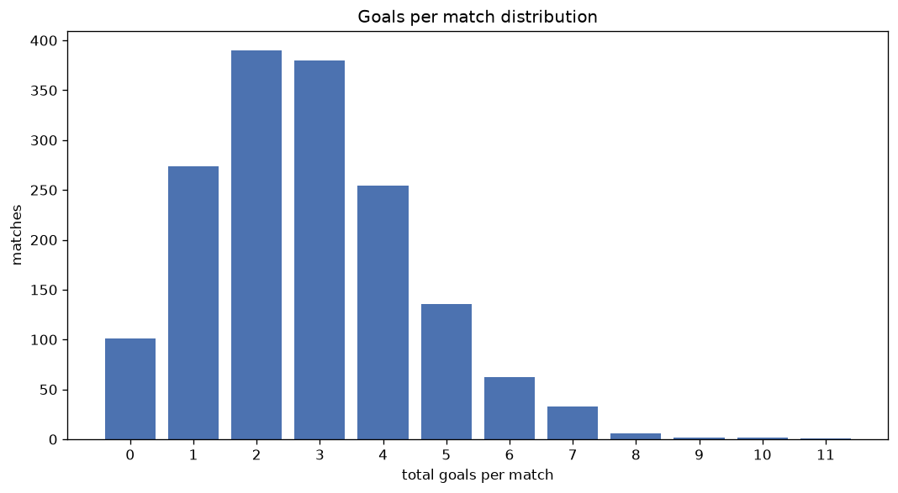
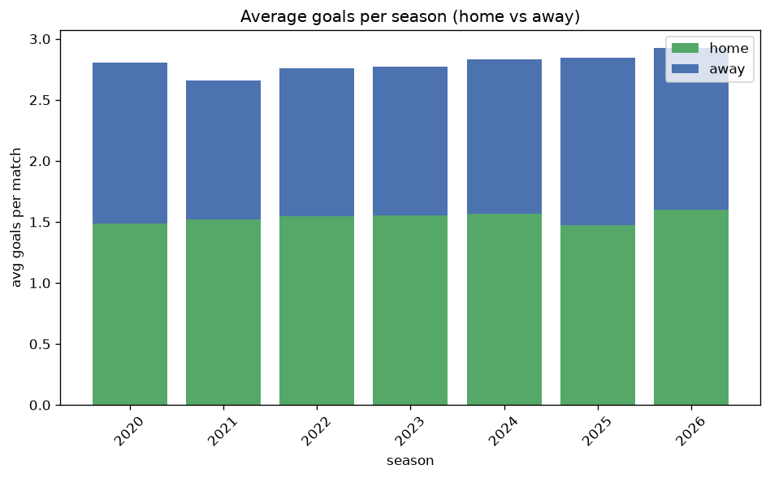

# Goal Analysis
- Report: `goals_analysis`
- Generated: 2026-10-29T02:17:12+00:00
- Script: `backend/scripts/analyze_goals.py` v1.0.0
- League: Allsvenskan (Sweden)
- Scope: league `sweden1`

## 1. Goals per match distribution
| goals | matches | pct |
|---|---|---|
| 0 | 101 | 6.2% |
| 1 | 274 | 16.7% |
| 2 | 390 | 23.8% |
| 3 | 380 | 23.2% |
| 4 | 254 | 15.5% |
| 5 | 136 | 8.3% |
| 6 | 62 | 3.8% |
| 7 | 33 | 2.0% |
| 8 | 6 | 0.4% |
| 9 | 2 | 0.1% |
| 10 | 2 | 0.1% |
| 11 | 1 | 0.1% |

## 2. Goals per match per season
| season | matches | total goals | avg home | avg away | avg total |
|---|---|---|---|---|---|
| 2020 | 240 | 674 | 1.483 | 1.325 | 2.808 |
| 2021 | 240 | 638 | 1.521 | 1.137 | 2.658 |
| 2022 | 240 | 662 | 1.546 | 1.212 | 2.758 |
| 2023 | 240 | 665 | 1.554 | 1.217 | 2.771 |
| 2024 | 240 | 680 | 1.567 | 1.267 | 2.833 |
| 2025 | 240 | 683 | 1.475 | 1.371 | 2.846 |
| 2026 | 201 | 588 | 1.597 | 1.328 | 2.925 |

## 3. Home vs away goal share
- Home goals: **2516** (54.8%)
- Away goals: **2074** (45.2%)
- Home/away ratio: **1.213**

| season | home goals | away goals | total | home pct | away pct |
|---|---|---|---|---|---|
| 2020 | 356 | 318 | 674 | 52.8% | 47.2% |
| 2021 | 365 | 273 | 638 | 57.2% | 42.8% |
| 2022 | 371 | 291 | 662 | 56.0% | 44.0% |
| 2023 | 373 | 292 | 665 | 56.1% | 43.9% |
| 2024 | 376 | 304 | 680 | 55.3% | 44.7% |
| 2025 | 354 | 329 | 683 | 51.8% | 48.2% |
| 2026 | 321 | 267 | 588 | 54.6% | 45.4% |

## 4. BTTS (Both Teams To Score)
- Overall: **866** of `1641` (52.8%)

| season | matches | BTTS | pct |
|---|---|---|---|
| 2020 | 240 | 138 | 57.5% |
| 2021 | 240 | 121 | 50.4% |
| 2022 | 240 | 126 | 52.5% |
| 2023 | 240 | 120 | 50.0% |
| 2024 | 240 | 131 | 54.6% |
| 2025 | 240 | 126 | 52.5% |
| 2026 | 201 | 104 | 51.7% |

## 5. Clean sheets
- Home clean sheets: **490** (29.9%)
- Away clean sheets: **386** (23.5%)
- Total clean sheets recorded: **876**
- Matches with at least one clean sheet: **775** (47.2%)
- Both teams kept clean sheets (0-0): **101**

| season | matches | home CS | away CS | total CS | matches w/ CS |
|---|---|---|---|---|---|
| 2020 | 240 | 61 | 58 | 119 | 102 (42.5%) |
| 2021 | 240 | 82 | 56 | 138 | 119 (49.6%) |
| 2022 | 240 | 78 | 51 | 129 | 114 (47.5%) |
| 2023 | 240 | 78 | 59 | 137 | 120 (50.0%) |
| 2024 | 240 | 66 | 54 | 120 | 109 (45.4%) |
| 2025 | 240 | 67 | 61 | 128 | 114 (47.5%) |
| 2026 | 201 | 58 | 47 | 105 | 97 (48.3%) |

## 6. Scoring intensity
- First-half goals: **2043** (44.5%)
- Second-half goals: **2547** (55.5%)
- Avg first-half goals per match: **1.245**
- Avg second-half goals per match: **1.552**
- Second-half-only scoring (HT 0-0, FT goals >= 1): **377** (23.0%)

| season | matches | 1st half | 2nd half | 1st half pct | 2nd half pct |
|---|---|---|---|---|---|
| 2020 | 240 | 308 | 366 | 45.7% | 54.3% |
| 2021 | 240 | 290 | 348 | 45.5% | 54.5% |
| 2022 | 240 | 291 | 371 | 44.0% | 56.0% |
| 2023 | 240 | 294 | 371 | 44.2% | 55.8% |
| 2024 | 240 | 305 | 375 | 44.9% | 55.1% |
| 2025 | 240 | 294 | 389 | 43.0% | 57.0% |
| 2026 | 201 | 261 | 327 | 44.4% | 55.6% |

## 7. First-goal timing
- Matches with first-goal time recorded: `1540` of `1641` (93.8%)
- Goalless matches: `101`
- Min `1` | Max `101` | Mean `30.79` | Median (p50) `25.0`

| bucket | count | % of matches | % of scoring matches |
|---|---|---|---|
| 1-15 | 519 | 31.6% | 33.7% |
| 16-30 | 363 | 22.1% | 23.6% |
| 31-45 | 243 | 14.8% | 15.8% |
| 46-60 | 232 | 14.1% | 15.1% |
| 61-75 | 92 | 5.6% | 6.0% |
| 76-90 | 65 | 4.0% | 4.2% |
| 91-120 | 26 | 1.6% | 1.7% |

---
*All statistics are computed from PostgreSQL tables (read-only). Run with `python backend/scripts/analyze_goals.py` to regenerate.*

## Charts

