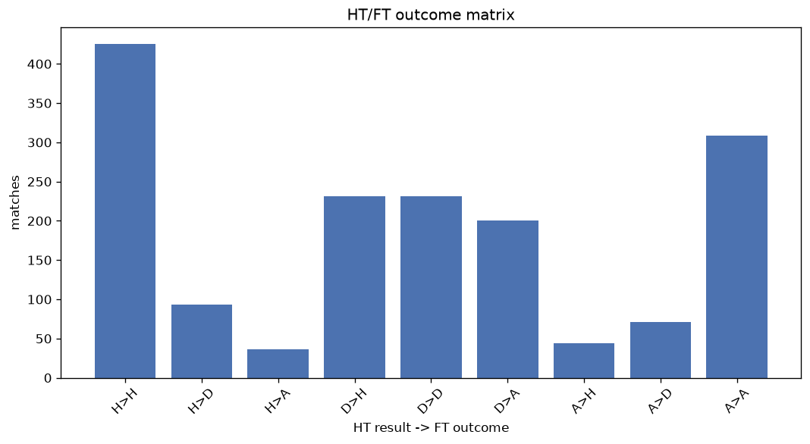
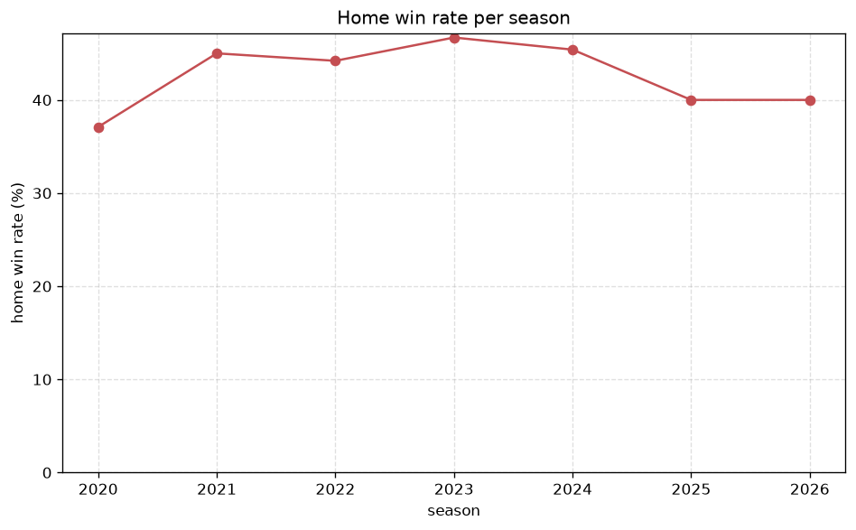

# Match Analysis
- Report: `matches_analysis`
- Generated: 2026-10-27T02:32:27+00:00
- Script: `backend/scripts/analyze_matches.py` v1.0.0
- League: Allsvenskan (Sweden)
- Scope: league `sweden1`

## 1. Overall summary
| metric | value |
|---|---|
| Matches | 1640 |
| Home wins | 700 (42.7%) |
| Draws | 395 (24.1%) |
| Away wins | 545 (33.2%) |
| Total goals | 4586 |
| Average goals per match | 2.796 |
| Goalless matches | 101 (6.2%) |

## 2. Per-season breakdown
| season | matches | home wins | draws | away wins | total goals | avg goals | goalless |
|---|---|---|---|---|---|---|---|
| 2020 | 240 | 89 (37.1%) | 77 (32.1%) | 74 (30.8%) | 674 | 2.808 | 17 (7.1%) |
| 2021 | 240 | 108 (45.0%) | 59 (24.6%) | 73 (30.4%) | 638 | 2.658 | 19 (7.9%) |
| 2022 | 240 | 106 (44.2%) | 60 (25.0%) | 74 (30.8%) | 662 | 2.758 | 15 (6.2%) |
| 2023 | 240 | 112 (46.7%) | 47 (19.6%) | 81 (33.8%) | 665 | 2.771 | 17 (7.1%) |
| 2024 | 240 | 109 (45.4%) | 52 (21.7%) | 79 (32.9%) | 680 | 2.833 | 11 (4.6%) |
| 2025 | 240 | 96 (40.0%) | 53 (22.1%) | 91 (37.9%) | 683 | 2.846 | 14 (5.8%) |
| 2026 | 200 | 80 (40.0%) | 47 (23.5%) | 73 (36.5%) | 584 | 2.92 | 8 (4.0%) |

## 3. HT/FT outcome matrix
| HT result \ FT result | Home | Draw | Away | total |
|---|---|---|---|---|
| HT home lead | 425 (76.7%) | 93 (16.8%) | 36 (6.5%) | 554 |
| HT draw | 231 (34.9%) | 231 (34.9%) | 200 (30.2%) | 662 |
| HT away lead | 44 (10.4%) | 71 (16.7%) | 309 (72.9%) | 424 |

## 4. Comeback matches
- Home comebacks (trailing at HT, won at FT): **44** (2.7%)
- Away comebacks (trailing at HT, won at FT): **36** (2.2%)

### Home comebacks
| season | home | away | HT | FT |
|---|---|---|---|---|
| 2020 | Mjallby | Hammarby | 0-1 | 2-1 |
| 2020 | Sirius | Orebro | 0-1 | 2-1 |
| 2020 | Malmo FF | Kalmar | 0-1 | 2-1 |
| 2020 | Djurgarden | Mjallby | 0-1 | 2-1 |
| 2020 | Sirius | Hammarby | 0-1 | 3-1 |
| 2020 | Varberg | Orebro | 0-1 | 2-1 |
| 2020 | Djurgarden | Malmo FF | 0-1 | 3-2 |
| 2021 | Norrkoping | Halmstad | 0-1 | 2-1 |
| 2021 | Degerfors | Ostersund | 0-1 | 3-1 |
| 2021 | Kalmar | Sirius | 0-1 | 3-1 |
| 2021 | Hammarby | Ostersund | 2-3 | 4-3 |
| 2021 | Norrkoping | Elfsborg | 1-2 | 3-2 |
| 2021 | Hammarby | Orebro | 0-1 | 3-2 |
| 2022 | Sirius | Sundsvall | 0-1 | 2-1 |
| 2022 | Djurgarden | Norrkoping | 0-1 | 2-1 |
| 2022 | Norrkoping | Hammarby | 0-1 | 4-1 |
| 2022 | Malmo FF | Norrkoping | 0-1 | 2-1 |
| 2022 | Degerfors | Goteborg | 0-1 | 3-1 |
| 2023 | Hacken | Djurgarden | 0-1 | 4-1 |
| 2023 | Elfsborg | Halmstad | 0-1 | 6-1 |
| 2023 | Goteborg | Djurgarden | 0-1 | 2-1 |
| 2023 | Sirius | Degerfors | 0-1 | 3-2 |
| 2023 | Varnamo | Norrkoping | 0-1 | 2-1 |
| 2023 | Varnamo | Goteborg | 0-1 | 3-1 |
| 2023 | Norrkoping | Varberg | 0-2 | 4-3 |
| 2023 | Brommapojkarna | Hacken | 0-1 | 2-1 |
| 2024 | Hacken | Hammarby | 0-1 | 2-1 |
| 2024 | Norrkoping | Elfsborg | 0-2 | 4-2 |
| 2024 | Kalmar | Halmstad | 1-2 | 5-2 |
| 2024 | Vasteras SK | Kalmar | 0-1 | 2-1 |
| 2024 | Malmo FF | Goteborg | 0-1 | 2-1 |
| 2025 | AIK | Norrkoping | 0-1 | 4-3 |
| 2025 | Hammarby | Brommapojkarna | 0-2 | 3-2 |
| 2025 | Mjallby | Sirius | 0-1 | 2-1 |
| 2025 | Elfsborg | Goteborg | 1-3 | 4-3 |
| 2025 | Brommapojkarna | Norrkoping | 3-4 | 6-4 |
| 2025 | AIK | Sirius | 0-1 | 2-1 |
| 2025 | Mjallby | Norrkoping | 0-1 | 2-1 |
| 2025 | Malmo FF | GAIS | 0-1 | 2-1 |
| 2026 | Sirius | Kalmar | 0-2 | 3-2 |
| 2026 | Hacken | Hammarby | 0-2 | 3-2 |
| 2026 | Orgryte | Hacken | 1-2 | 4-3 |
| 2026 | Mjallby | Sirius | 0-3 | 4-3 |
| 2026 | AIK | Hammarby | 1-2 | 3-2 |

### Away comebacks
| season | home | away | HT | FT |
|---|---|---|---|---|
| 2020 | Kalmar | Ostersund | 1-0 | 1-2 |
| 2020 | Falkenberg | Sirius | 1-0 | 1-2 |
| 2020 | Kalmar | Elfsborg | 1-0 | 1-2 |
| 2020 | Sirius | Malmo FF | 1-0 | 2-5 |
| 2020 | Falkenberg | Hammarby | 1-0 | 1-3 |
| 2021 | Varberg | Hammarby | 1-0 | 1-3 |
| 2021 | Hacken | Orebro | 2-0 | 2-3 |
| 2021 | Elfsborg | Halmstad | 2-1 | 2-3 |
| 2021 | Hacken | Halmstad | 2-1 | 2-3 |
| 2021 | Mjallby | Sirius | 1-0 | 2-3 |
| 2021 | Elfsborg | AIK | 2-1 | 2-4 |
| 2021 | Orebro | Elfsborg | 1-0 | 2-3 |
| 2022 | Goteborg | Kalmar | 1-0 | 1-2 |
| 2022 | Helsingborg | Varnamo | 1-0 | 1-4 |
| 2022 | Helsingborg | AIK | 1-0 | 1-2 |
| 2022 | Mjallby | Hacken | 1-0 | 1-2 |
| 2022 | Hacken | Djurgarden | 1-0 | 1-2 |
| 2022 | Malmo FF | Djurgarden | 2-0 | 2-3 |
| 2023 | Brommapojkarna | Malmo FF | 1-0 | 1-2 |
| 2023 | Sirius | Elfsborg | 2-1 | 3-4 |
| 2023 | Varberg | Norrkoping | 1-0 | 1-3 |
| 2023 | Norrkoping | Elfsborg | 1-0 | 1-2 |
| 2023 | Varnamo | Djurgarden | 1-0 | 1-2 |
| 2023 | AIK | Hacken | 1-0 | 1-2 |
| 2023 | Brommapojkarna | Degerfors | 1-0 | 1-2 |
| 2023 | Mjallby | Varnamo | 2-1 | 2-3 |
| 2024 | Hacken | Elfsborg | 2-1 | 3-5 |
| 2024 | Sirius | Malmo FF | 2-0 | 3-4 |
| 2025 | Norrkoping | Goteborg | 2-0 | 2-3 |
| 2025 | Varnamo | Hammarby | 2-1 | 2-3 |
| 2025 | Sirius | Degerfors | 1-0 | 1-3 |
| 2025 | Varnamo | Halmstad | 1-0 | 1-2 |
| 2025 | Oster | Djurgarden | 1-0 | 1-3 |
| 2026 | Orgryte | AIK | 2-1 | 3-4 |
| 2026 | AIK | Vasteras SK | 1-0 | 1-4 |
| 2026 | Vasteras SK | Halmstad | 1-0 | 1-2 |

## 5. HT lead conversion
| HT state | matches | converted to win | held as draw | collapsed to loss |
|---|---|---|---|---|
| Home lead | 554 | 425 (76.7%) | 93 (16.8%) | 36 (6.5%) |
| Away lead | 424 | 309 (72.9%) | 71 (16.7%) | 44 (10.4%) |

### Matches level at half-time
| FT result | count | pct |
|---|---|---|
| Home win | 231 | 34.9% |
| Draw | 231 | 34.9% |
| Away win | 200 | 30.2% |

## 6. First-goal timing
- Matches with a first-goal time recorded: `1539` of `1640` (93.8%)

Outcome distribution by first-goal timing bucket:
| bucket | matches | % of matches | home | draw | away |
|---|---|---|---|---|---|
| 1-15 | 519 | 31.6% | 246 (47.4%) | 102 (19.7%) | 171 (32.9%) |
| 16-30 | 362 | 22.1% | 161 (44.5%) | 79 (21.8%) | 122 (33.7%) |
| 31-45 | 243 | 14.8% | 118 (48.6%) | 40 (16.5%) | 85 (35.0%) |
| 46-60 | 232 | 14.1% | 93 (40.1%) | 50 (21.6%) | 89 (38.4%) |
| 61-75 | 92 | 5.6% | 38 (41.3%) | 16 (17.4%) | 38 (41.3%) |
| 76-90 | 65 | 4.0% | 32 (49.2%) | 7 (10.8%) | 26 (40.0%) |
| 91-120 | 26 | 1.6% | 12 (46.2%) | 0 (0.0%) | 14 (53.8%) |

## 7. Goalless matches
- Overall: **101** of `1640` (6.2%)

| season | matches | goalless | pct |
|---|---|---|---|
| 2020 | 240 | 17 | 7.1% |
| 2021 | 240 | 19 | 7.9% |
| 2022 | 240 | 15 | 6.2% |
| 2023 | 240 | 17 | 7.1% |
| 2024 | 240 | 11 | 4.6% |
| 2025 | 240 | 14 | 5.8% |
| 2026 | 200 | 8 | 4.0% |

---
*All statistics are computed from PostgreSQL tables (read-only). Run with `python backend/scripts/analyze_matches.py` to regenerate.*

## Charts

