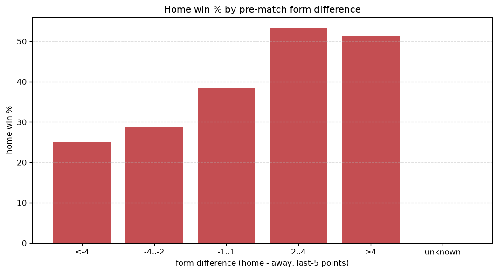
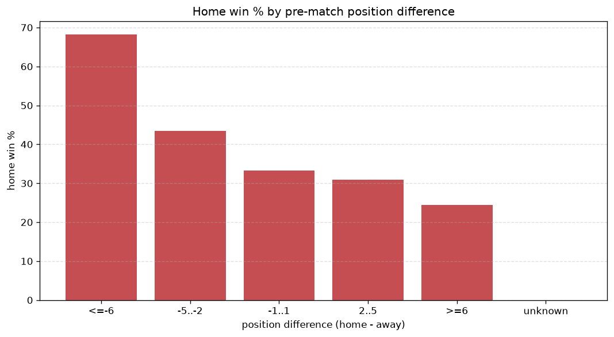

# Relationships Analysis
- Report: `relationships`
- Generated: 2026-10-30T04:13:56+00:00
- Script: `backend/scripts/analyze_relationships.py` v1.0.0
- League: Allsvenskan (Sweden)
- Scope: league `sweden1`

- Matches analysed: **1440** (23 leakage-safe pre-match features).

## 1. Correlation matrix
_Pearson correlation of each pre-match feature with observed goals; sorted by |corr(total goals)|._

| feature | corr(home) | corr(away) | corr(total) |
|---|---|---|---|
| home_team_goals_scored_last_5 | 0.162 | -0.019 | 0.113 |
| home_team_home_goals_avg | 0.182 | -0.059 | 0.101 |
| home_position_before_match | -0.213 | 0.116 | -0.086 |
| points_difference | 0.247 | -0.155 | 0.085 |
| home_team_points_last_5 | 0.147 | -0.044 | 0.084 |
| position_difference | -0.244 | 0.156 | -0.082 |
| home_team_wins_last_5 | 0.137 | -0.046 | 0.075 |
| away_team_goals_conceded_last_5 | 0.149 | -0.065 | 0.071 |
| home_points_before_match | 0.116 | -0.029 | 0.070 |
| away_team_away_conceded_avg | 0.110 | -0.051 | 0.051 |
| home_team_home_win_rate | 0.156 | -0.104 | 0.050 |
| home_team_home_conceded_avg | -0.034 | 0.091 | 0.037 |
| away_team_goals_scored_last_5 | -0.013 | 0.062 | 0.033 |
| away_position_before_match | 0.133 | -0.105 | 0.031 |
| away_rest_days | 0.021 | 0.016 | 0.027 |
| home_rest_days | 0.020 | 0.012 | 0.024 |
| home_team_goals_conceded_last_5 | -0.053 | 0.089 | 0.021 |
| away_team_away_goals_avg | -0.023 | 0.048 | 0.015 |
| away_team_away_win_rate | -0.064 | 0.049 | -0.015 |
| away_team_wins_last_5 | -0.059 | 0.081 | 0.011 |
| rest_days_difference | -0.002 | -0.013 | -0.010 |
| away_team_points_last_5 | -0.067 | 0.082 | 0.005 |
| away_points_before_match | -0.077 | 0.092 | 0.004 |

## 2. Form vs outcome
_Home win/draw/away % per bucket of `home_team_points_last_5 - away_team_points_last_5`._

| bucket | matches | home | draw | away | home % | draw % | away % |
|---|---|---|---|---|---|---|---|
| <-4 | 237 | 73 | 61 | 103 | 30.8% | 25.7% | 43.5% |
| -4..-2 | 298 | 128 | 57 | 113 | 43.0% | 19.1% | 37.9% |
| -1..1 | 405 | 173 | 98 | 134 | 42.7% | 24.2% | 33.1% |
| 2..4 | 300 | 138 | 77 | 85 | 46.0% | 25.7% | 28.3% |
| >4 | 200 | 108 | 55 | 37 | 54.0% | 27.5% | 18.5% |
| unknown | 0 | 0 | 0 | 0 | - | - | - |

## 3. Position vs outcome
_Home win/draw/away % per bucket of `position_difference` (home position - away position; negative favours the home team)._

| bucket | matches | home | draw | away | home % | draw % | away % |
|---|---|---|---|---|---|---|---|
| <=-6 | 298 | 179 | 68 | 51 | 60.1% | 22.8% | 17.1% |
| -5..-2 | 286 | 123 | 78 | 85 | 43.0% | 27.3% | 29.7% |
| -1..1 | 242 | 108 | 62 | 72 | 44.6% | 25.6% | 29.8% |
| 2..5 | 303 | 114 | 76 | 113 | 37.6% | 25.1% | 37.3% |
| >=6 | 311 | 96 | 64 | 151 | 30.9% | 20.6% | 48.6% |
| unknown | 0 | 0 | 0 | 0 | - | - | - |

## 4. Rest advantage
_Home win/draw/away % per bucket of `rest_days_difference` (home rest - away rest). Matches with unknown rest are bucketed separately._

| bucket | matches | home | draw | away | home % | draw % | away % |
|---|---|---|---|---|---|---|---|
| <-1 | 102 | 45 | 22 | 35 | 44.1% | 21.6% | 34.3% |
| -1..0 | 366 | 149 | 98 | 119 | 40.7% | 26.8% | 32.5% |
| 0 | 506 | 218 | 117 | 171 | 43.1% | 23.1% | 33.8% |
| 1..2 | 398 | 177 | 96 | 125 | 44.5% | 24.1% | 31.4% |
| >2 | 20 | 10 | 6 | 4 | 50.0% | 30.0% | 20.0% |
| unknown | 48 | 21 | 9 | 18 | 43.8% | 18.8% | 37.5% |
- *48 match(es) had unknown rest difference (missing rest data on at least one side).*

## 5. Home team quality
_Home win rate by `home_team_home_win_rate` tier (split at 0.5)._

- `< 0.5` tier: **37.1%** home win (311/839)
- `>= 0.5` tier: **51.4%** home win (309/601)
- Home-win gap (>= split minus < split): **+14.3 pp**

| tier | label | matches | home | draw | away | home % |
|---|---|---|---|---|---|---|
| low | < 0.5 | 839 | 311 | 200 | 328 | 37.1% |
| high | >= 0.5 | 601 | 309 | 148 | 144 | 51.4% |

## 6. Feature averages by result
_Mean feature value per outcome; `range` is home-minus-away spread of the group means._

| feature | home mean | draw mean | away mean | range |
|---|---|---|---|---|
| points_difference | 2.363 | 0.135 | -3.947 | 6.310 |
| position_difference | -1.266 | -0.103 | 2.356 | 3.622 |
| away_points_before_match | 18.634 | 20.144 | 22.059 | 3.425 |
| home_points_before_match | 20.997 | 20.279 | 18.112 | 2.884 |
| home_position_before_match | 7.776 | 8.661 | 10.138 | 2.362 |
| away_position_before_match | 9.042 | 8.764 | 7.782 | 1.260 |
| home_team_points_last_5 | 6.426 | 6.457 | 5.426 | 1.031 |
| home_team_goals_conceded_last_5 | 5.924 | 6.210 | 6.816 | 0.891 |
| away_team_goals_conceded_last_5 | 6.519 | 6.138 | 5.669 | 0.850 |
| home_team_goals_scored_last_5 | 6.411 | 6.282 | 5.655 | 0.757 |
| away_team_points_last_5 | 5.944 | 6.454 | 6.648 | 0.705 |
| away_team_goals_scored_last_5 | 6.132 | 6.466 | 6.405 | 0.333 |
| home_team_wins_last_5 | 1.781 | 1.770 | 1.458 | 0.323 |
| home_team_home_goals_avg | 1.493 | 1.348 | 1.261 | 0.232 |
| away_team_wins_last_5 | 1.632 | 1.741 | 1.854 | 0.222 |
| home_team_home_conceded_avg | 1.078 | 1.122 | 1.206 | 0.128 |
| away_team_away_conceded_avg | 1.441 | 1.360 | 1.332 | 0.109 |
| home_team_home_win_rate | 0.455 | 0.416 | 0.356 | 0.098 |
| home_rest_days | 7.464 | 7.463 | 7.368 | 0.096 |
| away_rest_days | 7.503 | 7.572 | 7.482 | 0.090 |
| rest_days_difference | -0.038 | -0.109 | -0.115 | 0.076 |
| away_team_away_goals_avg | 1.119 | 1.124 | 1.152 | 0.033 |
| away_team_away_win_rate | 0.295 | 0.303 | 0.314 | 0.019 |

---
*All features are leakage-safe pre-match values built by `ml.features.build_features.build_rows` from strictly prior matches. Run with `python backend/scripts/analyze_relationships.py` to regenerate.*

## Charts

