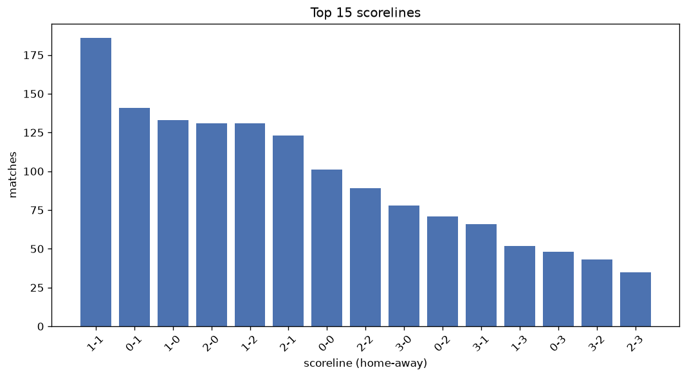
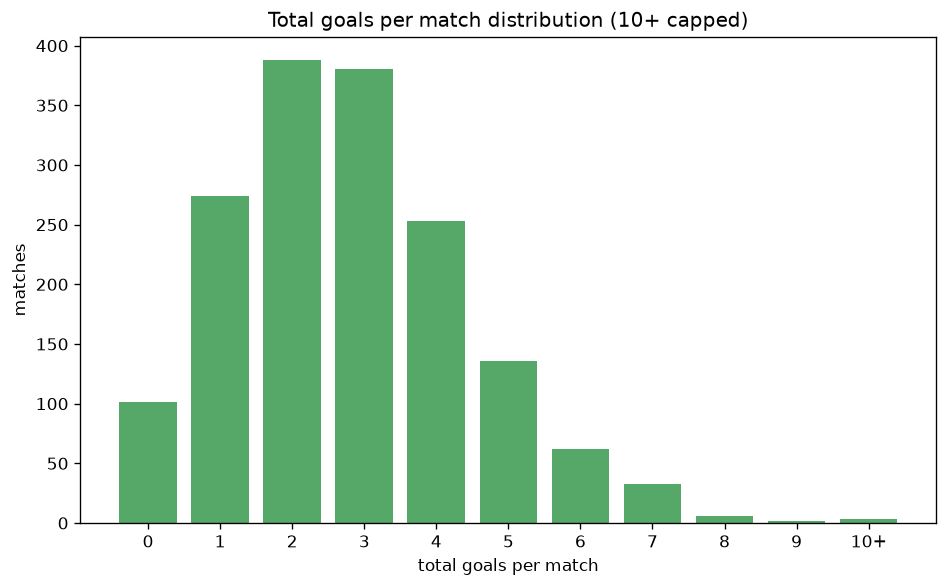

# Scoreline Analysis
- Report: `scoreline_analysis`
- Generated: 2026-10-26T01:50:14+00:00
- Script: `backend/scripts/analyze_scorelines.py` v1.0.0
- League: Allsvenskan (Sweden)
- Scope: league `sweden1`

## 1. Scoreline frequency
- Matches analysed: **1638** across **7** seasons.
- Distinct scorelines seen: **44**.

| scoreline | count | pct |
|---|---|---|
| 1-1 | 186 | 11.4% |
| 0-1 | 141 | 8.6% |
| 1-0 | 133 | 8.1% |
| 2-0 | 131 | 8.0% |
| 1-2 | 131 | 8.0% |
| 2-1 | 123 | 7.5% |
| 0-0 | 101 | 6.2% |
| 2-2 | 89 | 5.4% |
| 3-0 | 78 | 4.8% |
| 0-2 | 71 | 4.3% |
| 3-1 | 66 | 4.0% |
| 1-3 | 52 | 3.2% |
| 0-3 | 48 | 2.9% |
| 3-2 | 43 | 2.6% |
| 2-3 | 35 | 2.1% |
| 4-0 | 31 | 1.9% |
| 4-1 | 24 | 1.5% |
| 1-4 | 16 | 1.0% |
| 3-3 | 16 | 1.0% |
| 4-2 | 15 | 0.9% |

## 2. Scoreline frequency per season

### 2020
| scoreline | count | pct |
|---|---|---|
| 1-1 | 31 | 12.9% |
| 2-2 | 24 | 10.0% |
| 0-1 | 21 | 8.8% |
| 2-1 | 19 | 7.9% |
| 1-2 | 18 | 7.5% |

### 2021
| scoreline | count | pct |
|---|---|---|
| 1-1 | 30 | 12.5% |
| 1-0 | 25 | 10.4% |
| 0-1 | 20 | 8.3% |
| 0-0 | 19 | 7.9% |
| 2-1 | 17 | 7.1% |

### 2022
| scoreline | count | pct |
|---|---|---|
| 1-1 | 30 | 12.5% |
| 1-0 | 22 | 9.2% |
| 2-0 | 21 | 8.8% |
| 2-1 | 18 | 7.5% |
| 1-2 | 18 | 7.5% |

### 2023
| scoreline | count | pct |
|---|---|---|
| 1-2 | 24 | 10.0% |
| 2-0 | 23 | 9.6% |
| 1-0 | 22 | 9.2% |
| 0-1 | 18 | 7.5% |
| 2-1 | 17 | 7.1% |

### 2024
| scoreline | count | pct |
|---|---|---|
| 2-1 | 27 | 11.2% |
| 1-1 | 26 | 10.8% |
| 0-1 | 22 | 9.2% |
| 1-0 | 20 | 8.3% |
| 2-0 | 19 | 7.9% |

### 2025
| scoreline | count | pct |
|---|---|---|
| 1-1 | 30 | 12.5% |
| 0-1 | 22 | 9.2% |
| 2-0 | 20 | 8.3% |
| 1-2 | 20 | 8.3% |
| 1-0 | 17 | 7.1% |

### 2026
| scoreline | count | pct |
|---|---|---|
| 1-1 | 24 | 12.1% |
| 0-1 | 21 | 10.6% |
| 2-0 | 20 | 10.1% |
| 1-2 | 16 | 8.1% |
| 2-1 | 12 | 6.1% |

## 3. Total-goal histogram
_10+ groups all matches with 10 or more total goals._

| total goals | matches | pct |
|---|---|---|
| 0 | 101 | 6.2% |
| 1 | 274 | 16.7% |
| 2 | 388 | 23.7% |
| 3 | 380 | 23.2% |
| 4 | 253 | 15.4% |
| 5 | 136 | 8.3% |
| 6 | 62 | 3.8% |
| 7 | 33 | 2.0% |
| 8 | 6 | 0.4% |
| 9 | 2 | 0.1% |
| 10+ | 3 | 0.2% |

## 4. Extreme scorelines
- Matches with 7+ total goals: **44**

| season | date | scoreline | total goals |
|---|---|---|---|
| 2026 | 2026-10-10 | 5-6 | 11 |
| 2025 | 2025-08-02 | 6-4 | 10 |
| 2025 | 2025-09-29 | 8-2 | 10 |
| 2026 | 2026-04-18 | 8-1 | 9 |
| 2026 | 2026-05-31 | 4-5 | 9 |
| 2021 | 2021-12-04 | 5-3 | 8 |
| 2022 | 2022-07-31 | 4-4 | 8 |
| 2024 | 2024-05-05 | 6-2 | 8 |
| 2024 | 2024-07-14 | 3-5 | 8 |
| 2025 | 2025-10-25 | 6-2 | 8 |
| 2026 | 2026-07-03 | 4-4 | 8 |
| 2020 | 2020-07-26 | 2-5 | 7 |
| 2020 | 2020-08-30 | 4-3 | 7 |
| 2020 | 2020-11-08 | 5-2 | 7 |
| 2020 | 2020-12-06 | 3-4 | 7 |
| 2021 | 2021-10-24 | 4-3 | 7 |
| 2022 | 2022-05-28 | 4-3 | 7 |
| 2022 | 2022-06-26 | 2-5 | 7 |
| 2022 | 2022-10-30 | 2-5 | 7 |
| 2023 | 2023-05-03 | 6-1 | 7 |
| 2023 | 2023-05-08 | 3-4 | 7 |
| 2023 | 2023-05-13 | 6-1 | 7 |
| 2023 | 2023-05-14 | 4-3 | 7 |
| 2023 | 2023-09-03 | 4-3 | 7 |
| 2023 | 2023-09-16 | 7-0 | 7 |
| 2023 | 2023-11-06 | 4-3 | 7 |
| 2024 | 2024-04-15 | 4-3 | 7 |
| 2024 | 2024-05-04 | 5-2 | 7 |
| 2024 | 2024-05-15 | 6-1 | 7 |
| 2024 | 2024-05-27 | 5-2 | 7 |
| 2024 | 2024-07-19 | 3-4 | 7 |
| 2024 | 2024-07-27 | 3-4 | 7 |
| 2025 | 2025-03-30 | 4-3 | 7 |
| 2025 | 2025-04-06 | 4-3 | 7 |
| 2025 | 2025-04-23 | 3-4 | 7 |
| 2025 | 2025-04-23 | 4-3 | 7 |
| 2025 | 2025-05-15 | 4-3 | 7 |
| 2025 | 2025-07-27 | 1-6 | 7 |
| 2025 | 2025-07-28 | 4-3 | 7 |
| 2025 | 2025-09-14 | 4-3 | 7 |
| 2026 | 2026-05-30 | 5-2 | 7 |
| 2026 | 2026-07-11 | 4-3 | 7 |
| 2026 | 2026-08-08 | 3-4 | 7 |
| 2026 | 2026-08-15 | 4-3 | 7 |

## 5. Margin-of-victory distribution (decided matches)
- Decided matches: **1244** (draws: **394**)
- Average winning margin: **1.82**

| margin | matches | pct |
|---|---|---|
| 1 | 629 | 50.6% |
| 2 | 347 | 27.9% |
| 3+ | 268 | 21.5% |

## 6. Margin by outcome

### Home wins
- Matches: **700** | avg margin: **1.93** | max margin: **7**
| margin | matches | pct |
|---|---|---|
| 1 | 314 | 44.9% |
| 2 | 214 | 30.6% |
| 3+ | 172 | 24.6% |
- *Full match-by-match list available in `scoreline_analysis.json`.*

### Away wins
- Matches: **544** | avg margin: **1.67** | max margin: **6**
| margin | matches | pct |
|---|---|---|
| 1 | 315 | 57.9% |
| 2 | 133 | 24.4% |
| 3+ | 96 | 17.6% |
- *Full match-by-match list available in `scoreline_analysis.json`.*

## 7. Most common exact score by outcome type
| outcome | matches | most common score | count | pct |
|---|---|---|---|---|
| home | 700 | 1-0 | 133 | 19.0% |
| draw | 394 | 1-1 | 186 | 47.2% |
| away | 544 | 0-1 | 141 | 25.9% |

---
*All statistics are computed from PostgreSQL tables (read-only). Run with `python backend/scripts/analyze_scorelines.py` to regenerate.*

## Charts

