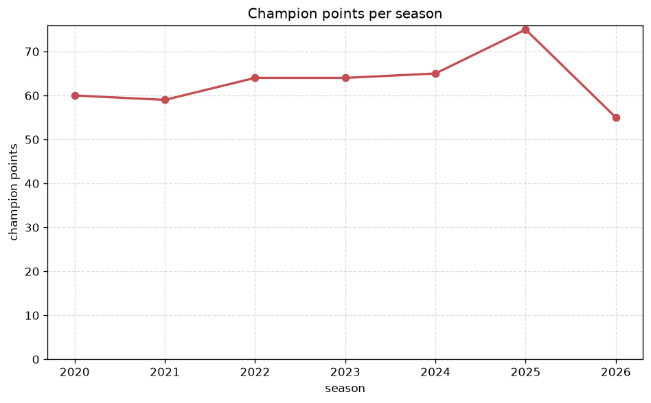
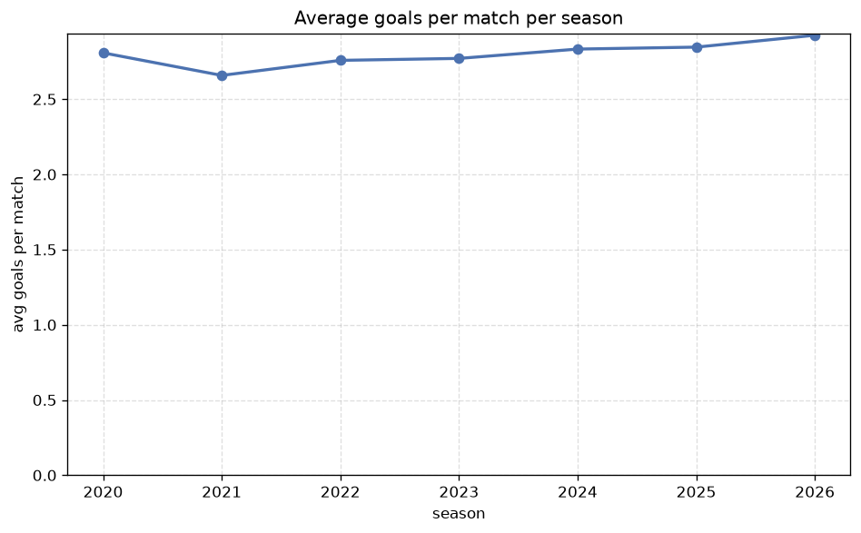

# Season Trends Analysis
- Report: `season_trends`
- Generated: 2026-10-29T02:17:16+00:00
- Script: `backend/scripts/analyze_seasons.py` v1.0.0
- League: Allsvenskan (Sweden)
- Scope: league `sweden1`

## 1. Champions per season
| season | champion | pts | runner-up | margin |
|---|---|---|---|---|
| 2020 | Malmo FF | 60 | Elfsborg | 9 pts |
| 2021 | Malmo FF | 59 | AIK | 0 pts |
| 2022 | Hacken | 64 | Djurgarden | 7 pts |
| 2023 | Malmo FF | 64 | Elfsborg | 0 pts |
| 2024 | Malmo FF | 65 | Hammarby | 11 pts |
| 2025 | Mjallby | 75 | Hammarby | 13 pts |
| 2026 | Sirius | 55 | Hammarby | 6 pts |

## 2. Title-race tightness
- Tight races (margin <= 3 pts): **2** of 7 seasons
- Tightest race: **2021** - Malmo FF beat AIK by **0** pts

| season | margin | tight |
|---|---|---|
| 2020 | 9 pts |  |
| 2021 | 0 pts | yes |
| 2022 | 7 pts |  |
| 2023 | 0 pts | yes |
| 2024 | 11 pts |  |
| 2025 | 13 pts |  |
| 2026 | 6 pts |  |

## 3. Points thresholds
_Position-specific points per season. Key: 1 = champion, 2 = runner-up, 4 = CL line, 6 = Europa, 13 = last safe, 16 = bottom._

| season | pos 1 | pos 2 | pos 4 | pos 6 | pos 13 | pos 16 |
|---|---|---|---|---|---|---|
| 2020 | 60 | 51 | 48 | 46 | 33 | 24 |
| 2021 | 59 | 59 | 55 | 47 | 34 | 14 |
| 2022 | 64 | 57 | 51 | 49 | 31 | 14 |
| 2023 | 64 | 64 | 50 | 45 | 34 | 15 |
| 2024 | 65 | 54 | 53 | 48 | 31 | 23 |
| 2025 | 75 | 62 | 51 | 49 | 30 | 16 |
| 2026 | 55 | 49 | 45 | 38 | 22 | 17 |

## 4. Relegation battle
| season | safe pos | safe pts | drop pos | drop pts | gap |
|---|---|---|---|---|---|
| 2020 | 13 | 33 | 14 | 28 | 5 pts |
| 2021 | 13 | 34 | 14 | 32 | 2 pts |
| 2022 | 13 | 31 | 14 | 31 | 0 pts |
| 2023 | 13 | 34 | 14 | 33 | 1 pts |
| 2024 | 13 | 31 | 14 | 31 | 0 pts |
| 2025 | 13 | 30 | 14 | 29 | 1 pts |
| 2026 | 13 | 22 | 14 | 20 | 2 pts |

## 5. League-level trends
| season | matches | total goals | avg goals | home win | draw | away win | goalless | avg pts/team |
|---|---|---|---|---|---|---|---|---|
| 2020 | 240 | 674 | 2.808 | 37.1% | 32.1% | 30.8% | 7.1% | 40.19 |
| 2021 | 240 | 638 | 2.658 | 45.0% | 24.6% | 30.4% | 7.9% | 41.31 |
| 2022 | 240 | 662 | 2.758 | 44.2% | 25.0% | 30.8% | 6.2% | 41.25 |
| 2023 | 240 | 665 | 2.771 | 46.7% | 19.6% | 33.8% | 7.1% | 42.06 |
| 2024 | 240 | 680 | 2.833 | 45.4% | 21.7% | 32.9% | 4.6% | 41.75 |
| 2025 | 240 | 683 | 2.846 | 40.0% | 22.1% | 37.9% | 5.8% | 41.69 |
| 2026 | 201 | 588 | 2.925 | 39.8% | 23.9% | 36.3% | 4.0% | 34.69 |

## 6. View divergence
- Largest divergence: **2025** (goals view, avg abs position diff = 7.000)

_Avg absolute position difference between classic view and alternative view per season._

| season | classic vs luck | classic vs goals |
|---|---|---|
| 2020 | 4.875 | 4.625 |
| 2021 | 3.000 | 5.250 |
| 2022 | 3.875 | 5.000 |
| 2023 | 3.750 | 5.500 |
| 2024 | 3.000 | 5.375 |
| 2025 | 2.750 | 7.000 |
| 2026 | 3.125 | 4.000 |

---
*All statistics are computed from PostgreSQL tables (read-only). Run with `python backend/scripts/analyze_seasons.py` to regenerate.*

## Charts

