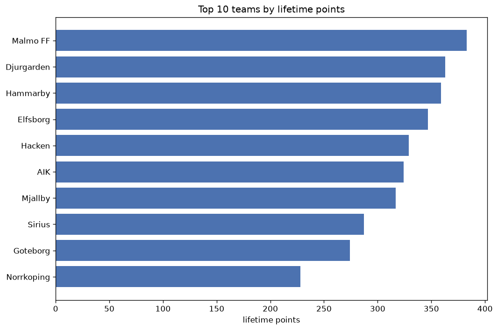
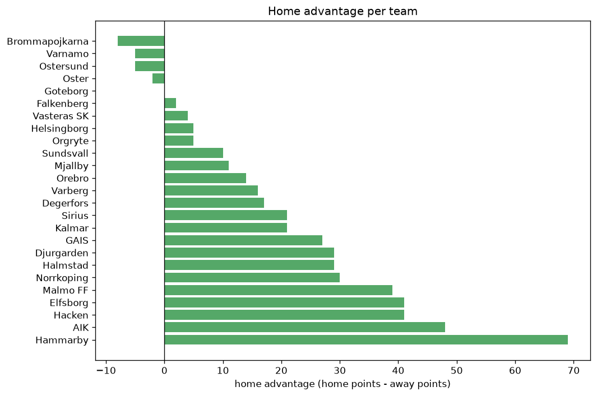

# Team Analysis
- Report: `teams_analysis`
- Generated: 2026-10-30T04:13:52+00:00
- Script: `backend/scripts/analyze_teams.py` v1.0.0
- League: Allsvenskan (Sweden)
- Scope: league `sweden1`

- Teams: **25** | Seasons: **7** | Matches: **1645**

## 1. Team standings (lifetime)
| team | seasons | played | W | D | L | pts | GF | GA | GD | avg pts/season | best pos | worst pos | titles |
|---|---|---|---|---|---|---|---|---|---|---|---|---|---|
| Malmo FF | 7 | 206 | 111 | 50 | 45 | 383 | 382 | 213 | 169 | 54.71 | 1 | 7 | 4 |
| Djurgarden | 7 | 206 | 107 | 42 | 57 | 363 | 340 | 215 | 125 | 51.86 | 2 | 5 | 0 |
| Hammarby | 7 | 205 | 102 | 53 | 50 | 359 | 362 | 229 | 133 | 51.29 | 2 | 8 | 0 |
| Elfsborg | 7 | 206 | 98 | 53 | 55 | 347 | 350 | 255 | 95 | 49.57 | 2 | 8 | 0 |
| Hacken | 7 | 206 | 90 | 59 | 57 | 329 | 372 | 282 | 90 | 47.0 | 1 | 12 | 1 |
| AIK | 7 | 206 | 91 | 51 | 64 | 324 | 282 | 251 | 31 | 46.29 | 2 | 11 | 0 |
| Mjallby | 7 | 205 | 87 | 56 | 62 | 317 | 276 | 233 | 43 | 45.29 | 1 | 12 | 1 |
| Sirius | 7 | 205 | 80 | 47 | 78 | 287 | 320 | 319 | 1 | 41.0 | 1 | 11 | 1 |
| Goteborg | 7 | 206 | 73 | 55 | 78 | 274 | 262 | 277 | -15 | 39.14 | 4 | 13 | 0 |
| Norrkoping | 6 | 180 | 63 | 39 | 78 | 228 | 266 | 288 | -22 | 38.0 | 6 | 14 | 0 |
| Kalmar | 6 | 175 | 61 | 40 | 74 | 223 | 208 | 254 | -46 | 37.17 | 4 | 15 | 0 |
| Halmstad | 5 | 146 | 39 | 36 | 71 | 153 | 125 | 219 | -94 | 30.6 | 11 | 16 | 0 |
| Degerfors | 5 | 146 | 37 | 30 | 79 | 141 | 150 | 258 | -108 | 28.2 | 13 | 15 | 0 |
| Brommapojkarna | 4 | 116 | 36 | 24 | 56 | 132 | 165 | 196 | -31 | 33.0 | 10 | 14 | 0 |
| GAIS | 3 | 85 | 36 | 23 | 26 | 131 | 112 | 90 | 22 | 43.67 | 3 | 11 | 0 |
| Varnamo | 4 | 120 | 33 | 30 | 57 | 129 | 137 | 190 | -53 | 32.25 | 5 | 16 | 0 |
| Varberg | 4 | 120 | 30 | 30 | 60 | 120 | 137 | 206 | -69 | 30.0 | 10 | 16 | 0 |
| Vasteras SK | 2 | 56 | 18 | 10 | 28 | 64 | 65 | 81 | -16 | 32.0 | 6 | 16 | 0 |
| Orebro | 2 | 60 | 16 | 12 | 32 | 60 | 60 | 99 | -39 | 30.0 | 7 | 15 | 0 |
| Ostersund | 2 | 60 | 11 | 14 | 35 | 47 | 51 | 105 | -54 | 23.5 | 13 | 16 | 0 |
| Helsingborg | 2 | 60 | 9 | 16 | 35 | 43 | 55 | 100 | -45 | 21.5 | 15 | 15 | 0 |
| Oster | 1 | 30 | 6 | 8 | 16 | 26 | 29 | 48 | -19 | 26.0 | 15 | 15 | 0 |
| Falkenberg | 1 | 30 | 5 | 9 | 16 | 24 | 33 | 54 | -21 | 24.0 | 16 | 16 | 0 |
| Orgryte | 1 | 25 | 4 | 7 | 14 | 19 | 31 | 56 | -25 | 19.0 | 15 | 15 | 0 |
| Sundsvall | 1 | 30 | 4 | 2 | 24 | 14 | 28 | 80 | -52 | 14.0 | 16 | 16 | 0 |

## 2. Home vs away split
| team | home P | H-W | H-D | H-L | H-pts | away P | A-W | A-D | A-L | A-pts | adv |
|---|---|---|---|---|---|---|---|---|---|---|---|
| Hammarby | 102 | 62 | 28 | 12 | 214 | 103 | 40 | 25 | 38 | 145 | 69 |
| AIK | 103 | 54 | 24 | 25 | 186 | 103 | 37 | 27 | 39 | 138 | 48 |
| Elfsborg | 103 | 55 | 29 | 19 | 194 | 103 | 43 | 24 | 36 | 153 | 41 |
| Hacken | 103 | 54 | 23 | 26 | 185 | 103 | 36 | 36 | 31 | 144 | 41 |
| Malmo FF | 103 | 63 | 22 | 18 | 211 | 103 | 48 | 28 | 27 | 172 | 39 |
| Norrkoping | 90 | 37 | 18 | 35 | 129 | 90 | 26 | 21 | 43 | 99 | 30 |
| Djurgarden | 103 | 58 | 22 | 23 | 196 | 103 | 49 | 20 | 34 | 167 | 29 |
| Halmstad | 73 | 23 | 22 | 28 | 91 | 73 | 16 | 14 | 43 | 62 | 29 |
| GAIS | 43 | 22 | 13 | 8 | 79 | 42 | 14 | 10 | 18 | 52 | 27 |
| Sirius | 103 | 45 | 19 | 39 | 154 | 102 | 35 | 28 | 39 | 133 | 21 |
| Kalmar | 87 | 34 | 20 | 33 | 122 | 88 | 27 | 20 | 41 | 101 | 21 |
| Degerfors | 73 | 21 | 16 | 36 | 79 | 73 | 16 | 14 | 43 | 62 | 17 |
| Varberg | 60 | 17 | 17 | 26 | 68 | 60 | 13 | 13 | 34 | 52 | 16 |
| Orebro | 30 | 10 | 7 | 13 | 37 | 30 | 6 | 5 | 19 | 23 | 14 |
| Mjallby | 103 | 45 | 29 | 29 | 164 | 102 | 42 | 27 | 33 | 153 | 11 |
| Sundsvall | 15 | 4 | 0 | 11 | 12 | 15 | 0 | 2 | 13 | 2 | 10 |
| Helsingborg | 30 | 5 | 9 | 16 | 24 | 30 | 4 | 7 | 19 | 19 | 5 |
| Orgryte | 12 | 2 | 6 | 4 | 12 | 13 | 2 | 1 | 10 | 7 | 5 |
| Vasteras SK | 28 | 9 | 7 | 12 | 34 | 28 | 9 | 3 | 16 | 30 | 4 |
| Falkenberg | 15 | 3 | 4 | 8 | 13 | 15 | 2 | 5 | 8 | 11 | 2 |
| Goteborg | 103 | 37 | 26 | 40 | 137 | 103 | 36 | 29 | 38 | 137 | 0 |
| Oster | 15 | 3 | 3 | 9 | 12 | 15 | 3 | 5 | 7 | 14 | -2 |
| Varnamo | 60 | 15 | 17 | 28 | 62 | 60 | 18 | 13 | 29 | 67 | -5 |
| Ostersund | 30 | 5 | 6 | 19 | 21 | 30 | 6 | 8 | 16 | 26 | -5 |
| Brommapojkarna | 58 | 17 | 11 | 30 | 62 | 58 | 19 | 13 | 26 | 70 | -8 |

## 3. Top performers
### Best points per game (PPG)
| rank | team | PPG |
|---|---|---|
| 1 | Malmo FF | 1.86 |
| 2 | Djurgarden | 1.76 |
| 3 | Hammarby | 1.75 |
| 4 | Elfsborg | 1.68 |
| 5 | Hacken | 1.60 |

### Most goals scored
| rank | team | goals |
|---|---|---|
| 1 | Malmo FF | 382 |
| 2 | Hacken | 372 |
| 3 | Hammarby | 362 |
| 4 | Elfsborg | 350 |
| 5 | Djurgarden | 340 |

### Best goal difference
| rank | team | GD |
|---|---|---|
| 1 | Malmo FF | 169 |
| 2 | Hammarby | 133 |
| 3 | Djurgarden | 125 |
| 4 | Elfsborg | 95 |
| 5 | Hacken | 90 |

### Best defence (goals against per match, standings)
| rank | team | GA/match |
|---|---|---|
| 1 | Malmo FF | 1.034 |
| 2 | Djurgarden | 1.044 |
| 3 | GAIS | 1.059 |
| 4 | Hammarby | 1.117 |
| 5 | Mjallby | 1.137 |

## 4. Team consistency
- Teams present in all **7** seasons: **9**

AIK, Djurgarden, Elfsborg, Goteborg, Hacken, Hammarby, Malmo FF, Mjallby, Sirius

## 5. Head-to-head dominance
- Distinct fixtures: **256** (showing the 15 most frequent)

| fixture | meetings | home wins | draws | away wins | home pct | draw pct | away pct |
|---|---|---|---|---|---|---|---|
| AIK vs Goteborg | 14 | 9 | 3 | 2 | 64.3% | 21.4% | 14.3% |
| Hammarby vs AIK | 14 | 9 | 3 | 2 | 64.3% | 21.4% | 14.3% |
| Mjallby vs Hammarby | 14 | 9 | 1 | 4 | 64.3% | 7.1% | 28.6% |
| Elfsborg vs Sirius | 14 | 8 | 3 | 3 | 57.1% | 21.4% | 21.4% |
| Malmo FF vs Elfsborg | 14 | 8 | 4 | 2 | 57.1% | 28.6% | 14.3% |
| Hacken vs Hammarby | 14 | 7 | 7 | 0 | 50.0% | 50.0% | 0.0% |
| Elfsborg vs Djurgarden | 14 | 6 | 3 | 5 | 42.9% | 21.4% | 35.7% |
| Elfsborg vs Goteborg | 14 | 6 | 3 | 5 | 42.9% | 21.4% | 35.7% |
| Hacken vs Mjallby | 14 | 6 | 4 | 4 | 42.9% | 28.6% | 28.6% |
| Malmo FF vs Djurgarden | 14 | 6 | 2 | 6 | 42.9% | 14.3% | 42.9% |
| Malmo FF vs Hacken | 14 | 6 | 5 | 3 | 42.9% | 35.7% | 21.4% |
| Malmo FF vs Sirius | 14 | 6 | 1 | 7 | 42.9% | 7.1% | 50.0% |
| Mjallby vs AIK | 14 | 6 | 5 | 3 | 42.9% | 35.7% | 21.4% |
| Mjallby vs Sirius | 14 | 6 | 3 | 5 | 42.9% | 21.4% | 35.7% |
| Djurgarden vs AIK | 14 | 5 | 2 | 7 | 35.7% | 14.3% | 50.0% |

## 6. Position per season (classic view)
_Cells show final position; '-' when the team was absent from that season._

| team | 2020 | 2021 | 2022 | 2023 | 2024 | 2025 | 2026 |
|---|---|---|---|---|---|---|---|
| Malmo FF | 1 | 1 | 7 | 1 | 1 | 6 | 7 |
| Djurgarden | 4 | 3 | 2 | 4 | 4 | 5 | 3 |
| Hammarby | 8 | 5 | 3 | 7 | 2 | 2 | 2 |
| Elfsborg | 2 | 4 | 6 | 2 | 7 | 8 | 5 |
| Hacken | 3 | 12 | 1 | 3 | 8 | 10 | 4 |
| AIK | 9 | 2 | 5 | 11 | 3 | 7 | 8 |
| Mjallby | 5 | 9 | 9 | 10 | 5 | 1 | 12 |
| Sirius | 10 | 11 | 11 | 8 | 9 | 9 | 1 |
| Goteborg | 12 | 8 | 8 | 13 | 13 | 4 | 9 |
| Norrkoping | 6 | 7 | 12 | 9 | 11 | 14 | - |
| Kalmar | 14 | 6 | 4 | 6 | 15 | - | 13 |
| Halmstad | - | 14 | - | 12 | 12 | 11 | 16 |
| Degerfors | - | 13 | 13 | 15 | - | 13 | 14 |
| Brommapojkarna | - | - | - | 14 | 10 | 12 | 10 |
| GAIS | - | - | - | - | 6 | 3 | 11 |
| Varnamo | - | - | 10 | 5 | 14 | 16 | - |
| Varberg | 11 | 10 | 14 | 16 | - | - | - |
| Vasteras SK | - | - | - | - | 16 | - | 6 |
| Orebro | 7 | 15 | - | - | - | - | - |
| Ostersund | 13 | 16 | - | - | - | - | - |
| Helsingborg | 15 | - | 15 | - | - | - | - |
| Oster | - | - | - | - | - | 15 | - |
| Falkenberg | 16 | - | - | - | - | - | - |
| Orgryte | - | - | - | - | - | - | 15 |
| Sundsvall | - | - | 16 | - | - | - | - |

---
*All statistics are computed from PostgreSQL tables (read-only). Run with `python backend/scripts/analyze_teams.py` to regenerate.*

## Charts

