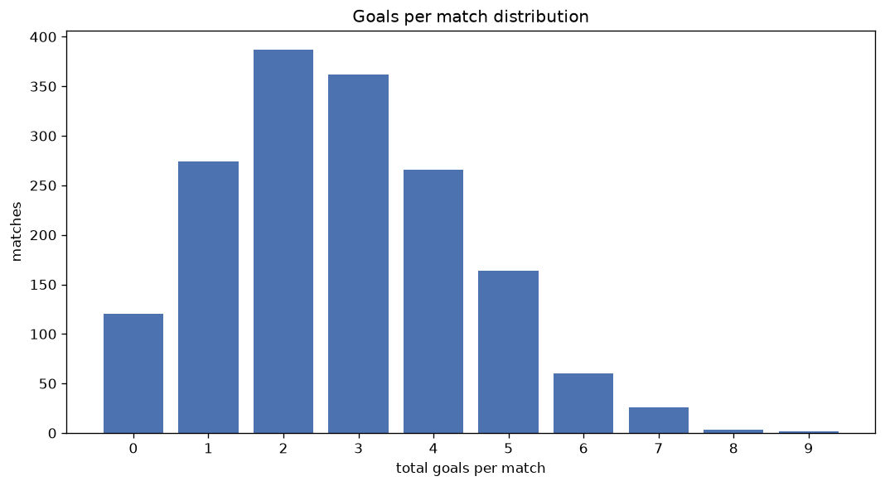
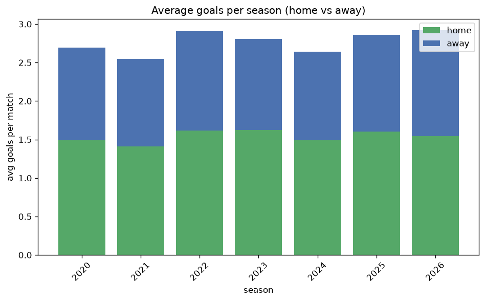

# Goal Analysis
- Report: `goals_analysis`
- Generated: 2026-10-29T02:17:31+00:00
- Script: `backend/scripts/analyze_goals.py` v1.0.0
- League: Superettan (Sweden)
- Scope: league `sweden2`

## 1. Goals per match distribution
| goals | matches | pct |
|---|---|---|
| 0 | 120 | 7.2% |
| 1 | 274 | 16.5% |
| 2 | 387 | 23.3% |
| 3 | 362 | 21.8% |
| 4 | 266 | 16.0% |
| 5 | 164 | 9.9% |
| 6 | 60 | 3.6% |
| 7 | 26 | 1.6% |
| 8 | 3 | 0.2% |
| 9 | 2 | 0.1% |

## 2. Goals per match per season
| season | matches | total goals | avg home | avg away | avg total |
|---|---|---|---|---|---|
| 2020 | 240 | 647 | 1.488 | 1.208 | 2.696 |
| 2021 | 240 | 612 | 1.408 | 1.142 | 2.55 |
| 2022 | 240 | 697 | 1.617 | 1.288 | 2.904 |
| 2023 | 240 | 673 | 1.625 | 1.179 | 2.804 |
| 2024 | 240 | 633 | 1.492 | 1.146 | 2.638 |
| 2025 | 240 | 686 | 1.6 | 1.258 | 2.858 |
| 2026 | 224 | 654 | 1.545 | 1.375 | 2.92 |

## 3. Home vs away goal share
- Home goals: **2561** (55.6%)
- Away goals: **2041** (44.4%)
- Home/away ratio: **1.255**

| season | home goals | away goals | total | home pct | away pct |
|---|---|---|---|---|---|
| 2020 | 357 | 290 | 647 | 55.2% | 44.8% |
| 2021 | 338 | 274 | 612 | 55.2% | 44.8% |
| 2022 | 388 | 309 | 697 | 55.7% | 44.3% |
| 2023 | 390 | 283 | 673 | 57.9% | 42.1% |
| 2024 | 358 | 275 | 633 | 56.6% | 43.4% |
| 2025 | 384 | 302 | 686 | 56.0% | 44.0% |
| 2026 | 346 | 308 | 654 | 52.9% | 47.1% |

## 4. BTTS (Both Teams To Score)
- Overall: **926** of `1664` (55.6%)

| season | matches | BTTS | pct |
|---|---|---|---|
| 2020 | 240 | 130 | 54.2% |
| 2021 | 240 | 127 | 52.9% |
| 2022 | 240 | 145 | 60.4% |
| 2023 | 240 | 130 | 54.2% |
| 2024 | 240 | 129 | 53.8% |
| 2025 | 240 | 132 | 55.0% |
| 2026 | 224 | 133 | 59.4% |

## 5. Clean sheets
- Home clean sheets: **486** (29.2%)
- Away clean sheets: **372** (22.4%)
- Total clean sheets recorded: **858**
- Matches with at least one clean sheet: **738** (44.4%)
- Both teams kept clean sheets (0-0): **120**

| season | matches | home CS | away CS | total CS | matches w/ CS |
|---|---|---|---|---|---|
| 2020 | 240 | 70 | 57 | 127 | 110 (45.8%) |
| 2021 | 240 | 77 | 55 | 132 | 113 (47.1%) |
| 2022 | 240 | 59 | 50 | 109 | 95 (39.6%) |
| 2023 | 240 | 77 | 50 | 127 | 110 (45.8%) |
| 2024 | 240 | 77 | 54 | 131 | 111 (46.2%) |
| 2025 | 240 | 70 | 56 | 126 | 108 (45.0%) |
| 2026 | 224 | 56 | 50 | 106 | 91 (40.6%) |

## 6. Scoring intensity
- First-half goals: **2020** (43.9%)
- Second-half goals: **2579** (56.1%)
- Avg first-half goals per match: **1.215**
- Avg second-half goals per match: **1.551**
- Second-half-only scoring (HT 0-0, FT goals >= 1): **365** (21.9%)
- *1 match(es) excluded (no HT score recorded).*

| season | matches | 1st half | 2nd half | 1st half pct | 2nd half pct |
|---|---|---|---|---|---|
| 2020 | 240 | 309 | 338 | 47.8% | 52.2% |
| 2021 | 240 | 260 | 352 | 42.5% | 57.5% |
| 2022 | 240 | 306 | 391 | 43.9% | 56.1% |
| 2023 | 240 | 287 | 386 | 42.6% | 57.4% |
| 2024 | 240 | 276 | 357 | 43.6% | 56.4% |
| 2025 | 240 | 296 | 390 | 43.1% | 56.9% |
| 2026 | 224 | 286 | 365 | 43.9% | 56.1% |

## 7. First-goal timing
- Matches with first-goal time recorded: `1543` of `1664` (92.7%)
- Goalless matches: `121`
- Min `1` | Max `96` | Mean `30.24` | Median (p50) `25`

| bucket | count | % of matches | % of scoring matches |
|---|---|---|---|
| 1-15 | 527 | 31.7% | 34.2% |
| 16-30 | 381 | 22.9% | 24.7% |
| 31-45 | 245 | 14.7% | 15.9% |
| 46-60 | 189 | 11.4% | 12.2% |
| 61-75 | 108 | 6.5% | 7.0% |
| 76-90 | 77 | 4.6% | 5.0% |
| 91-120 | 16 | 1.0% | 1.0% |

---
*All statistics are computed from PostgreSQL tables (read-only). Run with `python backend/scripts/analyze_goals.py` to regenerate.*

## Charts

