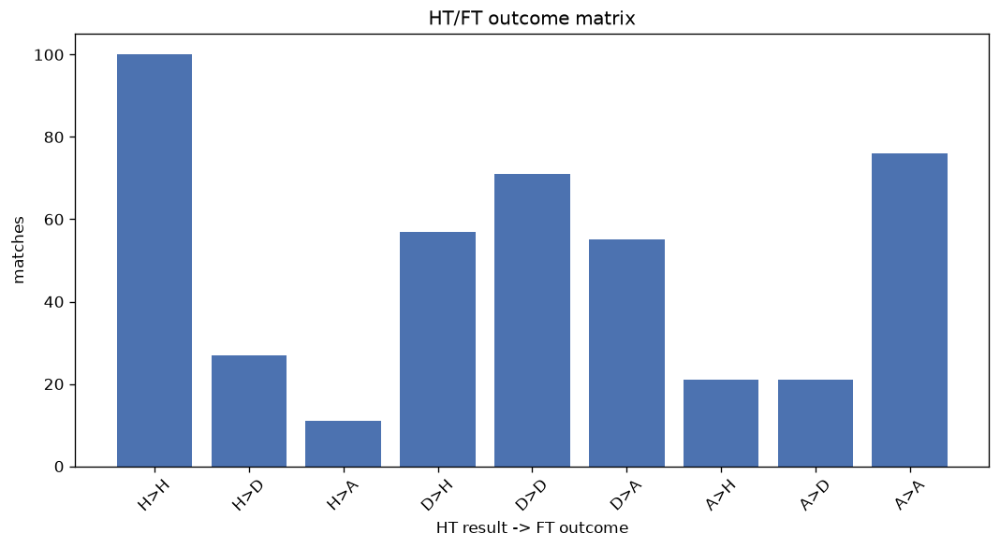
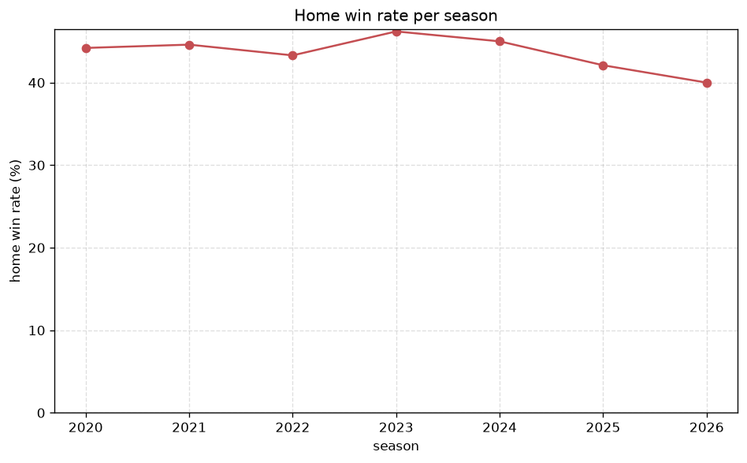

# Match Analysis
- Report: `matches_analysis`
- Generated: 2026-10-30T04:14:02+00:00
- Script: `backend/scripts/analyze_matches.py` v1.0.0
- League: Superettan (Sweden)
- Scope: league `sweden2`

## 1. Overall summary
| metric | value |
|---|---|
| Matches | 1664 |
| Home wins | 726 (43.6%) |
| Draws | 447 (26.9%) |
| Away wins | 491 (29.5%) |
| Total goals | 4602 |
| Average goals per match | 2.766 |
| Goalless matches | 120 (7.2%) |

## 2. Per-season breakdown
| season | matches | home wins | draws | away wins | total goals | avg goals | goalless |
|---|---|---|---|---|---|---|---|
| 2020 | 240 | 106 (44.2%) | 62 (25.8%) | 72 (30.0%) | 647 | 2.696 | 17 (7.1%) |
| 2021 | 240 | 107 (44.6%) | 65 (27.1%) | 68 (28.3%) | 612 | 2.55 | 19 (7.9%) |
| 2022 | 240 | 104 (43.3%) | 63 (26.2%) | 73 (30.4%) | 697 | 2.904 | 14 (5.8%) |
| 2023 | 240 | 111 (46.2%) | 64 (26.7%) | 65 (27.1%) | 673 | 2.804 | 17 (7.1%) |
| 2024 | 240 | 108 (45.0%) | 67 (27.9%) | 65 (27.1%) | 633 | 2.638 | 20 (8.3%) |
| 2025 | 240 | 101 (42.1%) | 65 (27.1%) | 74 (30.8%) | 686 | 2.858 | 18 (7.5%) |
| 2026 | 224 | 89 (39.7%) | 61 (27.2%) | 74 (33.0%) | 654 | 2.92 | 15 (6.7%) |

## 3. HT/FT outcome matrix
| HT result \ FT result | Home | Draw | Away | total |
|---|---|---|---|---|
| HT home lead | 428 (76.6%) | 96 (17.2%) | 35 (6.3%) | 559 |
| HT draw | 241 (35.0%) | 266 (38.6%) | 182 (26.4%) | 689 |
| HT away lead | 57 (13.7%) | 85 (20.5%) | 273 (65.8%) | 415 |
- *1 match(es) excluded (no HT score recorded).*

## 4. Comeback matches
- Home comebacks (trailing at HT, won at FT): **57** (3.4%)
- Away comebacks (trailing at HT, won at FT): **35** (2.1%)

### Home comebacks
| season | home | away | HT | FT |
|---|---|---|---|---|
| 2020 | Jonkoping | Ljungskile | 0-1 | 2-1 |
| 2020 | AFC Eskilstuna | Jonkoping | 1-2 | 3-2 |
| 2020 | Norrby | Vasteras SK | 0-1 | 3-1 |
| 2020 | Degerfors | Dalkurd | 0-1 | 2-1 |
| 2020 | Jonkoping | Oster | 0-1 | 4-1 |
| 2020 | Sundsvall | Jonkoping | 1-2 | 3-2 |
| 2020 | Jonkoping | Trelleborg | 0-1 | 2-1 |
| 2021 | Trelleborg | Norrby | 0-1 | 2-1 |
| 2021 | Jonkoping | Vasalund | 0-1 | 5-1 |
| 2021 | Brage | Jonkoping | 0-2 | 3-2 |
| 2021 | Orgryte | Akropolis | 0-1 | 3-1 |
| 2021 | GAIS | Orgryte | 0-1 | 2-1 |
| 2021 | Oster | Vasalund | 1-2 | 3-2 |
| 2021 | Varnamo | Falkenberg | 1-2 | 3-2 |
| 2021 | Varnamo | Helsingborg | 0-1 | 3-1 |
| 2022 | Orebro | Jonkoping | 0-1 | 3-1 |
| 2022 | Brommapojkarna | Jonkoping | 0-1 | 2-1 |
| 2022 | AFC Eskilstuna | Vasteras SK | 0-2 | 5-2 |
| 2022 | Landskrona | Halmstad | 0-1 | 2-1 |
| 2022 | Trelleborg | Skovde AIK | 0-1 | 2-1 |
| 2022 | Jonkoping | Vasteras SK | 0-1 | 2-1 |
| 2022 | Halmstad | Dalkurd | 0-1 | 3-1 |
| 2022 | Landskrona | Trelleborg | 0-1 | 2-1 |
| 2023 | Landskrona | Helsingborg | 0-1 | 2-1 |
| 2023 | Brage | Ostersund | 0-1 | 2-1 |
| 2023 | Vasteras SK | Helsingborg | 0-2 | 3-2 |
| 2023 | Gefle | Orebro | 0-1 | 2-1 |
| 2023 | Sundsvall | Jonkoping | 1-2 | 3-2 |
| 2023 | Orebro | Skovde AIK | 1-3 | 5-3 |
| 2023 | GAIS | Ostersund | 0-1 | 2-1 |
| 2023 | Vasteras SK | GAIS | 0-1 | 2-1 |
| 2024 | Ostersund | Varberg | 0-1 | 2-1 |
| 2024 | Trelleborg | Orebro | 0-1 | 2-1 |
| 2024 | Sandviken | Ostersund | 0-1 | 3-1 |
| 2024 | Utsikten | Ostersund | 0-1 | 3-1 |
| 2024 | Orgryte | Ostersund | 0-1 | 2-1 |
| 2025 | Landskrona | Utsikten | 0-1 | 2-1 |
| 2025 | Orgryte | Falkenberg | 0-2 | 4-2 |
| 2025 | Kalmar | Landskrona | 1-2 | 3-2 |
| 2025 | Vasteras SK | Orebro | 0-1 | 2-1 |
| 2025 | Oddevold | Trelleborg | 0-1 | 3-2 |
| 2025 | Brage | Trelleborg | 0-1 | 2-1 |
| 2025 | Kalmar | Vasteras SK | 0-1 | 2-1 |
| 2025 | Vasteras SK | Sundsvall | 0-1 | 2-1 |
| 2025 | Kalmar | Oddevold | 0-1 | 3-2 |
| 2025 | Helsingborg | Orebro | 0-1 | 3-2 |
| 2025 | Brage | Landskrona | 0-1 | 4-1 |
| 2025 | Vasteras SK | Varberg | 0-1 | 4-1 |
| 2026 | Sundsvall | Nordic United | 0-1 | 3-2 |
| 2026 | Ljungskile | Helsingborg | 0-1 | 4-1 |
| 2026 | Norrby | Ljungskile | 0-1 | 2-1 |
| 2026 | Ostersund | Orebro | 1-2 | 3-2 |
| 2026 | Ljungskile | Orebro | 1-2 | 3-2 |
| 2026 | Ljungskile | Norrby | 0-1 | 2-1 |
| 2026 | Varberg | Brage | 0-1 | 3-2 |
| 2026 | Sandviken | Orebro | 1-2 | 4-2 |
| 2026 | Sundsvall | Ljungskile | 0-2 | 3-2 |

### Away comebacks
| season | home | away | HT | FT |
|---|---|---|---|---|
| 2020 | AFC Eskilstuna | Umea FC | 1-0 | 1-3 |
| 2020 | AFC Eskilstuna | Brage | 1-0 | 1-2 |
| 2020 | Norrby | Trelleborg | 1-0 | 1-3 |
| 2021 | AFC Eskilstuna | Vasalund | 1-0 | 1-2 |
| 2021 | Jonkoping | AFC Eskilstuna | 1-0 | 1-2 |
| 2021 | Trelleborg | Jonkoping | 1-0 | 1-3 |
| 2022 | Halmstad | Norrby | 1-0 | 1-2 |
| 2022 | Dalkurd | Orgryte | 1-0 | 1-2 |
| 2022 | Ostersund | Brommapojkarna | 2-1 | 2-3 |
| 2023 | Trelleborg | Sundsvall | 3-1 | 3-4 |
| 2023 | Ostersund | Utsikten | 1-0 | 1-2 |
| 2023 | Orgryte | Helsingborg | 1-0 | 1-2 |
| 2023 | Landskrona | AFC Eskilstuna | 1-0 | 1-2 |
| 2023 | Helsingborg | Trelleborg | 1-0 | 1-3 |
| 2023 | Jonkoping | Landskrona | 1-0 | 1-2 |
| 2023 | Utsikten | Trelleborg | 2-0 | 2-3 |
| 2023 | Sundsvall | Brage | 1-0 | 1-2 |
| 2024 | Trelleborg | Oddevold | 1-0 | 1-2 |
| 2024 | Orgryte | Trelleborg | 1-0 | 1-2 |
| 2024 | Skovde AIK | Oster | 1-0 | 1-2 |
| 2024 | Sundsvall | Helsingborg | 1-0 | 1-3 |
| 2024 | Ostersund | Sundsvall | 1-0 | 1-2 |
| 2024 | Oster | Varberg | 2-0 | 3-4 |
| 2024 | Brage | Oddevold | 1-0 | 1-2 |
| 2025 | Sundsvall | Vasteras SK | 1-0 | 1-2 |
| 2025 | Orebro | Sundsvall | 1-0 | 1-2 |
| 2025 | Varberg | Orgryte | 1-0 | 1-2 |
| 2025 | Orebro | Orgryte | 1-0 | 1-3 |
| 2025 | Sundsvall | Varberg | 1-0 | 2-3 |
| 2025 | Umea FC | Sandviken | 1-0 | 1-2 |
| 2026 | Oddevold | Oster | 1-0 | 1-2 |
| 2026 | Varberg | Landskrona | 2-1 | 2-3 |
| 2026 | Brage | Falkenberg | 2-1 | 2-4 |
| 2026 | Orebro | Varnamo | 1-0 | 1-3 |
| 2026 | Norrby | Varberg | 1-0 | 1-2 |

## 5. HT lead conversion
| HT state | matches | converted to win | held as draw | collapsed to loss |
|---|---|---|---|---|
| Home lead | 559 | 428 (76.6%) | 96 (17.2%) | 35 (6.3%) |
| Away lead | 415 | 273 (65.8%) | 85 (20.5%) | 57 (13.7%) |

### Matches level at half-time
| FT result | count | pct |
|---|---|---|
| Home win | 241 | 35.0% |
| Draw | 266 | 38.6% |
| Away win | 182 | 26.4% |
- *1 match(es) excluded (no HT score recorded).*

## 6. First-goal timing
- Matches with a first-goal time recorded: `1543` of `1664` (92.7%)

Outcome distribution by first-goal timing bucket:
| bucket | matches | % of matches | home | draw | away |
|---|---|---|---|---|---|
| 1-15 | 527 | 31.7% | 255 (48.4%) | 108 (20.5%) | 164 (31.1%) |
| 16-30 | 381 | 22.9% | 189 (49.6%) | 76 (19.9%) | 116 (30.4%) |
| 31-45 | 245 | 14.7% | 110 (44.9%) | 61 (24.9%) | 74 (30.2%) |
| 46-60 | 189 | 11.4% | 86 (45.5%) | 43 (22.8%) | 60 (31.7%) |
| 61-75 | 108 | 6.5% | 39 (36.1%) | 29 (26.9%) | 40 (37.0%) |
| 76-90 | 77 | 4.6% | 39 (50.6%) | 10 (13.0%) | 28 (36.4%) |
| 91-120 | 16 | 1.0% | 8 (50.0%) | 0 (0.0%) | 8 (50.0%) |

## 7. Goalless matches
- Overall: **120** of `1664` (7.2%)

| season | matches | goalless | pct |
|---|---|---|---|
| 2020 | 240 | 17 | 7.1% |
| 2021 | 240 | 19 | 7.9% |
| 2022 | 240 | 14 | 5.8% |
| 2023 | 240 | 17 | 7.1% |
| 2024 | 240 | 20 | 8.3% |
| 2025 | 240 | 18 | 7.5% |
| 2026 | 224 | 15 | 6.7% |

---
*All statistics are computed from PostgreSQL tables (read-only). Run with `python backend/scripts/analyze_matches.py` to regenerate.*

## Charts

