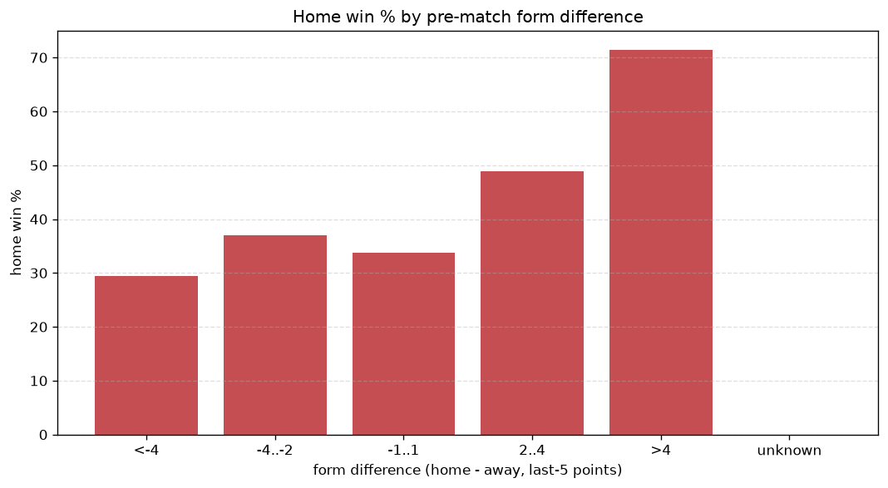
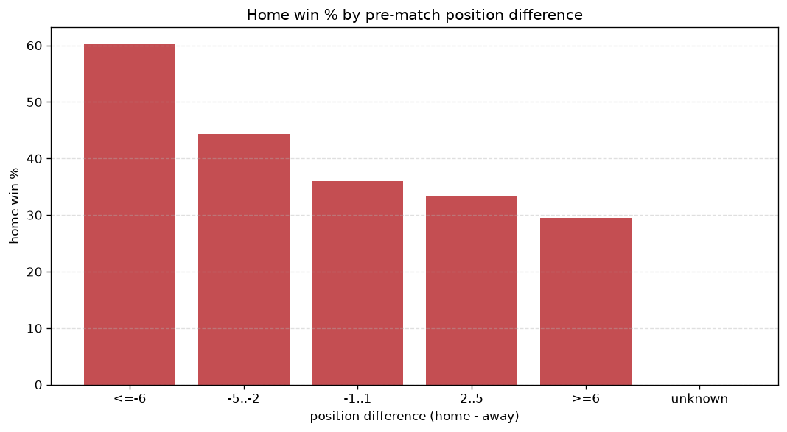

# Relationships Analysis
- Report: `relationships`
- Generated: 2026-10-29T02:17:38+00:00
- Script: `backend/scripts/analyze_relationships.py` v1.0.0
- League: Superettan (Sweden)
- Scope: league `sweden2`

- Matches analysed: **1440** (23 leakage-safe pre-match features).

## 1. Correlation matrix
_Pearson correlation of each pre-match feature with observed goals; sorted by |corr(total goals)|._

| feature | corr(home) | corr(away) | corr(total) |
|---|---|---|---|
| home_team_goals_scored_last_5 | 0.112 | -0.008 | 0.080 |
| home_team_points_last_5 | 0.087 | 0.016 | 0.077 |
| home_points_before_match | 0.081 | 0.015 | 0.072 |
| home_team_wins_last_5 | 0.082 | 0.013 | 0.071 |
| away_team_goals_scored_last_5 | -0.033 | 0.139 | 0.068 |
| points_difference | 0.166 | -0.107 | 0.055 |
| away_position_before_match | 0.148 | -0.100 | 0.047 |
| home_team_home_conceded_avg | 0.009 | 0.058 | 0.046 |
| position_difference | -0.166 | 0.122 | -0.045 |
| away_points_before_match | -0.035 | 0.090 | 0.033 |
| away_team_away_conceded_avg | 0.067 | -0.029 | 0.032 |
| away_team_points_last_5 | -0.064 | 0.119 | 0.031 |
| away_team_goals_conceded_last_5 | 0.055 | -0.023 | 0.027 |
| home_team_home_win_rate | 0.046 | -0.013 | 0.026 |
| home_team_home_goals_avg | 0.050 | -0.023 | 0.023 |
| home_position_before_match | -0.081 | 0.069 | -0.015 |
| away_team_wins_last_5 | -0.078 | 0.108 | 0.013 |
| home_rest_days | -0.009 | 0.029 | 0.013 |
| rest_days_difference | 0.033 | -0.019 | 0.012 |
| away_team_away_goals_avg | -0.060 | 0.084 | 0.010 |
| away_rest_days | -0.023 | 0.038 | 0.008 |
| away_team_away_win_rate | -0.063 | 0.061 | -0.007 |
| home_team_goals_conceded_last_5 | -0.034 | 0.049 | 0.007 |

## 2. Form vs outcome
_Home win/draw/away % per bucket of `home_team_points_last_5 - away_team_points_last_5`._

| bucket | matches | home | draw | away | home % | draw % | away % |
|---|---|---|---|---|---|---|---|
| <-4 | 224 | 81 | 65 | 78 | 36.2% | 29.0% | 34.8% |
| -4..-2 | 315 | 117 | 98 | 100 | 37.1% | 31.1% | 31.7% |
| -1..1 | 434 | 198 | 106 | 130 | 45.6% | 24.4% | 30.0% |
| 2..4 | 290 | 134 | 82 | 74 | 46.2% | 28.3% | 25.5% |
| >4 | 177 | 107 | 35 | 35 | 60.5% | 19.8% | 19.8% |
| unknown | 0 | 0 | 0 | 0 | - | - | - |

## 3. Position vs outcome
_Home win/draw/away % per bucket of `position_difference` (home position - away position; negative favours the home team)._

| bucket | matches | home | draw | away | home % | draw % | away % |
|---|---|---|---|---|---|---|---|
| <=-6 | 285 | 157 | 70 | 58 | 55.1% | 24.6% | 20.4% |
| -5..-2 | 293 | 149 | 69 | 75 | 50.9% | 23.5% | 25.6% |
| -1..1 | 245 | 99 | 60 | 86 | 40.4% | 24.5% | 35.1% |
| 2..5 | 305 | 116 | 95 | 94 | 38.0% | 31.1% | 30.8% |
| >=6 | 312 | 116 | 92 | 104 | 37.2% | 29.5% | 33.3% |
| unknown | 0 | 0 | 0 | 0 | - | - | - |

## 4. Rest advantage
_Home win/draw/away % per bucket of `rest_days_difference` (home rest - away rest). Matches with unknown rest are bucketed separately._

| bucket | matches | home | draw | away | home % | draw % | away % |
|---|---|---|---|---|---|---|---|
| <-1 | 165 | 69 | 45 | 51 | 41.8% | 27.3% | 30.9% |
| -1..0 | 305 | 129 | 87 | 89 | 42.3% | 28.5% | 29.2% |
| 0 | 455 | 200 | 121 | 134 | 44.0% | 26.6% | 29.5% |
| 1..2 | 416 | 186 | 111 | 119 | 44.7% | 26.7% | 28.6% |
| >2 | 51 | 34 | 10 | 7 | 66.7% | 19.6% | 13.7% |
| unknown | 48 | 19 | 12 | 17 | 39.6% | 25.0% | 35.4% |
- *48 match(es) had unknown rest difference (missing rest data on at least one side).*

## 5. Home team quality
_Home win rate by `home_team_home_win_rate` tier (split at 0.5)._

- `< 0.5` tier: **41.7%** home win (355/851)
- `>= 0.5` tier: **47.9%** home win (282/589)
- Home-win gap (>= split minus < split): **+6.2 pp**

| tier | label | matches | home | draw | away | home % |
|---|---|---|---|---|---|---|
| low | < 0.5 | 851 | 355 | 248 | 248 | 41.7% |
| high | >= 0.5 | 589 | 282 | 138 | 169 | 47.9% |

## 6. Feature averages by result
_Mean feature value per outcome; `range` is home-minus-away spread of the group means._

| feature | home mean | draw mean | away mean | range |
|---|---|---|---|---|
| points_difference | 1.378 | -1.207 | -2.012 | 3.390 |
| away_points_before_match | 19.129 | 19.435 | 21.513 | 2.384 |
| position_difference | -0.936 | 0.821 | 1.345 | 2.281 |
| home_points_before_match | 20.507 | 18.228 | 19.501 | 2.279 |
| away_position_before_match | 9.229 | 8.508 | 7.753 | 1.476 |
| home_position_before_match | 8.294 | 9.329 | 9.098 | 1.035 |
| away_team_points_last_5 | 5.969 | 6.389 | 6.671 | 0.703 |
| home_team_goals_scored_last_5 | 6.399 | 5.744 | 5.794 | 0.655 |
| away_team_goals_scored_last_5 | 5.978 | 6.435 | 6.552 | 0.574 |
| home_team_points_last_5 | 6.286 | 5.715 | 5.835 | 0.571 |
| away_team_goals_conceded_last_5 | 6.217 | 6.194 | 5.751 | 0.466 |
| home_team_goals_conceded_last_5 | 6.008 | 6.402 | 6.441 | 0.433 |
| home_rest_days | 7.422 | 7.176 | 7.545 | 0.369 |
| away_rest_days | 7.324 | 7.257 | 7.607 | 0.351 |
| away_team_wins_last_5 | 1.586 | 1.738 | 1.813 | 0.227 |
| home_team_wins_last_5 | 1.684 | 1.495 | 1.549 | 0.190 |
| rest_days_difference | 0.099 | -0.080 | -0.062 | 0.179 |
| away_team_away_goals_avg | 1.025 | 1.097 | 1.141 | 0.117 |
| away_team_away_conceded_avg | 1.432 | 1.382 | 1.336 | 0.096 |
| home_team_home_goals_avg | 1.417 | 1.351 | 1.358 | 0.066 |
| home_team_home_conceded_avg | 1.055 | 1.092 | 1.078 | 0.037 |
| home_team_home_win_rate | 0.420 | 0.391 | 0.406 | 0.029 |
| away_team_away_win_rate | 0.254 | 0.275 | 0.278 | 0.025 |

---
*All features are leakage-safe pre-match values built by `ml.features.build_features.build_rows` from strictly prior matches. Run with `python backend/scripts/analyze_relationships.py` to regenerate.*

## Charts

