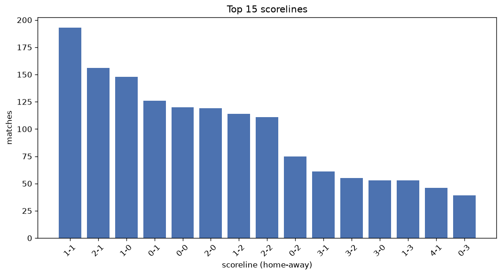
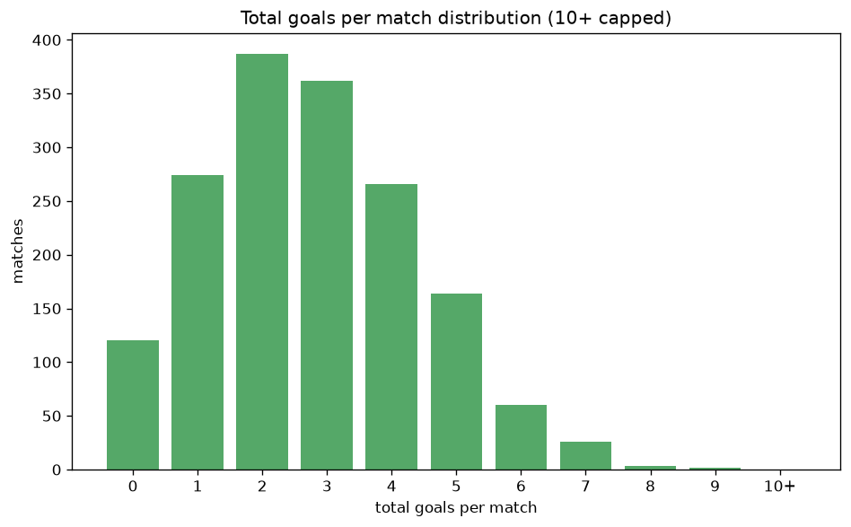

# Scoreline Analysis
- Report: `scoreline_analysis`
- Generated: 2026-10-29T02:17:36+00:00
- Script: `backend/scripts/analyze_scorelines.py` v1.0.0
- League: Superettan (Sweden)
- Scope: league `sweden2`

## 1. Scoreline frequency
- Matches analysed: **1664** across **7** seasons.
- Distinct scorelines seen: **37**.

| scoreline | count | pct |
|---|---|---|
| 1-1 | 193 | 11.6% |
| 2-1 | 156 | 9.4% |
| 1-0 | 148 | 8.9% |
| 0-1 | 126 | 7.6% |
| 0-0 | 120 | 7.2% |
| 2-0 | 119 | 7.2% |
| 1-2 | 114 | 6.9% |
| 2-2 | 111 | 6.7% |
| 0-2 | 75 | 4.5% |
| 3-1 | 61 | 3.7% |
| 3-2 | 55 | 3.3% |
| 3-0 | 53 | 3.2% |
| 1-3 | 53 | 3.2% |
| 4-1 | 46 | 2.8% |
| 0-3 | 39 | 2.3% |
| 2-3 | 35 | 2.1% |
| 4-0 | 34 | 2.0% |
| 3-3 | 21 | 1.3% |
| 1-4 | 19 | 1.1% |
| 4-2 | 16 | 1.0% |

## 2. Scoreline frequency per season

### 2020
| scoreline | count | pct |
|---|---|---|
| 1-1 | 31 | 12.9% |
| 2-1 | 25 | 10.4% |
| 0-1 | 22 | 9.2% |
| 2-0 | 22 | 9.2% |
| 1-0 | 18 | 7.5% |

### 2021
| scoreline | count | pct |
|---|---|---|
| 1-1 | 31 | 12.9% |
| 1-0 | 31 | 12.9% |
| 2-1 | 21 | 8.8% |
| 0-1 | 20 | 8.3% |
| 0-0 | 19 | 7.9% |

### 2022
| scoreline | count | pct |
|---|---|---|
| 1-1 | 30 | 12.5% |
| 2-1 | 24 | 10.0% |
| 2-0 | 19 | 7.9% |
| 1-2 | 18 | 7.5% |
| 0-1 | 17 | 7.1% |

### 2023
| scoreline | count | pct |
|---|---|---|
| 2-1 | 25 | 10.4% |
| 1-1 | 24 | 10.0% |
| 1-0 | 22 | 9.2% |
| 2-2 | 19 | 7.9% |
| 1-2 | 18 | 7.5% |

### 2024
| scoreline | count | pct |
|---|---|---|
| 1-0 | 28 | 11.7% |
| 1-1 | 28 | 11.7% |
| 2-1 | 23 | 9.6% |
| 0-0 | 20 | 8.3% |
| 2-2 | 18 | 7.5% |

### 2025
| scoreline | count | pct |
|---|---|---|
| 2-1 | 21 | 8.8% |
| 2-2 | 21 | 8.8% |
| 1-1 | 21 | 8.8% |
| 1-2 | 20 | 8.3% |
| 0-0 | 18 | 7.5% |

### 2026
| scoreline | count | pct |
|---|---|---|
| 1-1 | 28 | 12.5% |
| 0-1 | 18 | 8.0% |
| 1-0 | 18 | 8.0% |
| 2-1 | 17 | 7.6% |
| 2-2 | 15 | 6.7% |

## 3. Total-goal histogram
_10+ groups all matches with 10 or more total goals._

| total goals | matches | pct |
|---|---|---|
| 0 | 120 | 7.2% |
| 1 | 274 | 16.5% |
| 2 | 387 | 23.3% |
| 3 | 362 | 21.8% |
| 4 | 266 | 16.0% |
| 5 | 164 | 9.9% |
| 6 | 60 | 3.6% |
| 7 | 26 | 1.6% |
| 8 | 3 | 0.2% |
| 9 | 2 | 0.1% |
| 10+ | 0 | 0.0% |

## 4. Extreme scorelines
- Matches with 7+ total goals: **31**

| season | date | scoreline | total goals |
|---|---|---|---|
| 2025 | 2025-09-20 | 4-5 | 9 |
| 2026 | 2026-10-24 | 4-5 | 9 |
| 2022 | 2022-08-16 | 4-4 | 8 |
| 2023 | 2023-09-17 | 5-3 | 8 |
| 2025 | 2025-05-21 | 4-4 | 8 |
| 2020 | 2020-08-07 | 5-2 | 7 |
| 2020 | 2020-11-28 | 2-5 | 7 |
| 2021 | 2021-08-29 | 3-4 | 7 |
| 2021 | 2021-11-07 | 3-4 | 7 |
| 2022 | 2022-04-09 | 4-3 | 7 |
| 2022 | 2022-05-07 | 5-2 | 7 |
| 2022 | 2022-05-14 | 5-2 | 7 |
| 2022 | 2022-07-24 | 5-2 | 7 |
| 2022 | 2022-09-17 | 5-2 | 7 |
| 2022 | 2022-10-30 | 5-2 | 7 |
| 2023 | 2023-04-10 | 5-2 | 7 |
| 2023 | 2023-05-01 | 3-4 | 7 |
| 2023 | 2023-10-28 | 4-3 | 7 |
| 2024 | 2024-05-22 | 4-3 | 7 |
| 2024 | 2024-06-23 | 4-3 | 7 |
| 2024 | 2024-06-24 | 4-3 | 7 |
| 2024 | 2024-06-30 | 4-3 | 7 |
| 2024 | 2024-09-30 | 5-2 | 7 |
| 2024 | 2024-10-20 | 3-4 | 7 |
| 2024 | 2024-11-03 | 5-2 | 7 |
| 2025 | 2025-08-02 | 2-5 | 7 |
| 2025 | 2025-10-04 | 1-6 | 7 |
| 2026 | 2026-04-12 | 3-4 | 7 |
| 2026 | 2026-06-21 | 5-2 | 7 |
| 2026 | 2026-10-17 | 4-3 | 7 |
| 2026 | 2026-10-23 | 7-0 | 7 |

## 5. Margin-of-victory distribution (decided matches)
- Decided matches: **1217** (draws: **447**)
- Average winning margin: **1.74**

| margin | matches | pct |
|---|---|---|
| 1 | 648 | 53.2% |
| 2 | 331 | 27.2% |
| 3+ | 238 | 19.6% |

## 6. Margin by outcome

### Home wins
- Matches: **726** | avg margin: **1.82** | max margin: **7**
| margin | matches | pct |
|---|---|---|
| 1 | 366 | 50.4% |
| 2 | 197 | 27.1% |
| 3+ | 163 | 22.5% |
- *Full match-by-match list available in `scoreline_analysis.json`.*

### Away wins
- Matches: **491** | avg margin: **1.63** | max margin: **6**
| margin | matches | pct |
|---|---|---|
| 1 | 282 | 57.4% |
| 2 | 134 | 27.3% |
| 3+ | 75 | 15.3% |
- *Full match-by-match list available in `scoreline_analysis.json`.*

## 7. Most common exact score by outcome type
| outcome | matches | most common score | count | pct |
|---|---|---|---|---|
| home | 726 | 2-1 | 156 | 21.5% |
| draw | 447 | 1-1 | 193 | 43.2% |
| away | 491 | 0-1 | 126 | 25.7% |

---
*All statistics are computed from PostgreSQL tables (read-only). Run with `python backend/scripts/analyze_scorelines.py` to regenerate.*

## Charts

