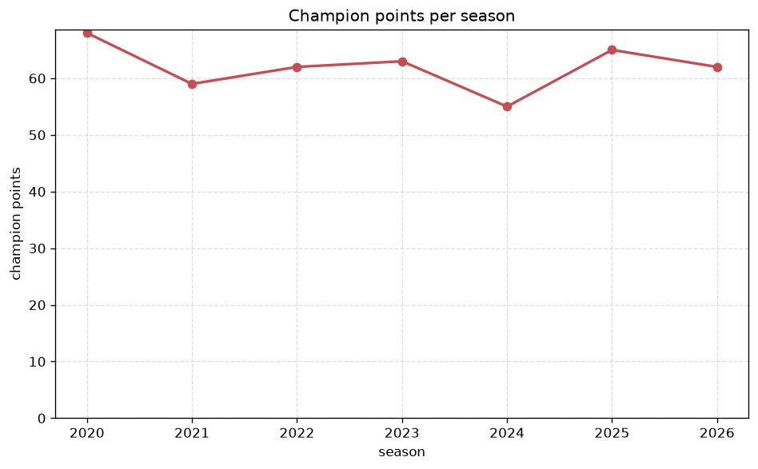
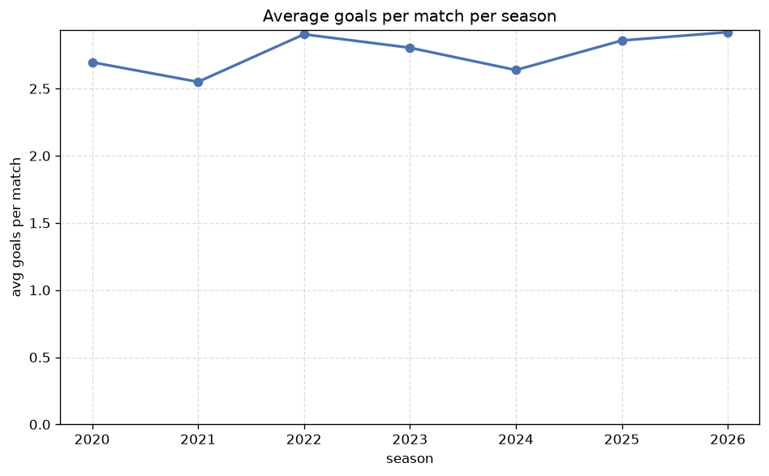

# Season Trends Analysis
- Report: `season_trends`
- Generated: 2026-10-27T02:32:51+00:00
- Script: `backend/scripts/analyze_seasons.py` v1.0.0
- League: Superettan (Sweden)
- Scope: league `sweden2`

## 1. Champions per season
| season | champion | pts | runner-up | margin |
|---|---|---|---|---|
| 2020 | Halmstad | 68 | Degerfors | 5 pts |
| 2021 | Varnamo | 59 | Sundsvall | 6 pts |
| 2022 | Brommapojkarna | 62 | Halmstad | 6 pts |
| 2023 | Vasteras SK | 63 | GAIS | 6 pts |
| 2024 | Degerfors | 55 | Oster | 1 pts |
| 2025 | Vasteras SK | 65 | Kalmar | 1 pts |
| 2026 | Norrkoping | 62 | Falkenberg | 11 pts |

## 2. Title-race tightness
- Tight races (margin <= 3 pts): **2** of 7 seasons
- Tightest race: **2024** - Degerfors beat Oster by **1** pts

| season | margin | tight |
|---|---|---|
| 2020 | 5 pts |  |
| 2021 | 6 pts |  |
| 2022 | 6 pts |  |
| 2023 | 6 pts |  |
| 2024 | 1 pts | yes |
| 2025 | 1 pts | yes |
| 2026 | 11 pts |  |

## 3. Points thresholds
_Position-specific points per season. Key: 1 = champion, 2 = runner-up, 4 = CL line, 6 = Europa, 13 = last safe, 16 = bottom._

| season | pos 1 | pos 2 | pos 4 | pos 6 | pos 13 | pos 16 |
|---|---|---|---|---|---|---|
| 2020 | 68 | 63 | 51 | 43 | 32 | 23 |
| 2021 | 59 | 53 | 48 | 44 | 35 | 25 |
| 2022 | 62 | 56 | 45 | 44 | 35 | 29 |
| 2023 | 63 | 57 | 54 | 41 | 33 | 31 |
| 2024 | 55 | 54 | 47 | 43 | 34 | 25 |
| 2025 | 65 | 64 | 48 | 43 | 30 | 19 |
| 2026 | 62 | 51 | 46 | 42 | 27 | 19 |

## 4. Relegation battle
| season | safe pos | safe pts | drop pos | drop pts | gap |
|---|---|---|---|---|---|
| 2020 | 13 | 32 | 14 | 29 | 3 pts |
| 2021 | 13 | 35 | 14 | 34 | 1 pts |
| 2022 | 13 | 35 | 14 | 31 | 4 pts |
| 2023 | 13 | 33 | 14 | 32 | 1 pts |
| 2024 | 13 | 34 | 14 | 32 | 2 pts |
| 2025 | 13 | 30 | 14 | 22 | 8 pts |
| 2026 | 13 | 27 | 14 | 26 | 1 pts |

## 5. League-level trends
| season | matches | total goals | avg goals | home win | draw | away win | goalless | avg pts/team |
|---|---|---|---|---|---|---|---|---|
| 2020 | 240 | 647 | 2.696 | 44.2% | 25.8% | 30.0% | 7.1% | 41.12 |
| 2021 | 240 | 612 | 2.55 | 44.6% | 27.1% | 28.3% | 7.9% | 40.94 |
| 2022 | 240 | 697 | 2.904 | 43.3% | 26.2% | 30.4% | 5.8% | 41.06 |
| 2023 | 240 | 673 | 2.804 | 46.2% | 26.7% | 27.1% | 7.1% | 41.0 |
| 2024 | 240 | 633 | 2.638 | 45.0% | 27.9% | 27.1% | 8.3% | 40.81 |
| 2025 | 240 | 686 | 2.858 | 42.1% | 27.1% | 30.8% | 7.5% | 40.94 |
| 2026 | 222 | 651 | 2.932 | 39.6% | 27.0% | 33.3% | 6.8% | 37.88 |

## 6. View divergence
- Largest divergence: **2021** (goals view, avg abs position diff = 5.750)

_Avg absolute position difference between classic view and alternative view per season._

| season | classic vs luck | classic vs goals |
|---|---|---|
| 2020 | 1.750 | 2.625 |
| 2021 | 2.000 | 5.750 |
| 2022 | 3.000 | 4.750 |
| 2023 | 2.875 | 5.250 |
| 2024 | 4.000 | 5.125 |
| 2025 | 1.750 | 4.875 |
| 2026 | 2.000 | 5.000 |

---
*All statistics are computed from PostgreSQL tables (read-only). Run with `python backend/scripts/analyze_seasons.py` to regenerate.*

## Charts

