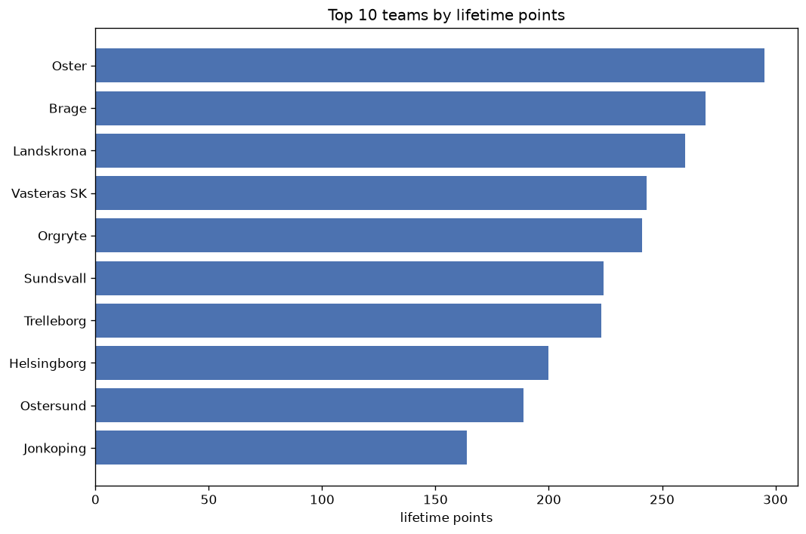
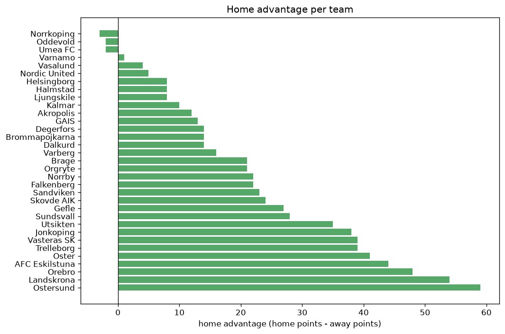

# Team Analysis
- Report: `teams_analysis`
- Generated: 2026-10-26T01:50:31+00:00
- Script: `backend/scripts/analyze_teams.py` v1.0.0
- League: Superettan (Sweden)
- Scope: league `sweden2`

- Teams: **33** | Seasons: **7** | Matches: **1660**

## 1. Team standings (lifetime)
| team | seasons | played | W | D | L | pts | GF | GA | GD | avg pts/season | best pos | worst pos | titles |
|---|---|---|---|---|---|---|---|---|---|---|---|---|---|
| Oster | 6 | 178 | 84 | 43 | 51 | 295 | 279 | 208 | 71 | 49.17 | 2 | 7 | 0 |
| Brage | 7 | 208 | 72 | 53 | 83 | 269 | 288 | 303 | -15 | 38.43 | 6 | 14 | 0 |
| Landskrona | 6 | 177 | 72 | 44 | 61 | 260 | 251 | 241 | 10 | 43.33 | 3 | 9 | 0 |
| Vasteras SK | 5 | 150 | 68 | 39 | 43 | 243 | 236 | 187 | 49 | 48.6 | 1 | 12 | 2 |
| Orgryte | 6 | 180 | 62 | 55 | 63 | 241 | 258 | 249 | 9 | 40.17 | 3 | 14 | 0 |
| Sundsvall | 6 | 178 | 62 | 38 | 78 | 224 | 220 | 273 | -53 | 37.33 | 2 | 16 | 0 |
| Trelleborg | 6 | 180 | 59 | 46 | 75 | 223 | 217 | 270 | -53 | 37.17 | 4 | 15 | 0 |
| Helsingborg | 5 | 147 | 53 | 41 | 53 | 200 | 198 | 186 | 12 | 40.0 | 3 | 12 | 0 |
| Ostersund | 5 | 148 | 46 | 51 | 51 | 189 | 177 | 204 | -27 | 37.8 | 3 | 14 | 0 |
| Jonkoping | 4 | 120 | 44 | 32 | 44 | 164 | 170 | 179 | -9 | 41.0 | 3 | 15 | 0 |
| Utsikten | 4 | 120 | 44 | 31 | 45 | 163 | 175 | 168 | 7 | 40.75 | 3 | 13 | 0 |
| Orebro | 5 | 147 | 37 | 47 | 63 | 158 | 182 | 215 | -33 | 31.6 | 10 | 15 | 0 |
| AFC Eskilstuna | 4 | 120 | 41 | 25 | 54 | 148 | 153 | 178 | -25 | 37.0 | 8 | 16 | 0 |
| Norrby | 4 | 117 | 34 | 38 | 45 | 140 | 144 | 158 | -14 | 35.0 | 4 | 15 | 0 |
| Varberg | 3 | 87 | 34 | 26 | 27 | 128 | 136 | 120 | 16 | 42.67 | 4 | 10 | 0 |
| GAIS | 3 | 90 | 36 | 19 | 35 | 127 | 122 | 104 | 18 | 42.33 | 2 | 14 | 0 |
| Oddevold | 3 | 88 | 32 | 30 | 26 | 126 | 124 | 120 | 4 | 42.0 | 4 | 12 | 0 |
| Sandviken | 3 | 88 | 35 | 20 | 33 | 125 | 131 | 124 | 7 | 41.67 | 6 | 10 | 0 |
| Halmstad | 2 | 60 | 38 | 10 | 12 | 124 | 118 | 50 | 68 | 62.0 | 1 | 2 | 1 |
| Falkenberg | 3 | 87 | 33 | 23 | 31 | 122 | 139 | 128 | 11 | 40.67 | 2 | 16 | 0 |
| Degerfors | 2 | 60 | 34 | 16 | 10 | 118 | 114 | 58 | 56 | 59.0 | 1 | 2 | 1 |
| Skovde AIK | 3 | 90 | 25 | 27 | 38 | 102 | 108 | 143 | -35 | 34.0 | 5 | 16 | 0 |
| Varnamo | 2 | 58 | 27 | 10 | 21 | 91 | 79 | 77 | 2 | 45.5 | 1 | 10 | 1 |
| Akropolis | 2 | 60 | 19 | 23 | 18 | 80 | 72 | 83 | -11 | 40.0 | 5 | 13 | 0 |
| Gefle | 2 | 60 | 17 | 18 | 25 | 69 | 73 | 99 | -26 | 34.5 | 9 | 15 | 0 |
| Kalmar | 1 | 30 | 18 | 10 | 2 | 64 | 52 | 21 | 31 | 64.0 | 2 | 2 | 0 |
| Brommapojkarna | 1 | 30 | 19 | 5 | 6 | 62 | 64 | 40 | 24 | 62.0 | 1 | 1 | 1 |
| Norrkoping | 1 | 27 | 18 | 5 | 4 | 59 | 54 | 18 | 36 | 59.0 | 1 | 1 | 1 |
| Dalkurd | 2 | 60 | 14 | 16 | 30 | 58 | 70 | 97 | -27 | 29.0 | 14 | 16 | 0 |
| Ljungskile | 2 | 57 | 12 | 16 | 29 | 52 | 58 | 89 | -31 | 26.0 | 12 | 16 | 0 |
| Umea FC | 2 | 60 | 9 | 19 | 32 | 46 | 55 | 104 | -49 | 23.0 | 15 | 16 | 0 |
| Nordic United | 1 | 28 | 10 | 9 | 9 | 39 | 41 | 47 | -6 | 39.0 | 9 | 9 | 0 |
| Vasalund | 1 | 30 | 7 | 5 | 18 | 26 | 35 | 52 | -17 | 26.0 | 15 | 15 | 0 |

## 2. Home vs away split
| team | home P | H-W | H-D | H-L | H-pts | away P | A-W | A-D | A-L | A-pts | adv |
|---|---|---|---|---|---|---|---|---|---|---|---|
| Ostersund | 74 | 33 | 25 | 16 | 124 | 74 | 13 | 26 | 35 | 65 | 59 |
| Landskrona | 88 | 44 | 25 | 19 | 157 | 89 | 28 | 19 | 42 | 103 | 54 |
| Orebro | 73 | 26 | 25 | 22 | 103 | 74 | 11 | 22 | 41 | 55 | 48 |
| AFC Eskilstuna | 60 | 28 | 12 | 20 | 96 | 60 | 13 | 13 | 34 | 52 | 44 |
| Oster | 89 | 50 | 18 | 21 | 168 | 89 | 34 | 25 | 30 | 127 | 41 |
| Vasteras SK | 75 | 39 | 24 | 12 | 141 | 75 | 29 | 15 | 31 | 102 | 39 |
| Trelleborg | 90 | 35 | 26 | 29 | 131 | 90 | 24 | 20 | 46 | 92 | 39 |
| Jonkoping | 60 | 29 | 14 | 17 | 101 | 60 | 15 | 18 | 27 | 63 | 38 |
| Utsikten | 60 | 27 | 18 | 15 | 99 | 60 | 17 | 13 | 30 | 64 | 35 |
| Sundsvall | 89 | 35 | 21 | 33 | 126 | 89 | 27 | 17 | 45 | 98 | 28 |
| Gefle | 30 | 13 | 9 | 8 | 48 | 30 | 4 | 9 | 17 | 21 | 27 |
| Skovde AIK | 45 | 16 | 15 | 14 | 63 | 45 | 9 | 12 | 24 | 39 | 24 |
| Sandviken | 44 | 22 | 8 | 14 | 74 | 44 | 13 | 12 | 19 | 51 | 23 |
| Norrby | 58 | 21 | 18 | 19 | 81 | 59 | 13 | 20 | 26 | 59 | 22 |
| Falkenberg | 44 | 20 | 12 | 12 | 72 | 43 | 13 | 11 | 19 | 50 | 22 |
| Brage | 104 | 40 | 25 | 39 | 145 | 104 | 32 | 28 | 44 | 124 | 21 |
| Orgryte | 90 | 34 | 29 | 27 | 131 | 90 | 28 | 26 | 36 | 110 | 21 |
| Varberg | 44 | 20 | 12 | 12 | 72 | 43 | 14 | 14 | 15 | 56 | 16 |
| Degerfors | 30 | 21 | 3 | 6 | 66 | 30 | 13 | 13 | 4 | 52 | 14 |
| Brommapojkarna | 15 | 12 | 2 | 1 | 38 | 15 | 7 | 3 | 5 | 24 | 14 |
| Dalkurd | 30 | 9 | 9 | 12 | 36 | 30 | 5 | 7 | 18 | 22 | 14 |
| GAIS | 45 | 20 | 10 | 15 | 70 | 45 | 16 | 9 | 20 | 57 | 13 |
| Akropolis | 30 | 11 | 13 | 6 | 46 | 30 | 8 | 10 | 12 | 34 | 12 |
| Kalmar | 15 | 12 | 1 | 2 | 37 | 15 | 6 | 9 | 0 | 27 | 10 |
| Helsingborg | 73 | 28 | 20 | 25 | 104 | 74 | 25 | 21 | 28 | 96 | 8 |
| Halmstad | 30 | 21 | 3 | 6 | 66 | 30 | 17 | 7 | 6 | 58 | 8 |
| Ljungskile | 29 | 8 | 6 | 15 | 30 | 28 | 4 | 10 | 14 | 22 | 8 |
| Nordic United | 14 | 6 | 4 | 4 | 22 | 14 | 4 | 5 | 5 | 17 | 5 |
| Vasalund | 15 | 4 | 3 | 8 | 15 | 15 | 3 | 2 | 10 | 11 | 4 |
| Varnamo | 29 | 13 | 7 | 9 | 46 | 29 | 14 | 3 | 12 | 45 | 1 |
| Oddevold | 44 | 16 | 14 | 14 | 62 | 44 | 16 | 16 | 12 | 64 | -2 |
| Umea FC | 30 | 4 | 10 | 16 | 22 | 30 | 5 | 9 | 16 | 24 | -2 |
| Norrkoping | 14 | 8 | 4 | 2 | 28 | 13 | 10 | 1 | 2 | 31 | -3 |

## 3. Top performers
### Best points per game (PPG)
| rank | team | PPG |
|---|---|---|
| 1 | Norrkoping | 2.19 |
| 2 | Kalmar | 2.13 |
| 3 | Halmstad | 2.07 |
| 4 | Brommapojkarna | 2.07 |
| 5 | Degerfors | 1.97 |

### Most goals scored
| rank | team | goals |
|---|---|---|
| 1 | Brage | 288 |
| 2 | Oster | 279 |
| 3 | Orgryte | 258 |
| 4 | Landskrona | 251 |
| 5 | Vasteras SK | 236 |

### Best goal difference
| rank | team | GD |
|---|---|---|
| 1 | Oster | 71 |
| 2 | Halmstad | 68 |
| 3 | Degerfors | 56 |
| 4 | Vasteras SK | 49 |
| 5 | Norrkoping | 36 |

### Best defence (goals against per match, standings)
| rank | team | GA/match |
|---|---|---|
| 1 | Norrkoping | 0.667 |
| 2 | Kalmar | 0.700 |
| 3 | Halmstad | 0.833 |
| 4 | Degerfors | 0.967 |
| 5 | GAIS | 1.156 |

## 4. Team consistency
- Teams present in all **7** seasons: **1**

Brage

## 5. Head-to-head dominance
- Distinct fixtures: **407** (showing the 15 most frequent)

| fixture | meetings | home wins | draws | away wins | home pct | draw pct | away pct |
|---|---|---|---|---|---|---|---|
| Brage vs Landskrona | 12 | 7 | 5 | 0 | 58.3% | 41.7% | 0.0% |
| Brage vs Trelleborg | 12 | 6 | 2 | 4 | 50.0% | 16.7% | 33.3% |
| Orgryte vs Brage | 12 | 5 | 3 | 4 | 41.7% | 25.0% | 33.3% |
| Orgryte vs Trelleborg | 12 | 5 | 3 | 4 | 41.7% | 25.0% | 33.3% |
| Oster vs Brage | 12 | 4 | 1 | 7 | 33.3% | 8.3% | 58.3% |
| Sundsvall vs Brage | 12 | 2 | 3 | 7 | 16.7% | 25.0% | 58.3% |
| Helsingborg vs Brage | 10 | 7 | 2 | 1 | 70.0% | 20.0% | 10.0% |
| Orebro vs Ostersund | 10 | 7 | 2 | 1 | 70.0% | 20.0% | 10.0% |
| Sundsvall vs Trelleborg | 10 | 7 | 2 | 1 | 70.0% | 20.0% | 10.0% |
| Vasteras SK vs Trelleborg | 10 | 7 | 2 | 1 | 70.0% | 20.0% | 10.0% |
| Ostersund vs Landskrona | 10 | 6 | 3 | 1 | 60.0% | 30.0% | 10.0% |
| Sundsvall vs Landskrona | 10 | 6 | 2 | 2 | 60.0% | 20.0% | 20.0% |
| Orgryte vs Landskrona | 10 | 5 | 2 | 3 | 50.0% | 20.0% | 30.0% |
| Ostersund vs Brage | 10 | 5 | 2 | 3 | 50.0% | 20.0% | 30.0% |
| Helsingborg vs Sundsvall | 10 | 4 | 4 | 2 | 40.0% | 40.0% | 20.0% |

## 6. Position per season (classic view)
_Cells show final position; '-' when the team was absent from that season._

| team | 2020 | 2021 | 2022 | 2023 | 2024 | 2025 | 2026 |
|---|---|---|---|---|---|---|---|
| Oster | 4 | 5 | 3 | 4 | 2 | - | 7 |
| Brage | 8 | 10 | 7 | 6 | 8 | 8 | 14 |
| Landskrona | - | 6 | 6 | 7 | 3 | 9 | 5 |
| Vasteras SK | 7 | 12 | 9 | 1 | - | 1 | - |
| Orgryte | 12 | 8 | 13 | 14 | 5 | 3 | - |
| Sundsvall | 6 | 2 | - | 10 | 13 | 11 | 16 |
| Trelleborg | 13 | 7 | 4 | 8 | 7 | 15 | - |
| Helsingborg | - | 3 | - | 12 | 4 | 7 | 11 |
| Ostersund | - | - | 14 | 5 | 14 | 12 | 3 |
| Jonkoping | 3 | 11 | 12 | 15 | - | - | - |
| Utsikten | - | - | 11 | 3 | 9 | 13 | - |
| Orebro | - | - | 10 | 11 | 11 | 14 | 15 |
| AFC Eskilstuna | 9 | 9 | 8 | 16 | - | - | - |
| Norrby | 11 | 4 | 15 | - | - | - | 13 |
| Varberg | - | - | - | - | 10 | 6 | 4 |
| GAIS | 10 | 14 | - | 2 | - | - | - |
| Oddevold | - | - | - | - | 12 | 4 | 6 |
| Sandviken | - | - | - | - | 6 | 10 | 8 |
| Halmstad | 1 | - | 2 | - | - | - | - |
| Falkenberg | - | 16 | - | - | - | 5 | 2 |
| Degerfors | 2 | - | - | - | 1 | - | - |
| Skovde AIK | - | - | 5 | 13 | 16 | - | - |
| Varnamo | - | 1 | - | - | - | - | 10 |
| Akropolis | 5 | 13 | - | - | - | - | - |
| Gefle | - | - | - | 9 | 15 | - | - |
| Kalmar | - | - | - | - | - | 2 | - |
| Brommapojkarna | - | - | 1 | - | - | - | - |
| Norrkoping | - | - | - | - | - | - | 1 |
| Dalkurd | 14 | - | 16 | - | - | - | - |
| Ljungskile | 16 | - | - | - | - | - | 12 |
| Umea FC | 15 | - | - | - | - | 16 | - |
| Nordic United | - | - | - | - | - | - | 9 |
| Vasalund | - | 15 | - | - | - | - | - |

---
*All statistics are computed from PostgreSQL tables (read-only). Run with `python backend/scripts/analyze_teams.py` to regenerate.*

## Charts

