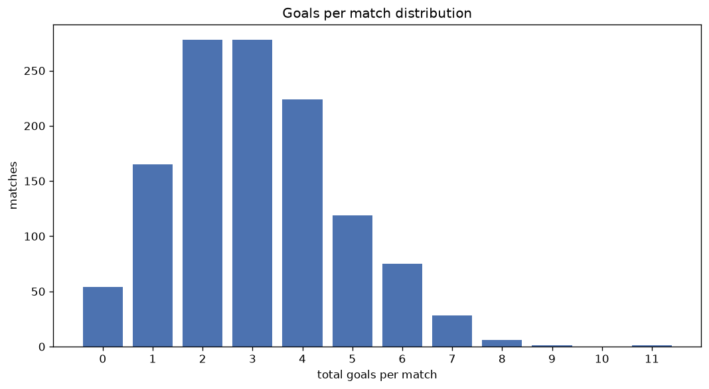
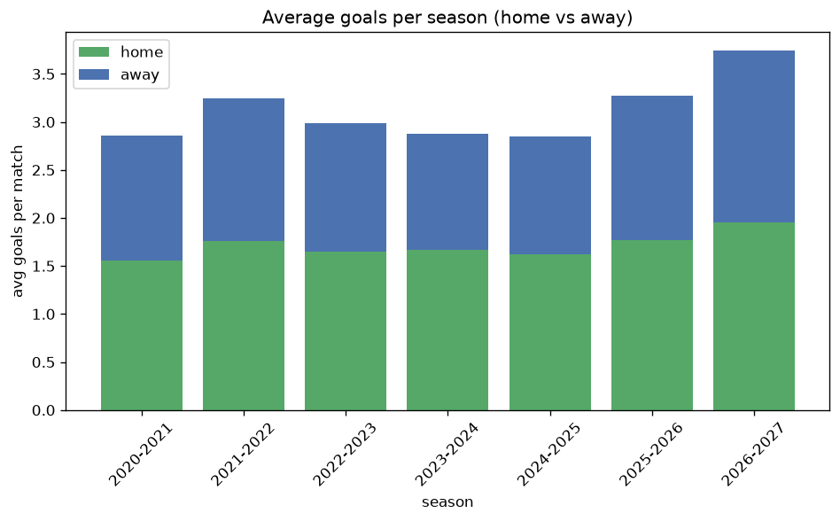

# Goal Analysis
- Report: `goals_analysis`
- Generated: 2026-10-26T01:50:49+00:00
- Script: `backend/scripts/analyze_goals.py` v1.0.0
- League: Super League (Switzerland)
- Scope: league `swiss1`

## 1. Goals per match distribution
| goals | matches | pct |
|---|---|---|
| 0 | 54 | 4.4% |
| 1 | 165 | 13.4% |
| 2 | 278 | 22.6% |
| 3 | 278 | 22.6% |
| 4 | 224 | 18.2% |
| 5 | 119 | 9.7% |
| 6 | 75 | 6.1% |
| 7 | 28 | 2.3% |
| 8 | 6 | 0.5% |
| 9 | 1 | 0.1% |
| 10 | 0 | 0.0% |
| 11 | 1 | 0.1% |

## 2. Goals per match per season
| season | matches | total goals | avg home | avg away | avg total |
|---|---|---|---|---|---|
| 2020-2021 | 180 | 515 | 1.561 | 1.3 | 2.861 |
| 2021-2022 | 180 | 585 | 1.761 | 1.489 | 3.25 |
| 2022-2023 | 180 | 537 | 1.65 | 1.333 | 2.983 |
| 2023-2024 | 198 | 569 | 1.667 | 1.207 | 2.874 |
| 2024-2025 | 198 | 565 | 1.621 | 1.232 | 2.854 |
| 2025-2026 | 230 | 753 | 1.77 | 1.504 | 3.274 |
| 2026-2027 | 63 | 236 | 1.952 | 1.794 | 3.746 |

## 3. Home vs away goal share
- Home goals: **2076** (55.2%)
- Away goals: **1684** (44.8%)
- Home/away ratio: **1.233**

| season | home goals | away goals | total | home pct | away pct |
|---|---|---|---|---|---|
| 2020-2021 | 281 | 234 | 515 | 54.6% | 45.4% |
| 2021-2022 | 317 | 268 | 585 | 54.2% | 45.8% |
| 2022-2023 | 297 | 240 | 537 | 55.3% | 44.7% |
| 2023-2024 | 330 | 239 | 569 | 58.0% | 42.0% |
| 2024-2025 | 321 | 244 | 565 | 56.8% | 43.2% |
| 2025-2026 | 407 | 346 | 753 | 54.1% | 45.9% |
| 2026-2027 | 123 | 113 | 236 | 52.1% | 47.9% |

## 4. BTTS (Both Teams To Score)
- Overall: **765** of `1229` (62.2%)

| season | matches | BTTS | pct |
|---|---|---|---|
| 2020-2021 | 180 | 105 | 58.3% |
| 2021-2022 | 180 | 117 | 65.0% |
| 2022-2023 | 180 | 115 | 63.9% |
| 2023-2024 | 198 | 117 | 59.1% |
| 2024-2025 | 198 | 117 | 59.1% |
| 2025-2026 | 230 | 151 | 65.7% |
| 2026-2027 | 63 | 43 | 68.3% |

## 5. Clean sheets
- Home clean sheets: **299** (24.3%)
- Away clean sheets: **219** (17.8%)
- Total clean sheets recorded: **518**
- Matches with at least one clean sheet: **464** (37.8%)
- Both teams kept clean sheets (0-0): **54**

| season | matches | home CS | away CS | total CS | matches w/ CS |
|---|---|---|---|---|---|
| 2020-2021 | 180 | 50 | 37 | 87 | 75 (41.7%) |
| 2021-2022 | 180 | 34 | 33 | 67 | 63 (35.0%) |
| 2022-2023 | 180 | 46 | 29 | 75 | 65 (36.1%) |
| 2023-2024 | 198 | 50 | 39 | 89 | 81 (40.9%) |
| 2024-2025 | 198 | 57 | 33 | 90 | 81 (40.9%) |
| 2025-2026 | 230 | 51 | 38 | 89 | 79 (34.3%) |
| 2026-2027 | 63 | 11 | 10 | 21 | 20 (31.7%) |

## 6. Scoring intensity
- First-half goals: **1663** (44.3%)
- Second-half goals: **2094** (55.7%)
- Avg first-half goals per match: **1.354**
- Avg second-half goals per match: **1.705**
- Second-half-only scoring (HT 0-0, FT goals >= 1): **253** (20.6%)
- *1 match(es) excluded (no HT score recorded).*

| season | matches | 1st half | 2nd half | 1st half pct | 2nd half pct |
|---|---|---|---|---|---|
| 2020-2021 | 180 | 229 | 286 | 44.5% | 55.5% |
| 2021-2022 | 180 | 254 | 331 | 43.4% | 56.6% |
| 2022-2023 | 180 | 256 | 278 | 47.9% | 52.1% |
| 2023-2024 | 198 | 250 | 319 | 43.9% | 56.1% |
| 2024-2025 | 198 | 247 | 318 | 43.7% | 56.3% |
| 2025-2026 | 230 | 329 | 424 | 43.7% | 56.3% |
| 2026-2027 | 63 | 98 | 138 | 41.5% | 58.5% |

## 7. First-goal timing
- Matches with first-goal time recorded: `1174` of `1229` (95.5%)
- Goalless matches: `55`
- Min `1` | Max `97` | Mean `28.5` | Median (p50) `23.0`

| bucket | count | % of matches | % of scoring matches |
|---|---|---|---|
| 1-15 | 446 | 36.3% | 38.0% |
| 16-30 | 278 | 22.6% | 23.7% |
| 31-45 | 181 | 14.7% | 15.4% |
| 46-60 | 128 | 10.4% | 10.9% |
| 61-75 | 87 | 7.1% | 7.4% |
| 76-90 | 41 | 3.3% | 3.5% |
| 91-120 | 13 | 1.1% | 1.1% |

---
*All statistics are computed from PostgreSQL tables (read-only). Run with `python backend/scripts/analyze_goals.py` to regenerate.*

## Charts

