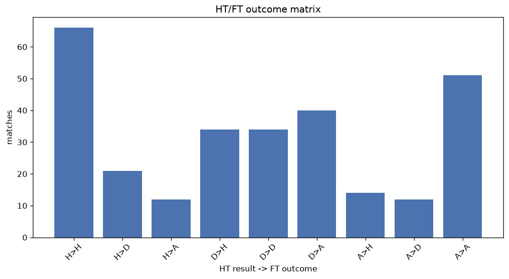
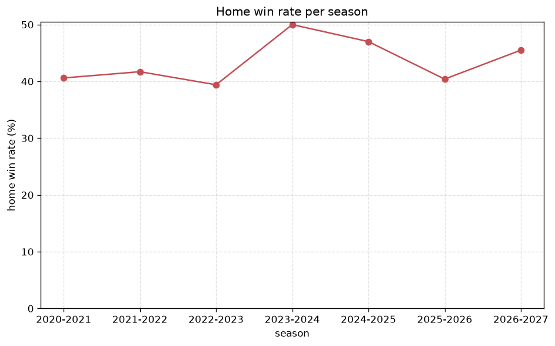

# Match Analysis
- Report: `matches_analysis`
- Generated: 2026-10-29T02:17:46+00:00
- Script: `backend/scripts/analyze_matches.py` v1.0.0
- League: Super League (Switzerland)
- Scope: league `swiss1`

## 1. Overall summary
| metric | value |
|---|---|
| Matches | 1232 |
| Home wins | 534 (43.3%) |
| Draws | 329 (26.7%) |
| Away wins | 369 (30.0%) |
| Total goals | 3766 |
| Average goals per match | 3.057 |
| Goalless matches | 55 (4.5%) |

## 2. Per-season breakdown
| season | matches | home wins | draws | away wins | total goals | avg goals | goalless |
|---|---|---|---|---|---|---|---|
| 2020-2021 | 180 | 73 (40.6%) | 51 (28.3%) | 56 (31.1%) | 515 | 2.861 | 12 (6.7%) |
| 2021-2022 | 180 | 75 (41.7%) | 51 (28.3%) | 54 (30.0%) | 585 | 3.25 | 4 (2.2%) |
| 2022-2023 | 180 | 71 (39.4%) | 58 (32.2%) | 51 (28.3%) | 537 | 2.983 | 10 (5.6%) |
| 2023-2024 | 198 | 99 (50.0%) | 49 (24.7%) | 50 (25.3%) | 569 | 2.874 | 8 (4.0%) |
| 2024-2025 | 198 | 93 (47.0%) | 52 (26.3%) | 53 (26.8%) | 565 | 2.854 | 9 (4.5%) |
| 2025-2026 | 230 | 93 (40.4%) | 57 (24.8%) | 80 (34.8%) | 753 | 3.274 | 10 (4.3%) |
| 2026-2027 | 66 | 30 (45.5%) | 11 (16.7%) | 25 (37.9%) | 242 | 3.667 | 2 (3.0%) |

## 3. HT/FT outcome matrix
| HT result \ FT result | Home | Draw | Away | total |
|---|---|---|---|---|
| HT home lead | 313 (72.6%) | 90 (20.9%) | 28 (6.5%) | 431 |
| HT draw | 182 (39.1%) | 164 (35.2%) | 120 (25.8%) | 466 |
| HT away lead | 39 (11.7%) | 75 (22.5%) | 220 (65.9%) | 334 |
- *1 match(es) excluded (no HT score recorded).*

## 4. Comeback matches
- Home comebacks (trailing at HT, won at FT): **39** (3.2%)
- Away comebacks (trailing at HT, won at FT): **28** (2.3%)

### Home comebacks
| season | home | away | HT | FT |
|---|---|---|---|---|
| 2020-2021 | Young Boys | Luzern | 0-1 | 2-1 |
| 2020-2021 | Lausanne | Luzern | 0-1 | 2-1 |
| 2020-2021 | Vaduz | Zurich | 0-1 | 3-2 |
| 2020-2021 | St. Gallen | Luzern | 0-1 | 2-1 |
| 2020-2021 | Luzern | St. Gallen | 1-2 | 4-2 |
| 2020-2021 | Lugano | Basel | 0-1 | 2-1 |
| 2020-2021 | Lausanne | Vaduz | 0-1 | 2-1 |
| 2020-2021 | Young Boys | Luzern | 1-2 | 5-2 |
| 2021-2022 | Young Boys | Lugano | 0-1 | 3-1 |
| 2021-2022 | Young Boys | Sion | 1-2 | 4-3 |
| 2021-2022 | Luzern | St. Gallen | 0-1 | 3-2 |
| 2022-2023 | Servette | Young Boys | 0-1 | 2-1 |
| 2023-2024 | Lausanne Ouchy | Grasshoppers | 0-1 | 2-1 |
| 2023-2024 | Servette | Lausanne | 0-1 | 2-1 |
| 2023-2024 | Lausanne | Luzern | 0-1 | 3-1 |
| 2023-2024 | Yverdon | Lausanne Ouchy | 0-1 | 2-1 |
| 2023-2024 | Luzern | Lausanne | 0-1 | 2-1 |
| 2023-2024 | Grasshoppers | Zurich | 0-1 | 2-1 |
| 2023-2024 | Winterthur | Luzern | 0-1 | 2-1 |
| 2023-2024 | Servette | Lugano | 0-1 | 2-1 |
| 2023-2024 | Young Boys | Luzern | 1-2 | 4-2 |
| 2024-2025 | Lugano | Grasshoppers | 0-1 | 2-1 |
| 2024-2025 | Yverdon | Grasshoppers | 0-1 | 2-1 |
| 2024-2025 | Young Boys | Basel | 0-1 | 3-2 |
| 2024-2025 | St. Gallen | Lugano | 0-1 | 2-1 |
| 2025-2026 | St. Gallen | Basel | 0-1 | 2-1 |
| 2025-2026 | Lausanne | Winterthur | 0-1 | 3-2 |
| 2025-2026 | Zurich | St. Gallen | 0-1 | 3-1 |
| 2025-2026 | Winterthur | Servette | 0-1 | 4-2 |
| 2025-2026 | Zurich | Luzern | 0-2 | 3-2 |
| 2025-2026 | St. Gallen | Sion | 0-1 | 3-1 |
| 2025-2026 | Thun | Zurich | 0-2 | 4-2 |
| 2025-2026 | Basel | Zurich | 0-1 | 2-1 |
| 2025-2026 | St. Gallen | Winterthur | 0-1 | 2-1 |
| 2025-2026 | Zurich | Grasshoppers | 0-1 | 2-1 |
| 2025-2026 | Grasshoppers | Winterthur | 0-2 | 3-2 |
| 2026-2027 | Sion | Vaduz | 1-2 | 3-2 |
| 2026-2027 | Zurich | Vaduz | 0-1 | 2-1 |
| 2026-2027 | Young Boys | Servette | 1-2 | 3-2 |

### Away comebacks
| season | home | away | HT | FT |
|---|---|---|---|---|
| 2021-2022 | Luzern | Young Boys | 2-1 | 3-4 |
| 2021-2022 | Young Boys | Servette | 1-0 | 1-2 |
| 2021-2022 | Grasshoppers | Zurich | 1-0 | 1-3 |
| 2022-2023 | Basel | Luzern | 1-0 | 2-3 |
| 2022-2023 | Grasshoppers | Zurich | 1-0 | 1-2 |
| 2022-2023 | St. Gallen | Lugano | 1-0 | 1-2 |
| 2022-2023 | Sion | Luzern | 1-0 | 1-2 |
| 2023-2024 | Lausanne Ouchy | St. Gallen | 2-1 | 2-5 |
| 2023-2024 | St. Gallen | Lugano | 2-1 | 2-3 |
| 2024-2025 | Lugano | Luzern | 2-1 | 2-3 |
| 2024-2025 | St. Gallen | Luzern | 2-0 | 2-3 |
| 2024-2025 | Winterthur | Luzern | 3-2 | 3-4 |
| 2024-2025 | Winterthur | Lugano | 2-0 | 2-3 |
| 2024-2025 | Zurich | St. Gallen | 1-0 | 1-2 |
| 2024-2025 | Grasshoppers | Servette | 1-0 | 1-2 |
| 2024-2025 | Sion | Winterthur | 1-0 | 1-2 |
| 2025-2026 | Zurich | Sion | 1-0 | 2-3 |
| 2025-2026 | Lugano | Thun | 1-0 | 1-2 |
| 2025-2026 | Winterthur | Lugano | 1-0 | 2-4 |
| 2025-2026 | Zurich | Young Boys | 2-1 | 2-3 |
| 2025-2026 | St. Gallen | Servette | 2-0 | 2-4 |
| 2025-2026 | Young Boys | Thun | 1-0 | 1-2 |
| 2025-2026 | Grasshoppers | Luzern | 1-0 | 1-2 |
| 2025-2026 | Lausanne | Luzern | 1-0 | 1-3 |
| 2026-2027 | Grasshoppers | Lugano | 1-0 | 1-4 |
| 2026-2027 | Zurich | Basel | 1-0 | 1-2 |
| 2026-2027 | Lausanne | Zurich | 1-0 | 2-3 |
| 2026-2027 | Basel | Sion | 1-0 | 1-2 |

## 5. HT lead conversion
| HT state | matches | converted to win | held as draw | collapsed to loss |
|---|---|---|---|---|
| Home lead | 431 | 313 (72.6%) | 90 (20.9%) | 28 (6.5%) |
| Away lead | 334 | 220 (65.9%) | 75 (22.5%) | 39 (11.7%) |

### Matches level at half-time
| FT result | count | pct |
|---|---|---|
| Home win | 182 | 39.1% |
| Draw | 164 | 35.2% |
| Away win | 120 | 25.8% |
- *1 match(es) excluded (no HT score recorded).*

## 6. First-goal timing
- Matches with a first-goal time recorded: `1176` of `1232` (95.5%)

Outcome distribution by first-goal timing bucket:
| bucket | matches | % of matches | home | draw | away |
|---|---|---|---|---|---|
| 1-15 | 446 | 36.2% | 210 (47.1%) | 99 (22.2%) | 137 (30.7%) |
| 16-30 | 278 | 22.6% | 133 (47.8%) | 65 (23.4%) | 80 (28.8%) |
| 31-45 | 183 | 14.9% | 72 (39.3%) | 52 (28.4%) | 59 (32.2%) |
| 46-60 | 128 | 10.4% | 48 (37.5%) | 38 (29.7%) | 42 (32.8%) |
| 61-75 | 87 | 7.1% | 42 (48.3%) | 16 (18.4%) | 29 (33.3%) |
| 76-90 | 41 | 3.3% | 23 (56.1%) | 3 (7.3%) | 15 (36.6%) |
| 91-120 | 13 | 1.1% | 6 (46.2%) | 1 (7.7%) | 6 (46.2%) |

## 7. Goalless matches
- Overall: **55** of `1232` (4.5%)

| season | matches | goalless | pct |
|---|---|---|---|
| 2020-2021 | 180 | 12 | 6.7% |
| 2021-2022 | 180 | 4 | 2.2% |
| 2022-2023 | 180 | 10 | 5.6% |
| 2023-2024 | 198 | 8 | 4.0% |
| 2024-2025 | 198 | 9 | 4.5% |
| 2025-2026 | 230 | 10 | 4.3% |
| 2026-2027 | 66 | 2 | 3.0% |

---
*All statistics are computed from PostgreSQL tables (read-only). Run with `python backend/scripts/analyze_matches.py` to regenerate.*

## Charts

