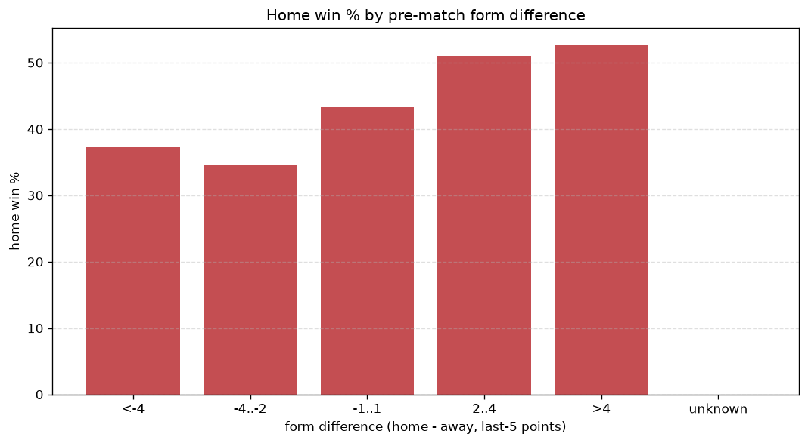
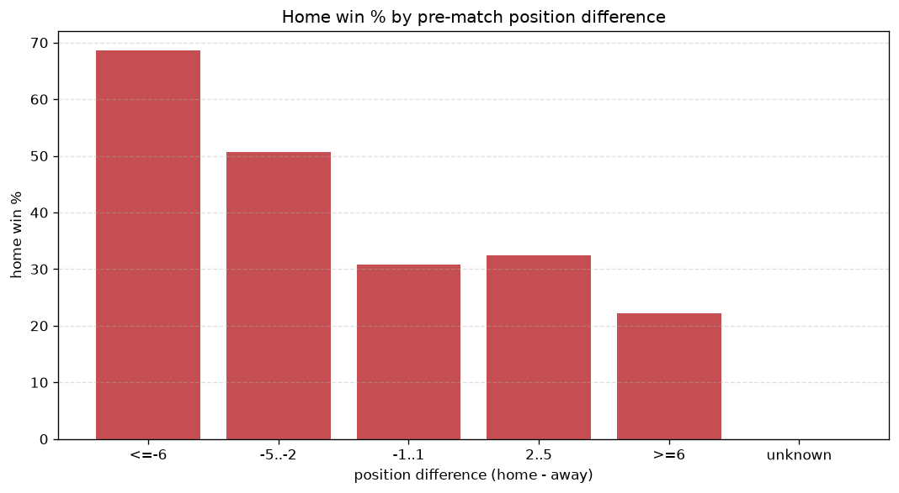

# Relationships Analysis
- Report: `relationships`
- Generated: 2026-10-29T02:17:55+00:00
- Script: `backend/scripts/analyze_relationships.py` v1.0.0
- League: Super League (Switzerland)
- Scope: league `swiss1`

- Matches analysed: **1166** (23 leakage-safe pre-match features).

## 1. Correlation matrix
_Pearson correlation of each pre-match feature with observed goals; sorted by |corr(total goals)|._

| feature | corr(home) | corr(away) | corr(total) |
|---|---|---|---|
| points_difference | 0.209 | -0.140 | 0.064 |
| home_rest_days | -0.064 | 0.021 | -0.035 |
| home_points_before_match | 0.097 | -0.061 | 0.033 |
| rest_days_difference | -0.037 | 0.000 | -0.029 |
| home_position_before_match | -0.138 | 0.117 | -0.025 |
| home_team_home_win_rate | 0.084 | -0.126 | -0.023 |
| away_team_points_last_5 | -0.081 | 0.057 | -0.023 |
| position_difference | -0.177 | 0.168 | -0.019 |
| away_team_away_win_rate | -0.051 | 0.084 | 0.019 |
| away_team_wins_last_5 | -0.074 | 0.058 | -0.017 |
| away_team_goals_conceded_last_5 | 0.050 | -0.079 | -0.017 |
| away_team_away_conceded_avg | 0.060 | -0.043 | 0.017 |
| away_rest_days | -0.041 | 0.022 | -0.017 |
| away_points_before_match | -0.051 | 0.039 | -0.013 |
| home_team_goals_scored_last_5 | 0.087 | -0.081 | 0.011 |
| home_team_points_last_5 | 0.069 | -0.090 | -0.010 |
| home_team_home_goals_avg | 0.076 | -0.071 | 0.010 |
| away_team_goals_scored_last_5 | -0.055 | 0.050 | -0.008 |
| away_team_away_goals_avg | -0.059 | 0.074 | 0.007 |
| away_position_before_match | 0.110 | -0.118 | 0.003 |
| home_team_home_conceded_avg | -0.069 | 0.079 | 0.002 |
| home_team_wins_last_5 | 0.068 | -0.077 | -0.001 |
| home_team_goals_conceded_last_5 | -0.067 | 0.075 | 0.001 |

## 2. Form vs outcome
_Home win/draw/away % per bucket of `home_team_points_last_5 - away_team_points_last_5`._

| bucket | matches | home | draw | away | home % | draw % | away % |
|---|---|---|---|---|---|---|---|
| <-4 | 185 | 69 | 50 | 66 | 37.3% | 27.0% | 35.7% |
| -4..-2 | 262 | 91 | 84 | 87 | 34.7% | 32.1% | 33.2% |
| -1..1 | 326 | 141 | 85 | 100 | 43.3% | 26.1% | 30.7% |
| 2..4 | 239 | 122 | 65 | 52 | 51.0% | 27.2% | 21.8% |
| >4 | 154 | 81 | 34 | 39 | 52.6% | 22.1% | 25.3% |
| unknown | 0 | 0 | 0 | 0 | - | - | - |

## 3. Position vs outcome
_Home win/draw/away % per bucket of `position_difference` (home position - away position; negative favours the home team)._

| bucket | matches | home | draw | away | home % | draw % | away % |
|---|---|---|---|---|---|---|---|
| <=-6 | 131 | 83 | 34 | 14 | 63.4% | 26.0% | 10.7% |
| -5..-2 | 318 | 159 | 77 | 82 | 50.0% | 24.2% | 25.8% |
| -1..1 | 244 | 96 | 71 | 77 | 39.3% | 29.1% | 31.6% |
| 2..5 | 325 | 119 | 90 | 116 | 36.6% | 27.7% | 35.7% |
| >=6 | 148 | 47 | 46 | 55 | 31.8% | 31.1% | 37.2% |
| unknown | 0 | 0 | 0 | 0 | - | - | - |

## 4. Rest advantage
_Home win/draw/away % per bucket of `rest_days_difference` (home rest - away rest). Matches with unknown rest are bucketed separately._

| bucket | matches | home | draw | away | home % | draw % | away % |
|---|---|---|---|---|---|---|---|
| <-1 | 63 | 28 | 13 | 22 | 44.4% | 20.6% | 34.9% |
| -1..0 | 280 | 128 | 81 | 71 | 45.7% | 28.9% | 25.4% |
| 0 | 444 | 189 | 114 | 141 | 42.6% | 25.7% | 31.8% |
| 1..2 | 295 | 126 | 87 | 82 | 42.7% | 29.5% | 27.8% |
| >2 | 49 | 17 | 18 | 14 | 34.7% | 36.7% | 28.6% |
| unknown | 35 | 16 | 5 | 14 | 45.7% | 14.3% | 40.0% |
- *35 match(es) had unknown rest difference (missing rest data on at least one side).*

## 5. Home team quality
_Home win rate by `home_team_home_win_rate` tier (split at 0.5)._

- `< 0.5` tier: **39.2%** home win (269/687)
- `>= 0.5` tier: **49.1%** home win (235/479)
- Home-win gap (>= split minus < split): **+9.9 pp**

| tier | label | matches | home | draw | away | home % |
|---|---|---|---|---|---|---|
| low | < 0.5 | 687 | 269 | 185 | 233 | 39.2% |
| high | >= 0.5 | 479 | 235 | 133 | 111 | 49.1% |

## 6. Feature averages by result
_Mean feature value per outcome; `range` is home-minus-away spread of the group means._

| feature | home mean | draw mean | away mean | range |
|---|---|---|---|---|
| points_difference | 2.349 | -0.830 | -3.169 | 5.518 |
| away_points_before_match | 22.220 | 23.421 | 25.224 | 3.004 |
| home_points_before_match | 24.569 | 22.591 | 22.055 | 2.514 |
| position_difference | -0.865 | 0.384 | 1.265 | 2.130 |
| home_rest_days | 7.717 | 8.981 | 8.476 | 1.264 |
| home_position_before_match | 5.734 | 6.223 | 6.872 | 1.138 |
| away_position_before_match | 6.599 | 5.840 | 5.608 | 0.992 |
| rest_days_difference | -0.197 | 0.597 | -0.067 | 0.794 |
| away_team_points_last_5 | 5.907 | 6.601 | 6.692 | 0.785 |
| home_team_goals_scored_last_5 | 6.950 | 7.082 | 6.302 | 0.779 |
| home_team_goals_conceded_last_5 | 6.599 | 7.060 | 7.265 | 0.665 |
| away_team_goals_conceded_last_5 | 7.177 | 6.717 | 6.532 | 0.645 |
| away_rest_days | 7.912 | 8.369 | 8.542 | 0.630 |
| home_team_points_last_5 | 6.353 | 6.157 | 5.744 | 0.609 |
| away_team_goals_scored_last_5 | 6.692 | 7.170 | 7.247 | 0.555 |
| away_team_wins_last_5 | 1.548 | 1.789 | 1.811 | 0.263 |
| home_team_wins_last_5 | 1.683 | 1.635 | 1.494 | 0.188 |
| home_team_home_conceded_avg | 1.231 | 1.271 | 1.352 | 0.121 |
| home_team_home_goals_avg | 1.642 | 1.585 | 1.523 | 0.119 |
| away_team_away_conceded_avg | 1.636 | 1.569 | 1.529 | 0.107 |
| away_team_away_goals_avg | 1.232 | 1.334 | 1.324 | 0.102 |
| home_team_home_win_rate | 0.442 | 0.410 | 0.371 | 0.071 |
| away_team_away_win_rate | 0.249 | 0.285 | 0.289 | 0.040 |

---
*All features are leakage-safe pre-match values built by `ml.features.build_features.build_rows` from strictly prior matches. Run with `python backend/scripts/analyze_relationships.py` to regenerate.*

## Charts

